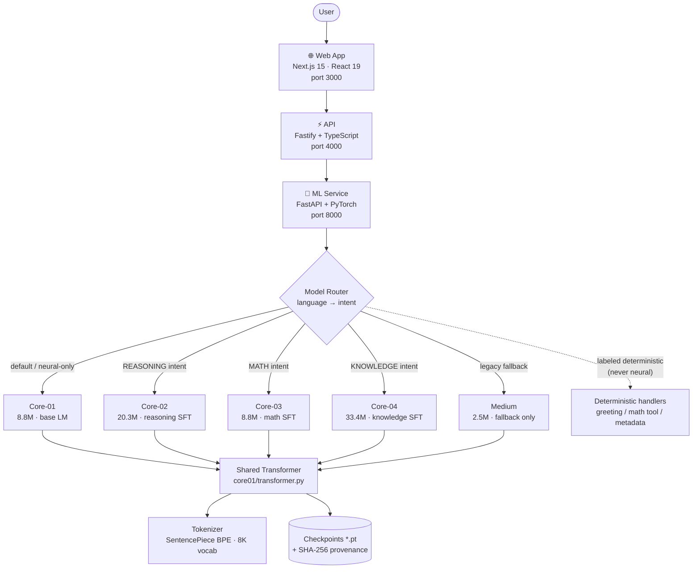
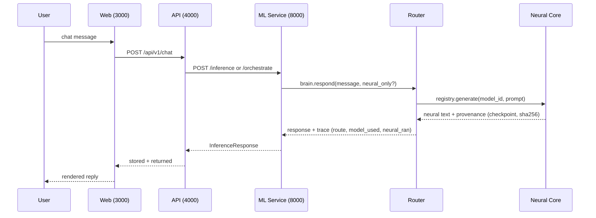

<div align="center">

# 🧠 NexusAI

### An Independently Developed AI Brain

*Own weights. Own code. Own data. No external AI APIs.*

[]()
[]()
[]()

</div>

---

## Table of Contents

- [1. Project Identity](#1-project-identity)
- [2. Architecture Overview](#2-architecture-overview)
- [3. Model Inventory](#3-model-inventory)
- [4. Current Capabilities](#4-current-capabilities)
- [5. Technology Stack](#5-technology-stack)
- [6. Requirements](#6-requirements)
- [7. Local Setup Guide](#7-local-setup-guide)
- [8. Running NexusAI](#8-running-nexusai)
- [9. Dataset Documentation](#9-dataset-documentation)
- [10. Model Training Guide](#10-model-training-guide)
- [11. Model Evaluation Guide](#11-model-evaluation-guide)
- [12. Backup & Recovery](#12-backup--recovery)
- [13. Development & Contributing](#13-development--contributing)
- [14. Known Limitations](#14-known-limitations)
- [15. Roadmap](#15-roadmap)
- [16. Documentation Index](#16-documentation-index)
- [17. License & Credits](#17-license--credits)
- [বাংলা briefly — Project Overview](#বাংলায়-সংক্ষিপ্ত-পরিচিতি)

---

## 1. Project Identity

**NexusAI** is a full-stack application whose goal is to become a genuinely independent artificial intelligence — an "AI Brain" owned end-to-end by the project: model architectures, weights, tokenizer, datasets, training pipeline, inference engine, and application.

### Core principles

- **No external AI inference.** No OpenAI, Anthropic, Gemini, or any third-party model API anywhere in the response path. Every neural token is produced by NexusAI's own weights running NexusAI's own code.
- **Honest labeling.** Deterministic handlers (greetings, math tools, metadata answers) are explicitly labeled as such in routing traces — never disguised as neural output.
- **Evidence over claims.** Every capability claim in this repository links to a reproducible test, checkpoint hash, or benchmark report.
- **Ownership.** All checkpoints carry SHA-256 provenance; weights are distributed through controlled channels (Git LFS / out-of-band bundles), not silently.

### Current development status

**PARTIALLY VERIFIED foundation.** The complete pipeline — web app → API → model registry/router → ML service → neural inference — is implemented and tested end-to-end. All four model cores strict-load and produce genuine neural text. **No core is yet a working conversational model** — see [§14 Known Limitations](#14-known-limitations) for the honest, measured assessment.

> All architecture diagrams in this README are original NexusAI project documentation assets, created for this repository.

---

## 2. Architecture Overview



**Key accuracy note:** Core-01 through Core-04 are **four separately configured model instances with different weights and sizes sharing ONE Transformer implementation** (`packages/ai-core/core01/transformer.py`). They are not four different architectures. Core-05 is a *proposed* future model — not implemented.

### Request-to-response flow



---

## 3. Model Inventory

All values verified 2026-11-18 by strict `load_state_dict(strict=True)` + SHA-256 validation (`ml-service/model_registry.py`).

| Model | Params | Architecture (shared impl, own config) | Checkpoint | Strict load | Generation | Specialization | Known limitations |
|---|---|---|---|---|---|---|---|
| **nexus-core-01** | 8,842,560 | d256·L6·H8·ff1024·len512 | `checkpoints_core01_run3/checkpoint_final.pt` (Git LFS) | ✅ VERIFIED | ⚠️ PARTIAL (38/56 non-empty) | general/base LM | undertrained; English-biased word salad; immediate-EOS on many chat prompts |
| **nexus-core-02** | 20,347,712 | d384·L8·H12·ff1536·len512 | `checkpoints_core02_sft_v2/checkpoint_final.pt` | ✅ VERIFIED | ⚠️ PARTIAL | reasoning specialist | template collapse — ~5 memorized responses for all prompts; 60% train-set duplication |
| **nexus-core-03** | 8,842,560 | d256·L6·H8·ff1024·len512 | `checkpoints_core03_sft_v2/checkpoint_final.pt` | ✅ VERIFIED | ⚠️ PARTIAL | mathematics specialist | emits bare numbers; **9.2%** held-out numeric accuracy |
| **nexus-core-04** | 33,419,072 | d512·L8·H8·ff2048·len512 | `checkpoints_core04_sft_v3/checkpoint_final.pt` | ✅ VERIFIED | ⚠️ PARTIAL | knowledge/memorization | prompt-insensitive recall over 318-record curated KB |
| **nexus-medium** | 2,452,544 | d128·L2·H2·ff512·len128 | `checkpoints_medium/final_model.pt` | ✅ VERIFIED | ❌ WEAK (4/24) | legacy fallback only | gibberish-prone; retained as emergency fallback |

**Tokenizer (shared):** SentencePiece BPE, vocab 8,000 — `data/experimental/phase9_2/tokenizers/bpe_8k/sp_bpe_8k.model`; pad=0, unk=1, bos=2, eos=3. Known limits: Banglish fragmentation, UNK on unseen foreign scripts.

---

## 4. Current Capabilities

### ✅ Implemented & verified
- Four-core model registry with SHA-256-gated loading and strict state-dict checks
- Language→intent model router with honest provenance traces
- `neural_only` chat mode — neural cores only, explicit failure errors, zero deterministic substitution
- CPU inference for all registered models
- SFT dataset serialization with response-only loss masking
- Pretraining driver with zero-step completion guard
- Colab GPU training cells with authorization + checkpoint-hash gates (Run4 prepared, not executed)
- Reproducible verification suites (`evaluation/`, `tests/four_core/`)

### ⚠️ Implemented but partially verified
- Neural text generation (mechanically verified; semantically weak — see §14)
- Bengali generation (works mechanically; quality limited to core-04's memorized KB sentences)
- Multi-turn (single-turn inference path; context only via inline history text)
- API↔ML integration (verified live: `/inference` → routed neural response)

### 📋 Planned (not implemented)
- Dataset V5 construction · Core-05 model · Core-01 Run5/SFT · KV-cache decoding · quantized inference · public model API · agent/voice capabilities · consent-based memory runtime

### ❌ Not implemented
- External AI provider integration (intentionally — prohibited by design)
- Production-grade conversational quality (no core qualifies)

---

## 5. Technology Stack

### Current (verified)
| Layer | Technology |
|---|---|
| Web | Next.js 15, React 19, TypeScript |
| API | Fastify, TypeScript, pnpm 11 workspaces |
| ML service | FastAPI, PyTorch 2.x, SentencePiece, uvicorn |
| Model | Custom decoder-only Transformer (`core01/transformer.py`) |
| Tokenizer | SentencePiece BPE 8K (own trained asset) |
| Database | Neon PostgreSQL (schema `nexus`) |
| Monorepo | pnpm workspaces: `apps/{web,api,worker}`, `packages/*` |
| GPU training | Google Colab (temporary, authorized cells only) |

### Recommended future additions
See `docs/architecture/future/NEXUSAI_RECOMMENDED_TECHNOLOGY_STACK.md` — includes KV caching, gradient checkpointing, dataset near-dup tooling, CI, and optional C++/CUDA/Triton paths *only where profiling justifies*. **No external AI services are recommended anywhere.**

---

## 6. Requirements

| Requirement | Verified value |
|---|---|
| OS | Windows/Linux/macOS (developed on Windows) |
| Node.js | ≥22 <25 (verified on v24.15.0) |
| pnpm | 11.x (verified 11.19.0) |
| Python | 3.11–3.14 (verified 3.14.6) |
| PyTorch | ≥2.0 CPU; CUDA build for GPU training |
| RAM | ~8 GB comfortable for CPU inference of all cores (core-04 peaks ~775 MB) |
| GPU | not required for inference; T4-class for authorized Colab training |
| Storage | ~2 GB for code+datasets; ~1 GB for checkpoints; check `du` before cloning corpora |

---

## 7. Local Setup Guide

> Beginner-friendly. All commands verified against this repository.

### Step 1 — Prerequisites
Install [Node.js 22–24](https://nodejs.org), [pnpm](https://pnpm.io) (`npm i -g pnpm`), and [Python 3.11+](https://python.org) with pip.

### Step 2 — Clone
```bash
git clone https://github.com/mrhasibuldev/ai-breand.git
cd ai-breand
```

### Step 3 — Install JS dependencies
```bash
pnpm install
```

### Step 4 — Python ML environment
```bash
cd packages/ai-core/ml-service
python -m venv .venv
.venv\Scripts\activate          # Windows
# source .venv/bin/activate     # Linux/macOS
pip install -r requirements.txt
```

### Step 5 — Environment variables
```bash
cp .env.example .env            # then edit .env with YOUR values
```
Minimum for local dev: `DATABASE_URL` (Neon), `COOKIE_SECRET` (`openssl rand -base64 32`), `AI_SERVICE_URL=http://127.0.0.1:8000`. **Never commit `.env`.**

### Step 6 — Start services (three terminals)
```bash
pnpm dev            # web (3000) + api (4000) + worker
pnpm dev:ml         # ML service (8000)
```

### Step 7 — Verify
```bash
curl http://127.0.0.1:8000/health        # {"status":"ok",...}
curl http://127.0.0.1:8000/model/status  # Core-01 loaded, 8,842,560 params
curl http://localhost:4000/health        # API (if exposed)
open http://localhost:3000               # web app
```

---

## 8. Running NexusAI

| Service | Command | Port | Health check |
|---|---|---|---|
| Web | `pnpm --filter @nexusai/web dev` (or `pnpm dev`) | 3000 | open browser |
| API | `pnpm --filter @nexusai/api dev` | 4000 | `GET /health` |
| ML | `cd packages/ai-core/ml-service && python main.py` | 8000 | `GET /health`, `GET /model/status` |

**Model selection** is automatic via `model_router.py`: language detection → intent classification → specialist (core-03 math / core-04 knowledge / core-02 reasoning) or primary core-01; `nexus-medium` is the labeled legacy fallback. `neural_only=True` (env `NEURAL_ONLY_CHAT`) restricts to neural cores with explicit error on failure.

**Test inference directly:**
```bash
curl -X POST http://127.0.0.1:8000/inference \
  -H "Content-Type: application/json" \
  -d '{"message":"What is artificial intelligence?"}'
# → response + "model":"NexusBrain/nexus-core-04" provenance
```

**Logs:** ML service prints to stdout; API logs `[API]`; use `pnpm dev` parallel output.

**Common failures:** `ModuleNotFoundError` → install ml-service requirements; `CHECKPOINT missing` → verify `.pt` files exist (they are gitignored — restore from backup/bundle); `COOKIE_SECRET required` → set in `.env`; poor responses → expected, see §14.

---

## 9. Dataset Documentation

| Dataset | Location | Records (verified) | Status |
|---|---|---|---|
| Core-02 reasoning SFT | `packages/ai-core/data/core02_reasoning/` | 2,386 train / 132 val / 132 test | ⚠️ 60% exact-duplicate train records (documented defect) |
| Core-03 math SFT | `packages/ai-core/data/core03_math/` | 1,576 / 87 / 87 | ⚠️ 18% duplicates; 1 cross-split leak |
| Core-04 knowledge SFT | `packages/ai-core/data/core04_knowledge/` (+`_full`) | 256 / 31 / 31 (+318 full) | clean; small curated KB |
| Unified conversational V1–V4 | `data/unified_conversational/v{1..4}/` | manifests+checksums committed; `.jsonl` gitignored | verified structure; V1≈645, V2≈1,054, V3/V4 record-dir format |
| **V5** | — | — | ❌ **NOT CONSTRUCTED** — builders exist (`build_unified_conv_v5*.py`), dataset absent; next authorized mission |

Format: JSONL `{"messages":[{"role":"user","content":...},{"role":"assistant","content":...}], ...}` with `dataset_manifest.json` + `checksums.sha256` per dataset. Splits are content-hash based; leakage checked (essentially clean). `*.jsonl` is gitignored by policy — datasets distribute out-of-band; manifests and checksums are committed.

---

## 10. Model Training Guide

> **Documentation only — no training was run for this release.** Commands below reference existing scripts; GPU runs require separate authorization.

### Concepts
- **Checkpoint**: a `.pt` file containing `model_state_dict` + optimizer/scheduler/RNG state + metadata (epoch, step, loss, status). Verified by SHA-256 sidecars.
- **Tokenizer**: SentencePiece BPE model file (`sp_bpe_8k.model`) — maps text↔token IDs. Trained once; treated as a fixed asset.
- **Pretraining**: next-token prediction on raw corpus (`core01/pretraining_driver.py`, `training.py`).
- **SFT**: supervised fine-tuning on conversations with response-only loss masking (`core01/sft_dataset.py`).
- **Instruction tuning / reasoning training**: SFT variants requiring appropriately formatted datasets (V5 roadmap).

### Existing verified pipeline
1. **Prepare data** — builders `packages/ai-core/data/build_*.py` emit `train/validation/test.jsonl` + manifest + checksums.
2. **Validate** — check manifest counts, duplicates, split leakage (see §9 findings).
3. **Configure** — per-core config in `models/nexusai_core_0X/config/model_config.py`.
4. **Train (CPU smoke / Colab GPU)** — `core01/training.py` supports AMP, grad-accum, resume, zero-step guard. Colab cells in `docs/notebooks/` (e.g., `COLAB_RUN4_TRAIN_CELL.py` — authorization-gated, verifies Run3 checkpoint SHA-256 before resuming).
5. **Checkpoint** — versioned dirs `checkpoints_core0X_<run>/`; never overwrite.
6. **Evaluate** — `eval_core.py`, `four_core_test_suite.py`, verification scripts (§11).
7. **Deploy locally** — register in `model_registry.py` with SHA-256; CPU inference verified path.

### Core-05 (PLANNED — not implemented)
Audit complete (`docs/architecture/audits/NEXUSAI_CORE05_STAGE0_TRAINING_READINESS_AUDIT.md`): ~45.9M params designed, **blocked on missing Dataset V5**. No config/weights exist.

---

## 11. Model Evaluation Guide

```bash
# Five-model strict-load + generation matrix (24 prompts × 5 models)
python packages/ai-core/evaluation/verify_four_core_generation.py \
  --models nexus-core-01,nexus-core-02,nexus-core-03,nexus-core-04,nexus-medium \
  --max-new-tokens 48 --out eval_reports/stage1_four_core_generation.json

# Held-out per-core suite + numeric oracle (core-03)
python packages/ai-core/evaluation/four_core_test_suite.py \
  --out eval_reports/four_core_test_suite.json

# Repair/regression tests (13 tests)
python packages/ai-core/tests/four_core/test_generation_repairs.py
```

**Reading results:** `strict_load` = state-dict compatibility; `generated_text` = genuine neural output (UTF-8 preserved); `EMPTY_OUTPUT` = model emitted EOS immediately; `numeric_oracle` = deterministic math check (verifies, never replaces, the model); `surface_sim` = token overlap with references (NOT a correctness metric for template models). Latest reports: `eval_reports/stage1_four_core_generation_postfix.json`, `four_core_test_suite.json`.

---

## 12. Backup & Recovery

- **What to back up:** source, configs, tokenizer, all `checkpoints_*/`, datasets (incl. gitignored `.jsonl`), docs, eval reports, `.env.example` (never real `.env`).
- **Verified backup (2026-11-18):** `C:\Users\Nusaiba\Desktop\nexusai_backup_20261118\nexusai_full_backup_20261118.zip` — 1.88 GB, 1,543 files, SHA-256 manifest, `testzip()` OK, checkpoint hashes verified inside archive.
- **Checkpoint integrity:** every `.pt` has a `.sha256` sidecar; registry re-hashes on `validate()`.
- **Restore:** unzip backup over repo root, or copy individual checkpoint dirs back; verify hashes before use.
- **Never** overwrite a checkpoint in place — write new versioned dirs.

---

## 13. Development & Contributing

- **Structure:** `apps/{web,api,worker}` (TS), `packages/*` (shared cores), `packages/ai-core/` (models, data, ml-service, evaluation, tests), `docs/` (architecture, audits, notebooks).
- **Conventions:** TypeScript strict; Python 3.11+; tests are standalone runnable scripts (`test_*.py` print PASS/FAIL); commits use conventional prefixes (`feat|fix|docs`).
- **Adding a model:** create `models/nexusai_core_0X/config/model_config.py`, register in `model_registry.py` `MODEL_DEFS` with checkpoint path + SHA-256 + `expected_params`, add router mapping if specialized.
- **Adding benchmarks:** extend `PROMPT_MATRIX` in `verify_four_core_generation.py` or add cases to `four_core_test_suite.py`.
- **Safety:** no `git add -A`; no secrets; no checkpoint overwrites; run `pnpm check` + Python test scripts before PR.

---

## 14. Known Limitations

*Verified 2026-11-18 — do not read this as marketing.*

| Limitation | Evidence |
|---|---|
| No working conversational model | core-01 38/56 non-empty, English word-salad; 18 immediate-EOS |
| Core-02 template collapse | identical `1. Boil water.`-style outputs across all 24 prompts |
| Core-03 unreliable math | 8/87 = 9.2% held-out numeric accuracy; bare numbers for any input |
| Core-04 narrow memorization | fluent but prompt-insensitive; 318-record KB only |
| Banglish fragmentation | tokenizer audit: 0.41 tok/char, `Programming`→`Pro gr am ming` |
| CPU-only, no KV cache | ~0.1–1.2 s/gen; O(n²) context cost |
| Single-turn inference | no multi-turn state in generation path |
| Dataset defects | core02 60% / core03 18% exact-duplicate train records |
| V5 absent | Core-05 training BLOCKED until V5 built |
| App tests need env | `pnpm test` requires `COOKIE_SECRET`/DB env — 166 env-dependent failures without `.env` (pre-existing, unrelated to model code) |

---

## 15. Roadmap

- [x] Four-core registry, router, strict loading, neural-only mode
- [x] Stage-1/2 forensic audit + three defect repairs (F2/F3/Q4)
- [x] Reproducible verification suites + regression tests
- [ ] Dataset V5 construction *(next authorized mission)*
- [ ] Core-01 Run4/Run5 SFT for chat-capable generation
- [ ] Core-02/03/04 retraining on deduplicated data
- [ ] KV-cache decoding + quantized CPU inference
- [ ] Core-05 implementation + staged training
- [ ] Multi-turn context, reasoning, self-correction
- [ ] Consent-based memory runtime, voice, agents, public API

---

## 16. Documentation Index

- `docs/architecture/audits/NEXUSAI_FOUR_CORE_COMPLETE_FORENSIC_AUDIT.md`
- `docs/architecture/audits/NEXUSAI_STAGE1_FOUR_CORE_GENERATION_VERIFICATION.md`
- `docs/architecture/audits/NEXUSAI_STAGE2_ROOT_CAUSE_DIAGNOSIS.md`
- `docs/architecture/audits/NEXUSAI_FOUR_CORE_REPAIR_REPORT.md`
- `docs/architecture/audits/NEXUSAI_FOUR_CORE_TEST_AND_BENCHMARK_REPORT.md`
- `docs/architecture/audits/NEXUSAI_FOUR_CORE_CHECKPOINT_AND_MODEL_INVENTORY.md`
- `docs/architecture/NEXUSAI_FOUR_CORE_SYSTEM_ARCHITECTURE.md`
- `docs/architecture/NEXUSAI_FOUR_CORE_OPERATIONS_AND_INFERENCE.md`
- `docs/architecture/NEXUSAI_FOUR_CORE_RELEASE_REPORT.md`
- `docs/architecture/future/NEXUSAI_RECOMMENDED_TECHNOLOGY_STACK.md`
- `docs/architecture/future/NEXUSAI_CORE05_*` (7 Core-05 planning docs)
- `docs/BANGLA_DEVELOPMENT_GUIDE.md` — Bengali developer guide
- `eval_reports/` — machine-readable benchmark JSONs

---

## 17. License & Credits

No `LICENSE` file exists in the repository — **no license is currently declared**; all rights remain with the project owner pending an explicit license decision. All architecture diagrams in this README were created for the NexusAI project. Third-party components (PyTorch, FastAPI, Next.js, SentencePiece, etc.) remain under their respective licenses.

---

## বাংলায় সংক্ষিপ্ত পরিচিতি (Bengali Overview)

**NexusAI** হলো একটি সম্পূর্ণ স্বদেশীয় AI প্রকল্প — এর নিজস্ব model, নিজের trained weights, নিজের tokenizer এবং নিজের inference engine আছে। এটি কোনো বাইরের AI API (যেমন OpenAI বা Gemini) ব্যবহার করে না — সব intelligent text 우리 model-ই generate করে।

**বর্তমান অবস্থা (সৎ মূল্যায়ন):**
- চারটি model core (Core-01 থেকে Core-04)적으로 কাজ করে — checkpoint load হয়, neural text generate হয়।
- তবে এখনো কোনো model-ই ভালো conversational partner নয়: Core-01 undertrained, Core-02 template_bound, Core-03-এর math accuracy মাত্র ~৯%, Core-04 মাত্র ছোট knowledge base মনে রাখে।
- পরের ধাপ: Dataset V5 তৈরি → Core-01-কে SFT করা → ধীরে ধীরে capability বাড়ানো।

বিস্তারিত বাংলা গাইড: `docs/BANGLA_DEVELOPMENT_GUIDE.md`
