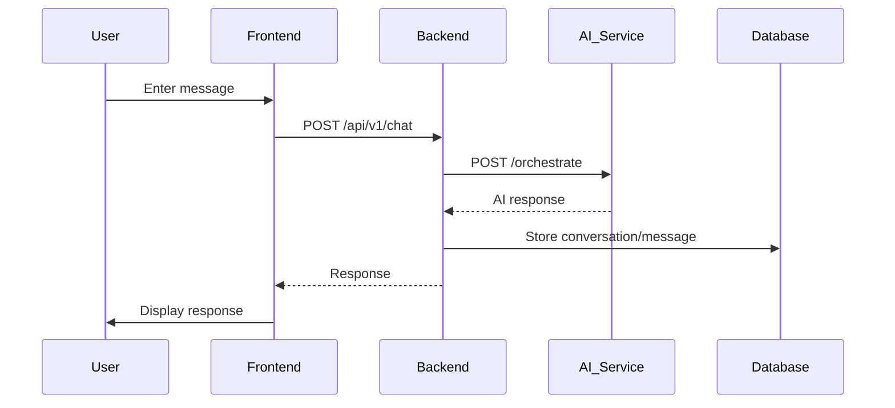
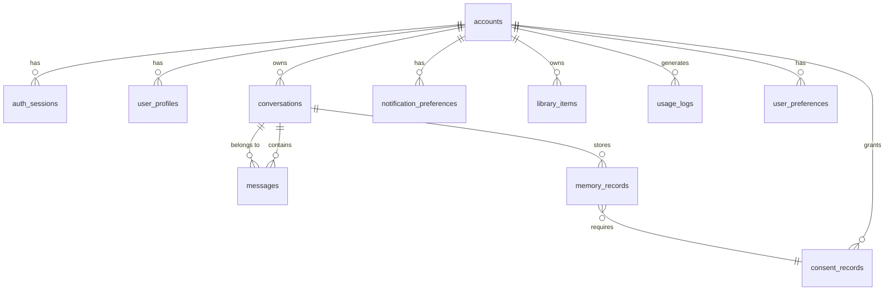

# NexusAI — Personal AI Health & Wellness Companion

NexusAI is an intelligent AI-powered application designed to assist users with health and wellness goals through conversational AI interactions.

---

## Table of Contents

- [Application Preview](#application-preview)
- [Overview](#overview)
- [What This Project Does](#what-this-project-does)
- [Key Features](#key-features)
- [Current Status](#current-status)
- [Technology Stack](#technology-stack)
- [System Architecture](#system-architecture)
- [Application Flow](#application-flow)
- [AI/ML Architecture](#aiml-architecture)
- [Complete API Inventory](#complete-api-inventory)
- [Database Architecture](#database-architecture)
- [Storage Architecture](#storage-architecture)
- [Security Audit](#security-audit)
- [Current Issues and Incomplete Features](#current-issues-and-incomplete-features)
- [Performance and Scalability](#performance-and-scalability)
- [Future Roadmap](#future-roadmap)
- [Developer References](#developer-references)
- [Project Structure](#project-important-files-and-folders)
- [Environment Variables](#environment-variables)
- [Local Development Setup](#local-development-setup)
- [Running the Project](#running-the-project)
- [Available Scripts](#available-scripts)
- [Database Setup](#database-setup)
- [API Architecture](#api-architecture)
- [Authentication Flow](#authentication-flow)
- [Known Limitations](#known-limitations)
- [Junior Developer Guide](#junior-developer-guide)
- [Troubleshooting](#troubleshooting)
- [Contributing](#contributing)
- [License](#license)

---

## Application Preview

Application preview image: Not currently available in the repository.

---

## Overview

NexusAI is a full-stack AI-powered application built with a modern architecture separating frontend, backend, and database layers. The application provides conversational AI capabilities with user authentication, conversation history, and profile management.

---

## What This Project Does

NexusAI enables users to:
- Interact with an AI assistant through a chat interface
- Create accounts to save conversation history
- Use the application as a guest without authentication
- Manage user profiles with custom avatars
- Access conversation history across sessions

---

## Key Features

| Feature | Status | Description |
|---------|--------|-------------|
| AI Chat Interface | ✅ Implemented | Interactive chat with AI assistant |
| User Authentication | ✅ Implemented | Email/password signup and login with session management |
| Guest Mode | ✅ Implemented | Try the application without signing up |
| Conversation History | ✅ Implemented | Save and revisit past conversations |
| Profile Management | ✅ Implemented | Customize profile with avatar and settings |
| Responsive Design | ✅ Implemented | Works on desktop and mobile devices |
| Profile Image Upload | ⚠️ Partial | Uses localStorage (development only, not production-ready) |

---

## Current Status

### Implemented
- Next.js frontend with React 19
- Fastify backend API
- PostgreSQL database (Neon)
- Self-managed authentication with bcrypt
- HTTP-only cookie session management
- AI service integration (external proxy)
- Conversation persistence for authenticated users
- Guest mode with in-memory conversations

### Partially Implemented
- Profile image upload (localStorage only, not cross-device)

### Not Implemented
- Email verification
- Password reset flow
- Two-factor authentication
- Cloud storage for profile images
- Background job processing
- Content filtering for AI responses

### Known Issues
- Profile images stored in localStorage (device-specific, not production-ready)
- AI service must be running externally at http://127.0.0.1:8000
- No retry logic for failed AI requests
- Rate limiting not production-tested

---

## Technology Stack

### Frontend
- **Framework**: Next.js 15.5.24
- **UI Library**: React 19
- **Language**: TypeScript
- **Icons**: lucide-react
- **Styling**: CSS with CSS variables
- **State Management**: React Context API
- **Routing**: Next.js App Router

### Backend
- **Framework**: Fastify 5.12.5
- **Language**: TypeScript
- **Authentication**: bcrypt for password hashing
- **Session Management**: @fastify/cookie with HTTP-only cookies
- **CORS**: @fastify/cors
- **Runtime**: Node.js

### Database
- **Provider**: PostgreSQL via Neon
- **Schema**: nexus (custom schema)
- **Connection**: PostgreSQL connection string via DATABASE_URL
- **Access Layer**: Custom PostgreSQL client (@nexusai/database-core)
- **Migrations**: SQL migration files in packages/database-core/migrations/

### Authentication
- **Provider**: Self-managed
- **Password Hashing**: bcrypt
- **Session Storage**: Database-backed (nexus.auth_sessions table)
- **Cookie**: HTTP-only nexus_session cookie
- **Session Duration**: 7 days
- **Token Hashing**: bcrypt for session tokens

### Storage
- **Current**: localStorage (development only)
- **Service**: apps/web/lib/avatar-service.ts
- **Limitation**: Device-specific, not cross-device, not production-ready

### AI Service
- **Type**: External Python FastAPI/ML service
- **URL**: http://127.0.0.1:8000 (configurable via AI_SERVICE_URL)
- **Integration**: Backend proxies requests to AI service
- **Timeout**: 10 seconds

### Development Tools
- **Package Manager**: pnpm 11.19.0
- **Node Version**: >=22 <25
- **Type Checking**: TypeScript
- **Linting**: ESLint (root eslint.config.mjs)
- **Testing**: Vitest

---

## System Architecture

### Architecture Diagram

```mermaid
graph TB
    User[User] -->|HTTP| Frontend[Frontend<br/>Next.js 3000]
    Frontend -->|HTTP| Backend[Backend API<br/>Fastify 4000]
    Backend -->|PostgreSQL| Database[(Database)<br/>Neon PostgreSQL]
    Backend -->|HTTP| AI[AI Service<br/>Python 8000]
    Frontend -->|localStorage| Storage[Profile Images<br/>localStorage]
```

### Component Responsibilities

**Frontend (Next.js):**
- Renders the user interface
- Collects user input
- Manages application state
- Communicates with backend API
- Handles authentication state
- Displays chat responses

**Backend API (Fastify):**
- Handles HTTP requests
- Implements authentication endpoints
- Manages sessions
- Stores conversations and messages
- Proxies requests to AI service
- Validates requests and responses

**Database (PostgreSQL via Neon):**
- Stores user accounts
- Stores sessions
- Stores conversations and messages
- Stores user profiles
- Maintains data persistence

**AI Service (External):**
- Processes chat messages
- Generates AI responses
- Provides conversational AI capabilities

---

## Application Flow

### User Flow

1. User opens application at http://localhost:3000
2. Frontend initializes and checks authentication state
3. If authenticated, frontend loads user profile and conversation history
4. User interacts with chat interface
5. Frontend sends message to backend API at http://localhost:4000
6. Backend forwards request to AI service at http://127.0.0.1:8000
7. AI service processes and returns response
8. Backend stores conversation and messages in database
9. Backend returns response to frontend
10. Frontend displays response in chat interface

### Authentication Flow

1. User fills signup form with email and password
2. Frontend sends POST /api/v1/auth/register to backend
3. Backend validates input and hashes password with bcrypt
4. Backend creates account in database
5. Backend creates session in database
6. Backend sets HTTP-only nexus_session cookie
7. Frontend receives response and updates authentication state
8. Subsequent requests include cookie for authentication

---

## Project Important Files and Folders

### Apps

**apps/web/** - Next.js frontend application
- `app/page.tsx` - Main application page
- `app/components/` - React components (AuthContext, AuthModal, ChatInterface, etc.)
- `lib/` - API clients and services (backend-auth.ts, backend-conversation.ts, avatar-service.ts)
- `dev.mjs` - Development server entry point

**apps/api/** - Fastify backend API
- `src/server.ts` - Server entry point
- `src/app.ts` - Fastify app builder with route registration
- `src/routes/` - API route handlers (auth.ts, conversations.ts, profile.ts, ai.ts)
- `src/middleware/` - Middleware (auth.ts)
- `src/auth-utils.ts` - Authentication utilities (hashing, token generation)

**apps/worker/** - Background worker (not actively used)

### Packages

**packages/database-core/** - PostgreSQL client and migrations
- `src/config.ts` - Database configuration
- `src/postgres-client.ts` - PostgreSQL client
- `src/migration-runner.ts` - Migration execution
- `migrations/` - SQL migration files (001_bootstrap.sql through 017_add_memory_consent_fk.sql)

**packages/auth-core/** - Authentication utilities
- `src/password.ts` - Password hashing and verification

**packages/repositories/** - Data access layer
- `src/conversation-repository.ts` - Conversation data access
- `src/message-repository.ts` - Message data access
- `src/profile-repository.ts` - Profile data access

**packages/config/** - Configuration utilities
- `src/config.ts` - Runtime configuration reading

**packages/ai-core/** - AI Brain implementation
- `ml-service/main.py` - Python FastAPI ML service
- `models/` - Model checkpoints (checkpoints_medium/final_model.pt is active)
- `tokenizer/` - Tokenizer implementation (SimpleTokenizer)
- `neural/` - Neural network architectures (MediumTransformer, SmallTransformer)
- `training/` - Training scripts and pipeline
- `evaluation/` - Evaluation scripts
- `inference/` - Text generation logic

### Root Files

- `package.json` - Root package.json with pnpm workspace configuration
- `.env.example` - Environment variable template (names only)
- `tsconfig.json` - TypeScript configuration
- `eslint.config.mjs` - ESLint configuration

### Documentation

**docs/** - Comprehensive technical documentation
- `README.md` - Documentation index
- `01_PROJECT_OVERVIEW.md` - Project overview
- `02_CODEBASE_STRUCTURE.md` - Codebase structure
- `03_SYSTEM_ARCHITECTURE.md` - System architecture
- `04_FRONTEND_GUIDE.md` - Frontend guide
- `05_BACKEND_API_REFERENCE.md` - API reference
- `06_DATABASE_GUIDE.md` - Database guide
- `07_AUTHENTICATION_SECURITY.md` - Authentication and security
- `08_AI_BRAIN_ARCHITECTURE.md` - AI architecture
- `09_STORAGE_AND_MEDIA.md` - Storage and media
- `10_DEVELOPER_SETUP.md` - Developer setup guide
- `11_DATA_FLOWS_AND_WORKFLOWS.md` - Data flows
- `12_TESTING_AND_QA.md` - Testing and QA
- `13_TECHNICAL_DEBT_AND_LIMITATIONS.md` - Technical debt
- `14_FUTURE_ROADMAP.md` - Future roadmap
- `15_ARCHITECTURAL_DECISIONS.md` - Architectural decisions

---

## Environment Variables

| Variable | Required | Purpose | Example |
|----------|----------|---------|---------|
| NODE_ENV | Yes | Environment mode (development/production) | development |
| WEB_PORT | Yes | Frontend server port | 3000 |
| API_PORT | Yes | Backend API port | 4000 |
| API_ORIGIN | Yes | Backend API origin for backend calls | http://localhost:4000 |
| WEB_ORIGIN | Yes | Frontend origin for CORS | http://localhost:3000 |
| NEXT_PUBLIC_API_ORIGIN | Yes | API origin for frontend calls | http://localhost:4000 |
| DATABASE_PROVIDER | Yes | Database provider | postgresql |
| DATABASE_URL | Yes | PostgreSQL connection string | postgresql://... |
| DATABASE_POOL_SIZE | No | Database connection pool size | 20 |
| COOKIE_SECRET | Yes | Secret for cookie signing | generate-random-string |
| AI_SERVICE_URL | Yes | External AI service URL | http://127.0.0.1:8000 |

**Note:** Copy `.env.example` to `.env` and fill in actual values before running the application.

---

## Local Development Setup

### Prerequisites
- Node.js >=22 <25
- pnpm 11.19.0
- PostgreSQL database (Neon recommended)
- Python AI service (for chat functionality)

### Installation

1. **Clone the repository**
   ```bash
   git clone https://github.com/mrhasibuldev/ai-breand.git
   cd ai-breand
   ```

2. **Install dependencies**
   ```bash
   pnpm install
   ```

3. **Configure environment variables**
   ```bash
   cp .env.example .env
   # Edit .env with your actual configuration
   ```

4. **Set up database**
   - Get PostgreSQL connection string from Neon dashboard: https://neon.tech
   - Add DATABASE_URL to .env
   - Run migrations (if needed)

5. **Start AI service** (if available)
   - Start your Python AI service at http://127.0.0.1:8000
   - Configure AI_SERVICE_URL in .env if different

---

## Running the Project

### Development Mode

**Start all services in parallel:**
```bash
pnpm dev
```

**Start services individually:**

**Terminal 1 - Backend API:**
```bash
cd apps/api
npm run dev
```
Server runs on http://localhost:4000

**Terminal 2 - Frontend Web:**
```bash
cd apps/web
npm run dev
```
Server runs on http://localhost:3000

**Terminal 3 - AI Service:**
```bash
cd packages/ai-core
python ml-service/main.py
```
Server runs on http://127.0.0.1:8000

The AI service requires Python dependencies. Install them first:
```bash
cd packages/ai-core
pip install torch fastapi uvicorn pydantic
```

### Access the Application
- Frontend: http://localhost:3000
- Backend API: http://localhost:4000

---

## Available Scripts

From root directory:

- `pnpm dev` - Start all services in parallel
- `pnpm build` - Build all packages
- `pnpm typecheck` - Run TypeScript type checking
- `pnpm lint` - Run ESLint
- `pnpm test` - Run tests
- `pnpm check` - Run format:check, lint, typecheck, test, build

From apps/web:
- `npm run dev` - Start Next.js development server
- `npm run build` - Build for production
- `npm run typecheck` - Run TypeScript type checking
- `npm run test` - Run tests

From apps/api:
- `npm run dev` - Start Fastify development server
- `npm run build` - Build TypeScript
- `npm run typecheck` - Run TypeScript type checking
- `npm run test` - Run tests

---

## Database Setup

### Database Technology
- **Provider**: PostgreSQL via Neon
- **Schema**: nexus (custom schema)
- **Connection**: PostgreSQL connection string via DATABASE_URL

### Schema Overview
The database contains 18 tables including:
- accounts - User accounts
- auth_sessions - Session management
- user_profiles - User profile data
- conversations - Chat conversations
- messages - Chat messages
- memory_records - AI memory with consent
- consent_records - User consent tracking
- notification_preferences - Notification settings
- library_items - User library (notes, bookmarks)
- file_metadata - File storage metadata
- usage_logs - Usage tracking
- rate_limits - Rate limiting data
- audit_logs - Audit trail
- jobs - Background jobs
- job_results - Job execution results
- job_dependencies - Job dependencies
- templates - Template definitions
- user_preferences - User preferences

### Migrations
Migrations are located in `packages/database-core/migrations/`:
- 001_bootstrap.sql through 017_add_memory_consent_fk.sql
- Migration runner in packages/database-core/src/migration-runner.ts

### Connection
Database connection is managed by @nexusai/database-core package:
- Configuration: packages/database-core/src/config.ts
- Client: packages/database-core/src/postgres-client.ts

---

## API Architecture

### Base URL
- Development: http://localhost:4000
- Production: (configure via environment)

### API Version
- v1 (all endpoints prefixed with /api/v1)

### Authentication
- Method: HTTP-only cookie (nexus_session)
- Cookie attributes: HttpOnly, SameSite=Lax, secure in production
- Session duration: 7 days

### Main Endpoints

**Authentication:**
- POST /api/v1/auth/register - User registration
- POST /api/v1/auth/login - User login
- POST /api/v1/auth/logout - User logout
- GET /api/v1/auth/session - Session validation

**Profile:**
- GET /api/v1/profile - Get user profile
- POST /api/v1/profile - Create profile
- PUT /api/v1/profile - Update profile

**Conversations:**
- GET /api/v1/conversations - List conversations
- POST /api/v1/conversations - Create conversation
- GET /api/v1/conversations/:id - Get conversation with messages
- POST /api/v1/conversations/:id/messages - Add message
- DELETE /api/v1/conversations/:id - Delete conversation

**AI:**
- POST /api/v1/chat - Proxy to AI service
- GET /api/v1/ai/health - AI service health check

**Health:**
- GET /health/live - Liveness probe
- GET /health/ready - Readiness probe

For complete API documentation, see [docs/05_BACKEND_API_REFERENCE.md](./docs/05_BACKEND_API_REFERENCE.md).

---

## Authentication Flow

### Signup Flow
1. User enters email and password in signup form
2. Frontend validates password length (minimum 8 characters)
3. Frontend sends POST /api/v1/auth/register to backend
4. Backend validates email and password
5. Backend checks if email already exists
6. Backend hashes password with bcrypt
7. Backend creates account in nexus.accounts table
8. Backend creates session in nexus.auth_sessions table
9. Backend generates session token and hashes it with bcrypt
10. Backend sets HTTP-only nexus_session cookie
11. Backend returns user data to frontend
12. Frontend updates authentication state

### Login Flow
1. User enters email and password in login form
2. Frontend sends POST /api/v1/auth/login to backend
3. Backend validates email and password
4. Backend finds account in database
5. Backend verifies password hash with bcrypt
6. Backend creates session in database
7. Backend sets HTTP-only nexus_session cookie
8. Backend returns user data to frontend
9. Frontend updates authentication state

### Session Validation
1. Frontend calls GET /api/v1/auth/session on initialization
2. Backend reads nexus_session cookie
3. Backend retrieves all active sessions from database
4. Backend verifies token against session hashes using bcrypt
5. If match found, backend returns user data
6. If no match, backend returns unauthenticated
7. Frontend updates authentication state accordingly

---

## AI/ML Architecture

### AI System Overview

NexusAI includes an internal Python ML service with a custom-trained Transformer model. The ML service is implemented in the `packages/ai-core/` monorepo package.

### AI Service Configuration

- **Type**: Internal Python FastAPI/ML service (packages/ai-core/ml-service/main.py)
- **Default URL**: http://127.0.0.1:8000
- **Configuration**: Configurable via AI_SERVICE_URL environment variable
- **Implementation Location**: packages/ai-core/ml-service/main.py
- **Integration Method**: HTTP proxy with POST requests

### AI Request Pipeline



### AI Request Flow

1. **User Input**: User types message in chat interface
2. **Frontend Submission**: Frontend sends POST request to backend at /api/v1/chat
3. **Backend Validation**: Backend validates message presence
4. **AI Service Call**: Backend forwards request to AI service at {AI_SERVICE_URL}/orchestrate
5. **Request Payload**:
   ```json
   {
     "message": "user message",
     "conversation_id": "optional",
     "context": [],
     "user_id": "account_id if authenticated"
   }
   ```
6. **Timeout**: 10-second timeout enforced by AbortController
7. **Response Processing**: Backend extracts response from AI service response
8. **Response Fields**:
   - response (primary)
   - message (fallback)
   - text (fallback)
   - conversation_id (returned or preserved)
   - message_id (from AI service)
9. **Error Handling**:
   - HTTP error (502): AI service unavailable
   - Timeout (504): AI service timeout
   - Network error (502): AI service unreachable
10. **Database Storage**: Conversation and messages stored in database (separate from AI proxy)
11. **Response Delivery**: Backend returns response to frontend for display

### AI Service Dependencies

- **External Service Required**: Python AI service must be running independently
- **No Fallback**: No fallback or retry logic implemented
- **No Caching**: No response caching implemented
- **No Model Selection**: No model selection logic in backend
- **No Content Filtering**: AI responses not filtered by backend

### AI Limitations

1. **External Dependency**: AI service must be running at configured URL
2. **No Retry Logic**: Failed requests are not retried
3. **No Fallback**: No backup AI provider or mock response
4. **Timeout**: 10-second timeout may be insufficient for complex queries
5. **No Context Management**: Backend does not manage conversation context (delegated to AI service)
6. **No Response Validation**: No validation of AI response content
7. **No Rate Limiting**: No rate limiting on AI service calls
8. **Model Quality**: Current model trained on only 19 samples with 74-token vocabulary produces poor quality, repetitive output
9. **Bengali Support**: Current word-level tokenizer is inadequate for Bengali morphology
10. **No GPU**: Inference is CPU-only, limiting scalability

### AI Model Implementation

**Model Architecture**: MediumTransformer (custom implementation)
- **Location**: packages/ai-core/neural/medium_transformer.py
- **Type**: 6-layer Transformer decoder (autoregressive)
- **Parameters**: 4,776,522
- **Vocabulary Size**: 74 tokens (SimpleTokenizer)
- **Max Sequence Length**: 512
- **Training Samples**: 19 (from data/public_datasets/v1.0_cleaned/train_cleaned.json)
- **Training Epochs**: 5

**Checkpoint Location**: packages/ai-core/models/checkpoints_medium/final_model.pt
- **Size**: 18.76 MB
- **Storage**: Tracked directly in Git (not using Git LFS)

**Tokenizer Implementation**: SimpleTokenizer (word-level whitespace tokenization)
- **Location**: packages/ai-core/tokenizer/tokenizer.py
- **Limitations**: 74-token vocabulary is critically small for bilingual use

**Current Status**: The model is in prototype stage with significant limitations:
- Trained on only 19 samples
- 74-token vocabulary insufficient for meaningful generation
- Word-level tokenization inadequate for Bengali morphology
- Output quality is poor (incoherent, repetitive)
- Deterministic handlers and fallback responses used for most queries

For detailed model documentation, see:
- packages/ai-core/models/README.md (checkpoint details)
- packages/ai-core/RUNTIME_ARCHITECTURE.md (runtime flow)
- packages/ai-core/CHECKPOINT_COMPATIBILITY.md (compatibility verification)

---

## Complete API Inventory

### Authentication Endpoints

| Method | Endpoint | Purpose | Auth Required | Input | Response | Implementation |
|--------|----------|---------|--------------|-------|----------|----------------|
| POST | /api/v1/auth/register | User registration | No | email, password (min 8 chars) | account_id, email, authenticated: true | apps/api/src/routes/auth.ts |
| POST | /api/v1/auth/login | User login | No | email, password | account_id, email, authenticated: true | apps/api/src/routes/auth.ts |
| POST | /api/v1/auth/logout | User logout | Yes (cookie) | None | logged_out: true | apps/api/src/routes/auth.ts |
| GET | /api/v1/auth/session | Session validation | Yes (cookie) | None | authenticated, account_id, email | apps/api/src/routes/auth.ts |

### Profile Endpoints

| Method | Endpoint | Purpose | Auth Required | Input | Response | Implementation |
|--------|----------|---------|--------------|-------|----------|----------------|
| GET | /api/v1/profile | Get user profile | Yes | None | profile object or 404 | apps/api/src/routes/profile.ts |
| POST | /api/v1/profile | Create profile | Yes | displayName, ageBand, locale, timezone | profile object (201) | apps/api/src/routes/profile.ts |
| PUT | /api/v1/profile | Update profile | Yes | displayName, ageBand, locale, timezone | profile object or 404 | apps/api/src/routes/profile.ts |

### Conversation Endpoints

| Method | Endpoint | Purpose | Auth Required | Input | Response | Implementation |
|--------|----------|---------|--------------|-------|----------|----------------|
| GET | /api/v1/conversations | List conversations | Yes | None | array of conversations | apps/api/src/routes/conversations.ts |
| POST | /api/v1/conversations | Create conversation | Yes | title (optional) | conversation object (201) | apps/api/src/routes/conversations.ts |
| GET | /api/v1/conversations/:id | Get conversation with messages | Yes | conversation id | conversation + messages or 404 | apps/api/src/routes/conversations.ts |
| POST | /api/v1/conversations/:id/messages | Add message | Yes | senderRole, content | message object (201) | apps/api/src/routes/conversations.ts |
| DELETE | /api/v1/conversations/:id | Delete conversation | Yes | conversation id | 204 or 404 | apps/api/src/routes/conversations.ts |

### AI Endpoints

| Method | Endpoint | Purpose | Auth Required | Input | Response | Implementation |
|--------|----------|---------|--------------|-------|----------|----------------|
| POST | /api/v1/chat | Proxy to AI service | Optional | message, conversationId, context | response, conversationId, messageId | apps/api/src/routes/ai.ts |
| GET | /api/v1/ai/health | AI service health check | No | None | status, service | apps/api/src/routes/ai.ts |

### Health Endpoints

| Method | Endpoint | Purpose | Auth Required | Input | Response | Implementation |
|--------|----------|---------|--------------|-------|----------|----------------|
| GET | /health/live | Liveness probe | No | None | OK | apps/api/src/server.ts |
| GET | /health/ready | Readiness probe | No | None | OK (or database status) | apps/api/src/server.ts |

### Error Responses

- **400 Bad Request**: Invalid input, missing required fields
- **401 Unauthorized**: Missing or invalid session cookie
- **403 Forbidden**: Account not active
- **404 Not Found**: Resource not found
- **409 Conflict**: Email already registered
- **502 Bad Gateway**: AI service unavailable
- **504 Gateway Timeout**: AI service timeout
- **503 Service Unavailable**: AI service unreachable
- **500 Internal Server Error**: Unexpected server error

---

## Database Architecture

### Database Technology

- **Provider**: PostgreSQL via Neon
- **Schema**: nexus (custom schema)
- **Connection String**: Configured via DATABASE_URL environment variable
- **Access Layer**: Custom PostgreSQL client (@nexusai/database-core)
- **Migration System**: SQL files in packages/database-core/migrations/

### Schema Overview

The nexus schema contains 18 tables organized around core application functionality.

### Key Tables and Relationships



### Core Identity Tables

**accounts** (User accounts)
- Primary Key: id (uuid)
- Columns: auth_issuer, auth_subject, email_normalized, status, email_verified_at, created_at, updated_at, deleted_at, purge_after
- Constraints: Unique on (auth_issuer, auth_subject), status check, email_verified_at validation
- Indexes: accounts_email_nonpurged_uk, accounts_status_created_idx
- Relationships: Has auth_sessions, user_profiles, conversations

**auth_sessions** (Session management)
- Primary Key: id (uuid)
- Foreign Key: account_id → accounts.id
- Columns: account_id, session_token_hash, created_at, expires_at, last_seen_at, revoked_at, status
- Constraints: Unique on session_token_hash, status check, expiry validation
- Indexes: auth_sessions_account_status_idx
- Password Hashing: Session tokens hashed with bcrypt before storage

### User Data Tables

**user_profiles** (User profile data)
- Primary Key: id (uuid)
- Foreign Key: account_id → accounts.id
- Columns: account_id, display_name, age_band, locale, timezone, created_at, updated_at, deleted_at
- Constraints: Unique on account_id, display_name validation

**user_preferences** (User preferences)
- Columns: account_id, preference_key, preference_value
- Relationships: Belongs to accounts

### Conversation Tables

**conversations** (Chat conversations)
- Primary Key: id (uuid)
- Foreign Key: account_id → accounts.id
- Columns: account_id, status, title, started_at, ended_at, deleted_at
- Constraints: status check (active, ended, deleted), end order validation
- Indexes: conversations_account_started_idx

**messages** (Chat messages)
- Primary Key: id (uuid)
- Foreign Key: conversation_id → conversations.id
- Columns: conversation_id, sequence_no, sender_role, content, content_status, created_at, deleted_at
- Constraints: Unique on (conversation_id, sequence_no), role check (user, assistant), content validation
- Indexes: messages_conversation_sequence_idx

### AI Memory Tables

**memory_records** (AI memory with consent)
- Columns: account_id, conversation_id, memory_type, content, consent_required
- Relationships: Belongs to conversations

**consent_records** (User consent tracking)
- Columns: account_id, consent_type, granted_at, revoked_at
- Relationships: Belongs to accounts

### Supporting Tables

**notification_preferences** (Notification settings)
- Columns: account_id, notification_type, enabled
- Relationships: Belongs to accounts

**library_items** (User library - notes, bookmarks)
- Columns: account_id, item_type, title, content
- Relationships: Belongs to accounts

**file_metadata** (File storage metadata)
- Columns: account_id, file_type, storage_path, size
- Relationships: Belongs to accounts

**usage_logs** (Usage tracking)
- Columns: account_id, action, timestamp
- Relationships: Belongs to accounts

**rate_limits** (Rate limiting data)
- Columns: account_id, endpoint, request_count, window_start

**audit_logs** (Audit trail)
- Columns: account_id, action, resource, timestamp

**jobs** (Background jobs)
- Columns: job_type, status, created_at

**job_results** (Job execution results)
- Columns: job_id, result_data, status

**job_dependencies** (Job dependencies)
- Columns: job_id, depends_on_job_id

**templates** (Template definitions)
- Columns: template_type, content, variables

### Database Connection

**Configuration**: packages/database-core/src/config.ts
- Reads DATABASE_URL from environment
- Configures connection pool size (default 20)

**Client**: packages/database-core/src/postgres-client.ts
- Creates PostgreSQL client with configuration
- Provides query method for SQL execution

**Migrations**: packages/database-core/src/migration-runner.ts
- Executes SQL migration files in order
- Tracks migration execution status

### Migration Files

- 001_bootstrap.sql - Schema, extensions, functions
- 002_core_identity.sql - accounts, auth_sessions
- 003_user_profiles.sql - user_profiles
- 004_conversations_messages.sql - conversations, messages
- 005_memory_records.sql - memory_records
- 006_consent_records.sql - consent_records
- 007_notification_preferences.sql - notification_preferences
- 008_library_items.sql - library_items
- 010_add_avatar_storage_path.sql - Avatar storage path
- 011_create_g_media_table.sql - Media table
- 012_g_media_rls_policies.sql - Media RLS policies
- 013_knowledge_tables.sql - Knowledge tables
- 014_fix_conversations_account_id.sql - Fix conversations account_id
- 015_grant_nexus_api_access.sql - Grant API access
- 016_add_password_hash.sql - Add password_hash column
- 017_add_memory_consent_fk.sql - Add memory consent foreign key

### Database Security

- **Row-Level Security**: RLS policies implemented for g_media table (012_g_media_rls_policies.sql)
- **Access Control**: API authentication required for database access
- **No Direct Access**: Frontend never accesses database directly
- **Connection Security**: SSL enabled in production (verify-full mode)

---

## Storage Architecture

### Current Implementation

**Storage Type**: Browser localStorage (development only)

**Implementation Location**: apps/web/lib/avatar-service.ts

**What is Stored**:
- Avatar images as Data URLs (base64 encoded strings)
- Storage key: `nexusai_avatar_{userId}`
- No metadata stored separately
- No server-side storage

### Upload Flow

1. **User Selection**: User selects image file from device
2. **Frontend Validation**:
   - File size: Maximum 5MB
   - File types: JPEG, PNG, WebP, GIF only
3. **Conversion**: File converted to Data URL using FileReader
4. **Storage**: Data URL saved to localStorage under `nexusai_avatar_{userId}`
5. **Response**: Returns publicUrl (Data URL) and storagePath ('local')

### Retrieval Flow

1. **Load Request**: Frontend calls loadAvatarFromLocalStorage(userId)
2. **Lookup**: Reads from localStorage key `nexusai_avatar_{userId}`
3. **Return**: Returns Data URL or null if not found

### Deletion Flow

1. **Delete Request**: Frontend calls deleteAvatar(storagePath, userId)
2. **Validation**: Checks if storagePath is 'local'
3. **Removal**: Removes from localStorage key `nexusai_avatar_{userId}`

### Limitations

1. **Device-Specific**: Data only available on the device where uploaded
2. **No Cross-Device Sync**: Images not synchronized across devices
3. **Browser Quota**: Limited by localStorage quota (typically 5-10MB total)
4. **Data Loss**: Clearing browser data deletes images
5. **Not Production-Ready**: No cloud storage integration
6. **No Server Storage**: No server-side image storage
7. **No CDN**: No content delivery network
8. **No Compression**: No image compression or optimization
9. **No Resizing**: No thumbnail generation
10. **No Metadata**: No EXIF data preservation or removal

### Storage Providers

**Status**: No Remote Object Storage Provider Configured

The following providers are NOT integrated:
- AWS S3
- Google Cloud Storage
- Cloudflare R2
- Supabase Storage
- Neon Object Storage

### Production Requirements

For production deployment, the following is recommended:
- Implement cloud object storage (AWS S3, Cloudflare R2, or Supabase Storage)
- Store only storage paths in database
- Implement signed URLs for secure access
- Add image compression and optimization
- Implement CDN for faster delivery
- Add metadata storage (file type, size, dimensions)
- Implement proper deletion and cleanup

---

## Security Audit

### Verified Protections

#### Password Hashing
- **Status**: ✅ Implemented
- **Implementation**: bcrypt with default rounds
- **Location**: packages/auth-core/src/password.ts, apps/api/src/routes/auth.ts
- **Strength**: bcrypt is cryptographically secure
- **Details**: Passwords hashed before storage in database

#### Session Management
- **Status**: ✅ Implemented
- **Implementation**: HTTP-only cookies with bcrypt token hashing
- **Location**: apps/api/src/routes/auth.ts
- **Cookie Attributes**: HttpOnly, SameSite=Lax, secure in production
- **Token Hashing**: Session tokens hashed with bcrypt before database storage
- **Session Duration**: 7 days
- **Session Validation**: Token verified against database hashes

#### Authentication
- **Status**: ✅ Implemented
- **Implementation**: Self-managed authentication with email/password
- **Middleware**: apps/api/src/middleware/auth.ts
- **Protection**: All protected routes require valid session cookie
- **Account Status**: Checks account status (active, suspended, etc.)

#### Input Validation
- **Status**: ✅ Partially Implemented
- **Password Validation**: Minimum 8 characters enforced
- **Email Validation**: Case-insensitive email normalization
- **File Validation**: Size (5MB) and type (JPEG/PNG/WebP/GIF) checks
- **Location**: apps/api/src/routes/auth.ts, apps/web/lib/avatar-service.ts

#### CORS Configuration
- **Status**: ✅ Implemented
- **Implementation**: @fastify/cors
- **Location**: apps/api/src/app.ts
- **Configuration**: Configured for WEB_ORIGIN

### Confirmed Issues

#### Session Validation Inefficiency
- **Severity**: Medium
- **Location**: apps/api/src/routes/auth.ts (session validation)
- **Issue**: Session validation retrieves up to 100 active sessions and compares token against each hash using bcrypt
- **Impact**: Performance degradation with many active sessions
- **Root Cause**: bcrypt cannot query by hash directly, requires rehashing for comparison
- **Recommendation**: Implement indexed token lookup or use different session token mechanism

#### No Automated Session Cleanup
- **Severity**: Low
- **Location**: Not implemented
- **Issue**: Expired sessions not automatically cleaned from database
- **Impact**: Database accumulation of expired sessions
- **Recommendation**: Implement background job to clean expired sessions

#### AI Service No Retry Logic
- **Severity**: Medium
- **Location**: apps/api/src/routes/ai.ts
- **Issue**: Failed AI requests are not retried
- **Impact**: Transient AI service failures cause immediate error
- **Recommendation**: Implement exponential backoff retry logic

#### Profile Images in localStorage
- **Severity**: High (for production)
- **Location**: apps/web/lib/avatar-service.ts
- **Issue**: Profile images stored in localStorage (device-specific)
- **Impact**: Data loss on browser clear, no cross-device sync
- **Recommendation**: Implement cloud object storage

### Potential Risks

#### Rate Limiting Not Production-Tested
- **Severity**: Medium
- **Location**: Implementation exists but not verified in production
- **Issue**: Rate limiting may not function correctly under load
- **Recommendation**: Load test rate limiting before production deployment

#### No Content Filtering for AI Responses
- **Severity**: Medium
- **Location**: apps/api/src/routes/ai.ts
- **Issue**: AI responses not filtered for harmful content
- **Impact**: Potentially harmful content could be displayed
- **Recommendation**: Implement content filtering or moderation

#### Console.log Statements
- **Severity**: Low
- **Location**: Throughout codebase
- **Issue**: Debugging console.log statements present in production code
- **Impact**: Potential information leakage in production logs
- **Recommendation**: Remove or replace with proper logging system

#### No Email Verification
- **Severity**: Medium
- **Location**: Not implemented
- **Issue**: Email addresses not verified during registration
- **Impact**: Fake or invalid email addresses can be registered
- **Recommendation**: Implement email verification flow

#### No Password Reset
- **Severity**: Medium
- **Location**: Not implemented
- **Issue**: Users cannot reset forgotten passwords
- **Impact**: Account recovery requires manual intervention
- **Recommendation**: Implement password reset flow

### Not Assessed

- Dependency vulnerability scanning (not performed)
- Production security headers (not verified)
- CSRF protection (not assessed)
- SQL injection resistance (code review only, no penetration testing)
- XSS prevention (code review only, no security testing)
- Secret management implementation (env variables only, no vault integration)

---

## Current Issues and Incomplete Features

### Confirmed Current Issues

1. **Profile Images in localStorage**
   - **Severity**: High
   - **Location**: apps/web/lib/avatar-service.ts
   - **Impact**: Data loss on browser clear, no cross-device sync
   - **Status**: Partially implemented (development only)
   - **Required Fix**: Implement cloud object storage

2. **AI Service Dependency**
   - **Severity**: High
   - **Location**: apps/api/src/routes/ai.ts
   - **Impact**: Application non-functional without external AI service
   - **Status**: External dependency
   - **Required Fix**: Implement fallback or mock for development

3. **No Retry Logic for AI Requests**
   - **Severity**: Medium
   - **Location**: apps/api/src/routes/ai.ts
   - **Impact**: Transient failures cause immediate errors
   - **Status**: Not implemented
   - **Required Fix**: Implement retry logic with exponential backoff

4. **Session Validation Inefficiency**
   - **Severity**: Medium
   - **Location**: apps/api/src/routes/auth.ts
   - **Impact**: Performance degradation with many sessions
   - **Status**: Implemented but inefficient
   - **Required Fix**: Optimize session token lookup

### Partially Implemented Features

1. **Profile Image Upload**
   - **Status**: Uses localStorage (development only)
   - **Missing**: Cloud storage, cross-device sync, metadata
   - **Implementation**: apps/web/lib/avatar-service.ts

2. **Rate Limiting**
   - **Status**: Implementation exists but not production-tested
   - **Missing**: Load testing, configuration verification
   - **Implementation**: apps/api/src/middleware/ (if present)

### Missing Features

1. **Email Verification**
   - **Status**: Not implemented
   - **Required**: Email verification flow
   - **Impact**: Invalid email addresses can be registered

2. **Password Reset Flow**
   - **Status**: Not implemented
   - **Required**: Password reset mechanism
   - **Impact**: Account recovery requires manual intervention

3. **Two-Factor Authentication**
   - **Status**: Not implemented
   - **Required**: 2FA for enhanced security
   - **Impact**: Account security relies on password only

4. **Cloud Storage for Profile Images**
   - **Status**: Not implemented
   - **Required**: Cloud object storage integration
   - **Impact**: No cross-device image sync

5. **Background Job Processing**
   - **Status**: Not implemented
   - **Required**: Background job system
   - **Impact**: No async task processing

6. **Content Filtering for AI Responses**
   - **Status**: Not implemented
   - **Required**: Content moderation
   - **Impact**: Potentially harmful content possible

7. **Automated Session Cleanup**
   - **Status**: Not implemented
   - **Required**: Background job for expired sessions
   - **Impact**: Database accumulation of expired sessions

### Previously Resolved Issues

Based on audit reports in the repository:
- CSS variable --surface was missing (added to globals.css)
- Guest mode loading issue (fixed in page.tsx)
- Password validation mismatch (synchronized to 8 characters)
- Auth polling replaced with visibilitychange listener
- ESLint configuration updated

### Items Requiring Runtime Verification

- Rate limiting effectiveness under load
- AI service timeout adequacy
- Session validation performance with production session count
- Cookie behavior across different browsers
- CORS configuration in production environment

---

## Performance and Scalability

### API Latency and Timeout Configuration

- **AI Service Timeout**: 10 seconds (hard-coded in apps/api/src/routes/ai.ts)
- **No Other Timeouts**: No other timeout configurations found
- **Risk**: 10 seconds may be insufficient for complex AI queries

### AI Service Dependency

- **Single Point of Failure**: Application depends entirely on external AI service
- **No Redundancy**: No backup AI provider configured
- **No Caching**: No response caching implemented
- **Impact**: AI service downtime renders chat non-functional

### Database Query Considerations

- **Session Validation Inefficiency**: Scans up to 100 sessions with bcrypt comparison
- **No Query Optimization**: No evidence of query performance optimization
- **Connection Pooling**: Pool size configurable (default 20)
- **Risk**: Performance degradation with high concurrent users

### Storage Limitations

- **localStorage Quota**: Limited to ~5-10MB per domain
- **Image Size Limit**: 5MB per avatar
- **No Compression**: No image optimization
- **Impact**: Storage limitations for profile images

### Error Recovery

- **No Retry Logic**: AI requests not retried on failure
- **No Graceful Degradation**: No fallback modes implemented
- **Error Handling**: Basic error responses only
- **Impact**: Poor resilience to transient failures

### Caching

- **No Response Caching**: No caching layer found
- **No Database Caching**: No query result caching
- **No Static Asset Caching**: Not configured
- **Impact**: No performance optimization through caching

### Logging and Monitoring

- **Console Logging**: Debugging statements throughout codebase
- **No Structured Logging**: No logging framework found
- **No Metrics**: No performance metrics collection
- **No APM**: No application performance monitoring
- **Impact**: Limited observability in production

### Potential Scaling Bottlenecks

1. **Session Validation**: O(n) complexity with bcrypt comparisons
2. **AI Service Dependency**: Single external service without redundancy
3. **No Caching**: All requests hit database and AI service
4. **No Load Balancing**: Single backend instance assumption
5. **localStorage Storage**: Not scalable for user data

---

## Future Roadmap

### Priority 1 — Critical

1. **Implement Cloud Object Storage for Profile Images**
   - **Current Gap**: localStorage is device-specific and not production-ready
   - **Recommended Next Step**: Integrate AWS S3, Cloudflare R2, or Supabase Storage
   - **Expected Benefit**: Cross-device sync, reliable storage, production-ready
   - **Dependencies**: Storage provider account, environment configuration
   - **Risks**: Migration of existing data, cost considerations

2. **Implement AI Service Fallback**
   - **Current Gap**: Application non-functional without external AI service
   - **Recommended Next Step**: Implement mock responses or backup AI provider
   - **Expected Benefit**: Improved reliability, graceful degradation
   - **Dependencies**: Fallback AI service or mock response system
   - **Risks**: Limited functionality in fallback mode

3. **Implement Retry Logic for AI Requests**
   - **Current Gap**: No retry logic for transient failures
   - **Recommended Next Step**: Add exponential backoff retry in apps/api/src/routes/ai.ts
   - **Expected Benefit**: Improved resilience to transient failures
   - **Dependencies**: None
   - **Risks**: Increased latency on retries

### Priority 2 — High

1. **Implement Email Verification**
   - **Current Gap**: Email addresses not verified during registration
   - **Recommended Next Step**: Add email verification flow with token-based confirmation
   - **Expected Benefit**: Prevent fake or invalid email registrations
   - **Dependencies**: Email service integration
   - **Risks**: User friction during signup

2. **Implement Password Reset Flow**
   - **Current Gap**: Users cannot reset forgotten passwords
   - **Recommended Next Step**: Add password reset with email token
   - **Expected Benefit**: Enable account recovery
   - **Dependencies**: Email service integration
   - **Risks**: Security of reset tokens

3. **Optimize Session Validation**
   - **Current Gap**: Session validation scans up to 100 sessions with bcrypt
   - **Recommended Next Step**: Implement indexed token lookup or different token mechanism
   - **Expected Benefit**: Improved performance with many sessions
   - **Dependencies**: Database schema changes possible
   - **Risks**: Breaking existing sessions

4. **Implement Content Filtering for AI Responses**
   - **Current Gap**: AI responses not filtered for harmful content
   - **Recommended Next Step**: Add content moderation or filtering layer
   - **Expected Benefit**: Prevent display of harmful content
   - **Dependencies**: Content moderation service or rules
   - **Risks**: False positives/negatives in filtering

### Priority 3 — Medium

1. **Implement Automated Session Cleanup**
   - **Current Gap**: Expired sessions not automatically cleaned
   - **Recommended Next Step**: Add background job to clean expired sessions
   - **Expected Benefit**: Prevent database accumulation
   - **Dependencies**: Background job system
   - **Risks**: Job system complexity

2. **Implement Two-Factor Authentication**
   - **Current Gap**: No 2FA for enhanced security
   - **Recommended Next Step**: Add TOTP or SMS-based 2FA
   - **Expected Benefit**: Enhanced account security
   - **Dependencies**: 2FA provider integration
   - **Risks**: User experience complexity

3. **Implement Structured Logging**
   - **Current Gap**: Console.log statements in production code
   - **Recommended Next Step**: Replace with structured logging framework
   - **Expected Benefit**: Better observability and debugging
   - **Dependencies**: Logging library selection
   - **Risks**: Minimal

4. **Implement Response Caching**
   - **Current Gap**: No caching layer
   - **Recommended Next Step**: Add Redis or in-memory cache for frequent queries
   - **Expected Benefit**: Improved performance, reduced database load
   - **Dependencies**: Cache infrastructure
   - **Risks**: Cache invalidation complexity

### Priority 4 — Long-Term

1. **Implement Background Job Processing**
   - **Current Gap**: No async task processing
   - **Recommended Next Step**: Add job queue system (Bull, Agenda, etc.)
   - **Expected Benefit**: Enable async operations (email, cleanup, etc.)
   - **Dependencies**: Job queue infrastructure
   - **Risks**: System complexity

2. **Implement Load Balancing**
   - **Current Gap**: Single backend instance assumption
   - **Recommended Next Step**: Configure load balancer and multiple instances
   - **Expected Benefit**: Improved scalability and reliability
   - **Dependencies**: Infrastructure setup
   - **Risks**: Session state management

3. **Implement Monitoring and APM**
   - **Current Gap**: No performance monitoring
   - **Recommended Next Step**: Integrate APM service (Datadog, New Relic, etc.)
   - **Expected Benefit**: Production observability
   - **Dependencies**: APM service integration
   - **Risks**: Cost

---

## Developer References

### Official Documentation Links

- **Next.js**: https://nextjs.org/docs
- **React**: https://react.dev
- **TypeScript**: https://www.typescriptlang.org/docs
- **Fastify**: https://fastify.dev/docs/latest
- **PostgreSQL**: https://www.postgresql.org/docs
- **Neon**: https://neon.tech/docs
- **pnpm**: https://pnpm.io
- **bcrypt**: https://github.com/kelektiv/node.bcrypt.js

### User Action to Code Mapping

**User enters message in chat:**
- Frontend: apps/web/app/components/ChatInterface.tsx
- API: POST /api/v1/chat (apps/api/src/routes/ai.ts)
- AI Service: External Python service (http://127.0.0.1:8000)
- Database: conversations, messages tables

**User signs up:**
- Frontend: apps/web/app/components/AuthModal.tsx
- API: POST /api/v1/auth/register (apps/api/src/routes/auth.ts)
- Database: accounts, auth_sessions tables

**User logs in:**
- Frontend: apps/web/app/components/AuthModal.tsx
- API: POST /api/v1/auth/login (apps/api/src/routes/auth.ts)
- Database: accounts, auth_sessions tables

**User uploads profile image:**
- Frontend: apps/web/app/components/ProfileEdit.tsx
- Service: apps/web/lib/avatar-service.ts
- Storage: localStorage (development only)

**User views conversation history:**
- Frontend: apps/web/app/components/HistoryPage.tsx
- API: GET /api/v1/conversations (apps/api/src/routes/conversations.ts)
- Database: conversations, messages tables

---

## Known Limitations

1. **Profile Images** - Stored in localStorage (device-specific, not cross-device, not production-ready)
2. **AI Service Dependency** - External AI service must be running at http://127.0.0.1:8000
3. **No Retry Logic** - Failed AI requests are not retried automatically
4. **Rate Limiting** - Implementation exists but not production-tested
5. **No Email Verification** - Email verification not implemented
6. **No Password Reset** - Password reset flow not implemented
7. **No Two-Factor Authentication** - 2FA not implemented
8. **Session Cleanup** - No automated session cleanup
9. **No Content Filtering** - AI responses not filtered for content
10. **Console.log Statements** - Debugging statements present in code

---

## Junior Developer Guide

### Where to Start

1. **Read this README** - Understand the project overview
2. **Read [docs/10_DEVELOPER_SETUP.md](./docs/10_DEVELOPER_SETUP.md)** - Set up your environment
3. **Read [docs/01_PROJECT_OVERVIEW.md](./docs/01_PROJECT_OVERVIEW.md)** - Understand the project
4. **Read [docs/03_SYSTEM_ARCHITECTURE.md](./docs/03_SYSTEM_ARCHITECTURE.md)** - Learn the architecture

### Important Files to Understand

**Frontend:**
- `apps/web/app/page.tsx` - Main application entry point
- `apps/web/app/components/AuthContext.tsx` - Authentication state management
- `apps/web/app/components/ChatInterface.tsx` - Chat interface component
- `apps/web/lib/backend-auth.ts` - Authentication API client
- `apps/web/lib/backend-conversation.ts` - Conversation API client

**Backend:**
- `apps/api/src/server.ts` - Server entry point
- `apps/api/src/app.ts` - Fastify app builder
- `apps/api/src/routes/auth.ts` - Authentication endpoints
- `apps/api/src/routes/conversations.ts` - Conversation endpoints
- `apps/api/src/middleware/auth.ts` - Authentication middleware

**Database:**
- `packages/database-core/src/config.ts` - Database configuration
- `packages/database-core/src/postgres-client.ts` - Database client
- `packages/database-core/migrations/` - Database migrations

### How Frontend Talks to Backend

Frontend uses fetch API to call backend endpoints:

```typescript
// Example from apps/web/lib/backend-auth.ts
const response = await fetch(`${API_BASE}/api/v1/auth/login`, {
  method: 'POST',
  headers: { 'Content-Type': 'application/json' },
  credentials: 'include', // Includes cookies
  body: JSON.stringify({ email, password }),
});
```

### How Backend Talks to Database

Backend uses custom PostgreSQL client:

```typescript
// Example from packages/database-core/src/postgres-client.ts
const db = createDatabaseClient(config);
await db.query('SELECT * FROM nexus.accounts WHERE email_normalized = $1', [email]);
```

### How to Make Changes Safely

1. **Read documentation first** - Understand the architecture before changing
2. **Run type checking** - `pnpm typecheck` before committing
3. **Test manually** - Verify your changes work
4. **Commit clearly** - Use descriptive commit messages
5. **Never commit secrets** - Use environment variables

### How to Debug Common Problems

**Port already in use:**
- Check if another process is using port 3000 or 4000
- Kill the process or change the port in .env

**Database connection fails:**
- Verify DATABASE_URL is correct in .env
- Check if database is accessible
- Verify network connectivity

**AI service not responding:**
- Verify AI_SERVICE_URL is correct in .env
- Check if AI service is running at http://127.0.0.1:8000
- Check backend logs for AI service errors

**Authentication fails:**
- Check cookie settings in browser
- Verify backend is running
- Check backend logs for authentication errors
- Verify password length (minimum 8 characters)

---

## Troubleshooting

### Dependency Installation Issues
- Ensure Node.js version is >=22 <25
- Ensure pnpm is installed globally
- Try `pnpm install` again

### Build Errors
- Run `pnpm typecheck` to check for TypeScript errors
- Check for missing dependencies
- Ensure environment variables are set

### Port Conflicts
- Change WEB_PORT or API_PORT in .env
- Kill processes using the ports

### Database Connection Issues
- Verify DATABASE_URL is correct
- Check database is accessible
- Verify network connectivity

### Authentication Issues
- Clear browser cookies
- Check backend is running
- Verify session cookie is being set
- Check backend logs for errors

### API Errors
- Check backend is running on port 4000
- Verify API_ORIGIN is correct
- Check CORS configuration
- Check browser console for errors

---

## Contributing

Contributions are welcome! Please:
1. Read the documentation in the `docs/` directory first
2. Follow the existing code style and architecture patterns
3. Run type checking before committing: `pnpm typecheck`
4. Test your changes thoroughly
5. Submit clear pull requests with descriptive messages

---

## License

This project is licensed under the terms specified in the repository.

---

## Additional Resources

- [Comprehensive Documentation](./docs/README.md) - Complete technical documentation
- [Developer Setup Guide](./docs/10_DEVELOPER_SETUP.md) - Detailed setup instructions
- [API Reference](./docs/05_BACKEND_API_REFERENCE.md) - Complete API documentation
- [Database Guide](./docs/06_DATABASE_GUIDE.md) - Database schema and relationships
- [System Architecture](./docs/03_SYSTEM_ARCHITECTURE.md) - Architecture diagrams

---

**Last Updated**: 2026-10-26 (Enhanced with detailed AI architecture, API inventory, database ER diagram, storage architecture, security audit, performance analysis, and future roadmap)
