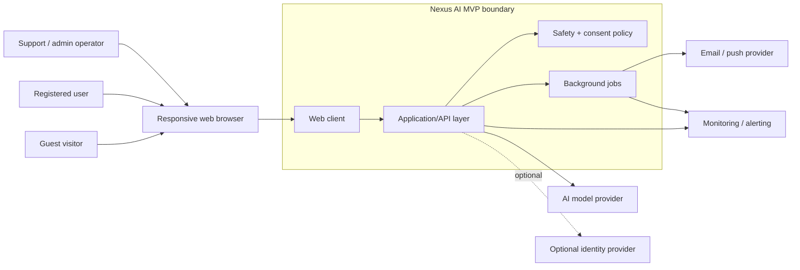
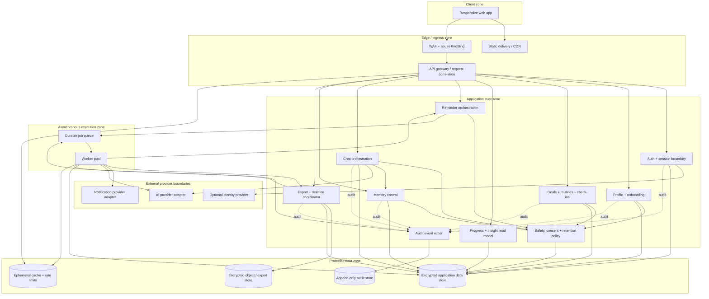
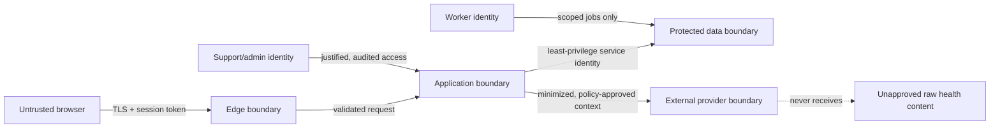
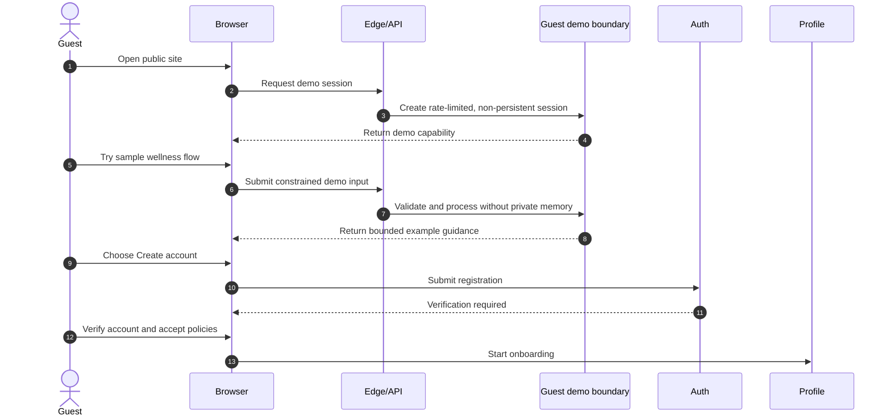
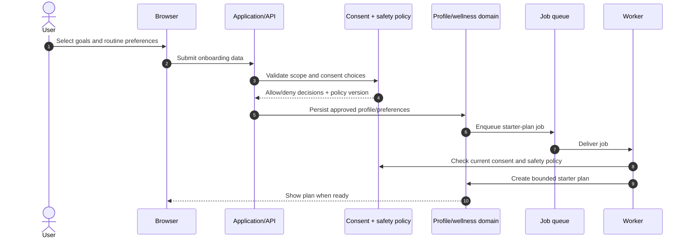
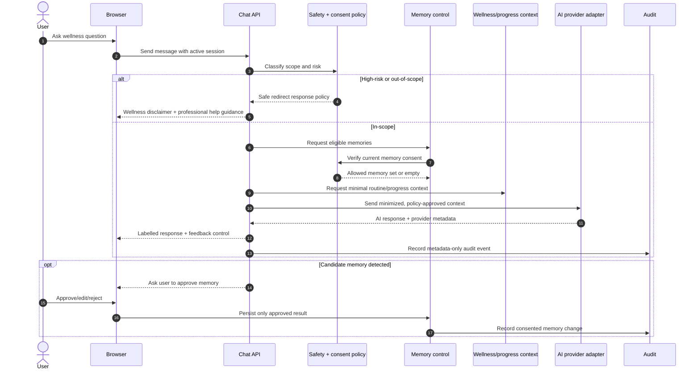
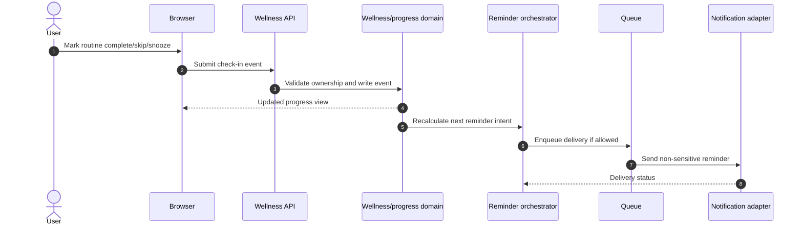
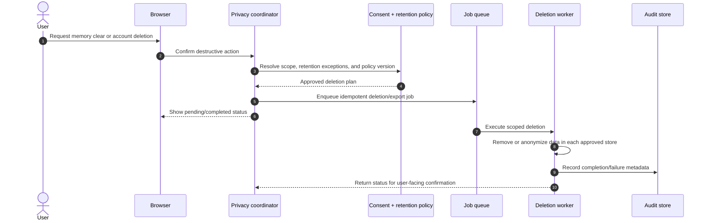
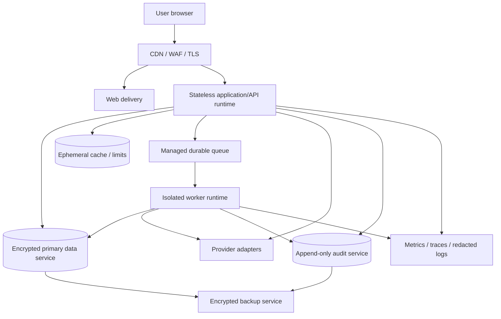

# NexusAI — Personal AI Health & Wellness Companion MVP System Architecture Outline

**Working title:** Nexus AI  
**Canonical product:** NexusAI — Personal AI Health & Wellness Companion  
**Document type:** System Architecture Outline  
**Phase:** System Architecture stage (repository sequence: 03)  
**Status:** Canonical approved baseline; Phases 04–12 APPROVED; Phase 13 Part 1 APPROVED; Phase 13 Part 2 AUTHORIZED / IN PROGRESS. Unresolved decisions remain `TBD / Pending Decision`.  
**Date:** 2026-09-07  
**Predecessor:** [Phase 1 PRD](02-prd-nexus-ai-health-companion-mvp.md)  
**Scope rule:** This is a technology-neutral, implementation-level outline. It contains no application code, SQL, ORM definitions, database schema, API contract, or deployment configuration.

## 1. Purpose and architecture outcomes

এই নথির উদ্দেশ্য হলো PRD-তে অনুমোদিত Health Companion MVP-এর জন্য একটি নিরাপদ, privacy-first এবং পরিবর্তনযোগ্য system shape নির্ধারণ করা। এটি পরের ফেজগুলোর জন্য boundary ও dependency স্পষ্ট করবে।

Architecture should enable:

- Guest demo with strict isolation and rate limits.
- Secure registration, onboarding, consent, and session management.
- Wellness goals, routines, reminders, check-ins, and progress views.
- AI chat with safety controls and explicit memory consent.
- User-controlled memory inspection, edit, deletion, and revocation.
- Auditability without exposing sensitive content unnecessarily.
- Asynchronous work for AI calls, notifications, exports, and deletion jobs.
- Provider replacement (AI, email, notifications) without rewriting product logic.

## 2. Scope and non-goals

### In scope

- Responsive web client.
- Public/guest experience and authenticated user workspace.
- Application/API boundary, domain services, background processing, and external provider boundaries.
- Security zones, trust boundaries, data classification, high-level data flows, resilience, and observability.
- Architecture decisions that must be confirmed before database/API design.

### Out of scope for this phase

- Concrete framework, cloud vendor, model, queue, or database selection.
- Physical database schema, table/collection design, migrations, indexes, or SQL.
- Endpoint paths, request/response JSON, SDK code, prompts, or infrastructure-as-code.
- Production sizing, cost commitments, or regulatory/legal sign-off.

## 3. Architecture principles

1. **Wellness boundary first:** The system must enforce non-diagnostic product scope at both UX and server/AI policy layers.
2. **Consent is a gate:** Personalization and memory retrieval/write paths must check current consent, not just a historical flag.
3. **Least privilege:** User, support, admin, worker, and provider credentials have separate scopes.
4. **Private by default:** Sensitive content is minimized in logs, analytics, notifications, prompts, and support tooling.
5. **Single source of policy:** Safety, consent, retention, and deletion rules are versioned and centrally evaluated.
6. **Asynchronous by design:** Slow, retryable, or bulk work must not block interactive requests.
7. **Provider isolation:** AI and notification vendors are replaceable adapters behind controlled interfaces.
8. **Observable without surveillance:** Measure reliability and safety using minimized, access-controlled telemetry.
9. **Reversible decisions:** Keep domain boundaries modular so V1 can evolve to a broader personal companion without exposing a user to unsafe coupling.

## 4. System context

The following context diagram shows the actors and systems that interact with Nexus AI. The dashed boundary is the MVP product boundary; external providers are not trusted with more data than a specific operation requires.

### Context assumptions

- The browser is an untrusted client; all authorization decisions are server-side.
- AI, notification, and identity providers are external trust boundaries.
- No wearable, location, camera, microphone, or passive sensor is required for V1.
- Admin/support access is exceptional and auditable; private chat/memory is not visible by default.

## 5. Logical container architecture

This is a logical decomposition, not a promise to deploy each box as a separate microservice. For the MVP, several containers may be packaged together while retaining these security and ownership boundaries.

## 6. Container responsibilities and boundaries

| Container | Owns | Must not own / do |
| --- | --- | --- |
| Web app | Presentation, client-side validation hints, accessibility, safe copy | Authorization, secrets, final validation, direct provider calls |
| WAF/gateway | TLS termination, request limits, correlation IDs, coarse abuse controls | Business authorization or sensitive content logging |
| Auth/session | Registration, verification, sign-in, recovery, session lifecycle, MFA hook | Wellness interpretation or memory decisions |
| Profile/onboarding | Basic profile, goals, preferences, consent capture | Implicitly enabling memory without current consent |
| Wellness | Goals, routines, check-ins, reminder intent | Diagnosis, clinical claims, provider credentials |
| Progress | Aggregations and user-facing trends | New sensitive facts not originating in approved domain events |
| Reminder | Schedule intent, quiet hours, delivery preferences | Sending sensitive content by default or bypassing opt-out |
| Chat orchestration | Context assembly, prompt policy, model adapter call, response labeling | Direct persistence of candidate memories without approval |
| Memory control | Candidate memory, confirmation, retrieval eligibility, edit/delete/revoke | Unbounded conversation recall or hidden profile inference |
| Safety/consent policy | Scope checks, high-risk routing, consent/retention decisions | Storing full chat or becoming an unreviewed clinical engine |
| Privacy coordinator | Export, deletion, revocation workflows and status | Ad-hoc destructive deletion without audit and retry handling |
| Audit writer | Structured security/privacy/admin events | Sensitive raw payloads or mutable event history |
| Worker/queue | Retryable AI, notification, export, deletion work | Unbounded retries, bypassing policy or authorization |

## 7. Trust boundaries and data classification

### 7.1 Trust boundaries

### 7.2 Data classes (conceptual; no schema implied)

| Class | Examples | Required handling |
| --- | --- | --- |
| Restricted health/wellness content | Check-in text, chat content, memory items, goal context | Strong encryption, narrow access, minimized prompt/log exposure, explicit retention/deletion |
| Personal account data | Email, timezone, preferences, consent records | Encryption, access control, export/delete support |
| Operational data | Job status, delivery status, feature flags, quotas | Integrity, retries, limited retention |
| Security/audit data | Login events, consent changes, admin access, deletion events | Append-only/tamper evidence, controlled access, retention policy |
| Aggregate telemetry | Counts, latency, error categories, safety evaluation outcomes | De-identify/minimize; never use raw content by default |

### 7.3 Prompt/data minimization rule

Before any AI call, the chat orchestrator asks the policy layer for an allowed context bundle. The bundle may include only the current user message, necessary active routine/progress context, and consented memory. The provider adapter must strip identifiers and disallowed fields where practical, and must return provider-retention status for operational review.

## 8. Key runtime flows

### 8.1 Guest demo to registration

### 8.2 Onboarding, consent, and first plan

### 8.3 Chat with consented memory

### 8.4 Check-in, progress, and reminder

### 8.5 Account deletion and memory revocation

## 9. Cross-cutting architecture concerns

### Identity and authorization

- Treat browser sessions as untrusted input; validate session, tenant/user ownership, and role on every protected operation.
- Separate end-user, support, admin, worker, and provider identities.
- Use short-lived access credentials, secure refresh/session rotation, revocation, and rate limits.
- Keep authorization policy independent of UI visibility.

### Safety enforcement

- Apply deterministic scope/risk checks before and after model calls.
- Keep system safety policy/version separate from user-editable content.
- Store only the metadata needed to evaluate and audit safety behavior.
- Maintain a reviewed evaluation set for diagnosis-like, emergency, medication, self-harm, eating-disorder, and other high-risk prompts.

### Consent and memory

- Consent is granular: product policies, personalization, reminders, optional channels, and AI memory are separate decisions.
- Memory retrieval and memory writes both require current consent and purpose compatibility.
- A revoked consent must invalidate future retrieval and enqueue cleanup of derived copies according to the approved retention policy.

### Reliability and idempotency

- Interactive flows should degrade gracefully when AI or notification providers are unavailable.
- Queue jobs need idempotency keys, bounded retries, dead-letter handling, and operator visibility.
- Deletion/export jobs must be resumable and safe to retry.
- Avoid making a successful check-in depend on a successful AI response.

### Observability

- Emit correlation IDs, latency, status, dependency outcome, policy version, and coarse error category.
- Redact health content, chat text, memory text, tokens, and secrets from logs by default.
- Alert on authentication abuse, authorization failures, unsafe-response evaluations, provider outages, queue growth, deletion failures, and unusual data access.
- Keep operational telemetry logically separate from restricted user content.

## 10. High-level deployment topology (technology-neutral)

Deployment requirements to validate later:

- Separate environments (local/development, staging, production) with isolated credentials and data.
- No production secrets in client bundles, source control, or logs.
- Private network path and restricted egress for protected data services where supported.
- Independent backup access, restore testing, and documented recovery objectives.
- Controlled release and rollback path for web, API, workers, prompts, and policy versions.

## 11. Failure modes and graceful degradation

| Failure | User-visible behavior | Required protection |
| --- | --- | --- |
| AI provider timeout/outage | Explain temporary unavailability; preserve check-in/routine functions | Timeout, bounded retry, circuit breaker, no duplicate charge/request |
| Notification provider outage | Show in-app reminder status; retry later | Queue durability, idempotent delivery, opt-out honored |
| Queue backlog | Show pending status, never claim work completed | Backpressure, age alert, dead-letter review |
| Cache loss | Recompute or reject safely; never treat cache as source of truth | Short TTL, fail-closed rate-limit fallback where needed |
| Audit write failure | Block security-sensitive mutations or use protected fallback | Audit integrity policy, operator alert |
| Data-store partial failure | Read-only or limited mode; preserve user clarity | Transactions/consistency plan deferred to database phase |
| Policy service unavailable | Fail closed for memory writes and high-risk AI calls | Versioned local safe defaults |
| Account deletion job failure | Clearly show pending/failed status and support path | Idempotent retries, reconciliation report, audit trail |

## 12. Architecture decisions deferred to later phases

The following must not be silently decided in this outline:

1. Runtime/framework and programming language.
2. Hosting/cloud region and residency model.
3. Relational/document/search data-store choice and physical schema.
4. Queue, cache, object storage, and observability products.
5. Authentication provider, MFA/passkey strategy, and session library.
6. AI model/provider, prompt versioning, provider retention, and regional processing.
7. Notification channel/provider and message templates.
8. Exact API resources and event contracts.
9. Retention periods, deletion semantics for backups, and legal holds.
10. Availability, latency, RTO/RPO, beta scale, and cost budgets.

These choices belong in the Database Design, API Design, Authentication Flow, Tech Stack, Deployment, and Security phases.

## 13. Phase 2 review checklist

- [ ] PRD scope, non-goals, and user journey are accurately reflected.
- [ ] Guest data cannot enter authenticated private memory by accident.
- [ ] All sensitive data paths cross a policy/consent boundary.
- [ ] AI provider receives only minimized, policy-approved context.
- [ ] Memory retrieval, write, edit, revoke, and delete paths are represented.
- [ ] Admin/support access is least-privilege and auditable.
- [ ] Async jobs, retries, idempotency, and failure behavior are represented.
- [ ] Logging/monitoring avoids raw health content by default.
- [ ] Deployment topology is conceptual and contains no implementation commitment.
- [ ] No code or database schema has been created in this phase.

## 14. Architecture stage gate

**HISTORICAL SNAPSHOT — NOT CURRENT PROJECT STATUS**

This section preserves the original architecture review gate and its prerequisites, including the original stage numbering. Current status is recorded in the header: Phases 04–12 APPROVED; Phase 13 Part 1 APPROVED; Phase 13 Part 2 AUTHORIZED / IN PROGRESS. The historical instructions below do not reopen approved gates or resolve existing TBD decisions.

This architecture outline is ready for review, not yet approved for implementation.

Before the Database Design stage begins, approval must confirm:

- the logical container boundaries;
- the trust boundaries and data classifications;
- the consent/memory and safety enforcement points;
- the synchronous versus asynchronous flow split;
- the failure/degradation expectations;
- which deferred decisions must be resolved in Phase 3 versus later.

**Approval states:** `Approved` · `Approved with changes` · `Not approved`  
**Implementation rule:** No code or database schema work starts until this Phase 2 gate is approved.
