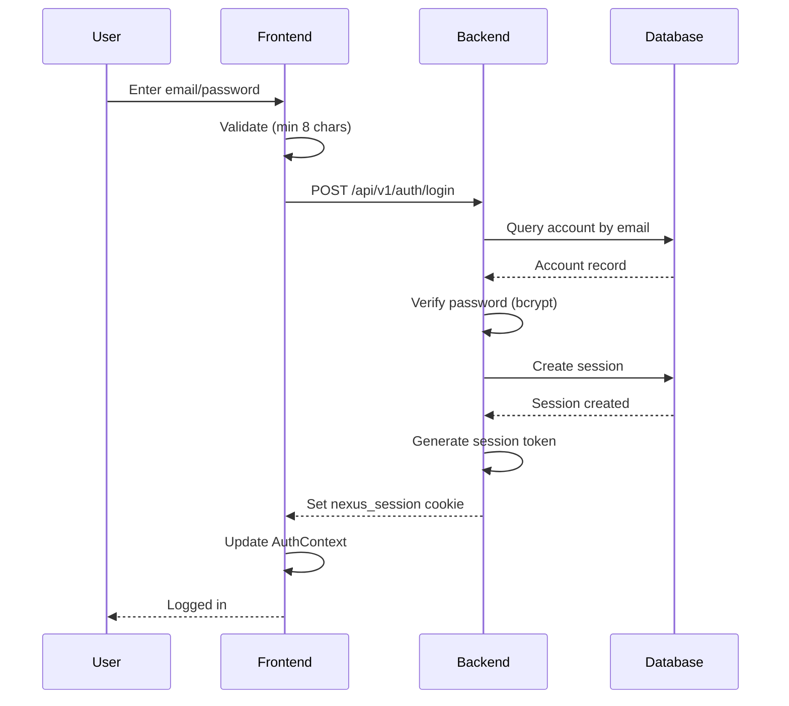
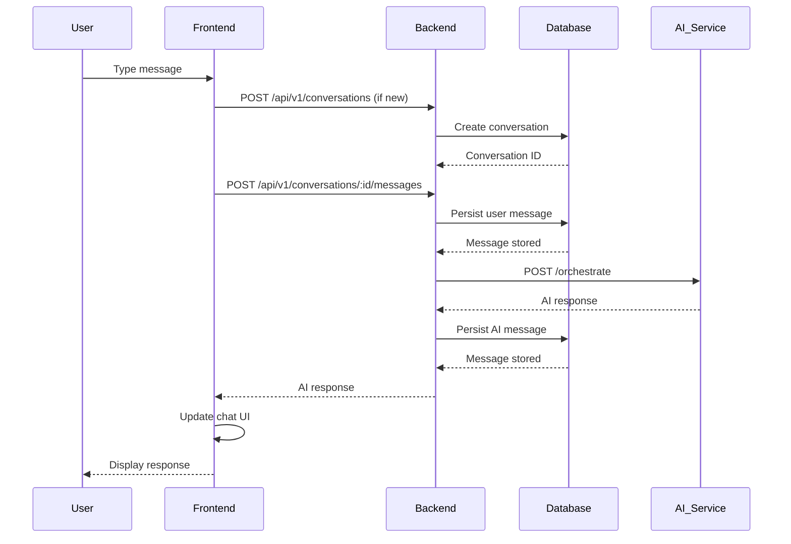
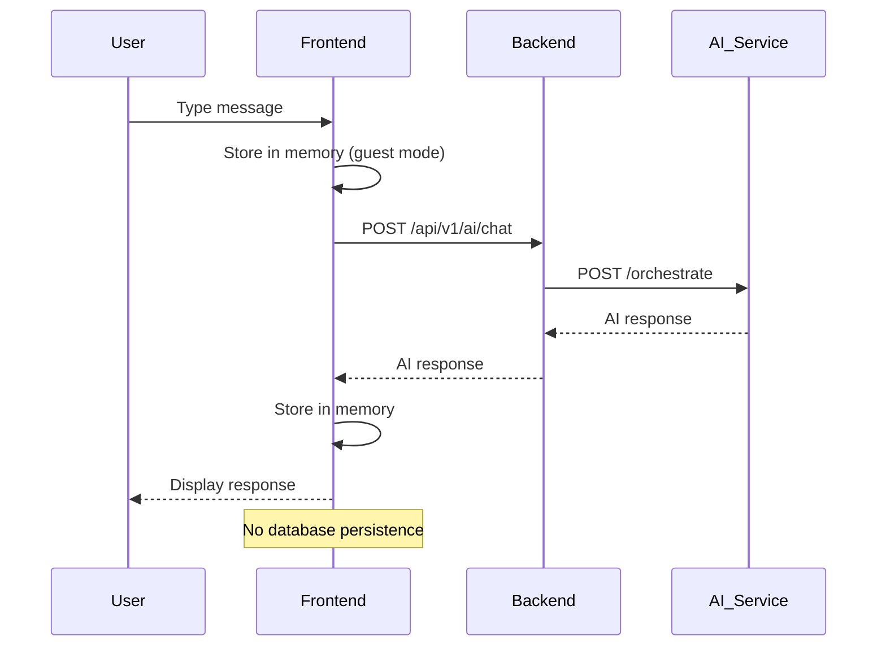
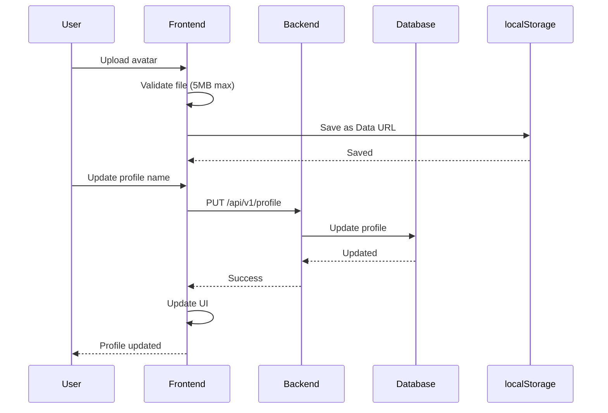

# NexusAI System Architecture

## High-Level Architecture

NexusAI is a three-tier web application with a monorepo structure:

```
┌─────────────────────────────────────────────────────────────┐
│                         Client Layer                          │
│                    (Next.js Frontend)                         │
│                         Port 3000                             │
└────────────────────────┬────────────────────────────────────┘
                         │ HTTP/HTTPS
                         │ Cookies (nexus_session)
                         │ JSON API
┌────────────────────────▼────────────────────────────────────┐
│                      Application Layer                        │
│                     (Fastify Backend)                         │
│                         Port 4000                             │
└────────────────────────┬────────────────────────────────────┘
                         │ PostgreSQL
                         │ TCP/SSL
┌────────────────────────▼────────────────────────────────────┐
│                       Data Layer                              │
│                    (Neon PostgreSQL)                           │
│                      nexus schema                             │
└─────────────────────────────────────────────────────────────┘
```

## Component Architecture

### Frontend (Next.js)

```
┌──────────────────────────────────────────────────────────────┐
│                        Next.js App                            │
├──────────────────────────────────────────────────────────────┤
│  ┌──────────────┐  ┌──────────────┐  ┌──────────────┐     │
│  │   AuthContext│  │  ChatInterface│  │   Sidebar    │     │
│  │              │  │              │  │              │     │
│  │ - User state │  │ - Messages   │  │ - Navigation │     │
│  │ - Session    │  │ - Input      │  │ - Profile    │     │
│  │ - Login/Logout│ │ - AI proxy   │  │ - Mobile nav │     │
│  └──────────────┘  └──────────────┘  └──────────────┘     │
│                                                              │
│  ┌──────────────┐  ┌──────────────┐  ┌──────────────┐     │
│  │  AuthModal   │  │ HistoryPage  │  │ ProfileEdit  │     │
│  │              │  │              │  │              │     │
│  │ - Register   │  │ - List convs │  │ - Edit form  │     │
│  │ - Login      │  │ - Pagination │  │ - Avatar     │     │
│  └──────────────┘  └──────────────┘  └──────────────┘     │
├──────────────────────────────────────────────────────────────┤
│  ┌──────────────────────────────────────────────────────┐  │
│  │              API Client (lib/api-client.ts)           │  │
│  │  - GET, POST, PUT, DELETE                            │  │
│  │  - Error handling                                    │  │
│  │  - Credential management                            │  │
│  └──────────────────────────────────────────────────────┘  │
└──────────────────────────────────────────────────────────────┘
```

### Backend (Fastify)

```
┌──────────────────────────────────────────────────────────────┐
│                      Fastify App                              │
├──────────────────────────────────────────────────────────────┤
│  ┌──────────────────────────────────────────────────────┐  │
│  │              Middleware Layer                          │  │
│  │  - CORS (@fastify/cors)                                │  │
│  │  - Cookies (@fastify/cookie)                          │  │
│  │  - Auth Middleware (session validation)               │  │
│  │  - Optional Auth (guest mode support)                 │  │
│  └──────────────────────────────────────────────────────┘  │
│                                                              │
│  ┌──────────────┐  ┌──────────────┐  ┌──────────────┐     │
│  │ Auth Routes  │  │Profile Routes│  │Conv Routes   │     │
│  │              │  │              │  │              │     │
│  │ /register    │  │ /profile     │  │ /conversations│    │
│  │ /login       │  │ /profile     │  │ /messages    │     │
│  │ /logout      │  │ (GET/POST/PUT)│ │ (CRUD)       │     │
│  │ /session     │  │              │  │              │     │
│  └──────────────┘  └──────────────┘  └──────────────┘     │
│                                                              │
│  ┌──────────────┐                                           │
│  │  AI Routes   │                                           │
│  │              │                                           │
│  │ /ai/chat     │                                           │
│  │ /ai/health   │                                           │
│  └──────────────┘                                           │
├──────────────────────────────────────────────────────────────┤
│  ┌──────────────────────────────────────────────────────┐  │
│  │              Repository Layer                          │  │
│  │  - ProfileRepository                                   │  │
│  │  - ConversationRepository                              │  │
│  │  - MessageRepository                                   │  │
│  │  - MemoryRepository                                    │  │
│  └──────────────────────────────────────────────────────┘  │
└──────────────────────────────────────────────────────────────┘
```

### Database (PostgreSQL)

```
┌──────────────────────────────────────────────────────────────┐
│                    Neon PostgreSQL                            │
│                     nexus schema                              │
├──────────────────────────────────────────────────────────────┤
│                                                              │
│  ┌──────────────┐    ┌──────────────┐                       │
│  │   accounts   │◄───┤auth_sessions │                       │
│  │              │    │              │                       │
│  │ - id (PK)    │    │ - id (PK)    │                       │
│  │ - email      │    │ - account_id │                       │
│  │ - password   │    │ - token_hash │                       │
│  │ - status     │    │ - expires_at │                       │
│  └──────┬───────┘    └──────────────┘                       │
│         │                                                      │
│         ├──────────────┬──────────────┐                      │
│         │              │              │                      │
│  ┌──────▼──────┐ ┌─────▼──────┐ ┌────▼─────┐                │
│  │user_profiles│ │conversations│ │ consent_ │                │
│  │             │ │             │ │ records  │                │
│  │ - account_id│ │ - account_id│ │          │                │
│  └─────────────┘ └──────┬──────┘ └──────────┘                │
│                        │                                       │
│                ┌───────▼────────┐                            │
│                │    messages    │                            │
│                │                │                            │
│                │ - conv_id (FK) │                            │
│                │ - sequence_no  │                            │
│                │ - content      │                            │
│                └────────────────┘                            │
│                                                              │
│  ┌──────────────┐  ┌──────────────┐  ┌──────────────┐     │
│  │memory_records│  │notification_ │  │library_items │     │
│  │              │  │ preferences  │  │              │     │
│  └──────────────┘  └──────────────┘  └──────────────┘     │
│                                                              │
└──────────────────────────────────────────────────────────────┘
```

## Data Flow Diagrams

### Authentication Flow



### Chat Flow (Authenticated)



### Chat Flow (Guest)



### Profile Update Flow



## Network Architecture

### Development Network

```
┌─────────────────────────────────────────────────────────────┐
│                        Browser                               │
│                    http://localhost:3000                     │
└────────────────────────┬────────────────────────────────────┘
                         │
                         │ HTTP requests
                         │ with nexus_session cookie
                         │
┌────────────────────────▼────────────────────────────────────┐
│                   Next.js Server                             │
│                   0.0.0.0:3000                                │
│                                                              │
│  - Serves React application                                  │
│  - Handles client-side routing                               │
│  - Manages authentication state                              │
│  - Stores avatar in localStorage                             │
└────────────────────────┬────────────────────────────────────┘
                         │
                         │ API calls to http://localhost:4000
                         │ with credentials (cookies)
                         │
┌────────────────────────▼────────────────────────────────────┐
│                   Fastify Server                             │
│                   127.0.0.1:4000                              │
│                                                              │
│  - Validates sessions                                        │
│  - Executes business logic                                   │
│  - Manages database operations                               │
│  - Proxies AI requests                                       │
└────────────────────────┬────────────────────────────────────┘
                         │
                         │ PostgreSQL connection
                         │ (DATABASE_URL)
                         │
┌────────────────────────▼────────────────────────────────────┐
│                   Neon PostgreSQL                            │
│                   (cloud-hosted)                             │
│                                                              │
│  - nexus schema                                              │
│  - 18 tables                                                 │
│  - User data, conversations, messages                        │
└─────────────────────────────────────────────────────────────┘

┌─────────────────────────────────────────────────────────────┐
│                   AI Service (External)                       │
│                   http://127.0.0.1:8000                       │
│                                                              │
│  - Python FastAPI/ML service                                │
│  - /orchestrate endpoint                                    │
│  - /health endpoint                                         │
│  - Must be running separately                                │
└─────────────────────────────────────────────────────────────┘
```

### CORS Configuration

**Development:**
- Origin: http://localhost:3000
- Credentials: true
- Methods: GET, POST, PUT, DELETE, OPTIONS
- Headers: Content-Type, Authorization

**Production (TODO):**
- Must update to actual production origin
- Same configuration structure
- HTTPS required for secure cookies

## Security Architecture

### Authentication Security

```
┌─────────────────────────────────────────────────────────────┐
│                  Authentication Layer                        │
├─────────────────────────────────────────────────────────────┤
│                                                              │
│  1. Password Security                                        │
│     - bcrypt hashing                                         │
│     - Minimum 8 characters                                   │
│     - Email normalization (lowercase)                         │
│                                                              │
│  2. Session Security                                        │
│     - HTTP-only nexus_session cookie                         │
│     - SameSite=Lax                                           │
│     - Secure flag in production                              │
│     - 7-day expiration                                       │
│     - Token hashing with bcrypt                              │
│                                                              │
│  3. Account Security                                        │
│     - Account status tracking (active, suspended, etc.)       │
│     - Session revocation support                             │
│     - Last seen tracking                                     │
│     - Soft delete support                                    │
│                                                              │
└─────────────────────────────────────────────────────────────┘
```

### API Security

```
┌─────────────────────────────────────────────────────────────┐
│                    API Security Layer                         │
├─────────────────────────────────────────────────────────────┤
│                                                              │
│  1. Request Headers                                          │
│     - x-request-id (unique request ID)                       │
│     - x-content-type-options: nosniff                        │
│     - x-frame-options: DENY                                  │
│     - referrer-policy: no-referrer                           │
│                                                              │
│  2. Authentication Middleware                                 │
│     - Validates nexus_session cookie                         │
│     - Checks account status                                  │
│     - Updates last_seen_at                                   │
│     - Sets request.accountId                                 │
│                                                              │
│  3. Rate Limiting (Implementation exists, not production-tested)│
│     - IP-based limits                                         │
│     - Email-based limits                                     │
│     - Configurable windows                                   │
│                                                              │
│  4. Error Handling                                           │
│     - Generic error messages (no sensitive data leak)       │
│     - Proper HTTP status codes                              │
│     - Error codes for client handling                        │
│                                                              │
└─────────────────────────────────────────────────────────────┘
```

## Module Dependencies

### Frontend Dependencies

```
apps/web/
├── React 19
├── Next.js 15.5.24
├── lucide-react (icons)
├── @nexusai/* (shared packages - none currently used directly)
└── Custom hooks and components
```

### Backend Dependencies

```
apps/api/
├── Fastify 5.12.5
├── @fastify/cookie
├── @fastify/cors
├── bcrypt
├── @nexusai/database-core (PostgreSQL client)
├── @nexusai/repositories (Data access)
└── @nexusai/contracts (Shared types)
```

### Shared Package Dependencies

```
packages/
├── database-core/ (PostgreSQL client)
│   └── node-postgres (pg)
├── auth-core/ (Auth utilities)
│   └── bcrypt
├── ai-core/ (AI integration)
│   └── (minimal dependencies)
└── repositories/ (Data access)
    └── @nexusai/database-core
```

## Deployment Architecture (Future)

### Production Deployment (Planned)

```
┌─────────────────────────────────────────────────────────────┐
│                        CDN                                   │
│                   (Static assets)                            │
└────────────────────────┬────────────────────────────────────┘
                         │
┌────────────────────────▼────────────────────────────────────┐
│                   Load Balancer                              │
│                   (HTTPS termination)                         │
└────────────────────────┬────────────────────────────────────┘
                         │
        ┌────────────────┼────────────────┐
        │                │                │
┌───────▼──────┐  ┌──────▼──────┐  ┌────▼─────┐
│ Next.js App  │  │ Fastify API │  │AI Service│
│ (Node.js)    │  │ (Node.js)   │  │(Python)  │
│ Port 3000    │  │ Port 4000   │  │Port 8000 │
└───────┬──────┘  └──────┬──────┘  └────┬─────┘
        │                │                │
        └────────────────┼────────────────┘
                         │
┌────────────────────────▼────────────────────────────────────┐
│                   Neon PostgreSQL                             │
│                   (Managed database)                         │
└─────────────────────────────────────────────────────────────┘
```

## Key Architectural Decisions

### 1. Monorepo Structure
**Decision**: Use pnpm workspaces for monorepo management
**Rationale**:
- Shared code reuse across apps
- Consistent dependency management
- Atomic commits across packages
- Simplified build process

### 2. PostgreSQL via Neon
**Decision**: Use Neon PostgreSQL as database provider
**Rationale**:
- Serverless PostgreSQL (no server management)
- Compatible with standard PostgreSQL
- Easy migration path to self-hosted
- Built-in connection pooling

### 3. External AI Service
**Decision**: Use external AI service instead of built-in model
**Rationale**:
- Separation of concerns
- Flexible model swapping
- Reduced deployment complexity
- Specialized AI infrastructure

### 4. HTTP-Only Cookie Sessions
**Decision**: Use HTTP-only cookies for session management
**Rationale**:
- More secure than localStorage/jwt in client
- Automatic CSRF protection (SameSite)
- Browser-managed expiration
- No client-side token storage

### 5. Repository Pattern
**Decision**: Use repository pattern for data access
**Rationale**:
- Abstraction over database queries
- Easy testing with mocks
- Centralized query logic
- Ownership validation

### 6. localStorage for Avatars (Dev Only)
**Decision**: Use localStorage for profile images in development
**Rationale**:
- Quick implementation for MVP
- No external service dependency
- Note: NOT production-ready, requires cloud storage

## Scalability Considerations

### Current Limitations
- Single Fastify instance (no horizontal scaling)
- No caching layer
- No message queue for background jobs
- No CDN for static assets
- AI service is single-instance

### Future Improvements
- Add Redis for caching
- Implement horizontal scaling with load balancer
- Add message queue (RabbitMQ/Redis) for background jobs
- Use CDN for static assets
- Multiple AI service instances with load balancing

## Monitoring and Observability

### Current State
- Console logging for debugging
- Basic error handling
- Request ID tracking (x-request-id)

### Future Improvements
- Structured logging (e.g., Winston, Pino)
- Metrics collection (e.g., Prometheus)
- Distributed tracing (e.g., OpenTelemetry)
- Error tracking (e.g., Sentry)
- Performance monitoring (e.g., New Relic)

## References

- [02_CODEBASE_STRUCTURE.md](./02_CODEBASE_STRUCTURE.md) - Detailed file structure
- [05_BACKEND_API_REFERENCE.md](./05_BACKEND_API_REFERENCE.md) - API endpoints
- [06_DATABASE_GUIDE.md](./06_DATABASE_GUIDE.md) - Database schema
- [07_AUTHENTICATION_SECURITY.md](./07_AUTHENTICATION_SECURITY.md) - Security details
- [15_ARCHITECTURE_DECISIONS.md](./15_ARCHITECTURE_DECISIONS.md) - ADRs
