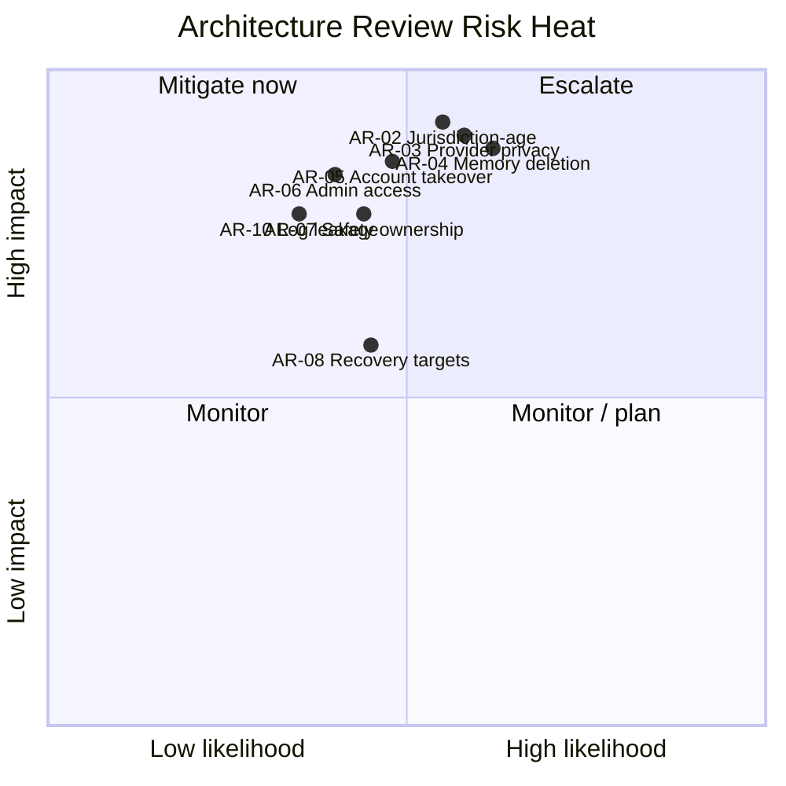
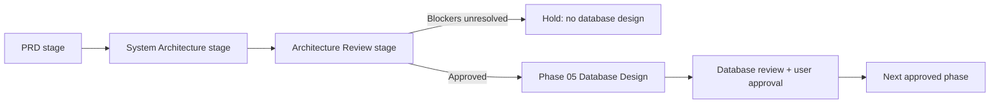

# NexusAI — Architecture Review Report

**Working title:** Nexus AI  
**Canonical product:** NexusAI — Personal AI Health & Wellness Companion  
**Document type:** Architecture Review Report  
**Phase:** Architecture Review stage (repository sequence: 04)  
**Phase 04 Status:** `APPROVED`  
**Current authorization:** Phases 04–12 APPROVED; Phase 13 Part 1 APPROVED; Phase 13 Part 2 AUTHORIZED / IN PROGRESS.  
**Documentation conflict status:** **RESOLVED** — the previous operations-copilot direction is historical only; current active documents describe the Health & Wellness Companion.  
**Approval date:** 2026-09-07  
**Reviewed artifacts:**

- [Phase 1/Project overview](00-project-overview.md)
- [Phase 2/Product Discovery](01-product-discovery.md)
- [Phase 3/Health Companion MVP PRD](02-prd-nexus-ai-health-companion-mvp.md)
- [Phase 4/System Architecture Outline](03-system-architecture-outline.md)

**Scope rule:** This is a review and decision record. It does not create code, database schema, API contracts, migrations, infrastructure-as-code, or production configuration.

**HISTORICAL SNAPSHOT — NOT CURRENT PROJECT STATUS**

The review narrative, findings, approval evidence and next-phase recommendations below record the Phase 04 review. They do not override the current authorization above; unresolved decisions remain unchanged.

## 1. Review objective

এই Phase 04 review-এর লক্ষ্য ছিল System Architecture Outline PRD-এর সঙ্গে সামঞ্জস্যপূর্ণ কি না, নিরাপত্তা/প্রাইভেসি/সেফটি boundary যথেষ্ট স্পষ্ট কি না, এবং Database Design-এ যাওয়ার আগে কোন সিদ্ধান্ত বা সংশোধন বাধ্যতামূলক তা নির্ধারণ করা।

Review outcome তিনটির একটিতে যাবে:

- **Approved:** Phase 05 শুরু করা যাবে।
- **Approved with changes:** নির্দিষ্ট corrective action সম্পন্ন করে Phase 05 শুরু করা যাবে।
- **Not approved:** blocker সমাধান না হওয়া পর্যন্ত Phase 05 শুরু করা যাবে না।

## 2. Executive summary

### Overall assessment: **APPROVED — Phase 05 documentation authorized**

`03-system-architecture-outline.md` Health Companion MVP-এর মূল user journey, consent-based memory, AI safety boundary, asynchronous jobs, auditability, privacy minimization এবং graceful degradation যথেষ্ট ভালোভাবে কভার করেছে। Logical decomposition-টি MVP-তে একসঙ্গে deploy হলেও domain boundary আলাদা রাখার সুযোগ দেয়, যা ভবিষ্যৎ evolution-এর জন্য উপযোগী।

Documentation correction সম্পন্ন হওয়ায় আগের critical documentation conflict (AR-01) এখন **resolved**। Database Design শুরু করার আগে কিছু **high-impact product/security decisions** নিষ্পত্তি বা explicit `TBD / Pending Decision` হিসেবে carry forward করতে হবে। বিশেষ করে:

1. Launch geography, minimum age, retention, identity/authentication, AI provider data handling এবং safety escalation এখনো সিদ্ধান্তহীন।
2. Memory revocation/deletion-এর সম্পূর্ণ lifecycle—বিশেষত cache, job payload, provider boundary এবং backup—পরবর্তী design-এ বাধ্যতামূলকভাবে নির্দিষ্ট করতে হবে।
3. Remaining High findings-এর owner এবং next-phase treatment approval record-এ রাখতে হবে।

এই report নিজে কোনো unresolved decision approve করে না; Phase 04 gate-এ user approval-এর পর Phase 05 শুরু করার অনুমতি দেওয়া হয়েছিল।

### Canonical direction confirmation

`00-project-overview.md` এবং `01-product-discovery.md` এখন NexusAI Personal AI Health & Wellness Companion MVP-কে canonical product direction হিসেবে বর্ণনা করে। পুরোনো operations-copilot concept-কে উভয় document-এ **SUPERSEDED / HISTORICAL — NOT CURRENT PRODUCT REQUIREMENT** হিসেবে চিহ্নিত করা হয়েছে।

Canonical hierarchy:

1. Product Vision — `00-project-overview.md`
2. Product Discovery — `01-product-discovery.md`
3. PRD — `02-prd-nexus-ai-health-companion-mvp.md`
4. System Architecture — `03-system-architecture-outline.md`
5. Architecture Review — this document
6. Current Phase 05 review artifact — `05-database-design.md`.
7. Future API Design.
8. Future AI/Memory Design.
9. Future UI/UX Design.
10. Future Implementation.

## 3. Review method and criteria

Architecture-কে নিচের criteria-তে পর্যালোচনা করা হয়েছে:

| Criterion | Review question |
| --- | --- |
| Product traceability | PRD-এর প্রতিটি MVP journey ও boundary architecture-এ দেখা যায় কি? |
| Safety | Diagnosis/urgent/high-risk requests-এর আগে ও পরে enforcement আছে কি? |
| Privacy | Consent, minimization, memory control, deletion, export ও retention-এর boundary আছে কি? |
| Security | Authentication, authorization, tenant isolation, secrets, audit ও abuse controls আছে কি? |
| Reliability | Provider outage, queue failure, deletion retry ও partial failure সামলানোর পথ আছে কি? |
| Operability | Redacted logs, metrics, alerting এবং incident signals সংজ্ঞায়িত কি? |
| Maintainability | Domain boundary ও provider adapter পরিবর্তনযোগ্য কি? |
| Database readiness | Database Design শুরু করার মতো logical ownership ও lifecycle স্পষ্ট কি? |

## 4. Traceability review

| PRD requirement | Architecture location | Assessment |
| --- | --- | --- |
| Guest limited demo | Context diagram; guest demo flow; edge throttling | **Pass with detail needed:** exact quota/abuse policy later |
| Registration/onboarding | Auth, Profile, Policy containers; onboarding sequence | **Pass** |
| Goals/routines/check-ins | Wellness, Progress, Reminder containers | **Pass** |
| Progress tracking | Progress read model and check-in flow | **Pass with detail needed:** aggregation consistency later |
| AI wellness chat | Chat orchestration, Safety/Consent Policy, Model adapter | **Pass with safety gate** |
| Memory opt-in and user control | Memory Control + policy checks + revocation flow | **Pass with lifecycle gap:** copies/backup semantics required |
| Secure authentication | Auth/session boundary, edge, scoped identities | **Partial:** auth method/MFA/session policy unresolved |
| RBAC and support isolation | Container responsibility table; trust-boundary diagram | **Partial:** role matrix and break-glass procedure required |
| Audit logs | Audit writer and append-only audit store | **Pass with detail needed:** event allowlist/retention later |
| Backups and recovery | Deployment topology and failure table | **Partial:** RTO/RPO/restore authority unresolved |
| Input validation/rate limiting | Browser hints, gateway/WAF, server-side policy | **Pass with detail needed:** validation rules belong in API phase |
| Privacy by design | Data classes, minimization rule, deletion coordinator | **Partial:** jurisdiction/retention/provider terms unresolved |

## 5. Architecture strengths

1. **Clear non-diagnostic boundary:** Safety policy is a first-class control rather than UI-only copy.
2. **Consent is placed at the data path:** Memory retrieval and writes both pass through policy checks.
3. **Provider isolation:** AI, identity, and notification providers are adapters, reducing vendor lock-in.
4. **Async separation:** AI, reminders, exports, and deletion are not coupled to the critical check-in write.
5. **Least-privilege intent:** Admin/support does not receive unrestricted chat/memory access by default.
6. **Auditability:** Authentication, consent, memory changes, admin access, and deletion events are explicitly represented.
7. **Graceful degradation:** The design distinguishes source-of-truth data from cache and protects against provider outages.
8. **Evolution-friendly modularity:** Logical containers can begin as a modular monolith without forcing premature microservices.

## 6. Findings and required actions

Severity levels: **Critical** blocks the next phase; **High** requires an explicit decision/action before or during the next phase; **Medium** should be resolved before beta; **Low** is a later improvement.

| ID | Severity | Finding | Impact | Required action / owner |
| --- | --- | --- | --- | --- |
| AR-01 | **Resolved** | The previous versions of `00-project-overview.md` and `01-product-discovery.md` described an operations copilot, conflicting with the Health Companion PRD/architecture. | Previously, developers or AI agents could implement the wrong product and safety posture. | **Resolved on 2026-08-28:** both documents were rewritten to the Health Companion direction and the old concept was marked `SUPERSEDED / HISTORICAL — NOT CURRENT PRODUCT REQUIREMENT`. **Owner: Product/Documentation.** |
| AR-02 | **High** | Launch geography, minimum age, and applicable privacy/regulatory posture are **TBD / Pending Decision**. | Data collection, consent, retention, emergency guidance, and legal copy may be invalid for the target users. | Decide initial jurisdiction(s), age policy, and legal review gate before public beta. **Owner: Product + Legal/Privacy.** |
| AR-03 | **High** | AI provider retention, training use, regional processing, and approved model are **TBD / Pending Decision**. | Restricted wellness/chat content could be retained or processed outside approved boundaries. | Select an approved provider policy and record contractual/data-processing requirements before provider integration. **Owner: Architecture + Privacy.** |
| AR-04 | **High** | Memory revocation/deletion propagation to cache, queued jobs, derived context, provider requests, and backups is **TBD / Pending Decision** beyond the conceptual flow. | A user may revoke consent while stale copies remain usable. | Define a deletion/revocation propagation model, completion evidence, and backup exception policy in Database/Privacy phases. **Owner: Architecture + Privacy.** |
| AR-05 | **High** | Authentication method, MFA requirement, session lifetime/rotation, and recovery assurance are **TBD / Pending Decision**. | Account takeover risk and inconsistent identity assumptions may leak private wellness data. | Approve an authentication baseline and threat model before API/authentication design. **Owner: Security.** |
| AR-06 | **High** | Admin/support role matrix and exceptional (“break-glass”) access are **TBD / Pending Decision** beyond the principle-level boundary. | Over-broad admin access or unreviewed support actions could expose chat/memory. | Define roles, allowed operations, justification, expiry, and audit requirements before implementation. **Owner: Security + Operations.** |
| AR-07 | **Medium** | Safety policy ownership, version lifecycle, and release approval are **TBD / Pending Decision**. | Prompt/policy changes may alter high-risk behavior without accountable review. | Name a safety owner, version policy artifacts, and require evaluation evidence for safety-affecting changes. **Owner: Product + Safety.** |
| AR-08 | **Medium** | RTO/RPO, availability targets, beta scale, and cost budgets are **TBD / Pending Decision**. | Backup topology and async capacity cannot be validated against a measurable target. | Set beta SLOs, recovery targets, and budget envelopes before deployment planning. **Owner: Technical PM.** |
| AR-09 | **Medium** | Data-store consistency and transaction boundaries for check-ins, progress, reminders, and deletion remain **TBD / Pending Decision**. | Progress or deletion status could become misleading if writes are partially committed. | In Phase 05, define aggregate consistency expectations and idempotent lifecycle operations at a conceptual level. **Owner: Data Architecture.** |
| AR-10 | **Medium** | Log redaction is a principle, not yet an allowlist and testable rule set. | Sensitive free text, identifiers, or model prompts may enter logs/telemetry. | Create a structured event allowlist, redaction tests, and restricted diagnostic access plan. **Owner: Security + Observability.** |
| AR-11 | **Medium** | Guest demo boundary is clear conceptually but quota, bot detection, and data expiry are **TBD / Pending Decision**. | Abuse and cost spikes could affect availability or create accidental persistence. | Define guest session TTL, quotas, abuse signals, and non-persistence tests. **Owner: Engineering.** |
| AR-12 | **Low** | Container diagram does not yet define accessibility, localization, or client offline behavior. | UX quality and future expansion may require rework. | Capture WCAG target, locale/timezone policy, and offline stance during UI/UX and API phases. **Owner: Product + UX.** |

## 7. Risk heat summary

The diagram is a relative prioritization, not a quantitative risk calculation. Likelihood and impact should be recalibrated once jurisdiction, user age, provider, and beta operating assumptions are approved.

## 8. Conditions and follow-up actions

### Documentation blocker status

**AR-01 is resolved.** The canonical hierarchy is now explicit in `00-project-overview.md`, `01-product-discovery.md`, and this review. No active operations-copilot requirement remains in the current product documentation.

### Conditions carried into Phase 05 and beyond

1. Launch geography, minimum age, and jurisdiction remain `TBD / Pending Decision`; Phase 05 may describe their data-design impact but must not select an answer.
2. V1 remains wellness-only and non-diagnostic; accountable safety/privacy approvers remain `TBD / Pending Decision`.
3. All unresolved High/Medium findings and owners remain tracked; recommendations must not be converted into confirmed requirements.

### Cross-document consistency check — reaffirmed 2026-09-07

| Check | Result | Notes |
| --- | --- | --- |
| Product identity | **Pass** | All active documents use NexusAI / Personal AI Health & Wellness Companion. |
| Vision and mission | **Pass** | `00-project-overview.md` defines the personal companion vision and wellness MVP mission. |
| Discovery rationale | **Pass** | `01-product-discovery.md` covers wellness users, jobs, hypotheses, validation and boundaries. |
| PRD requirements | **Pass** | `02-prd-nexus-ai-health-companion-mvp.md` covers guest, account, onboarding, routines, chat, progress and memory. |
| System boundaries | **Pass** | `03-system-architecture-outline.md` uses the same web-first, non-diagnostic, consent-based model. |
| Memory scope | **Pass** | Minimal Memory is the only MVP memory level; Smart/Full Life Memory are future phases. |
| AI direction | **Pass** | Provider/model abstraction is required; proprietary NexusAI AI is future direction, not an existing dependency. |
| Safety boundary | **Pass** | No diagnosis, prescribing or emergency treatment claim appears as an active requirement. |
| Historical concept | **Pass** | Operations-copilot language appears only in clearly marked historical notes and this resolved finding. |
| Pending decisions | **Pass** | Geography, age, jurisdiction, provider policy, deletion, auth/MFA, roles, safety ownership, RTO/RPO, beta scale and budget remain `TBD / Pending Decision`. |

**Remaining contradictions:** No active product-direction contradiction was found after the rewrite. The only intentional historical references are the superseded operations-copilot notes needed for traceability. The listed TBD decisions are unresolved choices, not contradictions.

### Decisions that Phase 05 must carry as explicit assumptions if not yet finalized

- Authentication/MFA baseline.
- AI provider data retention/training stance.
- Memory and account deletion propagation across all logical stores.
- Retention classes and backup deletion exceptions.
- User/tenant ownership model (individual-only versus future organization support).
- Beta scale, recovery objectives, and high-level consistency expectations.

## 9. Review of phase-gate compliance

Current state: **Phase 04 APPROVED on 2026-09-07**. AR-01 is resolved. The user explicitly acknowledged that all remaining High/Medium findings stay `TBD / Pending Decision`; they are not silently resolved here.

## 10. Recommendation to the user

**Final disposition at the Phase 04 gate:** `APPROVED` — the user explicitly approved Phase 04 on 2026-09-07 after the documentation corrections. This approval authorizes only `docs/05-database-design.md`; it does not approve SQL/DDL, migrations, database connections, ORM work, API design/implementation, AI provider integration, application code, or production infrastructure.

Phase 04 approval opened Phase 05 documentation. `docs/05-database-design.md` documents conceptual data domains, ownership, lifecycle, retention, integrity, deletion, privacy/security, and architecture traceability without silently choosing unresolved legal, provider, or authentication policies. Implementation remains separately gated.

## 11. Phase 04 Approval Checklist

- [x] `00-project-overview.md` describes NexusAI Personal AI Health & Wellness Companion as the current canonical product.
- [x] `01-product-discovery.md` describes the same Health Companion MVP; the superseded operations-copilot concept is not an active requirement.
- [x] `02-prd-nexus-ai-health-companion-mvp.md` and `03-system-architecture-outline.md` remain aligned with the canonical direction.
- [x] The superseded operations-copilot concept is labeled historical and non-current.
- [x] Canonical hierarchy and source-of-truth rule are documented.
- [x] AR-01 is marked resolved with a dated corrective action.
- [x] At the Phase 04 gate, no SQL, DDL, migration, API contract, or application code had been created; later Phase 05/06 artifacts are separately phase-gated.
- [x] Launch geography, minimum age, and privacy/regulatory jurisdiction acknowledged as `TBD / Pending Decision`.
- [x] AI provider retention/training policy acknowledged as `TBD / Pending Decision`.
- [x] Memory revocation/deletion propagation acknowledged as `TBD / Pending Decision`.
- [x] Authentication/MFA baseline and admin/support role matrix acknowledged as `TBD / Pending Decision`.
- [x] Safety policy ownership, RTO/RPO, beta scale, and cost budget acknowledged as `TBD / Pending Decision`.
- [x] User explicitly approves Phase 04 to proceed to Phase 05.

## 12. Phase 04 approval record

**Decision:** `APPROVED`  
**Approver:** User (explicit approval in project conversation)  
**Decision date:** 2026-09-07  

**Approval conditions:**

- NexusAI Personal AI Health & Wellness Companion MVP remains the canonical product direction.
- Operations Copilot remains **SUPERSEDED / HISTORICAL** and must not become an active requirement.
- The source-of-truth hierarchy is authoritative.
- The wellness-only, non-diagnostic safety boundary remains mandatory.
- Memory remains consent-based and user-controlled.
- All unresolved legal, privacy, safety, business, and infrastructure decisions remain `TBD / Pending Decision`.
- No TBD decision may be silently resolved.
- Remaining architecture risks remain documented and tracked.

**Authorization boundary:** This approval authorizes only `docs/05-database-design.md`. Pre-existing later-phase artifacts were not modified by this approval and do not override the current gate.
