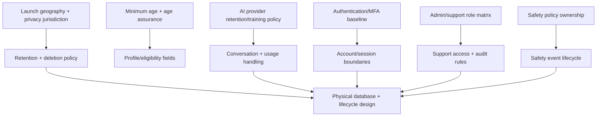

# NexusAI — Phase 05 Database Decisions Log

**Product:** NexusAI — Personal AI Health & Wellness Companion  
**Phase:** Phase 05 — Database Design  
**Status:** Approved — Phase 05 gate passed; Phase 06 through Phase 11 approved; Phase 12 Implementation Foundation/Project Initialization approved; Phase 13 Part 1 APPROVED; Phase 13 Part 2 AUTHORIZED / IN PROGRESS  
**Date:** 2026-08-28  
**Related artifacts:** [05-database-design.md](05-database-design.md) · [05-erd.md](05-erd.md) · [05-data-dictionary.md](05-data-dictionary.md)

## 1. Purpose

এই log-এ Phase 05-এর database-level decisions, recommendations, assumptions এবং unresolved questions আলাদা করা হয়েছে। এটি database design-কে স্থির ও traceable রাখে, কিন্তু product/legal/security choices নিজের থেকে চূড়ান্ত করে না।

Decision labels:

- **CONFIRMED:** Higher-level canonical documentation বা user-approved scope থেকে সরাসরি এসেছে।
- **RECOMMENDATION:** Database design-এর জন্য প্রস্তাব; explicit approval ছাড়া binding নয়।
- **ASSUMPTION:** Progress-এর জন্য ব্যবহৃত working assumption; পরে validate/change করা যাবে।
- **TBD / PENDING DECISION:** উত্তর দেওয়া হয়নি; design-এ invented answer ব্যবহার করা যাবে না।
- **DEFERRED:** এই phase-এর বাইরে; owner phase-এ সিদ্ধান্ত হবে।

## 2. Confirmed decisions inherited from canonical documents

| ID | Decision | Source | Database consequence |
| --- | --- | --- | --- |
| DB-C-01 | Product is NexusAI — Personal AI Health & Wellness Companion. | `00`–`04` | Model wellness domains only; no operations-copilot entities. |
| DB-C-02 | V1 is web-first and wellness-only, not diagnosis/treatment/emergency care. | PRD + Architecture | No clinical/medication/disease entities; safety metadata only. |
| DB-C-03 | Guest demo is limited and must not create private durable memory. | PRD + Architecture | No guest-owned durable business records in this model. |
| DB-C-04 | MVP supports goals, routines, daily plans, tasks, check-ins, progress, chat, reminders, and consent-based Minimal Memory. | PRD | These domains are represented as bounded entities. |
| DB-C-05 | Memory is off by default, user-approved, inspectable, editable, deletable, and revocable. | PRD + Architecture | `consent_records` and `memory_records` have explicit lifecycle/evidence. |
| DB-C-06 | Privacy/security by design requires encryption, access control, auditability, validation, backups, export, and deletion behavior. | PRD + Architecture Review | Restricted fields, audit/lifecycle entities, and infrastructure handoffs are documented. |
| DB-C-07 | AI provider/model must remain replaceable; proprietary NexusAI model is future direction. | Vision + Discovery + Architecture | Provider alias/usage metadata is separate from conversations/messages. |
| DB-C-08 | Product is currently treated as an individual-user experience; organization/household scope is not approved. | Discovery + Architecture Review | `account_id` ownership is used; organization/tenant entity is deferred. |
| DB-C-09 | Subscription/payment is not an approved MVP requirement. | PRD/Discovery | No billing entities are included. |

## 3. Database design recommendations

These are professional recommendations for review, not silent requirements.

| ID | Recommendation | Rationale | Revisit trigger |
| --- | --- | --- | --- |
| DB-R-01 | Use opaque generated IDs (`UUID` logical type). | Prevents guessable user-facing identifiers and keeps provider/business keys separate. | Physical database or interoperability requirement. |
| DB-R-02 | Keep a modular logical model even if V1 deploys as one database/application. | Preserves domain ownership without premature microservices. | Scale/team boundary or separate compliance boundary. |
| DB-R-03 | Use explicit lifecycle states and soft-delete markers for user-owned content; use append-biased records for audit/consent/safety. | Supports correction, deletion workflows, and accountability. | Legal retention/erasure policy. |
| DB-R-04 | Encrypt restricted wellness fields before persistence and exclude raw content from logs/telemetry. | Limits exposure if storage or observability systems are accessed. | Key management/provider/region decision. |
| DB-R-05 | Treat `account_id` as a mandatory ownership dimension on user-owned entities and check it with every foreign key. | Prevents cross-account reads/writes and eases future scope migration. | Organization/household decision. |
| DB-R-06 | Do not persist unapproved candidate memories in durable `memory_records`; keep them ephemeral until user confirmation. | Aligns with consent-before-memory and data minimization. | UX/product explicitly approves a short-lived candidate queue. |
| DB-R-07 | Keep progress dashboards derived from `check_ins`; do not make a second editable progress source. | Avoids divergent totals and normalization problems. | Measured scale requires a derived read model. |
| DB-R-08 | Track export/deletion/memory-clear as idempotent lifecycle requests. | Makes destructive/privacy operations resumable and auditable. | Workflow engine or legal hold requirement. |
| DB-R-09 | Keep provider alias, model class, usage, and latency in operational metadata only. | Supports provider replacement and avoids raw provider-data retention. | Billing/quality-evaluation requirement. |
| DB-R-10 | Default external notification channels to disabled until separate consent/provider policy is approved. | Fail-closed privacy posture while email/push/SMS remain unresolved. | Channel and notification policy decision. |

## 4. Explicit assumptions carried into Phase 05

| ID | Assumption | Why needed now | Must be replaced by |
| --- | --- | --- | --- |
| DB-A-01 | Individual `account_id` ownership is the only active scope. | Avoids speculative organization tables. | Approved organization/household scope decision. |
| DB-A-02 | Auth credentials are owned by an isolated auth subsystem/provider; core data stores only opaque identity/session metadata. | Keeps credential handling out of wellness domain. | Approved authentication architecture. |
| DB-A-03 | In-app reminders are the only approved MVP channel; email/push fields are future-compatible and safe-off. | PRD requires in-app reminders while other channels are TBD. | Channel consent/provider decision. |
| DB-A-04 | Age is represented, if collected, only as an optional coarse age band; exact DOB is not needed by current requirements. | Avoids inventing sensitive identity data while age policy is unresolved. | Minimum-age/age-assurance decision. |
| DB-A-05 | Guest demo interactions are ephemeral and may be handled outside the durable database. | Prevents unconsented private persistence. | Privacy-approved guest retention requirement. |
| DB-A-06 | Logical `ENCRYPTED_TEXT`/`ENCRYPTED_JSON` types represent an application/data-service boundary, not a chosen encryption product. | Documents sensitivity without selecting vendor/algorithm prematurely. | Security/tech-stack decision. |

## 5. Unresolved decisions — do not invent

| ID | Pending decision | Impacted entities/capabilities | Owner/gate |
| --- | --- | --- | --- |
| DB-T-01 | Launch geography and privacy/regulatory jurisdiction | Account/profile, consent, retention, emergency guidance | Product + Legal/Privacy |
| DB-T-02 | Minimum age, age assurance, and whether age is collected | `user_profiles`, onboarding, access policy | Product + Legal/Privacy |
| DB-T-03 | AI provider retention/training policy, regional processing, deletion guarantees | Conversations, messages, usage, provider adapter | Architecture + Privacy |
| DB-T-04 | Memory revocation/deletion propagation across cache, queue, provider, exports, and backups | `memory_records`, lifecycle workflow, derived context | Architecture + Privacy |
| DB-T-05 | Authentication provider, MFA baseline, session duration, recovery assurance | `accounts`, `auth_sessions`, authorization | Security |
| DB-T-06 | Admin/support role matrix, break-glass scope, approval, and expiry | `support_access_events`, `audit_events` | Security + Operations |
| DB-T-07 | Safety policy owner, policy retention, escalation governance | `safety_events`, message handling, audit | Product + Safety |
| DB-T-08 | Exact retention periods and legal-hold behavior per data class | All soft-delete/append-only entities, backups | Privacy/Legal |
| DB-T-09 | RTO/RPO, availability targets, beta scale, and cost budget | Backups, indexes, operational histories, queue sizing | Technical PM/Operations |
| DB-T-10 | Future organization/household scope | Ownership keys, authorization, migration strategy | Product/Architecture |

## 6. Decision dependencies

The dependency graph shows why unresolved product/security decisions are recorded as pending rather than guessed in this package.

## 7. Decision changes that require a new review

A new architecture/database review is required if any of the following become active requirements:

- clinical diagnosis, medication, treatment, lab, medical-record, or device telemetry data;
- organization/household/clinician/employer access;
- passive sensing, location, voice, or biometric data;
- provider-side model training or unrestricted raw prompt retention;
- billing/subscription state in the core account model;
- user-visible cross-domain Personal AI memory beyond approved Minimal Memory;
- a legal hold or retention rule that conflicts with user deletion promises.

## 8. Phase 05 decision review

- The model is intentionally MVP-sized: 21 bounded logical entities, with no speculative clinical, billing, social, or device tables.
- All sensitive user content has a purpose, owner, consent/lifecycle path, and deletion implication.
- Provider-specific data is operational metadata, not a core business dependency.
- The unresolved decisions above are visible in the data dictionary and main design; they are not hidden defaults.
- Any physical type, index syntax, encryption implementation, partitioning, or migration order remains a later implementation decision.

## 9. Approval record

**Decision:** `Approved`  
**Approver:** User (explicit approval in project conversation)  
**Decision date:** 2026-08-28  
**Conditions/comments:** Logical decisions and assumptions are approved; unresolved TBD items remain visible and must not be silently resolved by DDL.

Approval of this log approves the documented logical decisions and assumptions only. It does not authorize SQL/DDL, migrations, API design, or application code.
