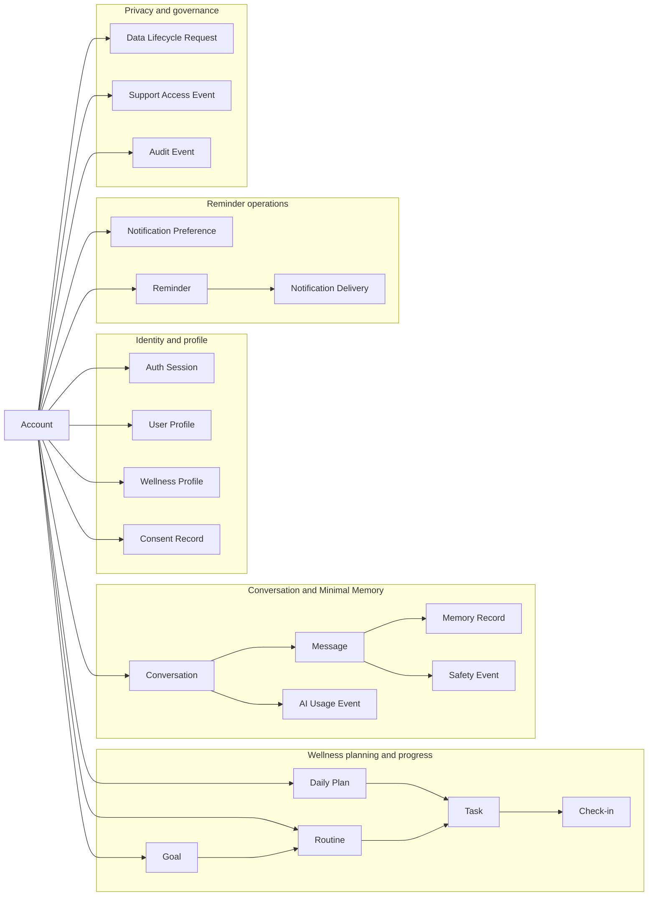

# NexusAI — Personal AI Health & Wellness Companion Database Design

**Document type:** Conceptual Database Design  
**Phase:** Phase 05 — Database Design  
**Status:** `APPROVED — PHASE 05 GATE PASSED`  
**Date:** 2026-09-07  
**Canonical product:** NexusAI — Personal AI Health & Wellness Companion  
**Source documents:** `00-project-overview.md`, `01-product-discovery.md`, `02-prd-nexus-ai-health-companion-mvp.md`, `03-system-architecture-outline.md`, `04-architecture-review.md`  
**Approval trace:** Approved by the user as recorded in `05-database-decisions.md`; later Phase 06–12 approvals and Phase 13 authorization do not alter this conceptual design.  
**Scope rule:** This is a conceptual, developer-readable design covering data domains, conceptual entities/relationships, ownership, lifecycle, retention, deletion, integrity, privacy/security, and architecture traceability. It contains no production SQL/DDL, migrations, database connection, PostgreSQL/ORM implementation, API implementation, AI-provider integration, infrastructure configuration, or application code.

## 1. Design status and source of truth

Phase 04 Architecture Review was explicitly approved on 2026-09-07. This Phase 05 document translates the approved product and architecture boundaries into a conceptual data model. It does not silently resolve product, legal, authentication, provider, safety, business, or infrastructure decisions that remain `TBD / Pending Decision`.

The document hierarchy remains:

1. `00-project-overview.md` — canonical vision and mission.
2. `01-product-discovery.md` — product rationale and discovery assumptions.
3. `02-prd-nexus-ai-health-companion-mvp.md` — testable MVP requirements.
4. `03-system-architecture-outline.md` — logical system and trust boundaries.
5. `04-architecture-review.md` — architecture findings and gates.
6. This Phase 05 document — conceptual database model, lifecycle and data requirements.

When a database decision conflicts with a higher-level document, the higher-level document wins and this document must be updated. Historical operations-copilot material is not a current data requirement.

## 2. Database goals and responsibilities

### 2.1 Goals

- Persist only the user, wellness, routine, progress, conversation, consent, memory, reminder, audit, safety, and lifecycle data required by the approved MVP.
- Keep user-owned data isolated by `account_id` and enforce authorization outside the database as well as at the data-access boundary.
- Represent consent as an auditable, append-only decision history rather than a hidden boolean scattered across entities.
- Support explicit memory approval, retrieval eligibility, edit, revoke, clear-all, and deletion lifecycle states.
- Keep AI provider details in operational metadata, not in core business entities.
- Make export, deletion, backup, and retention work trackable and retryable.
- Preserve enough history for security, privacy, and support accountability without retaining raw sensitive content unnecessarily.
- Leave a clean extension point for future Personal AI capabilities without adding speculative V1 domains.

### 2.2 Responsibilities

The database is the durable source of truth for:

- account identity references and account lifecycle;
- user profile and consented wellness context;
- goals, routines, daily plan tasks, and check-ins;
- authenticated conversations and AI messages;
- user-approved minimal memory;
- reminder intent and delivery outcomes;
- safety-policy outcomes and provider usage metadata;
- security/privacy audit history;
- export, deletion, and memory-clear requests;
- exceptional support/admin access records.

The database is not responsible for:

- authentication credential verification when a managed identity service owns it;
- generating AI responses or storing raw provider request/response payloads;
- sending notifications directly;
- serving as a search index, analytics warehouse, or model-training corpus;
- storing guest demo data beyond the explicitly approved ephemeral boundary.

## 3. MVP data scope

### 3.1 Included data

| Domain        | Included data                                                              | Sensitivity                            |
| ------------- | -------------------------------------------------------------------------- | -------------------------------------- |
| Account       | Stable account identity reference, normalized email, lifecycle status      | Personal / security                    |
| Profile       | Display name, locale/timezone, optional age band, notification preferences | Personal                               |
| Wellness      | Approved wellness areas and minimal consented lifestyle context            | Restricted wellness                    |
| Planning      | Goals, routines, daily plans, task instances                               | Restricted wellness                    |
| Progress      | Completion state and optional user reflection                              | Restricted wellness                    |
| Conversation  | Authenticated chat messages and minimal conversation metadata              | Restricted wellness                    |
| Memory        | User-approved, purpose-bound memory items and lifecycle state              | Restricted wellness / high sensitivity |
| Notifications | Reminder schedule intent, channel preference, delivery outcome             | Personal / operational                 |
| Safety        | Policy classification/action metadata without raw prompt by default        | Restricted security                    |
| Governance    | Consent history, audit events, export/deletion requests, support access    | Restricted security/privacy            |
| AI operations | Redacted usage/latency metadata for reliability and cost controls          | Operational                            |

### 3.2 Explicitly excluded from V1

- Exact diagnosis, disease, symptom, medication, dosage, prescription, lab, clinical record, insurance, or treatment fields.
- Wearable/device telemetry, location history, camera/microphone recordings, or passive sensing data.
- Social graph, household/organization membership, clinician accounts, or employer-administered health data.
- Payment/subscription tables: monetization is not an approved PRD requirement. A future billing module must be added separately.
- Raw AI provider prompts, hidden system prompts, raw provider responses, provider tokens, or provider user identifiers unless a later approved design proves they are necessary.
- Unbounded event streams or analytics copies of restricted content.

## 4. Modeling conventions

### 4.1 Logical data types

The data dictionary uses technology-neutral logical types. A physical database engine and exact types are a later technology decision.

| Logical type     | Meaning                                                                                        |
| ---------------- | ---------------------------------------------------------------------------------------------- |
| `UUID`           | Opaque generated identifier; no user-visible sequential meaning.                               |
| `STRING(n)`      | Short bounded text such as email, enum code, title, or provider alias.                         |
| `TEXT`           | User-visible or descriptive text; maximum length must be enforced at the application boundary. |
| `ENCRYPTED_TEXT` | Application-encrypted text; ciphertext and key metadata are implementation concerns.           |
| `ENCRYPTED_JSON` | Application-encrypted structured context; nested contents remain allow-listed and consented.   |
| `ENUM`           | Controlled value set documented by the owning domain.                                          |
| `BOOLEAN`        | True/false flag.                                                                               |
| `INTEGER`        | Whole-number count, order, or duration.                                                        |
| `DECIMAL`        | Exact numeric measurement when later justified; not used for clinical values in V1.            |
| `DATE`           | Calendar date in the user’s configured timezone.                                               |
| `TIMESTAMP`      | UTC instant; display conversion happens at the client/domain boundary.                         |
| `JSON`           | Small, non-sensitive structured metadata only; never a shortcut for an unbounded schema.       |

### 4.2 Identifier and ownership conventions

- Every durable entity has an opaque `id` primary key unless explicitly documented as a one-to-one child keyed by its parent.
- Every user-owned entity has a required account-ownership reference, except global policy/catalog data which is not part of this MVP document.
- User-owned foreign keys must be checked together with `account_id` to prevent cross-account references.
- Do not expose internal IDs as sensitive information in notification text, logs, or URLs without an approved reason.
- Organization/tenant support is a future extension. V1 uses individual account ownership while keeping the access layer ready to add a future scope key.

## 5. Entity catalog

The conceptual model identifies 21 entity types. Names express business meaning and ownership only; they are not SQL tables, ORM models, or a physical schema commitment.

|   # | Entity                     | Purpose                                               | MVP status      |
| --: | -------------------------- | ----------------------------------------------------- | --------------- |
|   1 | `accounts`                 | Stable user account and lifecycle anchor              | Core            |
|   2 | `auth_sessions`            | Revocable session metadata; token material is hashed  | Core security   |
|   3 | `user_profiles`            | Basic user-facing profile and locale/timezone         | Core            |
|   4 | `wellness_profiles`        | Approved wellness areas and minimal lifestyle context | Core            |
|   5 | `consent_records`          | Append-only policy and feature consent decisions      | Core privacy    |
|   6 | `goals`                    | User wellness goals                                   | Core            |
|   7 | `routines`                 | Repeatable habit/routine definitions                  | Core            |
|   8 | `daily_plans`              | Per-user plan for a calendar date                     | Core            |
|   9 | `tasks`                    | Plan task instances linked to routines/goals          | Core            |
|  10 | `check_ins`                | Completion/skip/snooze/reflection records             | Core            |
|  11 | `conversations`            | Authenticated AI chat container                       | Core            |
|  12 | `messages`                 | User/assistant chat messages                          | Core            |
|  13 | `memory_records`           | User-approved, purpose-bound memory                   | Core privacy    |
|  14 | `notification_preferences` | Channel, quiet-hour, and opt-out settings             | Core            |
|  15 | `reminders`                | Reminder scheduling intent                            | Core            |
|  16 | `notification_deliveries`  | Attempt and provider outcome metadata                 | Core operations |
|  17 | `safety_events`            | Safety classification/action metadata                 | Core safety     |
|  18 | `data_lifecycle_requests`  | Export, account deletion, and memory-clear workflow   | Core privacy    |
|  19 | `support_access_events`    | Justified exceptional operator access                 | Core security   |
|  20 | `audit_events`             | Append-only security/privacy/admin history            | Core security   |
|  21 | `ai_usage_events`          | Minimized provider/latency/usage telemetry            | Core operations |

## 6. Relationship and ownership model

The following diagram is a conceptual relationship map. It intentionally omits columns, data types, indexes, and physical storage choices.

### 6.1 Conceptual relationships

- One `accounts` record owns one `user_profiles`, zero or one `wellness_profiles`, many `consent_records`, goals, routines, daily plans, conversations, memories, reminders, lifecycle requests, and audit subjects.
- One `account` may have many `auth_sessions`; each session is independently revocable.
- One `goal` may guide many `routines`; a routine may optionally be associated with one goal in V1.
- One `daily_plan` contains many task instances; each task may point to one routine and one goal for attribution.
- One `task` may have zero or more `check_ins`; application policy may enforce at most one active check-in per task/date.
- One `conversation` contains ordered `messages`; only authenticated user conversations are durable in V1.
- One `message` may be the source of zero or more candidate/approved `memory_records` and may be associated with one `safety_event`.
- One `reminder` may produce many `notification_deliveries`; delivery records never become the scheduling source of truth.
- One `data_lifecycle_request` tracks a bounded export, deletion, or memory-clear operation and may carry a temporary encrypted artifact reference.
- `support_access_events` and `audit_events` reference operator and subject accounts but do not grant access by themselves.

### 6.2 Ownership boundaries

| Boundary           | Owns conceptually                                       | Ownership rule                                                                                    |
| ------------------ | ------------------------------------------------------- | ------------------------------------------------------------------------------------------------- |
| Identity/Profile   | Account, sessions, profile, wellness profile            | Account is the root; authentication data cannot grant wellness/memory access by itself.           |
| Consent/Policy     | Consent decisions and policy/version references         | Consent history is authoritative for whether a purpose is currently allowed.                      |
| Wellness           | Goals, routines, plans, tasks, check-ins                | Every record belongs to one user account; progress is derived from user-owned source events.      |
| Conversation       | Conversations, messages, safety/usage metadata          | Raw conversation content remains restricted; provider metadata does not own business data.        |
| Minimal Memory     | User-approved memory records                            | Memory Control owns lifecycle and retrieval eligibility; Chat cannot persist memory directly.     |
| Reminder           | Preferences, reminder intent, delivery outcomes         | User preference and quiet-hour policy override delivery attempts.                                 |
| Privacy/Governance | Export/deletion requests, support access, audit history | Privacy coordinator owns lifecycle workflow; audit records prove actions but do not grant access. |

Cross-boundary references must carry the same account ownership context. No domain may bypass current consent, safety policy, or user deletion/revocation state.

## 7. Keys, foreign keys, and requiredness

### 7.1 Primary keys

- Use generated opaque `UUID` identifiers for durable entities.
- Primary keys are immutable and have no business meaning.
- A future physical design may use a different opaque identifier format, but it must preserve uniqueness and non-guessability.

### 7.2 Foreign keys

- All listed foreign keys are logical referential constraints even before a physical engine is chosen.
- Deletion behavior must be explicitly chosen per relationship; do not use blanket cascade deletion for restricted content.
- Cross-account references are invalid, even when the referenced ID exists.
- Provider references use internal aliases or hashed references, never provider-specific identifiers as core business keys.

### 7.3 Required versus optional

- Required fields identify ownership, lifecycle, timestamps, state, and the minimum payload needed for the entity’s purpose.
- Optional fields include user-provided context, reflections, external provider metadata, completion timestamps, and future-compatible associations.
- Optional does not mean unrestricted: when populated, the same consent, encryption, validation, and retention rules apply.
- The data dictionary marks every field `Required` or `Optional` and records defaults where a safe default exists.

## 8. Constraints and unique rules

### 8.1 Global constraints

- `created_at` and `updated_at` are UTC timestamps; `updated_at` changes only on a meaningful mutation.
- State fields use allow-listed values and reject unknown states.
- User-editable text has length limits, Unicode normalization, and server-side validation.
- Timestamps and dates must be internally consistent (for example, `completed_at` cannot precede `created_at`).
- Sensitive fields must be encrypted before persistence or intentionally excluded.
- JSON/structured fields are bounded, versioned, and allow-listed; they are not a replacement for relational ownership.

### 8.2 Key uniqueness rules

- `accounts.email_normalized` is unique among non-purged accounts.
- `accounts.auth_subject` is unique within its `auth_issuer` when an external identity is used.
- One active `user_profiles` and at most one active `wellness_profiles` exist per account.
- `daily_plans` are unique per `(account_id, plan_date)` for active plans.
- `messages` are unique per `(conversation_id, sequence_no)`.
- One active `notification_preferences` record exists per account.
- A memory item’s active identity is unique by `(account_id, content_fingerprint, purpose)` where fingerprinting is privacy-safe and optional; duplicate prevention must not leak plaintext.
- Idempotent lifecycle requests use a unique `(account_id, idempotency_key)` within the retention window.
- No uniqueness rule is placed on raw chat text, reflection text, or health context.

## 9. Soft-delete and lifecycle requirements

### 9.1 Entities that generally require soft delete or lifecycle state

- `accounts`: lifecycle status plus `deleted_at`/`purge_after`; a later purge job handles irreversible removal.
- `user_profiles`, `wellness_profiles`, `goals`, `routines`, `daily_plans`, `tasks`, `check_ins`, `conversations`, `messages`, `memory_records`, `reminders`, and notification preferences: status/deleted timestamps where user correction or retention requires history.
- `data_lifecycle_requests`: never silently delete while a request is in progress; retain minimal outcome metadata.

### 9.2 Append-only entities

- `consent_records`, `audit_events`, `safety_events`, and `support_access_events` are append-only or append-biased. Corrections create a new event rather than rewriting history.
- `notification_deliveries` and `ai_usage_events` are operational histories with bounded retention; they must not contain raw restricted content.

### 9.3 Account deletion

Account deletion is a tracked, idempotent lifecycle request. The deletion coordinator must:

1. Revoke sessions and stop new reminders.
2. Disable personalization and memory retrieval immediately.
3. Mark user-owned records pending deletion and prevent new writes except the deletion workflow.
4. Remove or anonymize restricted content across primary stores, caches, queued jobs, derived views, and temporary export artifacts according to the approved policy.
5. Handle provider and backup copies according to the approved provider contract and retention/legal policy.
6. Record only the minimum completion/failure evidence in audit/lifecycle records.

Exact retention periods, backup exceptions, legal holds, and provider deletion guarantees are `TBD / Pending Decision`.

### 9.4 Memory revocation

Memory revocation is separate from account deletion:

- Set memory consent to revoked for future retrieval/writes.
- Mark affected memory records revoked/deleted and exclude them immediately from context assembly.
- Invalidate derived/cache copies and cancel or scrub queued jobs where possible.
- Do not send revoked memory in future provider requests.
- Record a minimal audit event and an observable completion status.

Propagation guarantees across backups, already-completed provider processing, and historical exports remain `TBD / Pending Decision` and must not be claimed as complete prematurely.

## 10. Audit and history requirements

- Every authentication event of security significance, consent change, memory change, export/deletion request, admin/support access, and policy decision must create an auditable event.
- Audit events record actor, subject, action, outcome, entity reference, policy/version reference, correlation ID, and timestamp.
- Audit payloads are metadata-only by default; raw chat, memory, email, access tokens, and full prompts are excluded.
- Audit history is append-only or tamper-evident, access-controlled, and retained according to a future approved policy.
- Domain records may use `version` or lifecycle state for user-visible correction, but audit history remains separate from mutable business data.

## 11. Indexing strategy

Indexing is logical guidance; exact indexes belong to the physical database decision.

### Required access patterns

- Account lookup by normalized email and external auth subject.
- User-owned list/read by `account_id` plus lifecycle status.
- Time-window reads by `(account_id, date/timestamp)` for plans, tasks, check-ins, messages, reminders, and deliveries.
- Ordered message retrieval by `(conversation_id, sequence_no)`.
- Active memory retrieval by `(account_id, status, purpose/category)` after consent filtering.
- Pending lifecycle jobs by `(status, requested_at)` and idempotency key.
- Security/audit review by subject, actor, event type, and time window.
- Operational queues by status, next-attempt time, and bounded retry state.

### Indexing rules

- Index ownership and state before adding content-oriented indexes.
- Use uniqueness/partial uniqueness for active records only where the physical engine supports it safely; otherwise enforce in a transaction/application boundary.
- Do not index plaintext restricted content, reflection text, or raw message bodies for convenience.
- Avoid unbounded JSON indexes; add a first-class field only after an observed access pattern and privacy review.
- Review index growth and retention together for messages, check-ins, audit events, deliveries, and usage events.

## 12. Privacy and security considerations

- Encrypt restricted fields at the application/data-service boundary; keys and rotation policy are separate security decisions.
- Keep `account_id` ownership checks on every user-owned read/write path.
- Separate auth/session, business, audit, and operational access identities.
- Store token hashes, not raw session/refresh tokens.
- Normalize and protect email; do not expose it in logs or notification payloads unnecessarily.
- Use explicit consent records for memory, personalization, reminders/channels, and policy acceptance.
- Do not place raw health/chat content in audit logs, metrics labels, traces, error messages, or provider usage events.
- Restrict support/admin access and log every exceptional access.
- Keep provider-specific data in adapters/usage metadata; do not make provider IDs business keys.
- Apply retention, export, revocation, and deletion controls to backups and derived copies, not only the primary store.

## 13. Retention considerations

Exact durations are not decided. The following classes must be assigned a policy before public beta:

| Data class                     | Retention decision needed                         | Default handling until decided                                  |
| ------------------------------ | ------------------------------------------------- | --------------------------------------------------------------- |
| Account/profile                | Account lifetime, deletion grace, legal exception | Keep only while account is active or deletion is pending        |
| Goals/routines/plans/check-ins | User value versus minimization                    | User-controlled deletion; no indefinite retention assumption    |
| Conversations/messages         | Product usefulness versus sensitivity             | Do not create secondary copies; user deletion must be supported |
| Memory                         | Purpose/expiry and revocation behavior            | Consent-bound; no retrieval after revoke                        |
| Notifications/deliveries       | Troubleshooting window                            | Metadata only; no sensitive message body                        |
| Safety events                  | Safety accountability and legal review            | Metadata-only, access-controlled                                |
| Consent/audit                  | Accountability and legal review                   | Append-only; duration TBD                                       |
| Exports                        | Short-lived secure artifact                       | Expiry required; never public URL                               |
| Backups                        | Recovery versus deletion obligations              | Encrypted, access-controlled; deletion semantics TBD            |

## 14. Data export implications

- Export is a tracked `data_lifecycle_request` with `request_type = export`.
- Export scope must include the user-owned records the Privacy Policy promises, in a human-readable and machine-readable format selected later.
- Export artifacts live in an encrypted, access-controlled temporary store and expire automatically.
- Export generation runs asynchronously and is idempotent; an incomplete export is never presented as complete.
- Audit records contain status and scope metadata, not a copy of the exported health/chat content.
- Provider-side data and backup copies are included only if the approved provider/legal policy requires or permits it.

## 15. Future extensibility without MVP over-engineering

- Keep account ownership separate from domain entities so future organization/household scope can add a scope key without rewriting wellness semantics.
- Keep `wellness_profiles` bounded and allow-listed; do not create generic “everything about the person” blobs.
- Keep AI provider alias/model class in `ai_usage_events`, not in conversations or messages.
- Keep memory as purpose-bound records with lifecycle state so future memory levels can add categories and retrieval policies safely.
- Add future domains (calendar, finance, education, work, device integrations) as separate bounded modules only after product/privacy approval.
- Use stable domain IDs and versioned policy references so later migrations can be incremental.

## 16. PRD → Architecture → Database traceability review

| Requirement/source               | Architecture boundary                       | Database support                                                             | Assessment                            |
| -------------------------------- | ------------------------------------------- | ---------------------------------------------------------------------------- | ------------------------------------- |
| Guest limited demo               | Guest demo boundary; no private persistence | No guest-owned durable entity; optional ephemeral session outside this model | Pass; non-persistence preserved       |
| Registration/session lifecycle   | Auth/session boundary                       | `accounts`, `auth_sessions`                                                  | Pass; auth method/MFA remains TBD     |
| Profile/onboarding               | Profile + Policy containers                 | `user_profiles`, `wellness_profiles`, `consent_records`                      | Pass; age format remains TBD          |
| Goals/routines/daily plans/tasks | Wellness, Progress, Reminder containers     | `goals`, `routines`, `daily_plans`, `tasks`                                  | Pass                                  |
| Check-ins/progress               | Wellness + Progress containers              | `check_ins` with date/status/reflection                                      | Pass; aggregation policy later        |
| AI chat                          | Chat orchestration + model adapter          | `conversations`, `messages`, `safety_events`, `ai_usage_events`              | Pass; raw provider payload excluded   |
| Consent-based Minimal Memory     | Memory Control + Policy                     | `consent_records`, `memory_records`, `audit_events`                          | Pass; propagation details TBD         |
| Reminders/quiet hours/opt-out    | Reminder orchestration                      | `notification_preferences`, `reminders`, `notification_deliveries`           | Pass; channels TBD                    |
| Admin/support least privilege    | Support boundary + audit                    | `support_access_events`, `audit_events`                                      | Partial; role matrix TBD              |
| Privacy export/deletion          | Privacy coordinator + async worker          | `data_lifecycle_requests` plus protected artifact reference                  | Pass; retention/legal rules TBD       |
| Security audit/backup            | Audit + protected data zones                | `audit_events`; backup is infrastructure concern                             | Pass; RTO/RPO TBD                     |
| Subscription/payment             | Not in approved PRD                         | Deliberately no billing entities                                             | Pass; add only after product approval |

## 17. Database Design Review

### 17.1 Missing entities or capabilities

No required MVP domain is missing from the logical model. The following are intentionally represented as capabilities rather than speculative tables:

- Guest demo persistence is intentionally absent.
- Backup copies are an infrastructure/data-service concern, not a duplicate business schema.
- AI provider prompt/response payloads are intentionally not modeled.
- Subscription/payment data is excluded because it is not an approved PRD requirement.
- Organization/household tenancy is deferred because the product decision is still TBD.

### 17.2 Unnecessary entities avoided

- No clinical records, medication, diagnosis, symptom, or medical device entities.
- No generic “user facts” or unrestricted memory blob.
- No separate microservice database for every logical container.
- No analytics warehouse tables in the MVP database.
- No billing, social, clinician, or employer surveillance entities.

### 17.3 Normalization review

- Account, profile, wellness context, planning, progress, chat, memory, notification, governance, and operational concerns have separate ownership.
- Repeating structures are represented as child entities (`tasks`, `check_ins`, `messages`, `notification_deliveries`, `audit_events`) rather than repeated columns.
- Controlled enumerations and bounded JSON are allowed only where the shape is genuinely variable and privacy-reviewed.
- Progress views are derived/read models; they must not become a second editable source of truth for check-ins.
- A physical design review must verify transaction boundaries for plan/task/check-in updates and lifecycle state changes.

### 17.4 Scalability concerns

- `messages`, `check_ins`, `audit_events`, `notification_deliveries`, and `ai_usage_events` can grow faster than profile data; retention and time-window indexes are mandatory.
- Chat retrieval should be paginated by conversation and sequence; never load an entire history by default.
- Audit and operational history may need partitioning/archival later, but no partition scheme is assumed now.
- Async jobs must avoid duplicating restricted payloads; use short-lived references and idempotency keys.
- Read-heavy progress views may use derived aggregates later, but source-of-truth check-ins remain authoritative.

### 17.5 Future migration risks

- Changing from individual ownership to organizations/households may require a new scope key and backfill; keep ownership checks centralized.
- Choosing a different AI provider must not require rewriting messages/memory; provider alias fields are intentionally abstract.
- Finalizing age, jurisdiction, retention, or provider policy may change fields, encryption, and purge workflows.
- Converting flexible JSON context into first-class fields requires versioned backfill and consent review.
- Introducing billing later must not couple payment identifiers to `accounts` beyond a separate bounded relation.
- Changing physical database vendors may affect JSON/encryption/index semantics; keep logical constraints testable.

## 18. Unresolved database decisions

The following remain `TBD / Pending Decision` and are not invented here:

1. Launch geography and privacy/regulatory jurisdiction.
2. Minimum age, age assurance, and whether an age band is collected at all.
3. AI provider retention/training policy, regional processing, and deletion guarantees.
4. Memory revocation/deletion propagation guarantees across caches, queues, providers, exports, and backups.
5. Authentication provider, MFA baseline, session duration, and recovery assurance.
6. Admin/support role matrix, break-glass scope, approval, and expiry.
7. Safety policy ownership, policy retention, and escalation governance.
8. Exact retention periods and legal-hold behavior for each data class.
9. RTO/RPO, availability targets, beta scale, and operational budget.
10. Whether future organization/household scope is needed after the individual-user MVP.

## 19. Phase 05 Approval Checklist

- [x] Canonical documents 00–04 were reviewed before database design.
- [x] Database scope matches the Health & Wellness Companion MVP.
- [x] Guest demo has no private durable data model.
- [x] No unsupported clinical/medical entities were invented.
- [x] User/account, profile, wellness, goals, plans, tasks, check-ins, chat, consent, memory, reminders, safety, admin/support, audit, and lifecycle requirements are represented.
- [x] Conceptual identity, ownership references, requiredness, integrity, lifecycle, retention, export, and deletion implications are documented without a physical schema commitment.
- [x] Memory is consent-bound and supports inspect/edit/delete/revoke behavior.
- [x] Account deletion is modeled as an idempotent lifecycle workflow.
- [x] AI provider-specific raw payloads are excluded from core business entities.
- [x] Subscription/payment entities are intentionally excluded because they are not in the approved PRD.
- [x] PRD → Architecture → Database traceability review is complete.
- [x] Missing/unnecessary entities, normalization, scalability, and migration risks are documented.
- [x] No production SQL/DDL, migrations, API endpoints, or application code were created.
- [x] Remaining TBD decisions are acknowledged without inventing answers.
- [x] User reviews this `docs/05-database-design.md` document.
- [x] User explicitly approves Phase 05 and separately authorizes the next documented phase.

## 20. Phase 05 review record

**Decision:** `Approved`  
**Approver:** User (explicit approval recorded in `05-database-decisions.md`)  
**Decision date:** 2026-08-28 (as recorded in `05-database-decisions.md`)  
**Conditions / comments:** All unresolved decisions remain `TBD / Pending Decision`. This document does not authorize physical schema, SQL/DDL, migrations, database connections, PostgreSQL/ORM implementation, APIs, AI-provider integration, application code, or production infrastructure.

Phase 05 is approved. Later phases require and retain their own separate approval/authorization records; this document alone does not authorize them.
