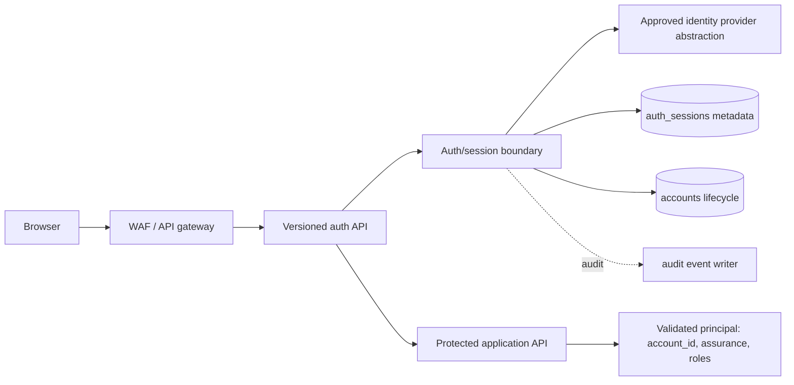
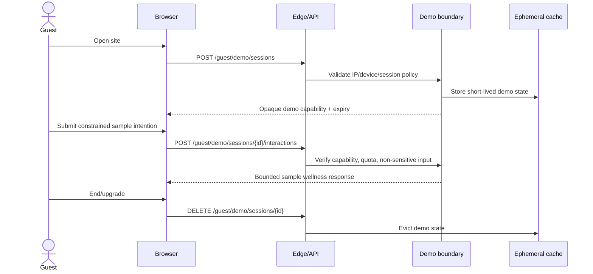
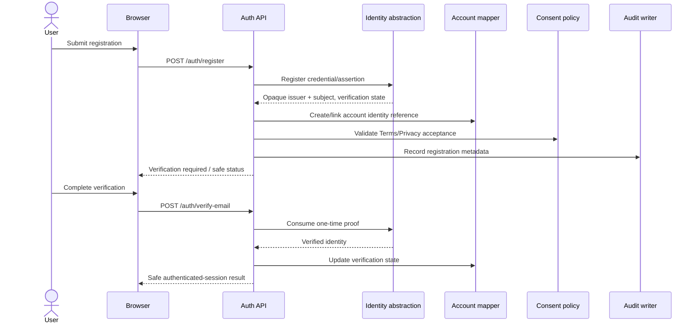
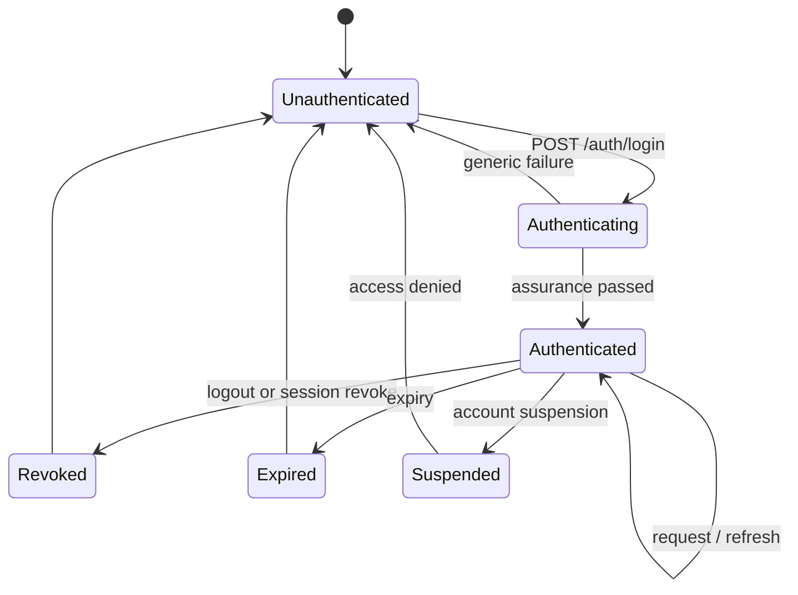

# NexusAI — API Authentication and Session Flow

**Document type:** Authentication contract and flow design  
**Phase:** Phase 07 — API Design  
**Status:** Approved — Phase 07 gate passed; Phase 08 through Phase 11 approved; Phase 12 Implementation Foundation/Project Initialization approved; Phase 13 Part 1 APPROVED; Phase 13 Part 2 AUTHORIZED / IN PROGRESS  
**Canonical product:** NexusAI — Personal AI Health & Wellness Companion  
**Related:** [07-api-design.md](07-api-design.md), [07-api-contract.md](07-api-contract.md), [07-api-security.md](07-api-security.md)

## 1. Authentication goals

The API must provide a secure, provider-replaceable identity boundary for guests, registered users, support/admin operators, workers, and future MFA. It must not turn the NexusAI database into a password vault or a raw-token store.

Confirmed constraints from the approved PRD/architecture/database design:

- Guest demo access is limited, ephemeral, rate-limited, and contains no durable private health profile or memory.
- Authenticated users receive an `account_id` principal and can access only their own records.
- `accounts.auth_issuer` + `accounts.auth_subject` stores an opaque identity reference, not a credential.
- `auth_sessions.session_token_hash` stores only a cryptographic verifier when server-side session metadata is used.
- Password reset, email verification, MFA secrets, and identity-provider credentials belong to the isolated auth boundary or approved identity provider.
- The provider, exact MFA baseline, credential modes, session lifetime, and recovery assurance remain `TBD / Pending Decision`.

## 2. Provider-neutral architecture



The public API depends on an `IdentityProvider` abstraction with operations such as `register`, `verify`, `authenticate`, `start_recovery`, `complete_recovery`, and optional `mfa_challenge`. These are interface concepts only; no SDK or provider is selected in this phase.

## 3. Principal and trust rules

After successful authentication, the auth boundary produces a server-validated principal:

```json
{
  "account_id": "opaque-uuid",
  "auth_issuer": "internal-or-approved-provider-alias",
  "auth_subject": "opaque-provider-subject",
  "session_id": "opaque-uuid",
  "assurance": "baseline",
  "roles": ["user"],
  "email_verified": true,
  "account_status": "active"
}
```

The browser cannot submit or override `account_id`, `roles`, `assurance`, `email_verified`, or `account_status`. The API rejects stale, revoked, expired, suspended, deleted, and purged principals before protected resource access.

## 4. Transport options and recommendation status

| Option | Strengths | Trade-off | Status |
| --- | --- | --- | --- |
| Secure session cookie | Natural for the responsive web MVP; HttpOnly prevents script token reads; server can revoke session metadata | Requires CSRF protection and careful same-site/origin policy | Recommended transport candidate; final baseline TBD |
| Bearer access token | Convenient for future mobile/integration clients; stateless edge validation possible | Token theft/revocation and browser storage risks; refresh design required | Supported abstraction; not selected |
| External identity redirect | Delegates credential/MFA assurance to provider | Residency, provider retention, account-linking, and recovery dependencies | Provider choice TBD |

The API contract accepts the final approved transport without changing `/api/v1` resource paths. Raw credentials and raw session/refresh tokens are never logged or stored by NexusAI.

## 5. Guest demo flow



Guest capability rules:

- It is opaque, short-lived, bound to an ephemeral session, and not interchangeable with an authenticated session.
- Guest interaction requests reject sensitive free text, durable memory, reminders, account-owned goals, and private progress.
- Demo content is not copied into `accounts`, `conversations`, `messages`, or `memory_records`.
- Exact TTL, quota, bot signals, and data expiry remain `TBD / Pending Decision`.

## 6. Registration and verification flow



Contract rules:

- Registration and recovery responses are enumeration-safe; the API does not confirm whether an email is already registered to an unauthenticated caller.
- Email is normalized before lookup and protected from logs/enumeration.
- Policy acceptance creates append-only `consent_records` with the published policy version; the API cannot accept an invented policy version.
- If registration creates an account before verification, the account remains restricted until the auth boundary marks it verified. Exact grace/purge behavior is a retention decision.
- Credential strength, breached-password checks, proof expiry, and email delivery are auth-boundary responsibilities.

## 7. Login and session lifecycle



Session requirements:

- Create a new session only after identity assurance passes.
- Store only `session_token_hash`, timestamps, status, and revocation metadata in `auth_sessions`.
- Never put raw tokens in URLs, logs, analytics, browser local storage, or database fields.
- Logout revokes the current session; “log out all” can be added as a later bounded action using the same session records.
- Refresh/rotation, idle timeout, absolute lifetime, concurrent-session cap, device metadata, and step-up triggers are `TBD / Pending Decision`.
- Session reads return status/timestamps only; they never return token material or provider references.

## 8. Recovery flow

1. `POST /auth/recovery/request` accepts a normalized email or provider-neutral identifier and always returns a generic `202` response.
2. The identity boundary sends the approved recovery challenge without exposing account existence.
3. `POST /auth/recovery/confirm` consumes a one-time proof and changes the credential/assertion at the identity boundary.
4. The auth service revokes affected sessions and records metadata-only audit events.
5. Recovery completion never returns a raw recovery token or credential.

The exact recovery factors, support override, recovery delay, and high-risk step-up policy remain TBD.

## 9. MFA and assurance hook

The API reserves an authentication assurance hook without enabling a specific MFA product:

- Principal includes an `assurance` value such as `baseline` or future `step_up_required`.
- Sensitive operations—account deletion, export download, memory clear/revoke, support access, and credential recovery—may require step-up authentication.
- A future `/api/v1/auth/mfa/*` route family may be added only after the MFA baseline, factor policy, recovery rules, and minimum-age/geography constraints are approved.
- No MFA secret, recovery code, or biometric data is added to the NexusAI database in Phase 07.

## 10. Role and authorization handoff

| Principal class | Intended routes | Default data scope |
| --- | --- | --- |
| Guest | `/guest/*` | Ephemeral demo only |
| User | `/me/*`, own auth/session routes | Own `account_id` |
| Support | `/support/*` | Narrow approved support scope, no private content by default |
| Admin | Privileged support/operations routes | Explicit role matrix; not unrestricted by default |
| Worker | `/internal/v1/*` callbacks/jobs | Specific job scope and service identity |
| Provider adapter | Egress from AI/notification boundary | Per-request minimized payload only |

The exact admin/support role matrix, break-glass approval, operator expiry, and audit requirements remain `TBD / Pending Decision`. A role claim alone never grants full chat or memory access.

## 11. Authentication error behavior

- Invalid credentials, unknown email, expired proof, and revoked session use safe generic messages.
- Locked/throttled authentication returns `429` with a bounded retry hint; it does not reveal account status.
- Missing/invalid session on protected routes returns `401 unauthenticated`.
- Suspended/deleted account returns a safe `403 account_unavailable` without exposing lifecycle internals.
- Provider outage returns `503 auth_dependency_unavailable` without provider details.
- All security-significant failures emit redacted audit/metric metadata with a request/correlation ID.

## 12. Open authentication decisions

- Authentication provider and supported login methods (email/password, external identity, passkey).
- Secure cookie versus bearer transport as the web baseline.
- MFA requirement, factor types, step-up operations, and recovery assurance.
- Session idle/absolute lifetime, rotation, revocation, and concurrent-session limits.
- Minimum age, age assurance, geography, residency, and provider regional processing.
- Support/admin recovery override and break-glass controls.

All remain `TBD / Pending Decision`; this document intentionally defines an abstraction rather than selecting a provider.
