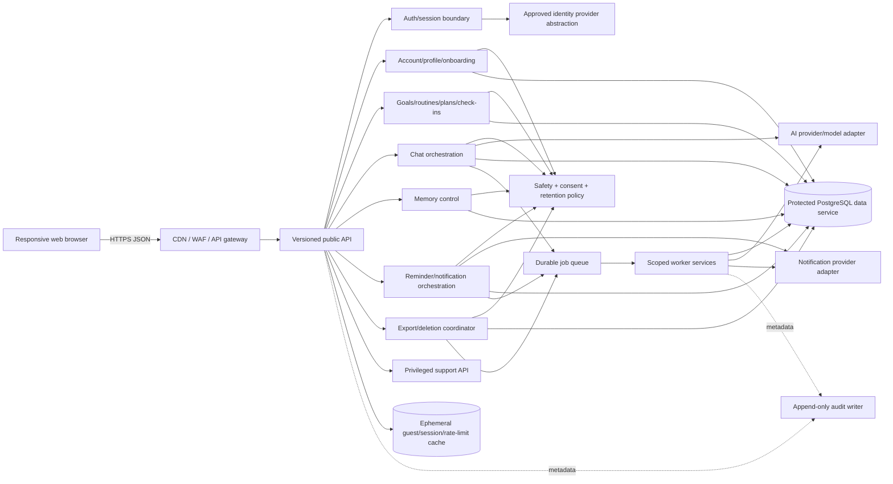
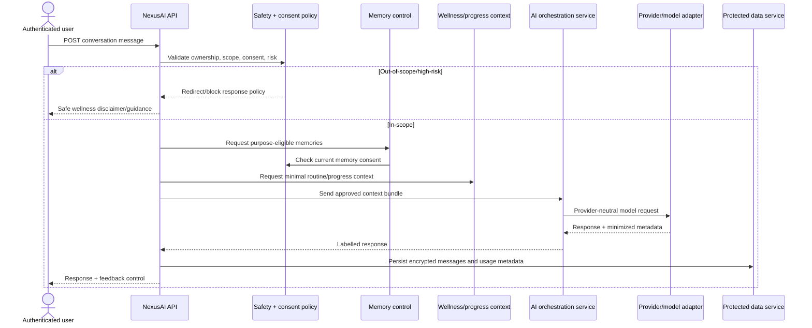

# NexusAI — API Design Specification

**Document type:** API architecture and contract overview  
**Phase:** Phase 07 — API Design  
**Status:** Approved — Phase 07 gate passed; Phase 08 through Phase 11 approved; Phase 12 Implementation Foundation/Project Initialization approved; Phase 13 Part 1 APPROVED; Phase 13 Part 2 AUTHORIZED / IN PROGRESS  
**Canonical product:** NexusAI — Personal AI Health & Wellness Companion  
**Date:** 2026-08-29  
**Scope:** Public web API, internal service boundaries, security, privacy, safety, and API governance. No backend implementation or API client code is created here.

## 1. Source of truth

This phase uses the approved documents below in order of authority:

1. [`00-project-overview.md`](00-project-overview.md) — product identity and mission.
2. [`01-product-discovery.md`](01-product-discovery.md) — problem, users, scope assumptions, and validation.
3. [`02-prd-nexus-ai-health-companion-mvp.md`](02-prd-nexus-ai-health-companion-mvp.md) — testable MVP requirements and non-goals.
4. [`03-system-architecture-outline.md`](03-system-architecture-outline.md) — trust boundaries, containers, and runtime flows.
5. [`04-architecture-review.md`](04-architecture-review.md) — architecture findings and gates.
6. [`05-database-design.md`](05-database-design.md), [`05-erd.md`](05-erd.md), [`05-data-dictionary.md`](05-data-dictionary.md), [`05-database-decisions.md`](05-database-decisions.md) — approved data ownership, fields, lifecycle, and privacy rules.
7. [`06-database-implementation.md`](06-database-implementation.md), [`06-ddl.md`](06-ddl.md), [`06-migration-strategy.md`](06-migration-strategy.md), [`06-database-validation.md`](06-database-validation.md) — approved physical database boundary.

If this API design conflicts with a higher-level document, the higher-level document wins. Unresolved product, legal, provider, authentication, retention, support-role, and safety decisions remain `TBD / Pending Decision`.

## 2. API outcomes and responsibilities

The API is the controlled boundary between the responsive web client and NexusAI application services. It must:

- expose the guest → registration → onboarding → daily wellness → progress → chat journey;
- authenticate users without storing raw passwords or session tokens in the NexusAI database;
- authorize every user-owned resource by the authenticated `account_id`;
- validate input and enforce wellness-only scope before data or AI actions;
- coordinate consent, Minimal Memory, reminders, lifecycle requests, and audit events;
- return safe, stable projections rather than database rows or provider payloads;
- provide asynchronous status for starter-plan generation, export, deletion, and memory-clear work;
- preserve AI-provider replaceability through an orchestration/adapter boundary;
- emit correlation, latency, usage, safety, and audit metadata without logging restricted content.

The API does not diagnose, prescribe, triage emergencies, store raw AI payloads, grant support access, or expose the database as a generic CRUD surface.

## 3. API architecture



### 3.1 Public versus internal boundaries

| Boundary | Intended caller | Allowed behavior | Not exposed |
| --- | --- | --- | --- |
| `/api/v1/public/*` | Browser/guest | Public policy copy and non-sensitive product information | Account data, private content |
| `/api/v1/guest/*` | Ephemeral guest session | Constrained demo only | Durable profile, memory, reminders, sensitive free text |
| `/api/v1/auth/*` | Browser | Registration, verification, sign-in, recovery, session control | Password storage, identity-provider secrets |
| `/api/v1/me/*` | Authenticated user | Own profile, wellness, planning, chat, memory, reminders, lifecycle | Other accounts, privileged operations |
| `/api/v1/support/*` | Approved support/admin identity | Least-privilege account status, consent status, usage/abuse signals, audit review | Full chat/memory by default |
| `/internal/v1/*` | Authenticated service/worker | Safety evaluation, worker callbacks, provider adapter operations | Browser access, arbitrary user impersonation |
| `/health/*` | Load balancer/operator | Liveness/readiness only | User data and dependency secrets |

## 4. Protocol and representation conventions

- **Base URL:** `/api/v1`; version is path-based for MVP clarity and future mobile/integration compatibility.
- **Transport:** HTTPS only in deployed environments; HTTP is not a supported production transport.
- **Media type:** `application/json`; file export download uses a short-lived signed URL or streamed response only after policy approval.
- **IDs:** opaque UUID strings; clients must not infer ordering or ownership from IDs.
- **Time:** timestamps are RFC 3339 UTC instants; calendar dates are user-local dates interpreted with the account timezone.
- **Naming:** JSON uses `snake_case` to match the approved data dictionary; database column names are never exposed directly when a safer projection is needed.
- **Pagination:** list endpoints use opaque `cursor` and bounded `limit` (server maximum; exact numeric maximum is an implementation decision). Cursors contain no sensitive content.
- **Request identity:** server returns `request_id`; clients may send a bounded `X-Request-Id` value that is validated and replaced if unsafe.
- **Idempotency:** state-changing/retryable operations accept `Idempotency-Key`; the key is scoped to the authenticated account and operation. Destructive and AI-send operations require it.
- **Caching:** only public, non-sensitive resources may be cached. User content, consent, memory, chat, and lifecycle status are `private, no-store` unless an explicit short TTL is approved.
- **Response projection:** API responses omit ciphertext, token hashes, provider references, internal classifier details, and unrestricted database metadata.

### 4.1 Success envelope

```json
{
  "data": {},
  "meta": {
    "request_id": "req_opaque",
    "next_cursor": null
  },
  "warnings": []
}
```

`data` may be an object, array, or `null`. `warnings` contains safe user-actionable notices and never stack traces or provider payloads.

### 4.2 Error envelope

The normative error structure is in [`07-api-error-handling.md`](07-api-error-handling.md).

```json
{
  "error": {
    "code": "validation_failed",
    "message": "One or more fields are invalid.",
    "details": [{"field": "timezone", "issue": "invalid_timezone"}],
    "request_id": "req_opaque",
    "retryable": false
  }
}
```

## 5. Authentication and authorization model

Authentication is provider-agnostic. The API accepts a principal produced by an approved identity/session abstraction; the final provider, MFA requirement, session lifetime, and recovery assurance remain `TBD / Pending Decision`.

- Guest requests carry an opaque, short-lived demo capability that maps only to ephemeral cache state.
- Authenticated browser requests may use a secure `HttpOnly`, `Secure`, `SameSite` session cookie or a bearer access token, subject to the later authentication decision. Raw token material is never persisted in the NexusAI database; only a hash is stored in `auth_sessions` where server-side session metadata is used.
- Every protected request resolves a principal containing `account_id`, authentication assurance, session state, and roles. Client-supplied account IDs are ignored for ownership decisions.
- User routes require an active account/session. Suspended, deleted, or purged accounts receive a safe authentication error and cannot access private content.
- Support/admin routes require a role claim issued by the trusted authorization boundary plus an auditable support-access decision where applicable. Exact role matrix and break-glass behavior remain TBD.
- Worker/internal routes require a separate service identity and narrow operation scope; a worker cannot impersonate a user without an explicit, audited job context.

Detailed flows and MFA hook are in [`07-api-authentication.md`](07-api-authentication.md).

## 6. Authorization and ownership rules

1. Every `/me/*` query is scoped from the authenticated principal’s `account_id`; an `account_id` request parameter is not accepted for user-owned resources.
2. Resource IDs are opaque and are checked together with ownership. A resource owned by another account is returned as `404 not_found` to reduce IDOR enumeration; the authorization failure is logged as metadata.
3. Nested relationships (task → plan/routine/goal, memory → consent/source message, safety/usage → conversation/message) are checked for same-account ownership before use.
4. A user cannot read or mutate another user’s profile, wellness context, goals, routines, plans, tasks, check-ins, conversations, messages, memories, reminders, exports, or deletion requests.
5. Support can view only the explicitly allowed scope. Full chat transcripts and memory values are denied by default, even when an operator can see account status.
6. Admin role does not automatically grant unrestricted content access. Exceptional access requires a reason, expiry, narrow scope, and audit event.
7. Consent and memory revocation are checked at request time; a historical `granted` event alone is insufficient.
8. Authorization failures never reveal whether a private message, memory, or account exists.

## 7. API domain and route inventory

The full operation-level contract is in [`07-api-contract.md`](07-api-contract.md). The catalog covers 13 domains and 77 route operations; CRUD rows may share one resource contract.

| Domain | Route family | Main database entities / boundary |
| --- | --- | --- |
| Public/policy | `/api/v1/public/*` | Published policy artifacts; no MVP business table |
| Guest demo | `/api/v1/guest/*` | Ephemeral cache only; no durable guest entity |
| Auth/session | `/api/v1/auth/*` | `accounts`, `auth_sessions`, external identity boundary |
| Account/profile | `/api/v1/me`, `/api/v1/me/profile`, `/api/v1/me/wellness-profile` | `accounts`, `user_profiles`, `wellness_profiles` |
| Consent | `/api/v1/me/consents/*` | `consent_records` append-only history |
| Goals/routines | `/api/v1/me/goals*`, `/api/v1/me/routines*` | `goals`, `routines` |
| Plans/tasks | `/api/v1/me/daily-plans*`, `/api/v1/me/tasks*` | `daily_plans`, `tasks` |
| Check-ins/progress | `/api/v1/me/check-ins*`, `/api/v1/me/progress` | `check_ins`, derived progress read model |
| Conversations/messages | `/api/v1/me/conversations*` | `conversations`, `messages`, `safety_events`, `ai_usage_events` |
| Memory | `/api/v1/me/memories*`, `/api/v1/me/memory-controls/*` | `memory_records`, `consent_records`, lifecycle requests |
| Reminders/notifications | `/api/v1/me/reminders*`, `/api/v1/me/notification-preferences` | `reminders`, `notification_preferences`, `notification_deliveries` |
| Privacy lifecycle | `/api/v1/me/data-requests*` | `data_lifecycle_requests`, protected export store |
| Usage/support | `/api/v1/me/usage`, `/api/v1/support/*` | `ai_usage_events`, `support_access_events`, `audit_events` |

No payment, clinical, wearable, location, social, household, or organization API is part of V1.

Onboarding is intentionally a composed client journey rather than a second aggregate endpoint: the web client submits profile, wellness, consent, goals, routine, and notification-preference changes through the canonical `/me/*` routes, then requests the starter plan through `/me/daily-plans`. This avoids duplicate write semantics while preserving the architecture’s Profile/onboarding boundary.

## 8. AI interaction boundary



The public API exposes provider-neutral fields (`model_class`, `response_mode`, usage summary) and never exposes provider credentials, raw request/response payloads, hidden prompts, or provider-specific business identifiers.

## 9. Memory API boundary

- Memory is off by default unless the latest applicable consent is granted.
- Candidate memories are ephemeral and represented by an opaque, expiring candidate ID; they are not a durable database entity until the user approves them.
- Durable memory responses show category, purpose, status, approval/source timestamps, and a user-readable value only to the owner.
- Fingerprints, ciphertext, policy internals, and other users’ data are never returned.
- Approve/edit/delete/clear/revoke operations require ownership, current consent checks, `Idempotency-Key`, and audit metadata.
- The memory-control convenience routes delegate to the canonical consent/lifecycle workflows; they do not create a second memory store or alternate deletion path.
- Revocation immediately removes memory from future context assembly and schedules cleanup of caches, queues, derived copies, exports, and provider-boundary work according to the still-TBD deletion policy.
- Account deletion disables retrieval first and then processes memory as part of the lifecycle request.

## 10. Safety API boundary

- Safety checks run before and after every AI provider call; the browser cannot bypass them.
- The client receives a safe response mode (`wellness`, `redirect`, or `blocked`) and reviewed guidance copy, not internal classifier scores or raw policy rules.
- Diagnosis, treatment, prescription/dosage, emergency treatment, self-harm, severe-symptom, and other high-risk requests are redirected or blocked according to the versioned safety policy.
- The API never claims to contact emergency services or a clinician.
- Persisted `safety_events` contain metadata only. Raw prompts are excluded by default.
- Internal safety-evaluation routes are service-authenticated and are not browser endpoints.
- Safety-policy owner, escalation authority, jurisdiction-specific copy, and release approval remain `TBD / Pending Decision`.

## 11. Notifications and asynchronous work

- In-app reminders are the only enabled MVP delivery channel in the approved DDL; email/push/SMS routes remain unavailable until separate consent/provider approval.
- Reminder creation stores intent; delivery outcomes are read-only operational projections.
- Starter-plan generation, export, deletion, memory-clear, and delivery work may return `202 Accepted` with a lifecycle/job reference.
- Jobs use idempotency keys, bounded retries, leases, dead-letter handling, and current consent checks.
- A successful check-in does not depend on AI or notification provider availability.

## 12. Rate-limit classes

Exact numeric limits are `TBD / Pending Decision` pending abuse testing, beta scale, and cost budgets. The contract uses named classes so the values can change without changing paths.

| Class | Applies to | Required behavior |
| --- | --- | --- |
| `public-low` | Policy/product pages | Cache-safe; protect against scraping |
| `guest-strict` | Demo session creation/interactions | Per-IP + per-ephemeral-session; no persistence bypass |
| `auth-strict` | Register/login/verify/recovery | Per-IP + account/email signal; generic failure messages |
| `user-standard` | Profile, goals, routines, plans, check-ins | Per-account and per-IP; return `429` with retry metadata |
| `ai-interactive` | Chat message send | Per-account, IP, and cost budget; circuit breaker on provider failure |
| `expensive-lifecycle` | Export/delete/memory-clear | Strong per-account serialization; idempotency required |
| `support-restricted` | Support/admin routes | Role, operator, and anomaly limits; every action audited |

## 13. Observability requirements

- Return a server-generated `request_id` on every response and propagate a bounded `correlation_id` through services/jobs.
- Structured logs record route template, method, status, latency, dependency outcome, policy version, coarse error code, and account-safe correlation metadata.
- Never log passwords, session secrets, bearer tokens, encrypted values, raw health/chat/reflection text, memory values, provider payloads, export URLs, or full request bodies.
- Metrics cover request latency/error rate, auth abuse, authorization failures, AI latency/timeouts, safety actions, queue age, notification outcomes, lifecycle completion/failure, and database constraint errors.
- AI usage telemetry uses the approved `ai_usage_events` projection: provider alias/model class, coarse units, latency, and safety-policy version only.
- Audit events cover authentication, consent, memory changes, export/deletion, support access, safety outcomes, and security-sensitive mutations.
- Traces must redact content-bearing attributes and use sampling/access controls appropriate for restricted data.

## 14. Privacy and data handling

- Return only the minimum projection needed by the requesting screen.
- Do not include sensitive content in notification previews, URLs, query strings, analytics labels, or error messages.
- Use `Cache-Control: private, no-store` for user content and lifecycle responses unless an explicit exception is approved.
- Export endpoints return only the policy-approved scope and use expiring protected artifacts.
- Account deletion/revocation APIs return workflow status; they do not claim provider/backup deletion before verified evidence exists.
- CORS, CSRF, cookie, origin, and regional processing settings depend on the unresolved authentication/geography decisions and must be finalized before beta.

## 15. Future integration boundaries

Future calendar, wearable, finance, education, household, or external automation integrations must use separate versioned namespaces and consented adapter contracts. They must not add arbitrary fields to wellness profiles or expose provider identifiers as core business keys. No future integration endpoint is active in V1.

## 16. API design decisions and unresolved items

### Confirmed design choices

- Versioned REST-style JSON paths under `/api/v1`.
- `/me` ownership model for normal user operations.
- Cursor pagination and opaque identifiers.
- `Idempotency-Key` for AI send and lifecycle mutations.
- Provider-neutral AI contract and internal-only provider adapter boundary.
- Safety/consent policy gates before persistence and provider calls.
- In-app reminders only for current MVP API exposure.
- Metadata-only audit/usage/safety records.

### `TBD / Pending Decision`

- Launch geography, jurisdiction, and minimum age/age assurance.
- Authentication provider, cookie versus bearer baseline, MFA requirement, session lifetime/rotation, and recovery assurance.
- Exact RBAC/support role matrix and break-glass process.
- AI provider/model, retention/training use, regional processing, and provider-side deletion guarantees.
- Memory revocation/deletion propagation evidence across caches, queues, exports, providers, and backups.
- Safety-policy owner, escalation authority, jurisdiction-specific copy, and release governance.
- Exact numeric rate limits, quotas, beta scale, cost budget, and SLO/RTO/RPO.
- Final reminder channels and recurrence semantics.

## 17. Phase boundary

**HISTORICAL SNAPSHOT — NOT CURRENT PROJECT STATUS**

> This document defines API shape and boundaries only. It does not create controllers, routers, OpenAPI generation code, SDKs, database migrations, backend/frontend code, prompts, or deployment configuration. Phase 07 through Phase 11 have passed their documentation gates. Phase 12 Implementation Foundation / Project Initialization Part 2 is complete and Final Review is in progress.

**Current project status:** Phases 04–12 APPROVED; Phase 13 Part 1 APPROVED; Phase 13 Part 2 AUTHORIZED / IN PROGRESS.
