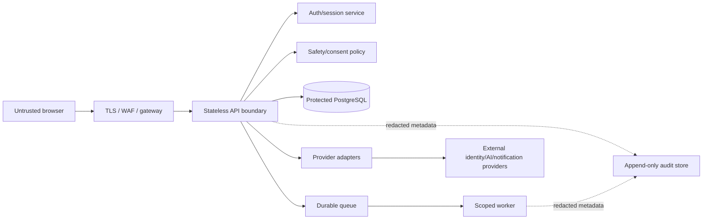

# NexusAI — API Security and Privacy Controls

**Document type:** API threat controls and security requirements  
**Phase:** Phase 07 — API Design  
**Status:** Approved — Phase 07 gate passed; Phase 08 through Phase 11 approved; Phase 12 Implementation Foundation/Project Initialization approved; Phase 13 Part 1 APPROVED; Phase 13 Part 2 AUTHORIZED / IN PROGRESS  
**Canonical product:** NexusAI — Personal AI Health & Wellness Companion  
**Related:** [07-api-design.md](07-api-design.md), [07-api-contract.md](07-api-contract.md), [07-api-authentication.md](07-api-authentication.md), [07-api-error-handling.md](07-api-error-handling.md)

## 1. Security objectives

The API protects personal account data, restricted wellness content, encrypted chat/reflections/memory, consent history, and security/audit metadata while preserving the MVP’s wellness-only boundary. Security decisions must be enforceable at the server boundary; client controls are hints only.

## 2. Trust boundaries

No external provider, browser, support operator, worker, or queue payload is implicitly trusted. Each boundary receives the minimum context required for one operation.

## 3. Authentication and session controls

- Use the approved identity/session abstraction; provider and MFA baseline remain TBD.
- Require TLS in deployed environments and reject insecure origin/scheme combinations.
- Prefer a secure `HttpOnly`, `Secure`, `SameSite` session cookie for the web MVP if approved; if bearer tokens are selected, never store them in browser local storage by default.
- Store only session-token hashes and lifecycle metadata in `auth_sessions`; never raw passwords, reset proofs, access tokens, refresh tokens, API keys, or MFA secrets.
- Rotate/revoke sessions after logout, recovery, suspected takeover, account suspension, or step-up failure.
- Enforce authentication assurance before account deletion, export download, memory clear/revoke, support access, and credential recovery when policy requires it.
- Use generic login/recovery responses to prevent email/account enumeration.
- Apply anti-automation controls at the edge and auth boundary; exact thresholds are TBD.

## 4. Authorization and IDOR prevention

### Required request policy

1. Resolve `account_id` only from the validated principal, never from a request body, query string, or path supplied as an ownership override.
2. Scope every database read/write by both resource ID and owner/account context.
3. For nested resources, validate the complete ownership chain (for example, task → plan/routine/goal and message → conversation).
4. Return `404 not_found` for non-owned resource IDs where revealing existence would aid enumeration.
5. Deny suspended, deleted, and purged accounts before reading restricted data.
6. Re-check current consent for memory, personalization, reminder channels, and exports at the point of use.
7. Require a new idempotency key for a different destructive operation; do not treat a client retry as a new authorization decision.

### Privileged access

- `/support/*` is separate from `/me/*` and requires a trusted operator identity, role, narrow scope, reason, expiry, and audit event.
- Account status, consent status, usage/abuse signals, and audit metadata are the default support projections.
- Full conversation transcripts, message content, memory values, reflections, and encrypted context are denied by default.
- A role claim is not sufficient for break-glass access. The exact admin/support role matrix, approvals, and expiry are `TBD / Pending Decision`.
- Internal worker/service identities cannot call browser routes or arbitrarily impersonate users.

## 5. Input validation and request hardening

- Enforce JSON content type, body-size limits, header-size limits, path/query allow-lists, and bounded pagination.
- Normalize Unicode and email before comparison; trim user-entered names/titles/reasons; reject control characters where not needed.
- Validate UUID syntax, date/time formats, IANA timezone values, paired quiet hours, lifecycle states, recurrence/schedule object shape, and same-account references.
- Treat all free text as untrusted. Reject or safely redirect diagnosis, medication/dosage, treatment, emergency, self-harm, and other high-risk content according to the safety policy; do not rely on keyword filtering alone.
- Use parameterized queries/data-access APIs; never interpolate path, query, JSON, or provider values into SQL or shell commands.
- Reject duplicate JSON keys, unknown fields where a closed schema is required, and oversized nested structures.
- Apply optimistic concurrency/state-transition checks to mutable resources; do not let clients set audit timestamps, owner IDs, policy decisions, or lifecycle completion timestamps.
- Validate `Idempotency-Key` length/charset and bind it to account, route, and normalized request digest.

## 6. Browser, CORS, and CSRF controls

- Allow only approved production origins; exact origin list is a deployment decision.
- If cookie authentication is used, require CSRF protection for every state-changing `/api/v1` route and verify `Origin`/`Referer` where appropriate.
- If bearer authentication is used, still enforce strict CORS, origin policy, token audience/issuer, and replay protection.
- Do not permit credentialed wildcard CORS, JSONP, cross-origin token reflection, or sensitive data in GET query strings.
- Set secure headers at the edge: HSTS, content security policy for the web app, frame-ancestors protection, referrer policy, and MIME sniffing protection as applicable.
- Do not cache user content, memory, chat, consent, or lifecycle responses in shared browser/CDN caches.

## 7. Rate limiting and abuse protection

Use named rate classes from [07-api-design.md](07-api-design.md): `public-low`, `guest-strict`, `auth-strict`, `user-standard`, `ai-interactive`, `expensive-lifecycle`, and `support-restricted`.

- Combine per-IP, per-account, per-session, and operation-cost signals where lawful and privacy-reviewed.
- Fail safely when the rate-limit cache is unavailable; do not disable abuse protection silently.
- Apply stricter limits to login, recovery, guest interactions, AI message sends, export/delete, memory clear, and support access.
- Return `429` with a safe retry hint; do not reveal internal thresholds or account existence.
- Detect automation, credential stuffing, ID enumeration, prompt abuse, cost spikes, and repeated lifecycle retries.
- Exact numerical limits, retention of abuse signals, and jurisdiction-specific controls remain TBD.

## 8. AI-specific security boundary

- Run pre-call and post-call safety/policy evaluation; the browser cannot select a provider, model, system prompt, or safety bypass.
- Build a minimal context bundle from current message, approved routine/progress data, and consent-eligible memory only.
- Treat user content, retrieved memory, and provider output as untrusted data; defend against prompt injection and instruction-confusion by keeping policy/system instructions outside user-controlled context.
- Strip direct identifiers and unnecessary metadata from provider requests where practical.
- Use provider-neutral `provider_alias`/`model_class` telemetry; never expose provider credentials, raw payloads, hidden prompts, or raw upstream errors.
- If the provider fails, return a stable `503/504` error and preserve independent wellness features; do not fabricate an assistant message.
- Do not use private user content for model training without separate explicit consent; provider retention/training contract is TBD.

## 9. Memory and consent security

- Memory retrieval and writes require current consent and purpose compatibility on every operation.
- Candidate IDs are short-lived, opaque, bound to the authenticated session, and unusable after expiry or consent revocation.
- Never expose fingerprints, ciphertext, hidden source context, or another account’s memory.
- Edit/delete/clear/revoke operations require ownership, validation, idempotency, and audit metadata.
- Revocation must fail closed immediately for new retrieval/writes, then enqueue cleanup of caches, queues, derived context, exports, provider work, and backups according to approved policy.
- Memory content must not appear in URLs, notifications, logs, analytics labels, support dashboards, or error details.

## 10. Sensitive data and privacy controls

| Data | API handling |
| --- | --- |
| Email/account identity | Normalize and minimize; protect enumeration; never include in logs by default |
| Wellness context/goals/check-ins | Owner-only projections; encrypt restricted fields; no clinical inference |
| Reflections/messages/memory values | Ciphertext at rest; decrypt only after authorization; no raw telemetry/logs |
| Consent history | Append-only projection; return only relevant owner/support scope |
| Tokens/passwords/proofs | Never persist in NexusAI; hash/session abstraction only |
| Provider payloads | Do not persist unless a later approved requirement explicitly proves necessity |
| Export artifacts | Opaque protected references, short-lived access, no public URL |
| Audit/safety/usage | Metadata-only, append-only where required, bounded access and retention |

Apply `Cache-Control: private, no-store` to restricted responses. Data export and deletion must cover primary data, caches, queues, replicas, backups, temporary artifacts, and provider copies according to the still-TBD retention policy.

## 11. Audit and observability security

- Audit authentication events, consent changes, memory changes, support access, safety outcomes, export/delete requests, authorization failures, and security-sensitive mutations.
- Audit payloads contain event type, actor/subject references, outcome, policy version, correlation/request IDs, and timestamps—not raw message, memory, reflection, prompt, token, or provider data.
- Make consent, safety, support-access, and audit history append-only/tamper-evident as specified in the approved DDL.
- Redact query strings, request bodies, headers, cookies, encrypted bytes, email, identifiers, and provider payloads in logs/traces.
- Monitor auth abuse, IDOR test failures, permission denials, unsafe-response evaluations, provider outages, queue backlog, lifecycle failures, and unusual support access.
- Restrict log/trace access using least privilege and retain only as long as an approved policy permits.

## 12. Threat-to-control matrix

| Threat | Primary control | Verification |
| --- | --- | --- |
| IDOR/cross-account read | Principal-derived ownership scope + composite data checks + 404 masking | Automated negative tests for every user-owned route |
| Session theft/replay | Secure transport, HttpOnly cookie/bearer policy, rotation/revocation, expiry | Auth/session integration tests and incident playbook |
| Credential stuffing | Auth strict limits, generic responses, anomaly signals, MFA hook | Load/abuse tests; exact thresholds TBD |
| CSRF/CORS abuse | CSRF token/origin checks or strict bearer/CORS policy | Browser security tests |
| Prompt injection/provider exfiltration | Minimal context, policy boundary, provider adapter, redaction | Red-team prompt/context tests |
| Unwanted memory persistence | Consent gate, candidate confirmation, idempotent revoke/delete | Memory lifecycle tests |
| Sensitive log leakage | Structured allow-list and redaction | Log snapshot scanning/CI tests |
| Support overreach | Separate routes, narrow scope, reason/expiry, audit | Role matrix and break-glass tests |
| Replay/duplicate destructive work | Account-scoped idempotency keys and lifecycle state machine | Retry/concurrency tests |
| Provider outage/fabrication | Adapter timeout/circuit breaker, stable errors, no fake response | Dependency failure tests |

## 13. Security decisions still pending

- Authentication provider, cookie/bearer baseline, MFA requirement, recovery assurance, session lifetime, and rotation.
- Launch geography, minimum age, privacy jurisdiction, and regional processing.
- Admin/support role matrix and break-glass access.
- AI provider retention/training contract and deletion guarantees.
- Exact memory/account deletion propagation, backup exceptions, legal holds, and retention windows.
- Numeric rate limits, abuse-signal retention, CORS origin list, and deployment security headers.

These remain `TBD / Pending Decision`; this security specification does not invent them.
