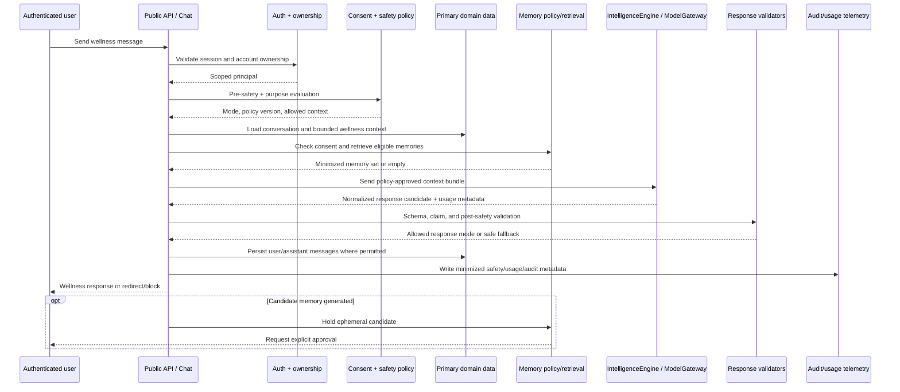
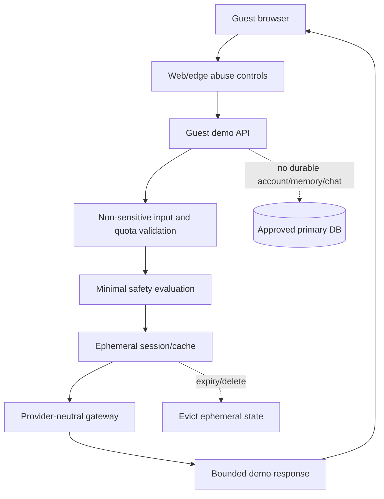
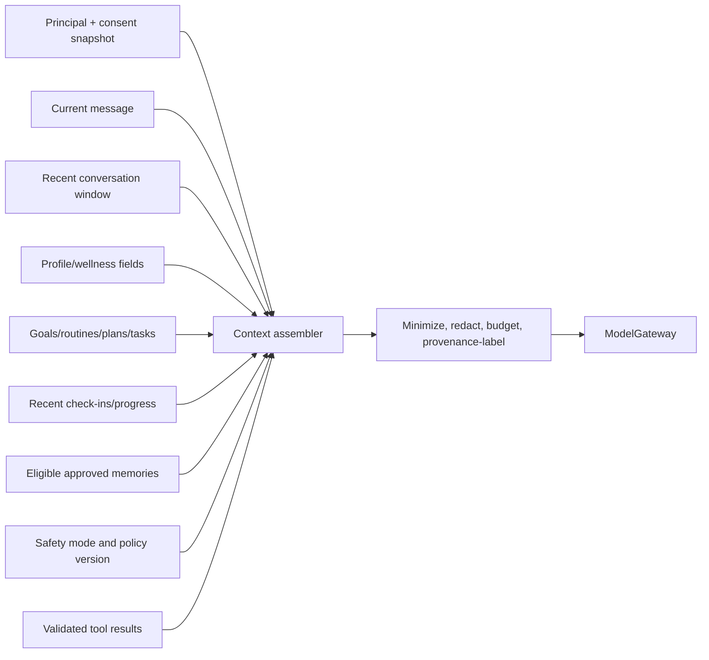
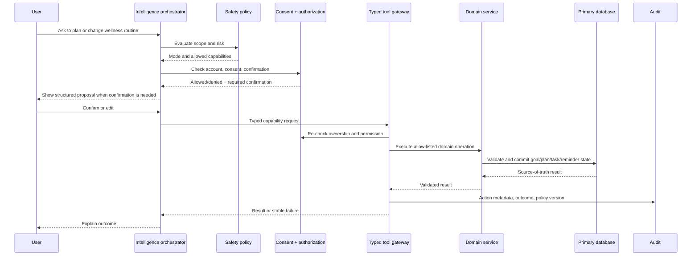
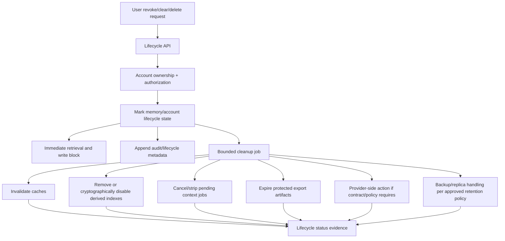

# NexusAI — AI and Personalization Data Flow

**Document type:** Phase 08 end-to-end AI, memory, planning, safety, provider, and lifecycle data-flow specification  
**Phase:** Phase 08 — AI Brain, Personal Memory & Intelligence Architecture  
**Status:** Approved — Phase 08 gate passed; Phase 09 through Phase 11 approved; Phase 12 Implementation Foundation/Project Initialization approved; Phase 13 Part 1 APPROVED; Phase 13 Part 2 AUTHORIZED / IN PROGRESS  
**Canonical product:** NexusAI — Personal AI Health & Wellness Companion  
**Date:** 2026-08-29  
**Scope:** Conceptual data movement and trust boundaries. No data pipeline, queue, model, API, or infrastructure implementation is created.

## 1. Flow objectives

Every AI path must answer four questions before data moves:

1. Who is the principal and owner of the data?
2. What purpose and current consent allow this use?
3. Which minimum fields are needed for this operation?
4. What policy, safety, retention, and deletion controls apply to every copy?

The primary data store and approved domain services remain authoritative. Caches, queues, retrieval indexes, summaries, provider payloads, and exports are derived or transient copies with explicit invalidation and retention behavior.

## 2. End-to-end authenticated chat flow



The model does not receive raw credentials, arbitrary account IDs, unrestricted history, hidden prompts, or unrelated user data. If memory is disabled, the memory branch returns an empty set while chat remains available using current conversation and explicitly available session context.

## 3. Guest demo flow

Guest requests use a separate ephemeral boundary:



Guest input must not enter authenticated conversations, memory, reminders, or progress. The demo accepts only constrained non-sensitive wellness intent and expires/evicts state according to the approved API policy. Exact TTL and quotas remain TBD.

## 4. Context assembly flow



The assembler excludes fields that fail ownership, consent, purpose, sensitivity, lifecycle, relevance, or context-budget checks. It may substitute a redacted or aggregate representation. A provider receives the result of this policy decision, not a raw database query.

## 5. Planning and tool flow



The model cannot call a database, shell, filesystem, arbitrary network, credential store, or provider secret. A capability is denied if authorization, consent, safety mode, schema, lifecycle, quota, or confirmation requirements fail.

## 6. Memory candidate and approval flow

```mermaid
sequenceDiagram
    participant MSG as Allowed interaction
    participant GEN as Candidate generator
    participant POL as Safety/privacy policy
    participant UI as User memory review
    participant DB as memory_records + consent_records
    participant LIFE as Lifecycle worker

    MSG->>GEN: Optional bounded source reference
    GEN->>POL: Check category, purpose, sensitivity, and current consent
    POL-->>GEN: Candidate allowed or discard
    GEN-->>UI: Ephemeral candidate with explanation
    UI->>POL: Approve, reject, or edit
    POL-->>UI: Confirm decision is permitted
    UI->>DB: Store approved purpose-bound memory + consent evidence
    UI->>LIFE: Audit and optional derived-index update
    LIFE-->>UI: Safe status; no premature provider/backup purge claim
```

Rejected candidates remain ephemeral and are not added to `memory_records`. Approved values are encrypted and bounded. The source message is referenced, not copied. Approval never means the model is trained on the value.

## 7. Revocation, clear, and account deletion flow



The synchronous path prevents future use immediately. The asynchronous path records evidence for each derived copy. Provider, backup, legal-hold, and regional deletion guarantees remain unresolved until a policy and operational control are approved.

## 8. Data classification and movement rules

| Data | Classification | Allowed movement | Prohibited default movement |
| --- | --- | --- | --- |
| Account/session identifiers | Personal/security | Auth and ownership services; opaque correlation | Provider prompts, logs, notifications |
| Profile/wellness fields | Personal/restricted wellness | Purpose-specific context after consent/policy | Unrelated provider calls, metrics labels |
| Goals/plans/tasks/check-ins | Restricted wellness | Planning/progress context for the same account | Cross-account access, unrestricted support views |
| Chat messages | Restricted wellness | Current conversation and approved bounded context | Raw logs, provider telemetry, support by default |
| Approved memory values | Restricted wellness/security | Eligible retrieval for stated purpose | Unconsented retrieval, notification text, raw telemetry |
| Safety metadata | Restricted security | Safety/audit/operations with least privilege | Classifier scores or raw content to clients |
| Provider usage metadata | Operational | `ai_usage_events`, metrics, cost controls | Prompts, completions, credentials |
| Tool results | Depends on source | Validated downstream context/action response | Unvalidated model context or durable copies by default |

## 9. Observability data flow

Telemetry should include request/correlation ID, route/operation class, latency, outcome/error class, policy/safety version, provider alias/model class, bounded usage units, and tool/memory validation outcome. It must omit raw user content, full prompt/response, memory values, secrets, and provider payloads by default.

Safety and lifecycle events use the approved `safety_events`, `audit_events`, `support_access_events`, `data_lifecycle_requests`, and `ai_usage_events` boundaries. Telemetry is not a second user-content store.

## 10. Cost and performance data flow

- Filter and summarize context before model calls.
- Use deterministic services for CRUD, consent, deletion, progress aggregation, and validation.
- Route simple requests to an appropriate approved capability and reserve expensive reasoning for structured planning or complex wellness conversations.
- Queue non-interactive summaries, candidate review preparation, plan generation, delivery, and cleanup.
- Cache only policy artifacts or explicitly approved derived data, with consent/version invalidation.
- Enforce named rate-limit classes and per-operation budgets; numeric values remain TBD.

## 11. Failure paths

| Failure point | Data-flow response |
| --- | --- |
| Auth/ownership failure | Stop before context loading; return safe API error |
| Consent unavailable | Use empty memory/context or fail closed for the operation |
| Safety unavailable | Block high-risk generation, memory write, and tool use; preserve independent features |
| Provider timeout | Discard incomplete result, expose safe temporary-unavailability state, preserve idempotency |
| Output validation failure | Do not display/persist unsafe response; use reviewed fallback |
| Tool partial failure | Preserve source-of-truth state and report eventual status; do not blind replay |
| Memory store failure | Do not claim memory saved; keep candidate ephemeral |
| Lifecycle cleanup failure | Keep retrieval blocked and lifecycle status incomplete until evidence exists |

## 12. Future data-flow extensions

Future search, calendar, wearable, notification, or proprietary-model integrations must attach to explicit adapter boundaries. Each new flow requires a data inventory, consent purpose, minimization rule, retention/deletion path, authorization scope, safety review, and audit design. A new provider must not receive historical data merely because it is technically available.

## 13. Open decisions

- Provider/model, regional processing, retention/training, and provider deletion contracts.
- Exact memory/retrieval cache/index approach and retention.
- Account/memory deletion propagation evidence for queues, exports, providers, replicas, and backups.
- Launch geography, minimum age, age assurance, and escalation copy.
- Notification channels, recurrence, quota, and cost/latency budgets.

All remain `TBD / Pending Decision`.

## 14. Phase boundary

This is a data-flow architecture document. It does not create ETL/pipeline code, queue workers, provider integrations, vector deployment, model training, API implementations, or production infrastructure.
