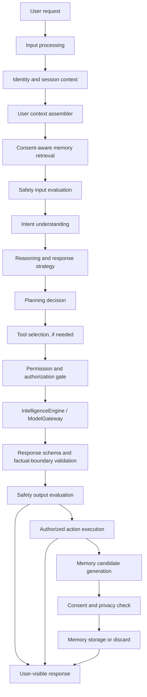
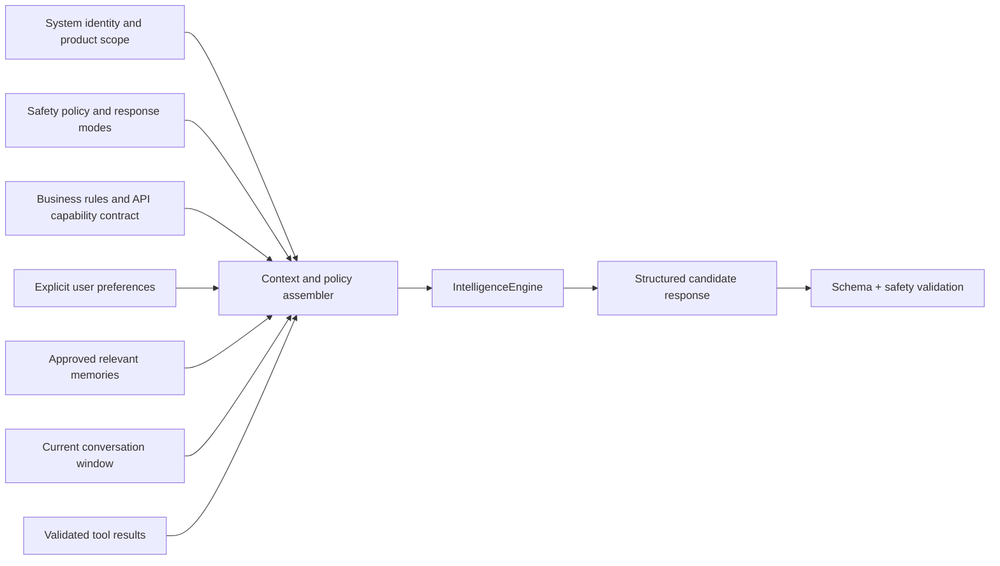

# NexusAI — AI Intelligence Architecture

**Document type:** Phase 08 conceptual AI, personalization, memory, planning, and intelligence architecture  
**Phase:** Phase 08 — AI Brain, Personal Memory & Intelligence Architecture  
**Status:** Approved — Phase 08 gate passed; Phase 09 through Phase 11 approved; Phase 12 Implementation Foundation/Project Initialization approved; Phase 13 Part 1 APPROVED; Phase 13 Part 2 AUTHORIZED / IN PROGRESS  
**Canonical product:** NexusAI — Personal AI Health & Wellness Companion  
**Date:** 2026-08-29  
**Scope:** Architecture and policy boundaries only. No model training, inference implementation, API implementation, vector deployment, or production infrastructure is defined here.

## 1. Source of truth and design intent

The approved Phase 00–07 documents remain authoritative for product scope, safety boundaries, database entities, DDL, and public API behavior. This document adds the intelligence-layer design needed to fulfill those contracts. It must not widen the MVP into a clinical product or silently resolve any decision marked `TBD / Pending Decision` in the earlier documents.

The long-term direction is a proprietary NexusAI Brain. The MVP does **not** contain a proprietary foundation model and does not claim to have trained one. The stable application boundary is:

```text
Current external/provider model
            ↓
NexusAI Intelligence Layer
            ↓
Future proprietary NexusAI Brain (replaceable engine)
```

The intelligence layer owns orchestration, context policy, memory policy, safety gates, planning, tool permissions, provider abstraction, and response validation. Product services remain the source of truth for accounts, goals, plans, tasks, check-ins, reminders, consent, and lifecycle operations.

## 2. Goals and non-goals

### Goals

- Turn a bounded user request into safe, useful, non-diagnostic wellness guidance.
- Personalize responses only with current, consented, purpose-compatible context.
- Treat memory as an explicit user-controlled capability, not an automatic transcript archive.
- Coordinate goals, daily plans, tasks, routines, check-ins, progress, and reminders without allowing autonomous consequential actions.
- Keep safety and privacy decisions independent of any model/provider.
- Allow the model/provider to be replaced without rewriting business logic or the public API.
- Create measurable boundaries for quality, cost, latency, safety, and failure handling.

### Non-goals for the MVP

- Diagnosis, treatment, triage, prescription, dosage determination, or emergency response.
- Automatic training of a model from conversations.
- Unrestricted long-term personal memory or cross-domain life logging.
- Autonomous external actions, calendar writes, purchases, messages, or healthcare decisions.
- A proprietary foundation model, custom model weights, or model-hosting platform.
- A mandatory vector database or a specific embedding provider.

## 3. Core separation of responsibilities

| Concern | Owns | Must not own |
| --- | --- | --- |
| Conversation | Turn order, message lifecycle, user-visible response | Hidden policy text, raw provider payloads, business truth |
| Reasoning | Interpreting a bounded request and choosing a response strategy | Clinical conclusions, permission grants, irreversible actions |
| Planning | Drafting goals/plans/tasks/routine adjustments for user review | Silent plan activation or sensitive execution |
| Memory | Candidate generation, consent, storage, retrieval eligibility, revocation | Remembering everything or inferring hidden attributes |
| Safety | Scope/risk classification, response mode, escalation guidance, fail-closed decisions | Invented medical protocols or emergency dispatch |
| Tool execution | A narrowly defined capability with authorization and validation | General system access or arbitrary code execution |
| User preferences | Explicit profile and communication settings | Inferred permanent preferences without consent |
| Long-term context | Approved, purpose-bound summaries derived from allowed sources | Raw unrestricted history |
| AI model/provider | Generate/analyze within a gateway contract | Account authorization, consent, retention promises, or policy ownership |
| Application business logic | Database truth, state transitions, ownership, quotas, lifecycle | Direct provider calls or model-specific assumptions |

## 4. Conceptual intelligence pipeline



The arrows describe policy gates, not a promise that every request uses every stage. For example, a simple task-completion check-in may skip model reasoning; a memory-disabled conversation skips retrieval and memory storage; a safety-blocked request stops before ordinary generation.

## 5. Layer responsibilities

### 5.1 Input processing

Input processing accepts only the fields allowed by the API contract. It applies size, encoding, content-type, locale/timezone, and abuse checks before the text reaches an intelligence engine. It normalizes metadata without rewriting the user’s meaning, assigns a correlation/request identifier, and labels whether the request came from a guest or authenticated session.

Raw input is restricted wellness content. It must not be copied into logs, metrics labels, provider telemetry, or memory candidates merely because it passed validation.

### 5.2 Identity and session context

The authenticated principal is derived from the approved auth/session boundary. The intelligence layer receives a scoped principal reference and account ownership facts, not raw credentials or session-token material. Guest sessions receive only the ephemeral capability and quota context required for the demo.

The layer does not infer authorization from a model response. It asks the application authorization service whether the principal may read, write, plan, remind, or invoke a tool.

### 5.3 User context assembler

The assembler creates a request-specific context bundle from approved sources:

- minimal profile fields and communication preferences;
- current wellness profile, where permitted;
- active goals, routines, daily plan, tasks, and recent check-ins;
- current conversation messages within the context budget;
- approved memory records whose consent, purpose, status, sensitivity, relevance, confidence, and expiry checks pass;
- reviewed safety/policy version and product scope rules;
- validated tool results, if a tool was already authorized and executed.

It must not create a second canonical profile, expose arbitrary account IDs, or pass unbounded history to a provider.

### 5.4 Memory retrieval

Retrieval is a policy-controlled read, not a database query made by the model. It first checks current consent and lifecycle state, then filters by purpose, category, sensitivity, expiration, and account ownership. A relevance ranker may combine semantic similarity, recency, importance, explicit user preference, confidence, and context fit. Exact weighting and any embedding technology remain implementation decisions, not Phase 08 commitments.

### 5.5 Safety input evaluation

Safety evaluates scope and risk before ordinary intent handling. It may select `NORMAL`, `WELLNESS_REDIRECT`, `SAFETY_ESCALATION`, or `BLOCKED`. A policy outage fails closed for memory writes and high-risk AI calls. Safety records contain minimized metadata in `safety_events`; they do not require raw prompt persistence.

### 5.6 Intent, reasoning, and planning

Intent understanding maps the request to a bounded product capability, such as wellness guidance, goal update, plan suggestion, task completion, reminder request, memory control, or unsupported/high-risk content. Reasoning selects a response strategy and identifies facts or tool results required. Planning creates a proposed sequence of domain changes; the application validates and commits those changes only through approved API/domain services.

The model may propose. It does not become the source of truth for account state, consent, ownership, safety policy, or lifecycle completion.

### 5.7 Tool selection and permission gate

Tool selection emits a typed capability request. The permission gate checks user consent, endpoint authorization, account ownership, safety mode, input schema, rate/usage policy, and whether confirmation is required. A denied tool request is not retried by choosing a broader tool.

MVP tools are limited to first-party wellness capabilities such as creating or updating a reminder, suggesting a plan/task, or recording a user-confirmed check-in. External calendar, search, wearable, messaging, or healthcare integrations are future capabilities and remain separately consented and reviewed.

### 5.8 Intelligence engine / model gateway

The gateway receives a typed context bundle and policy envelope. It may route simple requests to a lower-cost model and complex planning requests to a stronger model, but the routing policy is provider-neutral and must not change the public API semantics. The gateway returns a normalized result, usage metadata, finish reason, and safety-relevant signal—not a provider-specific response object.

### 5.9 Response and action validation

Response validation checks schema, length, allowed response mode, uncertainty language, unsupported-claim boundaries, and whether suggested actions match the authorized intent. Safety output evaluation runs after generation and before persistence or display. A failed validation returns a safe fallback or redirect and does not store a fabricated assistant message.

### 5.10 Memory candidate generation and storage

Candidate generation is optional and bounded. A candidate contains a proposed category, purpose, value, source reference, confidence, sensitivity estimate, and expiry suggestion. It is ephemeral until privacy/safety checks and the required user consent succeed. Only an approved, purpose-bound record may enter `memory_records`.

## 6. Personal AI identity and context classes

NexusAI’s consistent identity is an application-owned persona and policy bundle, not a claim that a model has a persistent self. The response style, scope disclaimer, uncertainty behavior, and capability vocabulary are versioned product/policy artifacts. User-specific facts are injected only through the context classes below.

| Context class | Examples | Lifetime | User control / policy |
| --- | --- | --- | --- |
| Session context | Current request, authenticated principal, locale/timezone, current consent snapshot | One request/session | Derived from current session; never permanent by default |
| Short-term context | Recent conversation turns, current plan/task, recent check-in | Bounded conversation/window | Retention and message deletion rules apply; not automatically memory |
| Long-term memory | Approved name, age band, preference, wellness goal, daily habit, or plan preference | Until expiry/revocation/deletion | Explicit user visibility, edit, delete, clear, and revoke |
| Derived context | Progress summary, relevance rank, plan suggestion, communication-style hint | Request or bounded cache | Recomputed from source; must not outlive source consent without policy approval |
| User-controlled memory | The subset of long-term memory the user has approved | User-defined | Memory can be disabled globally; revocation blocks retrieval immediately |

Age handling remains constrained by the approved profile/age-band design. Exact age, age assurance, minimum age, and jurisdiction remain `TBD / Pending Decision`; the intelligence layer must not invent or infer an age category.

## 7. Modular policy and context assembly

One giant prompt is explicitly avoided. A request is assembled from independently versioned layers:



Each layer has a maximum size and an explicit provenance label. The assembler can omit a layer when consent, relevance, sensitivity, or budget checks fail. Policy text and user-editable preferences remain distinct so a user cannot override a safety or authorization rule by writing a preference.

## 8. MVP request classes

| Request class | Context policy | Model use | Side effects |
| --- | --- | --- | --- |
| Wellness explanation | Current message + minimal approved context | Optional generation | None |
| Goal/routine support | Relevant goals/routines and recent progress | Suggestion or structured plan | User confirms domain update |
| Daily-plan suggestion | Active goal/routine/check-in context | Structured planning | Plan/task write only after service validation |
| Check-in reflection | Current check-in and bounded recent context | Optional summary/reflection | Check-in remains source of truth |
| Reminder request | Task/routine reference + notification preferences | May classify timing/text | Reminder service validates and commits |
| Memory control | Memory metadata and consent state | No model required for delete/revoke | Immediate control action, async cleanup |
| Out-of-scope/high-risk request | Minimal context + safety policy | Safety evaluator/fallback only | Redirect, escalation guidance, or block |

## 9. Cost, performance, and reliability principles

- Minimize context before selecting a model; do not send full conversation history by default.
- Prefer deterministic application logic for CRUD, consent, deletion, reminders, and progress aggregation.
- Use model routing by request complexity and safety class; exact providers, tiers, budgets, and thresholds are TBD.
- Use safe bounded caching only for non-user-specific policy artifacts or explicitly approved derived context. Sensitive user context is `no-store` unless a later retention decision permits a protected cache.
- Move non-interactive summarization, memory candidate review queues, plan generation, and cleanup to bounded asynchronous work.
- Record minimized `ai_usage_events` for latency, provider alias/model class, units, failure category, and policy version; never raw prompts or responses by default.
- Apply request, account, AI, lifecycle, and tool quotas from the approved API rate-limit classes; numeric limits remain TBD.
- Use timeouts, bounded retries, circuit breaking, and safe fallbacks. A provider outage must not disable independent check-in, routine, reminder, or memory-control features.

## 10. Failure handling

| Failure | Required behavior |
| --- | --- |
| Input validation failure | Reject before model/provider call; return stable API validation error |
| Missing/expired consent | Omit memory/personalization or require consent; never silently broaden scope |
| Safety policy unavailable | Fail closed for high-risk generation and memory writes; preserve safe non-AI functions |
| Model timeout/outage | Return safe temporary-unavailability response; do not fabricate assistant success |
| Invalid model structure | Discard invalid result, log minimized category, use safe fallback |
| Tool denied | Explain that confirmation/permission is required; do not retry with broader authority |
| Tool execution partial failure | Preserve source-of-truth state, expose eventual status, audit failure |
| Memory storage failure | Show response without claiming memory saved; keep candidate ephemeral |
| Deletion/revocation worker failure | Retrieval remains blocked; lifecycle status remains incomplete until evidence exists |

## 11. Future evolution boundary

The following must remain stable as the model evolves: user/API contracts, account ownership, consent semantics, memory lifecycle, safety modes, plan/task domain state, tool permission checks, audit categories, and provider-neutral result schemas. Internal prompts, retrieval algorithms, routing policies, evaluators, and model weights may change behind those boundaries with versioned review.

Phase 08 therefore designs an intelligence platform, not a proprietary model claim. A future proprietary engine is one implementation of `IntelligenceEngine`; it does not gain authority over privacy, safety, or user data merely by replacing an external provider.

## 12. Phase boundary

This document is architecture-only. It creates no model code, prompts for production, training pipeline, vector deployment, backend/frontend implementation, API endpoints, migrations, or infrastructure. Those require later phase approval and separate implementation/testing gates.
