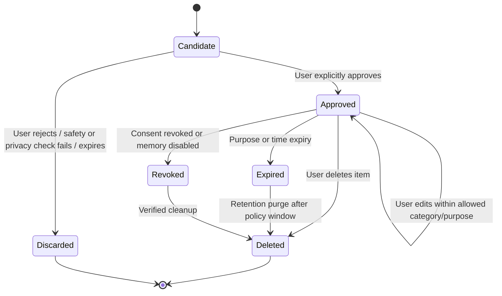
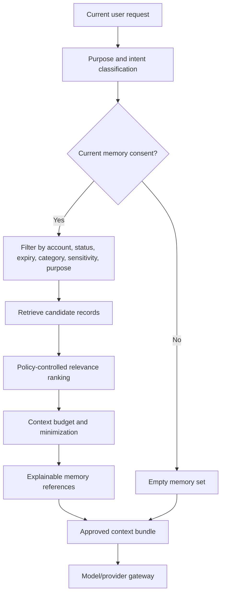
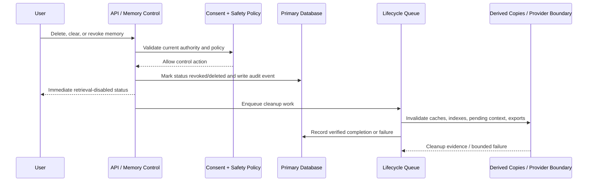

# NexusAI — Consent-Based Personal Memory Architecture

**Document type:** Phase 08 personal memory model, lifecycle, retrieval, and privacy architecture  
**Phase:** Phase 08 — AI Brain, Personal Memory & Intelligence Architecture  
**Status:** Approved — Phase 08 gate passed; Phase 09 through Phase 11 approved; Phase 12 Implementation Foundation/Project Initialization approved; Phase 13 Part 1 APPROVED; Phase 13 Part 2 AUTHORIZED / IN PROGRESS  
**Canonical product:** NexusAI — Personal AI Health & Wellness Companion  
**Date:** 2026-08-29  
**Scope:** Memory architecture only. No vector database, embedding provider, memory service code, or migration is created.

## 1. Purpose and governing principles

Memory is a user-controlled personalization feature for the wellness MVP. It is not a complete transcript archive, a hidden user profile, a medical record, or an automatic model-training dataset.

Principles:

1. **Off by default:** No durable personalization memory is written or retrieved unless the current consent policy allows it.
2. **Least data necessary:** Store only a small, useful, purpose-bound value.
3. **Visible and explainable:** The user can see what is remembered, why it is remembered, and where it came from.
4. **Reversible:** Each item can be edited, revoked, expired, or deleted; global clear and account deletion are supported.
5. **Fail closed:** A missing, stale, conflicting, or unavailable consent decision means no memory retrieval/write.
6. **No hidden inference:** The system must not turn model speculation into permanent memory.
7. **Provider independent:** Memory remains owned by NexusAI application policy and storage, not by a model/provider.

## 2. MVP memory scope

### Permitted taxonomy

The taxonomy matches the approved `memory_records.category` constraint:

| Category | Example | MVP treatment |
| --- | --- | --- |
| `name` | Preferred display name | May be proposed for explicit approval |
| `age_band` | A user-approved age band, if the product collects one | Exact age handling and age assurance remain TBD |
| `wellness_goal` | “Improve sleep routine” | May reference an active goal; goal table remains source of truth |
| `preference` | Preferred coaching tone or planning style | Must be bounded and user-visible |
| `daily_habit` | “Usually walks after dinner” | Non-clinical habit only; no passive sensing implied |
| `plan_preference` | Prefers short plans or morning tasks | Used only for the stated planning purpose |

Future categories such as interaction preference, progress context, or broader life context require a separate product/privacy/safety review and a schema/policy update.

### Do not remember in MVP

- Diagnoses, symptoms interpreted as diagnoses, medication names/dosages, treatment plans, clinical risk scores, or medical-record content.
- Emergency details or crisis assessments as durable personalization memory.
- Sensitive attributes inferred by the model rather than explicitly supplied and approved by the user.
- Raw conversation transcripts as a “memory” value.
- Provider prompts, hidden chain-of-thought, classifier scores, secrets, credentials, or internal policy text.
- Information from a guest demo or another account.
- “Remember everything” or unrestricted cross-domain life history.

## 3. Memory classes and lifetimes

| Class | Description | Default lifetime |
| --- | --- | --- |
| Candidate | A bounded suggestion generated from an allowed interaction | Ephemeral until user decision or short operational expiry |
| Approved memory | User-approved, purpose-bound `memory_records` item | Until user edit/revoke/delete, purpose expiry, or account deletion |
| Derived context | A temporary summary/ranking made for one request | Request-scoped or protected bounded cache, subject to policy |
| Source reference | Optional link to `messages.id` | Reference only; source content is never copied into the memory value |
| Provider context | A minimized per-request projection | Exists only for the request unless a later approved policy says otherwise |

Derived context and provider context are not new durable memory categories. If they are cached, the cache must carry consent/purpose/version metadata and support revocation invalidation.

## 4. Memory lifecycle



### Candidate generation

Candidate generation is optional and conservative. A candidate must include:

- allow-listed category;
- a concrete personalization purpose, never “all future use”;
- bounded proposed value in a versioned shape;
- source message reference when available, without copying source content;
- confidence and sensitivity estimates for review/UI, not as authorization;
- creation timestamp and optional expiry suggestion;
- reason the candidate may help the user.

The candidate is held outside durable `memory_records` until consent is confirmed. If the policy service is unavailable, candidate generation and storage fail closed.

### Approval and update

The user reviews the candidate through the approved memory API flow. Approval creates a `memory_records` row linked to a currently granted `consent_records` row. Editing must preserve the category and purpose constraints; changing purpose or materially changing sensitivity requires a fresh review/consent decision. The original approval/deletion/revocation is represented in audit history rather than silently rewritten.

## 5. Consent model

Memory consent is a current policy decision, not a one-time boolean copied forever. Retrieval and write checks must consider:

- account ownership;
- consent type and decision;
- policy version and capture source;
- purpose compatibility;
- current account/lifecycle status;
- memory status and expiry;
- any global “memory disabled” or clear operation.

The exact names of consent types and retention windows are controlled by the approved consent model and remain subject to product/legal confirmation. Revocation must block future retrieval synchronously, even if physical cleanup is asynchronous.

## 6. Data model alignment

This architecture uses the approved Phase 05/06 model without adding tables:

| Memory concern | Approved record |
| --- | --- |
| Durable value | `memory_records.value` as encrypted, bounded JSON |
| Category/purpose/status | `memory_records.category`, `purpose`, `status` |
| Consent evidence | `memory_records.consent_record_id` → granted `consent_records` |
| Optional origin | `memory_records.source_message_id` → same-account `messages.id` |
| Confidence/relevance support | Application metadata or bounded policy projection; no unapproved schema field is assumed |
| Expiry/revocation/deletion | `expires_at`, `revoked_at`, `deleted_at`, and lifecycle status |
| User-visible changes | API responses plus append-only `audit_events` |
| Global clear/account deletion | `data_lifecycle_requests` with `memory_clear` or `account_delete` |

The database is the source of truth for approved memory state. Search indexes, embeddings, caches, queues, exports, and provider context are derived copies and must never be treated as authoritative.

## 7. Retrieval architecture



### Eligibility filters

Before ranking, exclude any record that is:

- not owned by the authenticated account;
- not `approved`;
- linked to denied/revoked/superseded consent;
- expired, soft-deleted, or under account/memory deletion;
- outside the request purpose or category policy;
- too sensitive for the current request;
- unavailable because the safety/policy dependency is degraded.

### Conceptual ranking

The ranking function may combine semantic relevance, recency, explicit importance, user preference, confidence, sensitivity penalty, purpose fit, and expiration proximity. The weights, embedding choice, retrieval index, and maximum item/token budget are intentionally not fixed in Phase 08. A deterministic recency/metadata filter is a valid MVP fallback; semantic retrieval is an optimization, not a prerequisite.

The system should retain a provenance reference for why an item was selected (category, purpose, recency, policy version). This explanation is metadata for user trust and debugging; it must not expose hidden scores or private model reasoning.

## 8. User controls and API behavior

The approved API surface provides:

- list memories with safe metadata;
- approve or reject candidates;
- edit an approved value within policy;
- delete one memory;
- clear all memory;
- revoke future memory consent;
- inspect lifecycle request status.

Controls must be idempotent and ownership-scoped. A deleted or revoked item must disappear from retrieval immediately. A clear/revoke response reports lifecycle status and does not claim provider, backup, replica, queue, or cache purge until the deletion policy has evidence.

## 9. Deletion and revocation propagation



Required behavior:

1. Synchronous read paths consult status/consent and fail closed immediately.
2. Pending jobs and provider-bound context are tagged with a lifecycle generation or equivalent invalidation marker so revoked data is not reused.
3. Derived copies are deleted or cryptographically made unusable according to the approved retention policy.
4. Failed cleanup remains visible as incomplete; the product never presents a premature “fully deleted” claim.
5. Backup/legal-hold/provider deletion guarantees remain `TBD / Pending Decision` and require operational evidence before launch.

## 10. Privacy and security controls

- Encrypt memory values at rest; decrypt only inside the authorized memory/policy boundary.
- Do not put memory values in URLs, notifications, logs, analytics labels, traces, or support screens by default.
- Use opaque IDs and account-derived ownership checks.
- Do not send a memory to a provider unless the current request has a compatible purpose and consent.
- Apply data minimization before provider calls; redact identifiers where practical.
- Keep candidates ephemeral and bounded; do not persist rejected candidates as durable memory.
- Audit approval, edit, revoke, delete, clear, retrieval-policy denial, and lifecycle transitions using metadata only.
- Keep provider retention/training and regional processing decisions explicit and unresolved until approved.

## 11. Future extensibility

The memory interface should support alternative stores or retrieval methods behind a policy-aware boundary:

```text
MemoryPolicy → MemoryStore → optional RetrievalIndex → ContextProjector
```

The application contract remains category/purpose/status/consent based. A future semantic index, encrypted vector store, or proprietary memory model can be introduced without changing the user controls or treating embeddings as the canonical record. Any new category, sensitivity class, or cross-domain scope requires a new product/privacy/safety gate.

## 12. Open decisions

- Exact consent types and whether any category requires explicit per-item consent beyond global memory consent.
- Minimum age, age assurance, launch geography, and privacy jurisdiction.
- Memory/chat/backup retention windows and legal-hold behavior.
- Revocation/deletion propagation guarantees across caches, queues, provider boundaries, exports, and backups.
- Whether semantic retrieval is needed for the MVP and, if so, approved embedding/index provider and regional processing.
- Whether derived progress or communication-style summaries may be retained and for how long.

All remain `TBD / Pending Decision`; no answer is invented here.

## 13. Phase boundary

This is an architecture specification. It does not create memory code, embeddings, vector infrastructure, model training, API endpoints, database schema changes, or production prompts.
