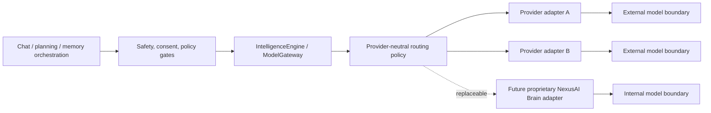

# NexusAI — Model and Provider Abstraction

**Document type:** Provider-neutral intelligence engine, model gateway, routing, and future Brain evolution  
**Phase:** Phase 08 — AI Brain, Personal Memory & Intelligence Architecture  
**Status:** Approved — Phase 08 gate passed; Phase 09 through Phase 11 approved; Phase 12 Implementation Foundation/Project Initialization approved; Phase 13 Part 1 APPROVED; Phase 13 Part 2 AUTHORIZED / IN PROGRESS  
**Canonical product:** NexusAI — Personal AI Health & Wellness Companion  
**Date:** 2026-08-29  
**Scope:** Conceptual provider abstraction only. No SDK integration, model deployment, training pipeline, or provider selection is made.

## 1. Purpose

NexusAI must be useful with a current external/provider model while preserving a path toward a proprietary NexusAI Brain. Product logic, memory, planning, safety, consent, authorization, and observability must not depend on a vendor-specific SDK or response format.

The application talks to an internal `IntelligenceEngine`/`ModelGateway` contract. Provider adapters translate that contract to and from an approved model. The adapter is not allowed to define product policy or retain raw user content by default.

## 2. Stable gateway responsibilities

The gateway owns:

- normalized request/response schemas;
- model capability and policy metadata;
- routing and fallback decisions;
- timeout, bounded retry, circuit-breaker, and quota behavior;
- provider-neutral usage/error telemetry;
- redaction/minimization before an external call;
- response normalization before safety/output validation.

The gateway does **not** own:

- user authentication or authorization;
- consent or memory lifecycle;
- source-of-truth goal/plan/task/check-in state;
- safety-policy ownership or clinical decisions;
- hidden chain-of-thought persistence;
- arbitrary tool execution;
- provider contract promises that have not been approved.

## 3. Conceptual operations

The exact programming language and framework remain TBD. A conceptual interface can expose operations such as:

| Operation | Input | Normalized result | MVP use |
| --- | --- | --- | --- |
| `generateResponse` | Policy-approved context, response mode, output schema | Structured response candidate, finish reason, usage metadata | Wellness chat |
| `analyzeIntent` | Bounded user input and product capability list | Intent class, confidence for routing only, requested capability | Chat/planning routing |
| `createPlan` | Goal/routine/progress context and plan constraints | Structured plan proposal | Starter plan/adjustment suggestion |
| `summarizeContext` | Approved bounded source items | Short-lived summary with provenance | Context minimization |
| `evaluateSafety` | Minimal input/action representation | Safety mode, policy version, allowed actions | Pre/post safety gate |
| `generateMemoryCandidates` | Allowed source reference and memory taxonomy | Bounded candidates with purpose/confidence/sensitivity hints | Consent workflow |

An operation may be implemented by a deterministic rule engine, an external model, a future internal model, or a combination. The caller must not assume that every operation is model-generated.

## 4. Request and response envelope

The gateway receives:

- request/correlation identifier;
- authenticated account scope or guest capability class;
- operation name/version;
- policy and safety version;
- minimized context items with provenance, sensitivity, consent/purpose status;
- output schema and token/size budget;
- allowed tool/capability set, if any;
- timeout, idempotency, and retry class.

The gateway returns:

- normalized content or structured proposal;
- response mode and validation hints;
- operation/model class and adapter version;
- finish reason (`completed`, `length_limited`, `blocked`, `provider_error`, `timeout`, or equivalent normalized class);
- minimized usage/latency metadata;
- no raw provider payload unless an explicitly approved restricted diagnostic path exists.

Raw prompts, completions, provider request IDs, credentials, and hidden reasoning are not part of the core business entities. The approved `ai_usage_events` stores only bounded provider alias/model class/units/latency/outcome metadata.

## 5. Provider adapter boundary

Each adapter is responsible for:

1. converting the normalized request to provider format;
2. applying provider-specific content/length constraints;
3. redacting identifiers and disallowed data;
4. handling provider authentication without exposing secrets;
5. translating provider response/errors into normalized classes;
6. reporting retention/training/regional-processing metadata for policy review;
7. discarding raw payloads unless a separately approved, time-limited diagnostic need exists.

The adapter cannot:

- choose whether a memory is saved;
- authorize a tool or user action;
- override a safety mode;
- change the public API error contract;
- persist full prompts/responses into application logs.

## 6. Routing and model policy

Routing is an application policy decision based on operation class, safety mode, context size, latency/cost budget, and model capability—not on arbitrary model self-selection.

| Route class | Example | Preferred behavior |
| --- | --- | --- |
| Deterministic | CRUD validation, consent, deletion, task status | Do not call a model |
| Simple wellness | Short explanation or reflection | Lowest suitable approved capability |
| Structured planning | Starter plan or bounded adjustment | Schema-constrained capable route |
| Safety-sensitive | Redirect/escalation/blocked | Policy evaluator and reviewed fallback; model optional |
| Memory candidate | Candidate extraction | Small bounded operation; candidate never auto-approved |

Exact provider, model, region, tier, concurrency, quota, cost budget, and fallback chain are `TBD / Pending Decision`. A routing change affecting safety or privacy requires policy/version review.

## 7. Privacy and data processing

- Only the context assembler may decide which approved data is eligible; adapters receive the resulting minimized bundle.
- Provider contracts must be reviewed for retention, training use, subprocessors, regional processing, deletion, and security before launch.
- Private user content must not be used for model training without separate explicit consent and an approved policy.
- Provider-bound payloads carry no unnecessary account identifiers, tokens, or raw memory provenance beyond what is required for the operation.
- If provider retention/deletion behavior is unknown or unavailable, the request is blocked or routed to an approved alternative; the system must not imply stronger privacy guarantees than evidence supports.

## 8. Error, retry, and fallback semantics

Adapters map upstream conditions to the stable API classes defined in Phase 07:

| Adapter condition | Normalized outcome |
| --- | --- |
| Timeout | `ai_timeout`, retryable only under the operation/idempotency policy |
| Temporary unavailable | `ai_unavailable` or `dependency_unavailable` |
| Invalid/unsafe response | `ai_provider_invalid`, discard output |
| Quota/throttle | `ai_quota_exceeded` or `rate_limited` with safe retry metadata |
| Authentication/configuration error | Restricted operational alert; generic client error |

Retries are bounded and occur at the adapter boundary. Destructive, tool, memory, and AI-send operations require the same idempotency key for a logical retry. A timeout never results in a second blind side effect.

Fallback may use a deterministic reviewed response, a lower-capability approved route, or a temporary-unavailability message. It must not silently downgrade a safety-sensitive request into ordinary generation.

## 9. Observability contract

The gateway emits minimized telemetry:

- operation class and version;
- provider alias and model class, not hidden provider secrets;
- latency, timeout, retry count, finish/error class;
- bounded usage units and cost signal where available;
- policy/safety version;
- correlation/request ID;
- whether output/tool/memory validation passed.

It must not emit raw user messages, prompt text, memory values, assistant content, provider payloads, or model chain-of-thought to ordinary logs or metrics. Restricted diagnostics, if ever approved, require redaction, access control, expiry, and audit.

## 10. Future proprietary NexusAI Brain roadmap

| Stage | Intelligence implementation | What remains stable |
| --- | --- | --- |
| 1. External model behind abstraction | One approved provider adapter handles normalized operations | API, safety, consent, memory, planning, domain services, audit |
| 2. NexusAI orchestration | Context assembly, routing, evaluation, and planning become more application-owned | Gateway contract and user controls |
| 3. Proprietary memory/planning/safety intelligence | Internal retrieval, ranking, planning heuristics, and safety evaluators mature | Memory lifecycle, safety modes, tool permissions, data ownership |
| 4. Specialized internal models | Task-specific models handle classification, summaries, planning, or safety support | Provider-neutral operation schemas and release gates |
| 5. Proprietary foundation model / NexusAI Brain | An internal foundation model becomes another gateway adapter or primary route | Product contracts, consent, deletion, authorization, and non-clinical scope |

At no stage does model ownership transfer authority over user data or safety policy. A proprietary model is not automatically trusted; it must pass the same evaluations, privacy controls, and operational gates.

## 11. Migration and replacement strategy

Messages, memories, goals, plans, tasks, and safety events use application-owned schemas. Switching adapters should require:

1. capability comparison and contract tests;
2. privacy/provider review;
3. safety evaluation and regression comparison;
4. traffic shadowing or controlled rollout where appropriate;
5. usage/cost/latency monitoring;
6. rollback or forward-fix plan.

No migration should rewrite historical user content merely because the provider changed. Provider-specific metadata remains bounded operational telemetry and may expire under the approved retention policy.

## 12. Open decisions

- Approved model/provider, model classes, regions, and fallback policy.
- Provider retention/training, deletion, subprocessors, and regional-processing terms.
- Exact gateway operation schemas, model routing thresholds, token budgets, and cost ceilings.
- Internal versus external safety evaluator responsibilities and policy owner.
- Whether/when a proprietary model is feasible, and the evaluation bar for replacing an external route.

All remain `TBD / Pending Decision`; this document makes no vendor or proprietary-model claim.

## 13. Phase boundary

This document defines a replaceable abstraction and roadmap only. It does not integrate a provider, train a model, deploy a model, create SDK code, implement an agent, or change the approved API/database design.
