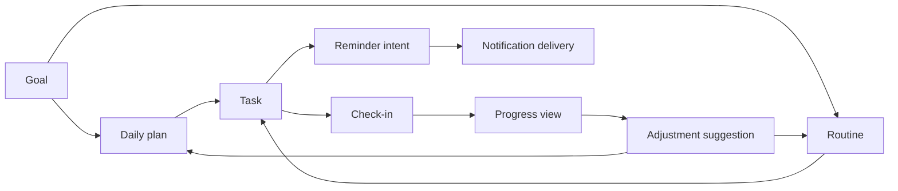
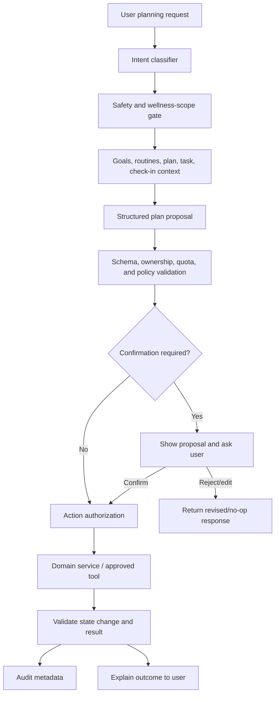

# NexusAI — Planning and Bounded Agent Architecture

**Document type:** Phase 08 goal, plan, task, routine, reminder, and tool-use architecture  
**Phase:** Phase 08 — AI Brain, Personal Memory & Intelligence Architecture  
**Status:** Approved — Phase 08 gate passed; Phase 09 through Phase 11 approved; Phase 12 Implementation Foundation/Project Initialization approved; Phase 13 Part 1 APPROVED; Phase 13 Part 2 AUTHORIZED / IN PROGRESS  
**Canonical product:** NexusAI — Personal AI Health & Wellness Companion  
**Date:** 2026-08-29  
**Scope:** Conceptual planning and bounded agent behavior only. No agent runtime, tool implementation, scheduler, or API code is created.

## 1. Design objective

NexusAI helps a user turn a wellness intention into manageable actions, observe progress, and adjust suggestions. The application remains the source of truth for goals, routines, plans, tasks, check-ins, reminders, consent, and lifecycle state. AI can propose and explain; it cannot silently commit arbitrary changes or operate as an unrestricted autonomous agent.

The MVP is intentionally narrow:

- non-clinical wellness goals and routines;
- daily plan and task suggestions;
- user-confirmed task/check-in progress;
- in-app reminder intent and delivery status;
- bounded plan adjustments based on recorded progress.

Calendar, wearable, search, messaging, purchases, healthcare, and other external tools are future capabilities requiring separate consent and review.

## 2. Canonical planning graph

The graph represents relationships, not an instruction to generate all nodes for every request. A user may create a goal without a plan, a plan without a routine, or a one-off task without recurring behavior. Exact recurrence semantics and channel support remain TBD in the approved product/API documents.

## 3. Planning responsibilities by layer

| Layer | Responsibility | Authority boundary |
| --- | --- | --- |
| Goal service | Validate, store, and lifecycle-manage user goals | User/API authorization is required |
| Routine service | Validate repeatable habit structure and preferences | No clinical schedule or passive monitoring |
| Plan builder | Create or revise a proposed daily plan | Proposal until user confirmation or approved product action |
| Task service | Persist task instances, status, ordering, and ownership | Database/domain rules are authoritative |
| Check-in service | Record completion, skip, snooze, or reflection | User action remains source of truth |
| Progress service | Derive bounded aggregates from check-ins/tasks | Never infer diagnosis or clinical risk |
| Reminder service | Validate reminder intent, quiet hours, consent, and delivery | In-app MVP; external channels TBD |
| Planning intelligence | Suggest prioritization, decomposition, and adjustments | Cannot bypass domain services or permission checks |
| Tool gateway | Expose typed capabilities to the intelligence layer | No arbitrary system access |

## 4. Planning lifecycle

1. **Understand intent:** Classify whether the user wants to create, inspect, adjust, complete, or explain a wellness plan.
2. **Load bounded context:** Retrieve active goals/routines/plans/tasks/check-ins and only the approved memory relevant to the planning purpose.
3. **Check safety and consent:** Reject clinical or consequential instructions, verify account ownership, and determine whether a reminder or memory action is allowed.
4. **Draft a structured proposal:** Produce typed goals/tasks/timing/constraints rather than an unstructured instruction to “do everything.”
5. **Validate proposal:** Enforce title/length/date/recurrence/task-count/ownership and product scope constraints. Exact numeric limits remain TBD.
6. **Request confirmation when needed:** User confirms any multi-item plan, changed routine, new reminder, or action with a meaningful side effect.
7. **Commit through application services:** The domain service writes `goals`, `routines`, `daily_plans`, `tasks`, or `reminders`; the model never writes the database directly.
8. **Observe progress:** Check-ins and task status feed a derived progress view.
9. **Suggest adjustment:** The system may propose a smaller, reordered, paused, or rescheduled plan. It must explain the basis and preserve user control.
10. **Audit:** Record relevant action metadata, actor class, policy version, and outcome without raw hidden reasoning.

## 5. Plan and task state principles

The approved database statuses remain authoritative. The intelligence layer must work with, not replace, them:

| Object | Approved state examples | AI behavior |
| --- | --- | --- |
| Goal | Draft, active, paused, completed, archived, deleted | Suggest wording or next steps; never mark completed from inference alone |
| Routine | Draft/active/paused/completed/archived/deleted according to approved model | Suggest cadence or simplification; user/domain service controls state |
| Daily plan | Draft, active, completed, archived, deleted | Generate or revise a bounded plan; enforce one active plan/date rule |
| Task | Pending, completed, skipped, snoozed, cancelled, deleted | Propose ordering/timing; user action or authorized service changes status |
| Check-in | Completed, skipped, not recorded, snoozed | Treat recorded user check-in as truth; use reflection only for wellness context |
| Reminder | Active/paused/cancelled/deleted according to approved model | Request reminder creation/update; notification service validates consent/channel |

The exact routine status vocabulary and recurrence model are approved database/API constraints; any implementation must follow those artifacts rather than inventing a second state machine.

## 6. Bounded planning engine

The planning engine is a constrained workflow, not an open-ended autonomous loop:

The engine has a bounded step count, timeout, context budget, and tool budget. If it cannot complete within those limits it returns a partial proposal or safe temporary-unavailability response. It never loops until a desired outcome is achieved.

## 7. Tool and action capabilities

Each capability has a stable name, typed input/output, scope, confirmation policy, and audit event. A conceptual registry is:

| Capability | MVP status | Permission boundary | Result validation |
| --- | --- | --- | --- |
| `suggest_plan` | In scope | Read approved user context; no side effect | Plan schema, task count, wellness scope |
| `create_task` | In scope | User-owned plan/goal/routine; confirmation as product policy requires | Same-account FK and task constraints |
| `update_task_status` | In scope | User-owned task; user action or explicit confirmation | Allowed status transition and timestamp rules |
| `create_reminder` | In scope | User-owned task/routine plus reminder consent/preferences | Channel, quiet hours, schedule, and ownership checks |
| `record_check_in` | In scope | Current user; explicit user submission | Check-in schema and task ownership |
| `adjust_plan` | Suggestion first | Existing user plan; confirmation before material change | Diff review, active-date uniqueness, audit |
| `search` | Future | Separate data/source/privacy policy | Source allow-list, citation and prompt-injection controls |
| `calendar_write` | Future | Explicit integration consent and per-action confirmation | Event scope, timezone, idempotency, revocation |
| `wearable_read` | Future | Separate health-data consent and provider review | Field allow-list, freshness, deletion propagation |
| `external_message_send` | Future/high risk | Explicit recipient/content/authorization policy | Preview, confirmation, delivery audit |

No tool may expose filesystem, shell, database, credential, provider-secret, or arbitrary network access to the model.

## 8. Tool invocation contract

The intelligence layer submits a capability request containing:

- capability name and version;
- authenticated principal/account scope;
- normalized, schema-validated arguments;
- purpose and user-consent references;
- safety mode and policy version;
- idempotency/correlation key;
- confirmation state.

The tool gateway then:

1. re-checks authorization and ownership;
2. validates arguments against the capability schema;
3. enforces rate/quota and lifecycle status;
4. executes only the allow-listed domain service;
5. validates the returned result against a safe output schema;
6. writes minimized audit/usage metadata;
7. returns a result or stable error to the orchestrator.

The model cannot elevate a denied capability by changing its own arguments or policy text.

## 9. Progress and adjustment logic

Progress is derived from recorded task/check-in state and user-visible aggregates. A planning suggestion may consider completion patterns, skipped tasks, recent reflections, and explicit preferences. It must:

- state that it is a suggestion, not a medical conclusion;
- avoid interpreting non-completion as illness, incapacity, or diagnosis;
- prefer smaller/reversible adjustments;
- preserve the user’s original goal and allow undo/edit;
- avoid changing reminders or routines without the required confirmation;
- record the source data window and policy version without storing hidden reasoning.

If source data is missing or contradictory, the system asks a clarifying question or returns a conservative suggestion rather than inventing facts.

## 10. Planning privacy and safety

- Planning context is account-scoped and minimized to the requested goal/plan/task purpose.
- The model does not receive unrelated conversations or memories by default.
- Medication-related reminders remain a user-entered wellness reminder capability; the system must not prescribe, calculate dosage, or claim treatment authority.
- Potentially urgent or clinical requests exit the planning flow through the safety architecture.
- Reminder content must not expose sensitive health/chat text unnecessarily.
- Deletion, revocation, and account lifecycle status are checked before reading or mutating plans/tasks/reminders.

## 11. Async and failure behavior

Starter-plan generation, bulk plan adjustments, reminder delivery, and cleanup may run asynchronously. The API returns an opaque status reference and never claims completion before the domain service confirms it.

If a model/provider fails, the user can still inspect and manually update goals, routines, tasks, and check-ins. If a tool partially fails, the source-of-truth state and failure status are preserved; the orchestrator does not silently replay a non-idempotent action. Durable idempotency for non-lifecycle mutations remains a TBD operational decision from Phase 07.

## 12. Future agent evolution

Future planning agents may coordinate more steps, but these invariants remain stable:

- bounded context and step budgets;
- explicit user authorization for side effects;
- policy/safety gates before and after model calls;
- domain services as state authority;
- typed tools only;
- auditability and revocation;
- no clinical or unrestricted system authority.

Adding a new autonomous capability requires product, privacy, security, safety, and API review. It is not enabled merely because a provider supports tool calling.

## 13. Open decisions

- Exact recurrence semantics, active routine/task limits, and reminder channels.
- Which plan changes require confirmation versus can be directly requested by the user.
- Numeric tool quotas, planning budgets, latency targets, and beta scale.
- External integration consent, provider selection, regional processing, and deletion guarantees.
- Safety-policy owner and jurisdiction-specific escalation copy.

All unresolved items remain `TBD / Pending Decision`.

## 14. Phase boundary

This document defines bounded planning and tool-use architecture only. It does not create an agent loop, tool adapters, schedulers, backend/frontend code, model prompts, API endpoints, or external integrations.
