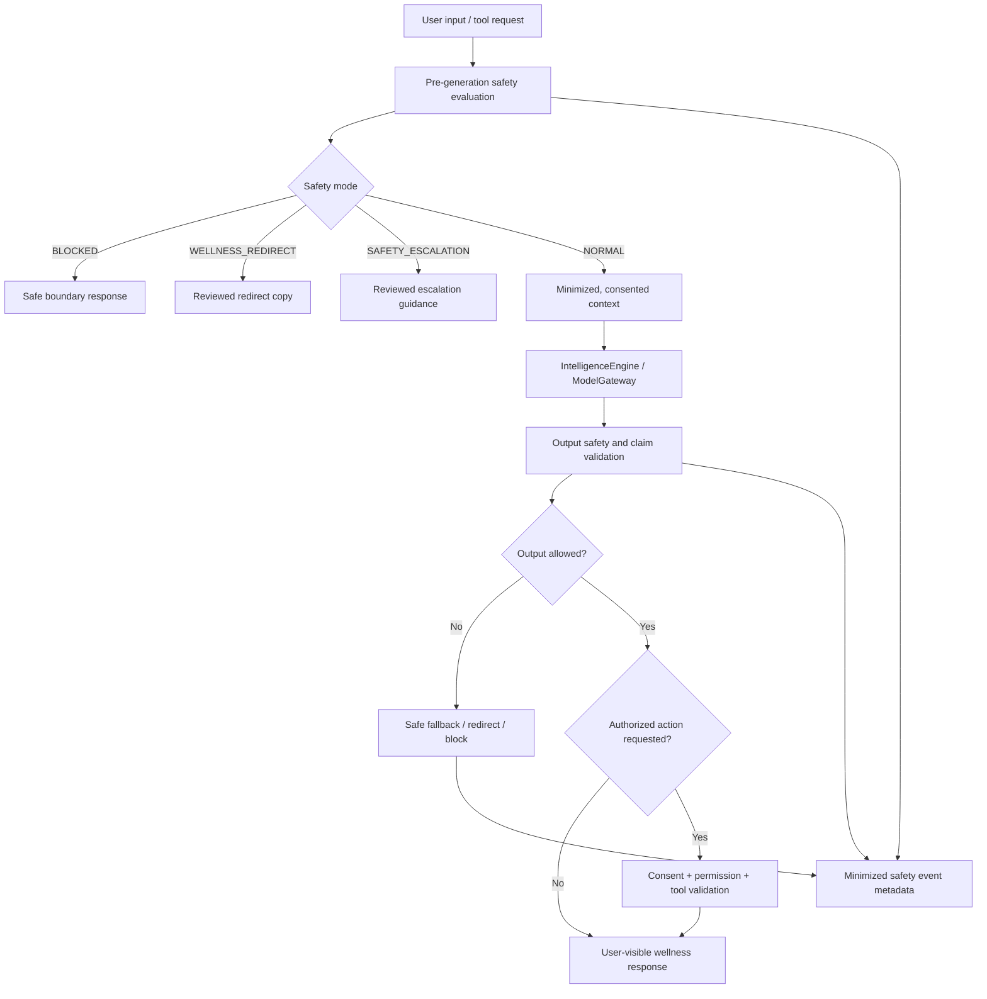

# NexusAI — Safety Architecture

**Document type:** Phase 08 wellness safety, policy enforcement, escalation, and response validation architecture  
**Phase:** Phase 08 — AI Brain, Personal Memory & Intelligence Architecture  
**Status:** Approved — Phase 08 gate passed; Phase 09 through Phase 11 approved; Phase 12 Implementation Foundation/Project Initialization approved; Phase 13 Part 1 APPROVED; Phase 13 Part 2 AUTHORIZED / IN PROGRESS  
**Canonical product:** NexusAI — Personal AI Health & Wellness Companion  
**Date:** 2026-08-29  
**Scope:** Safety architecture and governance boundaries only. No clinical protocol, classifier implementation, model training, or production safety copy is created.

## 1. Safety mission

NexusAI is a wellness companion, not a doctor, diagnostic service, emergency service, or replacement for licensed professional care. The safety layer ensures that an AI/provider cannot turn a wellness product into an unsafe clinical or autonomous system.

The layer is independent of the chosen model/provider and sits before and after intelligence generation. Safety policy is versioned, reviewable, auditable, and centrally evaluated. The exact policy owner, escalation authority, jurisdiction-specific copy, and release governance are `TBD / Pending Decision`.

## 2. Safety boundary

NexusAI may support:

- healthy habit formation and routine planning;
- general wellness education and reflection;
- user-entered goals, tasks, check-ins, and reminders;
- progress observation using recorded activity;
- safe uncertainty language and referral to an appropriate professional resource.

NexusAI must not claim to:

- diagnose disease or determine a clinical condition;
- prescribe, change, or calculate medication dosage;
- provide clinical triage or guarantee a treatment outcome;
- replace a doctor, therapist, pharmacist, emergency service, or crisis responder;
- dispatch emergency services or pretend to monitor an emergency.

Medication-related reminders may remain a user-controlled wellness reminder use case, but the assistant cannot recommend dosage, schedule a treatment, or infer a diagnosis.

## 3. Safety modes

The public API exposes safe response modes, not classifier scores or hidden policy text:

| Mode | When used | Allowed behavior |
| --- | --- | --- |
| `NORMAL` | In-scope, low-risk wellness request | Provide general wellness guidance with uncertainty and scope boundaries |
| `WELLNESS_REDIRECT` | Request is outside wellness scope or asks for clinical certainty | Briefly state the boundary and redirect to a suitable professional/resource category |
| `SAFETY_ESCALATION` | User content may indicate urgency or a sensitive high-risk situation | Present reviewed, jurisdiction-appropriate guidance to contact local emergency services or a licensed professional; do not pretend to assess or dispatch |
| `BLOCKED` | Content or action cannot be safely processed under policy | Do not generate the requested content/action; return safe, non-judgmental boundary copy |

The system must not invent a clinical protocol or give a false impression that a mode is a medical risk diagnosis. The safety policy determines how a category maps to a mode; that mapping remains subject to review.

## 4. Dual-gate safety pipeline



Safety is not delegated to the model. A model-generated “safe” statement does not override the policy evaluator, API authorization, consent, or tool boundary.

## 5. Pre-generation evaluation

Before ordinary intent handling or memory writes, evaluate:

- product-scope match (wellness versus diagnosis/treatment/triage);
- urgency indicators requiring reviewed escalation guidance;
- sensitive-topic categories named in the approved PRD, including self-harm, eating disorders, abuse, medication, pregnancy, and severe symptoms;
- requests for protected personal data, secrets, or another user’s information;
- prompt-injection or instruction-conflict signals attempting to disable policy, reveal hidden prompts, or elevate tools;
- whether the request is guest or authenticated and whether durable side effects are available.

The evaluator returns a policy version, mode, allowed capability set, and safe handling instruction. It must not return a raw classifier score to the client or use an inferred label as a medical fact.

## 6. Output validation

After model generation, validate:

- structured response schema and length;
- no unsupported diagnosis, medication, dosage, clinical certainty, or emergency-service claim;
- scope disclaimer/uncertainty language where required;
- consistency with the selected safety mode;
- no disclosure of hidden policies, provider payloads, system prompts, secrets, or other accounts;
- no unauthorized tool call or side effect embedded in natural language;
- no memory candidate containing prohibited or unapproved medical/clinical content.

If validation fails, discard the invalid result, return a reviewed fallback/redirect/block, and record minimized metadata. Do not persist a fabricated assistant message as successful output.

## 7. Safety and tool execution

Tool authorization is a separate safety decision:

```text
Safety mode
    ↓
Capability allow-list
    ↓
User consent and account authorization
    ↓
Input validation and confirmation
    ↓
Tool execution
    ↓
Result validation and post-action safety check
```

`NORMAL` does not automatically authorize a tool. A redirect or escalation mode must not create reminders, change plans, save memory, or call external integrations unless a separately reviewed rule explicitly permits the action. No tool has arbitrary database, filesystem, shell, network, credential, or provider-secret access.

## 8. Memory safety

- Candidate memory generation is blocked or discarded for clinical diagnoses, medication/treatment conclusions, crisis assessments, classifier scores, and hidden inferences.
- Current consent and purpose compatibility are checked before retrieval and before write.
- A safety/policy outage fails closed for memory writes and high-risk AI calls.
- Revocation/clear blocks retrieval immediately; asynchronous cleanup cannot re-enable access.
- Safety events may reference account/conversation/message IDs and policy metadata, but raw content is excluded by default.

## 9. Escalation behavior without invented protocols

When content may be urgent, the system should show reviewed guidance to contact local emergency services or an appropriate licensed professional. It must not:

- assess or confirm that an emergency exists;
- choose a specific local number before geography/jurisdiction is approved;
- promise response times or monitoring;
- contact a professional or emergency service without a separately authorized integration;
- discourage real-world help because the assistant is available.

The exact copy, localization, jurisdiction logic, and human escalation ownership are unresolved decisions. Until approved, implementation must use conservative reviewed placeholders and keep the feature behind an explicit safety gate.

## 10. Policy and versioning architecture

Safety policy is modular and versioned separately from user preferences and model prompts:

| Policy layer | Example responsibility |
| --- | --- |
| Product scope | Wellness-only capability boundary and disclaimer |
| Safety classification | Mode selection and sensitive-topic handling |
| Response constraints | Forbidden claims, uncertainty, redirect/block shape |
| Tool safety | Capability allow-list, confirmation, side-effect rules |
| Memory safety | Prohibited categories, consent/purpose rules |
| Release governance | Reviewer, effective time, rollback/forward-fix procedure |

The public API and persisted `safety_events.policy_version` reference a reviewed policy artifact. A policy change affecting safety requires evaluation, approval, versioning, and audit. User-editable preferences cannot override safety policy.

## 11. Safety observability

Measure minimized signals:

- mode counts by policy version and coarse request class;
- false diagnosis/overconfidence reports;
- redirect/block and escalation display rates;
- policy service latency/failure;
- output validation failures;
- unsafe tool attempt/denial counts;
- memory candidate rejection and revocation outcomes;
- user safety feedback and response reports.

Do not log raw prompts, full chat, memory values, provider payloads, classifier scores, or emergency details by default. Access to safety metadata is restricted and audited.

## 12. Failure and degradation rules

| Failure | Behavior |
| --- | --- |
| Policy service unavailable | Fail closed for high-risk generation, memory writes, and tool actions; preserve safe CRUD features |
| Model unavailable | Return safe temporary-unavailability response; do not fabricate guidance |
| Output validator unavailable | Do not display model output; use reviewed fallback |
| Safety event write fails | Do not silently claim an evaluated result; apply conservative response and alert operations |
| Tool result unsafe/invalid | Do not commit/announce the result; preserve source-of-truth state and audit failure |
| Escalation copy unavailable | Use approved minimal fallback or block; do not invent local emergency instructions |

## 13. Review and testing requirements

Before implementation release, the team must maintain a reviewed evaluation set covering diagnosis-like, medication/dosage, urgent/severe symptoms, self-harm, eating-disorder, abuse, pregnancy, privacy, prompt injection, and unsafe tool-use prompts. Tests must cover both false negatives and false positives, multilingual/localized behavior when supported, and policy-version regressions.

Exact thresholds, reviewers, legal sign-off, launch geography, minimum age, and safety policy ownership remain `TBD / Pending Decision`.

## 14. Phase boundary

This document defines safety architecture and governance requirements only. It does not define clinical protocols, implement classifiers, train models, write prompts for production, create API/backend/frontend code, or deploy safety infrastructure.
