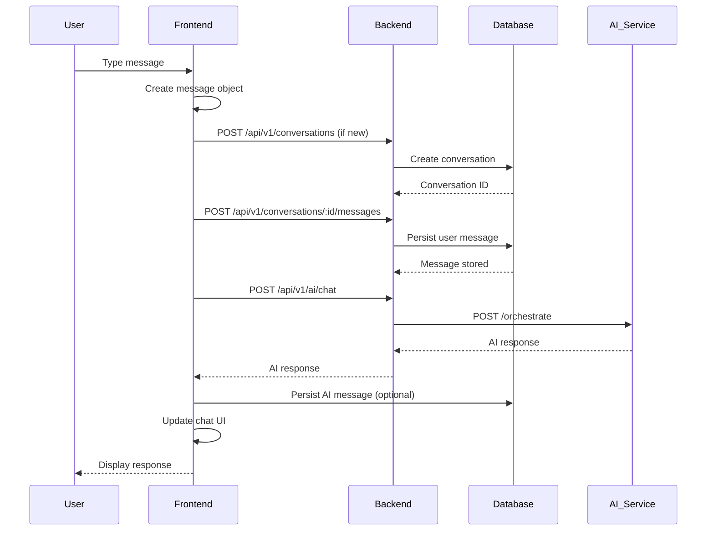
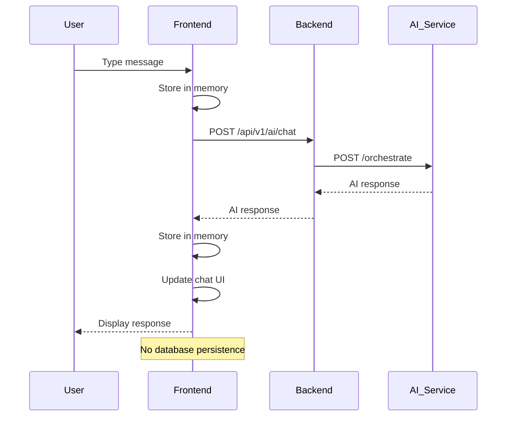

# NexusAI Brain Architecture

## Overview

NexusAI uses an EXTERNAL AI service for chat functionality. The backend acts as a proxy between the frontend and the AI service. The AI service is a separate Python FastAPI/ML application that must be running independently.

## Critical Clarification

**NexusAI does NOT have a built-in AI model.**

The application uses an external AI service at `http://127.0.0.1:8000`. The backend proxies requests to this service and returns responses to the frontend.

## Architecture

### Component Diagram

```
┌─────────────────────────────────────────────────────────────┐
│                     Frontend (Next.js)                        │
│                   http://localhost:3000                       │
└────────────────────────┬────────────────────────────────────┘
                         │
                         │ POST /api/v1/ai/chat
                         │ JSON: { message, conversationId, context }
                         │
┌────────────────────────▼────────────────────────────────────┐
│                  Backend (Fastify)                           │
│                  http://localhost:4000                        │
│                                                              │
│  POST /api/v1/ai/chat                                       │
│  - Validates request                                         │
│  - Forwards to AI service                                   │
│  - Handles timeout (10s)                                    │
│  - Returns response to frontend                             │
└────────────────────────┬────────────────────────────────────┘
                         │
                         │ POST /orchestrate
                         │ JSON: { message, conversation_id, context, user_id }
                         │
┌────────────────────────▼────────────────────────────────────┐
│              AI Service (External)                           │
│              http://127.0.0.1:8000                           │
│                                                              │
│  Python FastAPI/ML Service                                  │
│  - /orchestrate endpoint                                    │
│  - /health endpoint                                         │
│  - AI model inference                                       │
│  - Context management                                        │
└─────────────────────────────────────────────────────────────┘
```

## AI Service Configuration

### Environment Variable

**Variable**: `AI_SERVICE_URL`
**Default**: `http://127.0.0.1:8000`
**Location**: `.env` file

### Configuration

```env
AI_SERVICE_URL=http://127.0.0.1:8000
```

## Backend AI Proxy

### Endpoints

#### POST /api/v1/ai/chat

**File**: `apps/api/src/routes/ai.ts`

**Purpose**: Proxy chat requests to AI service

**Authentication**: Optional (guest mode supported)

**Request Body**:
```json
{
  "message": "Hello, AI!",
  "conversationId": "uuid",
  "context": [
    {
      "role": "user",
      "content": "Previous message",
      "timestamp": "2024-01-01T00:00:00Z"
    }
  ]
}
```

**Validation**:
- message: Required, non-empty string
- conversationId: Optional UUID
- context: Optional array of previous messages

**Response (200 OK)**:
```json
{
  "response": "AI response text",
  "conversationId": "uuid",
  "messageId": "uuid"
}
```

**Error Responses**:
- 400: Message required
- 502: AI service unavailable
- 504: AI service timeout
- 500: Backend error

**Implementation Details**:
- Forwards request to AI_SERVICE_URL/orchestrate
- Timeout: 10 seconds
- Passes user_id if authenticated (null for guests)
- Supports guest mode
- Uses AbortController for request cancellation

**AI Service Request**:
```json
{
  "message": "Hello, AI!",
  "conversation_id": "uuid",
  "context": [...],
  "user_id": "uuid"
}
```

---

#### GET /api/v1/ai/health

**File**: `apps/api/src/routes/ai.ts`

**Purpose**: Check AI service health

**Authentication**: Not required

**Response (200 OK)**:
```json
{
  "status": "healthy",
  "service": "http://127.0.0.1:8000"
}
```

**Error Responses**:
- 503: AI service unreachable

---

## Frontend AI Integration

### ChatInterface Component

**File**: `apps/web/app/components/ChatInterface.tsx`

**Features**:
- Sends messages to backend AI endpoint
- Displays AI responses
- Handles errors with Bangla messages
- Supports guest mode (in-memory)
- Supports authenticated mode (persistent)
- Request cancellation
- Typing indicator

**Guest Mode Flow**:
1. User types message
2. Frontend stores in memory (guest conversation)
3. Frontend calls POST /api/v1/ai/chat
4. Backend forwards to AI service
5. AI service returns response
6. Frontend stores response in memory
7. Frontend displays response
8. No database persistence

**Authenticated Mode Flow**:
1. User types message
2. Frontend creates conversation (if new)
3. Frontend persists user message to database
4. Frontend calls POST /api/v1/ai/chat
5. Backend forwards to AI service
6. AI service returns response
7. Backend (optionally) persists AI response to database
8. Frontend displays response

**Error Handling**:
- AI service unavailable: "দুঃখিত, AI সার্ভিসটি বর্তমানে উপলব্ধ নেই। অনুগ্রহ করে পরে আবার চেষ্টা করুন।"
- AI service timeout: "দুঃখিত, AI সার্ভিসটি সময়সীমা অতিক্রম করেছে। অনুগ্রহ করে পরে আবার চেষ্টা করুন।"
- Backend server error: "দুঃখিত, সার্ভারে একটি ত্রুটি হয়েছে। অনুগ্রহ করে পরে আবার চেষ্টা করুন।"
- Authentication required: "দুঃখিত, আপনার সেশন মেয়াদ শেষ হয়েছে। অনুগ্রহ করে আবার লগ ইন করুন।"

## AI Service (External)

### Expected Interface

The external AI service must implement the following interface:

#### POST /orchestrate

**Request**:
```json
{
  "message": "string",
  "conversation_id": "uuid",
  "context": [
    {
      "role": "user|assistant",
      "content": "string",
      "timestamp": "ISO8601"
    }
  ],
  "user_id": "uuid|null"
}
```

**Response**:
```json
{
  "response": "string",
  "conversation_id": "uuid",
  "message_id": "uuid"
}
```

#### GET /health

**Response**:
```json
{
  "status": "healthy"
}
```

### Implementation Details

The AI service is not part of the NexusAI codebase. It is a separate Python FastAPI/ML application that must be:

1. Running at the configured AI_SERVICE_URL
2. Implementing the /orchestrate endpoint
3. Implementing the /health endpoint
4. Returning responses in the expected format

### Current Assumptions

Since the AI service is external, the following assumptions are made:

- The AI service handles model inference
- The AI service manages conversation context
- The AI service implements safety checks
- The AI service handles rate limiting (if needed)
- The AI service is responsible for model updates

## AI Core Package

**Location**: `packages/ai-core/`

**Purpose**: AI service integration abstractions (not currently used)

**Structure**:
```
packages/ai-core/
├── bridge/                     # AI service bridge
│   ├── client.ts
│   ├── config.ts
│   ├── errors.ts
│   └── types.ts
├── orchestrator/               # AI orchestration
│   ├── brain-orchestrator.ts
│   ├── intent-classifier.ts
│   ├── response-validator.ts
│   └── intent-types.ts
├── memory/                     # Memory management
├── safety/                     # Safety checks
└── tools/                      # AI tools
```

**Current Status**: The ai-core package exists but is not actively used in the current implementation. The backend directly proxies requests to the external AI service without using these abstractions.

## Data Flow

### Complete Flow (Authenticated)



### Complete Flow (Guest)



## Error Handling

### Backend Error Handling

**File**: `apps/api/src/routes/ai.ts`

**Error Types**:
- AbortError: Request timeout (504)
- NetworkError: AI service unavailable (502)
- Other errors: Backend error (500)

**Timeout**: 10 seconds

### Frontend Error Handling

**File**: `apps/web/app/components/ChatInterface.tsx`

**Error Types**:
- 502: AI service unavailable
- 504: AI service timeout
- 500: Backend server error
- 401: Authentication required
- Network errors: Connection issues

**Error Messages**: Localized to Bangla for user-friendly display

## Current Limitations

### AI Service Dependency

1. **External Dependency**: AI service must be running separately
2. **No Built-in Model**: NexusAI does not include an AI model
3. **No Fallback**: No fallback if AI service is unavailable
4. **No Retry**: No automatic retry logic for failed requests
5. **Timeout**: Fixed 10-second timeout

### Current Implementation

1. **Direct Proxy**: Backend directly proxies requests without using ai-core abstractions
2. **No Model Abstraction**: No support for multiple AI providers
3. **No Context Management**: Context is passed but not managed by backend
4. **No Safety Checks**: Safety checks assumed to be in AI service
5. **No Memory Integration**: Memory feature not integrated with AI service

## Future Improvements

### AI Service Integration

1. **Multiple Providers**: Support for OpenAI, Anthropic, local models
2. **Model Abstraction**: Use ai-core package for provider abstraction
3. **Context Management**: Backend-managed conversation context
4. **Safety Checks**: Backend safety validation before sending to AI
5. **Memory Integration**: Integrate memory_records with AI context
6. **Retry Logic**: Automatic retry with exponential backoff
7. **Streaming**: Support for streaming responses
8. **Caching**: Cache common responses

### AI Core Package Usage

1. **Bridge Implementation**: Use bridge/client.ts for AI service communication
2. **Orchestrator**: Use orchestrator for intent classification and routing
3. **Safety**: Use safety package for content filtering
4. **Memory**: Use memory package for context enhancement

### Reliability

1. **Health Checks**: Automated health checks with circuit breaker
2. **Fallback Models**: Fallback to simpler models if primary unavailable
3. **Request Queuing**: Queue requests when AI service is overloaded
4. **Monitoring**: Monitor AI service latency and error rates

## Testing

### Manual Testing

1. Start AI service at http://127.0.0.1:8000
2. Start backend at http://localhost:4000
3. Start frontend at http://localhost:3000
4. Send message via chat interface
5. Verify response is displayed

### cURL Testing

**AI Chat**:
```bash
curl -X POST http://localhost:4000/api/v1/ai/chat \
  -H "Content-Type: application/json" \
  -d '{"message":"Hello!"}' \
  -b cookies.txt
```

**AI Health**:
```bash
curl -X GET http://localhost:4000/api/v1/ai/health
```

## Security Considerations

### Current Implementation

1. **Optional Auth**: AI endpoint supports guest mode
2. **User ID Pass-through**: Passes user_id to AI service if authenticated
3. **No Data Leakage**: Backend does not log message content
4. **CORS**: Configured for allowed origins

### Recommendations

1. **Rate Limiting**: Implement rate limiting on AI endpoint
2. **Content Filtering**: Add content filtering before sending to AI
3. **PII Redaction**: Redact PII before sending to AI service
4. **Audit Logging**: Log AI requests for compliance
5. **Input Validation**: Validate input before sending to AI service

## Monitoring

### Current State

- Console logging for debugging
- Request ID tracking (x-request-id)
- Basic error handling

### Recommended Monitoring

1. **Latency**: Track AI service response time
2. **Error Rate**: Track AI service error rate
3. **Availability**: Monitor AI service health
4. **Usage**: Track token usage and costs
5. **Quality**: Monitor response quality

## References

- [05_BACKEND_API_REFERENCE.md](./05_BACKEND_API_REFERENCE.md) - API documentation
- [04_FRONTEND_GUIDE.md](./04_FRONTEND_GUIDE.md) - Frontend guide
- [01_PROJECT_OVERVIEW.md](./01_PROJECT_OVERVIEW.md) - Project overview
