# NexusAI — Accessibility Architecture

**Document type:** Phase 09 accessibility requirements, interaction patterns, and validation checklist  
**Phase:** Phase 09 — UI/UX & User Experience Architecture  
**Status:** Approved — Phase 09 through Phase 11 gates passed; Phase 12 Implementation Foundation/Project Initialization approved; Phase 13 Part 1 APPROVED; Phase 13 Part 2 AUTHORIZED / IN PROGRESS  
**Canonical product:** NexusAI — Personal AI Health & Wellness Companion  
**Date:** 2026-08-29  
**Scope:** Accessibility architecture only. No frontend code or accessibility test automation is created.

## 1. Target and conformance posture

Design toward **WCAG 2.2 AA** principles for the responsive web MVP. This is a target, not a certification claim. Conformance requires implementation testing with keyboard-only use, screen readers, zoom/text scaling, contrast tools, mobile browsers, and representative assistive technology.

Accessibility is part of product safety: a user must be able to understand consent, memory, safety guidance, errors, and deletion controls without relying on color, hover, audio, or a pointer.

## 2. Perceivable content

- Use semantic headings in a logical order; each page has one clear primary heading.
- Provide text alternatives for meaningful icons and illustrations; decorative imagery is hidden from assistive technology.
- Never communicate completion, warning, safety mode, or deletion state by color alone. Pair color with text, icon, and/or status label.
- Maintain contrast for body text, controls, focus indicators, disabled states, charts, and dark mode.
- Allow text to scale to at least 200% without clipping, overlap, or loss of primary actions.
- Reflow content at narrow widths without requiring two-dimensional scrolling for ordinary screens or forms.
- Give charts and progress visuals a text summary and an accessible data table/list where useful.

## 3. Operable interaction

### Keyboard

- All links, buttons, fields, dialogs, menus, task actions, memory controls, and chat controls are keyboard reachable.
- Focus order follows the visual and task order.
- No keyboard trap; Escape closes a dismissible dialog/drawer when safe.
- Focus indicators remain visible in both light and dark modes.
- Do not require drag, hover, long-press, or a precise pointer gesture for essential actions.

### Focus management

- Move focus to the page heading after navigation where appropriate.
- On dialog open, move focus to the dialog heading or first meaningful control; trap focus until close.
- On dialog close, return focus to the invoking control.
- On form submit, focus the error summary or first invalid field.
- When a chat response arrives, announce a concise status without stealing focus from the composer or memory review.
- When a safety panel appears, move focus only when necessary and preserve a clear escape/return path.

### Time and motion

- Do not auto-expire a guest interaction without a visible warning and safe exit.
- Provide pause/snooze controls for reminders and avoid time-critical UI assumptions.
- Respect `prefers-reduced-motion`; avoid flashing, parallax, auto-scroll, or animated urgency.
- Loading and retry behavior must remain understandable when motion is disabled.

## 4. Understandable content and forms

- Use plain language, short labels, sentence case, and consistent terms: Goals, Plans, Tasks, Progress, Reminders, Memory.
- Identify required versus optional fields explicitly.
- Explain why optional lifestyle or memory information is requested and allow skipping where policy permits.
- Use persistent labels; placeholder text is not a label.
- Associate helper/error text programmatically with the field.
- Provide an error summary for multi-field forms and preserve entered values after validation/network failure.
- Do not echo sensitive rejected text, memory values, tokens, or recovery proofs in errors.
- Date, time, timezone, and recurrence controls provide textual examples and do not silently change values.

## 5. Screen-reader and live-region behavior

### Navigation

- Landmark regions identify header, navigation, main content, complementary content, and footer.
- Current navigation destination is exposed programmatically.
- Skip link moves to main content.

### Chat

- User/assistant roles are available as text, not only visual bubble position.
- New assistant messages use a polite live region; avoid announcing every token or repeated status.
- A retry/error message is associated with the failed send action.
- Suggested prompts and proposal cards have descriptive names and keyboard controls.

### Memory

- “AI remembers this” and “This is only part of the current conversation” are visible text labels and accessible descriptions.
- Approve, reject, edit, delete, clear, and revoke actions expose scope and outcome.
- Cleanup-pending status is announced without claiming completion.

### Safety

- Safety mode has a clear heading, text explanation, and reading order.
- Escalation guidance is announced as important content without relying on sound or color.
- The UI must not expose classifier scores or imply a diagnosis.

## 6. Accessible safety and privacy controls

- Persistent wellness disclaimer is keyboard and screen-reader accessible.
- Consent controls are not preselected invisibly; the current state and purpose are explicit.
- Destructive actions state what data is affected, what is not, and whether cleanup is asynchronous.
- Session expiry and unauthorized states offer an accessible re-authentication path without exposing the prior page’s sensitive content.
- Privacy, Memory, Export, and Delete Account remain discoverable without hover-only menus.

## 7. Responsive accessibility

Desktop, tablet, and mobile web must preserve:

- readable order and landmarks;
- touch target size and spacing;
- keyboard and switch-access alternatives;
- accessible chat composer above the virtual keyboard;
- dialogs that fit the viewport and remain scrollable;
- no horizontal scrolling for safety content, consent forms, or destructive confirmations;
- orientation changes without loss of context.

Exact breakpoints and target-device matrix remain implementation decisions.

## 8. Color, contrast, and non-visual status

Contrast review covers normal text, secondary text, links, buttons, focus rings, disabled controls, safety panels, warning/danger states, chart lines, and dark mode. Status examples:

| State | Required non-color signal |
| --- | --- |
| Completed | Text/icon and optionally check mark |
| Pending/queued | Label and progress/status text |
| Error | Heading, field/message text, and programmatic association |
| Safety escalation | Explicit mode heading and reviewed guidance |
| Memory revoked/deleted | Status text and timestamp/scope |
| Reminder paused | Label and control state |

## 9. Cognitive and language considerations

- Keep the Home dashboard focused on a small number of daily actions.
- Avoid shame, streak pressure, ambiguous iconography, and unexplained AI terminology.
- Explain why a suggestion appears and whether it changes saved data.
- Present one decision at a time for plan confirmation, memory approval, and deletion.
- Allow users to review and correct profile, goal, routine, and memory information.
- Keep safety language calm, direct, and non-clinical; do not invent jurisdiction-specific emergency numbers.
- Localization and launch language remain TBD; text expansion must be considered before final layout.

## 10. Accessibility review flow

```mermaid
flowchart LR
    SPEC[Screen specification] --> SEM[Semantic structure]
    SEM --> KEY[Keyboard + focus review]
    KEY --> SR[Screen-reader review]
    SR --> VIS[Contrast + zoom + reflow]
    VIS --> MOTION[Reduced-motion review]
    MOTION --> REAL[Real-device/AT testing]
    REAL --> FIX[Document and fix findings]
    FIX --> REG[Regression review]
```

## 11. Validation checklist for implementation phase

- [ ] Keyboard-only user can complete guest demo, registration, onboarding, chat, plan confirmation, check-in, memory deletion, export request, and account deletion.
- [ ] Screen-reader user can identify all headings, landmarks, labels, statuses, dialogs, and errors.
- [ ] Chat updates are announced without interrupting composition or memory review.
- [ ] Safety redirect/escalation/blocked states are understandable without color or audio.
- [ ] Memory consent and deletion scope are explicit and reversible where appropriate.
- [ ] Text at 200% zoom and narrow mobile widths remains usable.
- [ ] Contrast and focus indicators meet the chosen target in light and dark modes.
- [ ] Reduced-motion behavior is respected.
- [ ] Offline, rate-limit, AI-unavailable, session-expired, and deleted-data states are accessible.
- [ ] Automated and manual tests cover representative browsers and assistive technologies.

These checks are implementation/release gates, not claims that Phase 09 architecture alone proves conformance.

## 12. Open decisions

- Final brand typography/colors and dark-mode support.
- Launch locale, localization strategy, and translated safety copy.
- Browser/assistive-technology support matrix and testing budget.
- Exact breakpoint, touch-target, and chart interaction standards.

All remain `TBD / Pending Decision` unless explicitly approved later.

## 13. Phase boundary

This document defines accessibility requirements and validation guidance only. It does not create frontend code, component semantics, automated tests, production copy, or accessibility certification.
