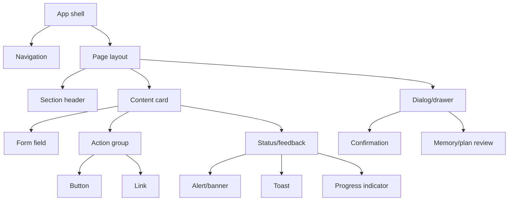

# NexusAI — MVP Design System

**Document type:** Phase 09 visual language, component hierarchy, interaction states, and responsive design system  
**Phase:** Phase 09 — UI/UX & User Experience Architecture  
**Status:** Approved — Phase 09 through Phase 11 gates passed; Phase 12 Implementation Foundation/Project Initialization approved; Phase 13 Part 1 APPROVED; Phase 13 Part 2 AUTHORIZED / IN PROGRESS  
**Canonical product:** NexusAI — Personal AI Health & Wellness Companion  
**Date:** 2026-08-29  
**Scope:** Design-system specification only. No production CSS, HTML, component code, or framework lock-in is created.

## 1. Design-system goals

The design system should feel calm, personal, clear, and trustworthy. It should support wellness actions without looking like a clinical dashboard or gamified productivity tool. Tokens are semantic recommendations; exact implementation values and brand approval remain a later design decision.

Principles:

- Use hierarchy and whitespace before decoration.
- Prefer plain-language labels and direct actions.
- Make consent, memory, and safety states visually distinct but not alarming.
- Keep AI suggestions visually separate from confirmed records.
- Ensure every interactive state has a keyboard and screen-reader equivalent.
- Avoid color as the only status signal.

## 2. Visual direction

| Attribute | Direction |
| --- | --- |
| Mood | Calm, warm, grounded, optimistic without hype |
| Shape | Soft corners and restrained elevation; avoid excessive rounded “chat bubble” decoration |
| Imagery | Optional abstract wellness illustrations; no clinical imagery or diagnostic symbols |
| Density | Comfortable reading width, one primary action per region |
| Voice | Encouraging, neutral, transparent, never shame-based or medically authoritative |

## 3. Typography

Use a legible system sans-serif or approved product font with strong fallback coverage. Do not lock to a specific vendor font in this phase.

| Role | Guidance |
| --- | --- |
| Display/title | Clear, human, restrained; used for page titles and greeting |
| Heading | Distinguishes sections and card groups; sentence case |
| Body | Comfortable line height for health/wellness reading |
| Label | Short, explicit, never color-only |
| Caption/helper | Used for source, consent, status, and secondary context; maintain readable contrast |
| Monospace | Reserved for support/request IDs, never shown for ordinary users |

Text should remain readable at 200% zoom without loss of content. Avoid all-caps paragraphs and decorative text treatments.

## 4. Spacing and layout tokens

Use a small, consistent spacing scale (for example, 4-unit increments) with semantic names such as `space-1`, `space-2`, `space-3`, `space-4`, and `space-6`. Components should use tokens rather than screen-specific arbitrary margins.

Recommended layout rules:

- Content reading width: comfortable measure for chat and wellness guidance.
- Dashboard: one primary column plus an optional secondary rail on wide screens.
- Forms: single-column by default; group related optional fields.
- Cards: internal padding must remain comfortable at mobile width.
- Touch targets: meet the chosen accessibility target; do not rely on tiny icon-only controls.

Exact pixel values, breakpoints, and grid columns are implementation decisions after visual QA.

## 5. Color semantics

Use a neutral/light canvas, high-contrast text, and a restrained accent for primary actions. The exact palette requires brand and contrast review. Semantic roles matter more than color names:

| Semantic token | Use | Constraint |
| --- | --- | --- |
| `surface` | Page/card backgrounds | Preserve separation without heavy borders |
| `text-primary` | Main content | Meets contrast target |
| `text-secondary` | Helper/source text | Never used for essential content alone |
| `accent` | Primary action and selected navigation | Not the only status signal |
| `success` | Confirmed save/completion | Pair with text/icon |
| `warning` | Pending, paused, or attention-needed state | Calm, non-alarmist language |
| `danger` | Destructive action or blocked operation | Use sparingly with explicit text |
| `safety` | Redirect/escalation treatment | Reviewed copy; not a diagnosis score |
| `focus` | Keyboard focus ring | Clearly visible in light and dark modes |

Safety escalation should use layout, heading, and text—not red color alone—to communicate importance. Dark mode requires independently checked contrast, not simple color inversion.

## 6. Component hierarchy

Components should be composable but not abstracted beyond what the MVP needs. A component is justified when it has repeated semantics, keyboard behavior, or validation rules—not merely because two screens share a color.

## 7. Buttons and links

Button hierarchy:

- **Primary:** one main action in a region, such as “Start check-in” or “Save goal.”
- **Secondary:** a safe alternative, such as “Edit proposal” or “View plan.”
- **Tertiary/text:** navigation or low-emphasis actions.
- **Destructive:** delete, clear, revoke, or close account; requires explicit label and confirmation.

Use links for navigation and buttons for state-changing actions. Every action has a visible label; icon-only controls require an accessible name and tooltip/help where appropriate. Loading buttons preserve their label and expose progress to assistive technology.

## 8. Inputs and forms

- Every input has a persistent label; placeholder text is not a label.
- Required/optional status is explicit.
- Sensitive or optional fields explain why they are requested and can be skipped where policy allows.
- Inline validation appears near the field and in a summary for screen readers.
- Do not echo rejected sensitive values in error messages.
- Date/time/timezone controls respect locale and do not silently alter a user’s schedule.
- Memory consent uses a dedicated explanation and control, not a preselected hidden checkbox.

## 9. Cards, lists, and tables

Cards present one coherent decision: today’s plan, a goal, a reminder, a memory item, or an AI proposal. Avoid nesting cards inside cards repeatedly. Lists support empty, loading, error, deleted, and pagination states.

Tables are reserved for dense settings/support metadata. On mobile, transform rows into labeled cards rather than requiring horizontal scrolling for essential actions.

## 10. Navigation patterns

- Desktop: persistent navigation rail or sidebar with clear active state.
- Tablet: condensed rail or top navigation based on available width.
- Mobile web: compact header plus bottom/overflow navigation; Home and AI Companion remain direct.
- Breadcrumbs: detail screens only; never use them to hide privacy controls.
- Account menu: profile, sessions, privacy, and sign out are grouped predictably.

The navigation must keep Memory and Privacy discoverable from any AI surface.

## 11. Dialogs, drawers, and confirmations

Use dialogs only for focused decisions: delete item, clear memory, revoke consent, confirm a plan proposal, or re-authenticate. Destructive dialogs state:

- what data/action is affected;
- what is not affected;
- whether cleanup is immediate or asynchronous;
- how to cancel.

Mobile drawers may replace non-destructive detail dialogs but must preserve focus trapping, heading, close control, and back-button behavior.

## 12. Toasts, alerts, and status messages

- Toasts confirm non-destructive transient events and are also available in an accessible live region.
- Inline alerts explain form, network, consent, or AI failures near the affected content.
- Persistent banners communicate wellness scope, safety mode, planned maintenance, or lifecycle status.
- Do not use a red toast for a safety escalation or a missed task; use reviewed text and appropriate hierarchy.
- Request IDs are shown only when helping users contact support.

## 13. Loading, empty, and error states

| State | Pattern |
| --- | --- |
| Loading | Skeleton or progress indicator that preserves layout and explains long operations |
| Empty | Friendly explanation and one next action; no fake data |
| Success | Confirm source-of-truth save and offer next safe step |
| Validation error | Field-level issue plus summary; focus first invalid field |
| Network/offline | Preserve safe drafts, offer retry, avoid duplicate mutation |
| AI unavailable | Explain temporary issue and expose manual wellness functions |
| Session expired | Move focus to sign-in/reauthentication without leaking the prior page |
| Rate limited | Calm explanation and retry timing without thresholds |
| Deleted data | Clearly unavailable; never display stale cached content |
| Consent not granted | Explain which context is omitted and how to change consent |

## 14. AI-specific components

### Conversation message

Distinguish user and assistant messages semantically, not only by color. Assistant responses may include a safety mode label, source/context disclosure, feedback/report action, or structured proposal.

### Proposal card

Shows what NexusAI suggested, what data it used at a high level, what will change, and Confirm/Edit/Dismiss actions. It is visually marked as unconfirmed.

### Memory candidate card

Shows “AI would like to remember,” category, purpose, source/date, and Approve/Reject/Edit actions. It must not look like an already-saved memory item.

### Safety panel

Uses reviewed mode-specific copy, a clear heading, calm spacing, and no classifier score. Escalation guidance must not invent local emergency numbers.

## 15. Light and dark mode

Light mode is the MVP baseline unless a later product decision says otherwise. Dark mode can be supported through semantic tokens, but it must be tested independently for:

- contrast and focus visibility;
- chart/visual distinction without color-only signals;
- safety and destructive action clarity;
- image/icon legibility;
- user preference persistence without exposing a health inference.

## 16. Motion and feedback

Motion is purposeful and brief: page transitions, loading progress, and confirmation feedback. Respect `prefers-reduced-motion`; never use motion to communicate urgency or shame. Avoid auto-scrolling the chat when a user is reviewing a memory candidate or safety panel.

## 17. Responsive behavior

Design content-first for desktop, tablet, and mobile web. Use semantic layout bands rather than assuming one device width. At narrow widths:

- stack cards and actions;
- keep primary actions visible;
- move secondary navigation into a labeled menu;
- avoid horizontal scroll for forms and safety content;
- preserve chat composer access above the virtual keyboard.

The information architecture can later feed native mobile apps without changing product/data semantics.

## 18. Framework posture

No CSS framework or component vendor is mandated in Phase 09. The eventual implementation should consume these semantic tokens and component behaviors through an accessible, testable system. Framework selection belongs to a later implementation/tech-stack decision.

## 19. Phase boundary

This document defines visual and interaction rules only. It does not create production CSS, HTML, React/Vue components, design assets, or frontend implementation.
