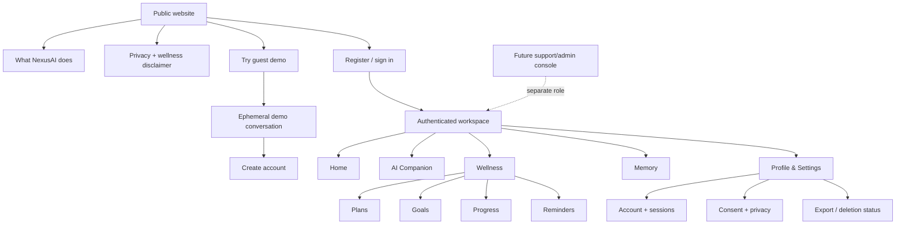

# NexusAI — Information Architecture

**Document type:** Phase 09 navigation, content hierarchy, and screen architecture  
**Phase:** Phase 09 — UI/UX & User Experience Architecture  
**Status:** Approved — Phase 09 through Phase 11 gates passed; Phase 12 Implementation Foundation/Project Initialization approved; Phase 13 Part 1 APPROVED; Phase 13 Part 2 AUTHORIZED / IN PROGRESS  
**Canonical product:** NexusAI — Personal AI Health & Wellness Companion  
**Date:** 2026-08-29  
**Scope:** Information architecture only. No routes, components, CSS, or frontend implementation are created.

## 1. IA principles

- Keep the MVP mental model small: **Today**, **Talk**, **Organize**, **Reflect**, **Control**.
- Make privacy and memory controls one navigation step away from any AI surface.
- Keep proposed changes visually separate from confirmed user state.
- Use familiar nouns (Goals, Plans, Tasks, Progress, Reminders, Memory) rather than internal service names.
- Keep guest and authenticated experiences separate so ephemeral demo data cannot be mistaken for saved data.
- Preserve a stable hierarchy that can later support native mobile or voice without adding Life OS features to the MVP.

## 2. Site map



## 3. Public and guest hierarchy

### Public website

1. Value proposition: personal wellness companion, not medical care
2. How it helps: goals, plans, check-ins, reminders, and chat
3. What it remembers: explicit consent and user controls
4. Privacy summary and links to current policies
5. Primary calls to action: Try demo / Create account / Sign in

### Guest demo

- One focused conversation surface with a small set of suggested prompts
- A visible “Demo is temporary and non-sensitive” notice
- No memory, reminders, progress, or private profile navigation
- Clear upgrade path after the user sees value
- Expiry and rate-limit states that explain what happened without exposing internal quotas

## 4. Authenticated navigation

### Primary navigation

| Destination | User question answered | Priority |
| --- | --- | --- |
| Home | What should I do today? | Primary |
| AI Companion | Can NexusAI help me think through this? | Primary |
| Plans | What are my tasks today/upcoming? | Primary |
| Goals | What am I working toward? | Secondary |
| Progress | What have I recorded over time? | Secondary |
| Reminders | What will prompt me and when? | Secondary |
| Memory | What does NexusAI remember? | Primary privacy control |
| Profile & Settings | How do I control my account/data? | Persistent utility |

On desktop, these destinations may appear in a left navigation rail. On mobile web, Home, AI Companion, Plans, and Profile/Settings remain directly reachable; other destinations can be grouped under Wellness or a clearly labeled menu. Memory must not be hidden under a generic “More” menu.

### Secondary navigation and breadcrumbs

Use breadcrumbs only for detail screens (for example, `Plans / Today / Task details`). Do not create deep nested settings. Destructive or privacy flows show a scope breadcrumb such as `Settings / Privacy / Delete account`.

## 5. Home content hierarchy

```text
Home
├── Greeting + wellness scope cue
├── Today’s plan
│   ├── Next task
│   ├── Remaining tasks
│   └── View plan
├── Check-in prompt
├── One AI suggestion (optional)
├── Goal snapshot
├── Reminder summary
└── Ask NexusAI quick action
```

Only one primary action should compete for attention at a time. The user can hide or dismiss optional AI suggestions without affecting core tracking.

## 6. Onboarding information architecture

Onboarding is a short sequence with progressive disclosure:

```mermaid
flowchart LR
    A[Welcome + what NexusAI is] --> B[Wellness boundary + privacy summary]
    B --> C[Name and age/age-band field per approved policy]
    C --> D[Choose one or more wellness goals]
    D --> E[Optional lifestyle and routine context]
    E --> F[Timezone, schedule, reminder preferences]
    F --> G[Memory explanation + consent choice]
    G --> H[Review choices]
    H --> I[Create first goal/plan]
    I --> J[Home + suggested first conversation]
```



Rules:

- Required fields are limited to what the approved PRD and policy require.
- Sensitive information is optional unless a later approved requirement says otherwise.
- Age versus age-band, minimum age, age assurance, and jurisdiction remain `TBD / Pending Decision`.
- Memory consent is a distinct choice with examples and an immediate settings link.
- The user can skip optional context and still reach the product.
- The final screen summarizes what was saved, what was not saved, and where to change it.

## 7. Wellness hierarchy

### Plans

- Today, upcoming, and past plan views
- Plan status and source (`user`, `template`, `AI-assisted`, or system wording as approved)
- Tasks grouped by plan date or routine
- Proposed plan changes clearly separated from confirmed state

### Goals

- Active goals first
- Goal detail with linked routines/tasks and progress context
- Pause, edit, complete, archive, and delete controls
- No clinical score or diagnosis-like status

### Progress

- Check-in history and neutral aggregates
- “Recorded,” “not recorded,” and “completed” language
- Short time windows by default; no interpretation beyond wellness behavior
- Explain how an aggregate was derived when practical

### Reminders

- Active, paused, and completed/cancelled reminder views
- In-app channel shown explicitly
- Quiet hours/preferences visibly applied
- Delivery status and retry/failure explanation
- Email/push/SMS remain absent or labeled future until approved

## 8. AI Companion information hierarchy

```text
AI Companion
├── Conversation switcher/history
├── Scope and privacy cue
├── Current conversation
│   ├── User messages
│   ├── Assistant responses
│   ├── Safety mode labels when needed
│   └── Suggested plan/task/reminder cards
├── Composer + suggested prompts
└── Memory candidate review surface
```

The UI makes current conversation, profile/plan context, and approved memory distinguishable. A candidate card never looks like an already-saved memory. Tool proposals remain in the conversation until the user confirms or dismisses them.

## 9. Memory information architecture

```text
Memory
├── Memory status (on/off + explanation)
├── Remembered items
│   ├── Category
│   ├── Purpose
│   ├── Source/date
│   ├── Edit
│   └── Delete
├── Pending candidates
│   ├── Approve
│   ├── Reject
│   └── Edit before approval
├── Clear all memory
└── Revoke future memory / lifecycle status
```

Memory list and candidate review use plain language. The interface does not expose internal confidence scores as if they were facts; it may show an explanation such as “Suggested because you mentioned this preference in a recent conversation.”

## 10. Profile, privacy, and settings hierarchy

```text
Profile & Settings
├── Profile
├── Communication preferences
├── Notifications and quiet hours
├── Authentication and active sessions
├── Consent and policy history
├── Memory controls
├── Data export
├── Delete account
└── Policies (Privacy, Terms, wellness disclaimer)
```

Account deletion and export are separate flows with status screens. The UI must not imply that a request is complete until the lifecycle API returns verified completion.

## 11. Future support/admin hierarchy

Support/admin is a separate application shell and role boundary, not an extra user navigation item. Its minimum MVP view is account status, consent status, usage/abuse signals, and audit events needed for support. Full chat or memory content is not visible by default. Role matrix, break-glass process, and operator expiry remain TBD.

## 12. URL and deep-link principles

Conceptual UI paths should be stable, readable, and independent of database IDs where possible:

- `/` — public landing
- `/demo` — guest demo
- `/sign-in`, `/register`, `/recover` — authentication
- `/app`, `/app/companion`, `/app/plans`, `/app/goals`, `/app/progress`, `/app/reminders`, `/app/memory`, `/app/settings`

These are UI routes, not new API endpoints. Deep links must enforce authentication, ownership, lifecycle status, and safe fallback for deleted or unavailable resources.

## 13. Search, filtering, and empty states

MVP search is limited to a user’s own visible plans, tasks, goals, reminders, and conversations where product value justifies it. Search must not become a cross-account or unrestricted memory search. Empty states explain the next safe action, such as creating a first goal or enabling reminders.

## 14. IA decisions held for later

- Final mobile navigation pattern and breakpoint values
- Localization and launch locale
- Exact naming for “Progress” versus “Check-ins” in navigation
- Export/download UX and artifact format
- Support/admin console navigation after role matrix approval
- Voice and future Life OS information architecture

These remain `TBD / Pending Decision` or future design work.

## 15. Phase boundary

This document defines content hierarchy and navigation only. It does not create frontend routes, components, CSS, HTML, native mobile screens, voice interfaces, or production analytics.
