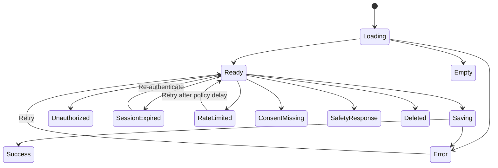

# NexusAI — MVP Screen Specifications

**Document type:** Phase 09 screen-level behavior and content specification  
**Phase:** Phase 09 — UI/UX & User Experience Architecture  
**Status:** Approved — Phase 09 through Phase 11 gates passed; Phase 12 Implementation Foundation/Project Initialization approved; Phase 13 Part 1 APPROVED; Phase 13 Part 2 AUTHORIZED / IN PROGRESS  
**Canonical product:** NexusAI — Personal AI Health & Wellness Companion  
**Date:** 2026-08-29  
**Scope:** Screen contracts and states only. No frontend components, HTML/CSS, API code, or visual design files are created.

## 1. Screen contract conventions

Every screen specification includes:

- user goal and primary action;
- visible information and privacy boundary;
- supporting API/domain data (the full mapping is in [`09-ui-api-traceability.md`](09-ui-api-traceability.md));
- loading, empty, success, error, unauthorized/session, rate-limit, AI-unavailable, safety, deletion, and consent states where applicable;
- keyboard/focus and responsive considerations.

Screen content is user-facing and must not expose database internals, provider payloads, classifier scores, raw tokens, or support-only metadata.

## 2. Public landing screen

**Purpose:** Establish value and trust before signup.  
**Primary action:** Try the guest demo.  
**Secondary actions:** Create account, sign in, view Privacy/Terms.

**Content:**

- Personal AI wellness companion description
- Goals, routines, check-ins, reminders, and chat benefits
- Persistent statement that NexusAI is not medical diagnosis/treatment
- Short memory explanation: explicit user control, inspect/edit/delete/revoke
- Privacy summary and current policy links

**States:** public loaded, policy unavailable (safe fallback or hide dynamic copy), network failure, keyboard navigation, narrow/mobile layout.

## 3. Guest demo screen

**Purpose:** Let a visitor experience one constrained wellness conversation.  
**Primary action:** Send a non-sensitive wellness intention.  
**Secondary action:** Create account or exit demo.

**Content:**

- Ephemeral/non-sensitive notice
- Suggested prompt chips
- Conversation area and composer
- Demo expiry/remaining-session explanation without raw quota thresholds
- Upgrade CTA

**States:** initial, sending, response, safety redirect/escalation/blocked, rate limited, expired, AI unavailable, network failure, sign-in transition. Guest content is never shown as saved memory or account history.

## 4. Authentication screens

### Register

Collect only approved identity fields and acknowledgements. Explain verification and privacy without confirming whether an email already exists. Show field-level errors and generic success/recovery states.

### Verify email / identity

Explain one-time proof flow, expiry, resend behavior, and safe failure. Do not display or log the proof.

### Sign in

Provide credential/identity assertion form, recovery link, and MFA/step-up slot when supported. Provider, transport, MFA baseline, and session policy remain TBD.

### Recovery

Always use enumeration-safe copy. Preserve no sensitive proof in URL history or analytics.

## 5. Onboarding screens

Onboarding may be a multi-step page or a focused stepper, but each step must be skippable where policy allows.

| Step | Visible content | Primary action | Privacy note |
| --- | --- | --- | --- |
| Welcome | What NexusAI is/is not | Continue | No data collected |
| Wellness boundary | Disclaimer and privacy summary | Continue | Clear non-doctor language |
| Identity | Name; age/age-band per approved policy | Continue | Minimum age/age assurance TBD |
| Goals | Select/create wellness goal | Continue | Non-clinical wording |
| Lifestyle | Optional routines/preferences/context | Skip or continue | Do not require sensitive data |
| Notifications | Timezone, schedule, reminder preference | Skip or continue | Channels/recurrence TBD |
| Memory | What may be remembered and why | Enable/keep off | Separate explicit consent |
| Review | What will be saved and current choices | Confirm | Edit before commit |

Loading and save errors preserve progress without creating duplicate writes. The completion screen links to Memory and Settings.

## 6. Home dashboard

**Purpose:** Answer “What is useful today?” within one glance.  
**Primary action:** Start today’s task or check-in.  
**Secondary actions:** Continue conversation, view plan, open reminder.

**Content order:** greeting/date, today’s plan (one to three next tasks), check-in prompt, optional AI suggestion, goal snapshot, reminder summary, quick chat.

**States:**

- first-use empty state: create a first goal or start a conversation;
- plan loading/queued/failed;
- task completed/undo/pending;
- AI unavailable with manual alternatives;
- consent-not-granted explanation for omitted personalization;
- deleted or archived plan state.

Avoid dense metrics, clinical scores, and unsolicited AI content. On mobile, stack modules and keep the next task/check-in above the fold.

## 7. AI Companion screen

**Purpose:** Provide safe, personal wellness conversation.  
**Primary action:** Send a message.  
**Secondary actions:** Use suggested prompt, review proposal, manage memory.

**Content:**

- conversation switcher/history;
- current conversation with semantic user/assistant distinction;
- context cue explaining current conversation, profile/plan context, and remembered information;
- composer with character/size guidance;
- suggested prompts tied to active goals/tasks;
- structured plan/task/reminder proposal cards;
- memory candidate cards;
- response report/feedback action.

**States:** streaming/loading (if later approved), sent, retryable AI error, provider timeout, rate limited, session expired, safety redirect/escalation/blocked, consent omitted, deleted conversation, offline draft.

The assistant is friendly but not presented as human. It does not reveal chain-of-thought, provider data, hidden policy text, or medical certainty.

## 8. Plans screen

**Purpose:** Inspect and manage daily plans and tasks.  
**Primary action:** Start next task or create a plan.  
**Secondary actions:** View upcoming plan, adjust, archive.

**Content:** date selector, plan status/source, grouped tasks, routine/goal links, AI proposal label, confirm/edit/dismiss controls, task status and undo.

**States:** no plan, plan generation queued, generation failed, active/completed/archived/deleted, task pending/completed/skipped/snoozed/cancelled, conflict or rate limit.

Never silently activate or materially change an AI proposal. Preserve a clear distinction between suggested and confirmed state.

## 9. Goals screen

**Purpose:** Define what the user wants to improve.  
**Primary action:** Create or activate a goal.  
**Secondary actions:** Edit, pause, complete, archive, delete, create plan.

**Content:** goal title/area/timeframe, linked routines/plans, neutral progress context, history/status, optional AI suggestions.

**States:** empty, validation error, duplicate/conflict, active/paused/completed/archived/deleted, unauthorized/resource-not-found.

Goal language must remain wellness-oriented and avoid disease or treatment labels.

## 10. Progress and Check-ins screen

**Purpose:** Reflect on recorded activity and progress.  
**Primary action:** Record a check-in.  
**Secondary actions:** Review date range, open task/goal, request an adjustment suggestion.

**Content:** recent check-ins, completion/skip summaries, neutral trend language, source window, optional reflection, no clinical score.

**States:** first check-in empty, saving, saved, progress refresh pending, AI unavailable, deleted source data, invalid date range, network failure.

Charts or visual trends must have a text alternative and must not imply diagnosis, risk prediction, or treatment outcome.

## 11. Reminders screen

**Purpose:** Control reminder intent and delivery.  
**Primary action:** Create or enable an in-app reminder.  
**Secondary actions:** Edit, pause, snooze, disable, inspect delivery status.

**Content:** reminder title, linked task/routine, schedule, active/paused state, quiet hours, in-app channel, delivery outcome, preferences link.

**States:** no reminders, pending save, active, paused, delivery failed/retrying, consent-not-granted, channel unavailable, deleted target, rate limit.

Email/push/SMS are not assumed. Future channels require separate consent and provider review.

## 12. Memory screen

**Purpose:** Give transparent control over AI memory.  
**Primary action:** Review a candidate or change memory status.  
**Secondary actions:** Edit, delete, clear all, revoke future memory.

**Content:** memory on/off status, approved items with category/purpose/source/date, pending candidates, clear/revoke actions, lifecycle status.

**States:** no memories, candidate pending, approved, rejected/discarded, deleted, revoked, cleanup pending/failed/completed, consent unavailable, session expired.

Use the explicit distinction **“AI remembers this”** versus **“This is only part of the current conversation.”** Do not expose internal confidence as fact.

## 13. Profile and Settings screen

**Purpose:** Manage identity, communication, security, privacy, and account lifecycle.  
**Primary action:** Save a selected setting.  
**Secondary actions:** View sessions, consent history, export, delete account.

**Sections:** Profile, communication preferences, authentication/MFA when supported, sessions, consent, notifications/quiet hours, Memory, export, deletion, current policies.

Settings use clear save/cancel states and do not place destructive actions next to routine preferences without visual separation.

## 14. Export status screen

**Purpose:** Show the lifecycle of a data export request.  
**Content:** requested scope, requested/queued/running/completed/failed status, artifact expiry, safe download action when available.

Do not expose internal artifact paths or promise a format/download method before that decision is approved. Repeated requests use lifecycle idempotency behavior.

## 15. Account deletion screen

**Purpose:** Explain and confirm account deletion scope.  
**Content:** affected data categories, what is retained under approved exceptions, re-authentication step if required, status timeline, cancel/forward-fix guidance.

The screen must distinguish request acceptance from verified completion and must not promise provider/backup purge while that policy is TBD.

## 16. Future support/admin screen

Support/admin uses a separate shell and is not linked from the end-user navigation. The minimum view covers account status, consent status, usage/abuse signals, and audit events needed for support. Full private chat/memory access is not default. Exact role matrix, break-glass, expiry, and escalation remain TBD.

## 17. Shared screen-state model

Each screen may specialize these states but must not remove the safety, privacy, or ownership behavior.

## 18. Phase boundary

This document defines screen behavior and content structure only. It does not create components, pages, CSS, production copy, API endpoints, analytics code, or native/voice UI.
