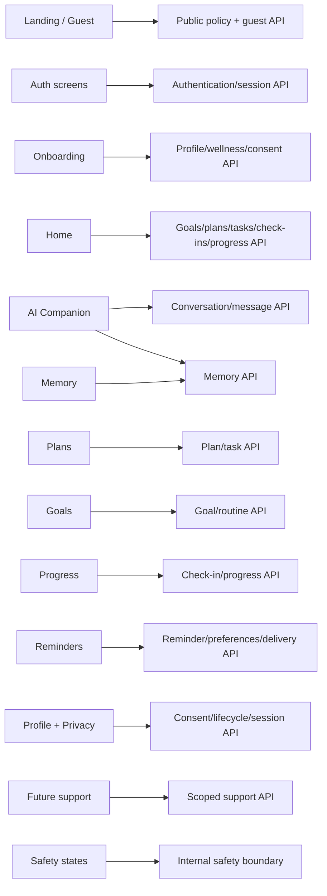

# NexusAI — UI to API Traceability

**Document type:** Phase 09 screen/action to approved API and data-boundary mapping  
**Phase:** Phase 09 — UI/UX & User Experience Architecture  
**Status:** Approved — Phase 09 through Phase 11 gates passed; Phase 12 Implementation Foundation/Project Initialization approved; Phase 13 Part 1 APPROVED; Phase 13 Part 2 AUTHORIZED / IN PROGRESS  
**Canonical product:** NexusAI — Personal AI Health & Wellness Companion  
**Date:** 2026-08-29  
**Scope:** Traceability only. No frontend code, API changes, endpoint implementation, or database changes are created.

## 1. Traceability rules

- The approved Phase 07 API contract is normative; UI routes are not new API endpoints.
- Each screen action maps to an existing API operation or is explicitly client-only.
- User-owned actions derive ownership from the authenticated principal and use the API’s IDOR-safe behavior.
- Safety, consent, lifecycle, rate-limit, and error states are rendered from the approved API semantics.
- Guest data remains ephemeral and cannot enter authenticated memory, conversation, or planning state.
- No UI control is offered for a capability that is not present in the approved API or clearly marked future.

## 2. Screen-to-domain map

## 3. Complete approved API operation mapping

The following groups account for all **77 approved Phase 07 operations**. Paths are relative to the approved public `/api/v1` namespace unless noted.

| Domain / count | UI surfaces and actions | Approved operations | Approved data/boundary |
| --- | --- | --- | --- |
| Public policy — 1 | Landing policy links, onboarding disclaimer, Terms/Privacy links | `GET /public/policies/current` | Published policy artifact; cacheable non-user copy |
| Guest demo — 3 | Demo start, send interaction, exit/expiry | `POST /guest/demo/sessions`; `POST /guest/demo/sessions/{demo_id}/interactions`; `DELETE /guest/demo/sessions/{demo_id}` | Ephemeral guest capability; no durable private DB record |
| Authentication/session — 9 | Register, verify, sign in, sign out, sessions, recovery | `POST /auth/register`; `POST /auth/verify-email`; `POST /auth/login`; `POST /auth/logout`; `GET /auth/sessions`; `DELETE /auth/sessions/{session_id}`; `POST /auth/recovery/request`; `POST /auth/recovery/confirm`; `GET /me` | `accounts`, `auth_sessions`; provider/MFA/transport TBD |
| Profile/wellness/consent/preferences — 9 | Onboarding, profile, wellness context, consent, notification preferences | `GET /me/profile`; `PATCH /me/profile`; `GET /me/wellness-profile`; `PATCH /me/wellness-profile`; `GET /me/consents`; `POST /me/consents`; `POST /me/consents/{consent_type}/revoke`; `GET /me/notification-preferences`; `PUT /me/notification-preferences` | `user_profiles`, `wellness_profiles`, `consent_records`, `notification_preferences` |
| Goals/routines — 10 | Goal list/detail/create/edit/delete; routine list/detail/create/edit/delete | `GET /me/goals`; `POST /me/goals`; `GET /me/goals/{goal_id}`; `PATCH /me/goals/{goal_id}`; `DELETE /me/goals/{goal_id}`; `GET /me/routines`; `POST /me/routines`; `GET /me/routines/{routine_id}`; `PATCH /me/routines/{routine_id}`; `DELETE /me/routines/{routine_id}` | `goals`, `routines`; account-scoped ownership |
| Plans/tasks/check-ins/progress — 13 | Home plan, plan detail/create/edit, task add/detail/edit/delete, check-in, progress | `GET /me/daily-plans`; `POST /me/daily-plans`; `GET /me/daily-plans/{plan_id}`; `PATCH /me/daily-plans/{plan_id}`; `POST /me/daily-plans/{plan_id}/tasks`; `GET /me/tasks/{task_id}`; `PATCH /me/tasks/{task_id}`; `DELETE /me/tasks/{task_id}`; `GET /me/check-ins`; `POST /me/check-ins`; `PATCH /me/check-ins/{check_in_id}`; `DELETE /me/check-ins/{check_in_id}`; `GET /me/progress` | `daily_plans`, `tasks`, `check_ins`; derived progress read model |
| Conversations/messages/feedback — 8 | AI Companion history, conversation create/detail/edit/delete, messages, report | `GET /me/conversations`; `POST /me/conversations`; `GET /me/conversations/{conversation_id}`; `PATCH /me/conversations/{conversation_id}`; `DELETE /me/conversations/{conversation_id}`; `GET /me/conversations/{conversation_id}/messages`; `POST /me/conversations/{conversation_id}/messages`; `POST /me/conversations/{conversation_id}/messages/{message_id}/report` | `conversations`, `messages`, metadata-only audit; AI gateway/safety boundary |
| Memory — 6 | Memory list, candidate approval/rejection, edit/delete, clear, revoke | `GET /me/memories`; `POST /me/memories/candidates/{candidate_id}/approve`; `PATCH /me/memories/{memory_id}`; `DELETE /me/memories/{memory_id}`; `POST /me/memory-controls/clear`; `POST /me/memory-controls/revoke` | `memory_records`, `consent_records`, `data_lifecycle_requests`, `audit_events` |
| Reminders/deliveries — 6 | Reminder list/create/detail/edit/delete/delivery status | `GET /me/reminders`; `POST /me/reminders`; `GET /me/reminders/{reminder_id}`; `PATCH /me/reminders/{reminder_id}`; `DELETE /me/reminders/{reminder_id}`; `GET /me/reminders/{reminder_id}/deliveries` | `reminders`, `notification_preferences`, `notification_deliveries` |
| Lifecycle — 3 | Export request/list/status, account deletion status | `GET /me/data-requests`; `POST /me/data-requests`; `GET /me/data-requests/{request_id}` | `data_lifecycle_requests`; protected export artifact boundary |
| Usage — 1 | Settings/support-safe usage view | `GET /me/usage` | Minimized `ai_usage_events`; no prompts/responses |
| Support/admin — 5 | Future support account status, consent, usage signals, audit, access event | `POST /support/access-events`; `GET /support/accounts/{account_id}/status`; `GET /support/accounts/{account_id}/consents`; `GET /support/accounts/{account_id}/usage-signals`; `GET /support/accounts/{account_id}/audit-events` | Least-privilege support boundary; `support_access_events`, `audit_events`; role matrix TBD |
| Internal safety/health — 3 | Not end-user navigation; safety service and infrastructure monitoring | `POST /internal/v1/safety/evaluate`; `GET /health/live`; `GET /health/ready` | Internal safety policy and operational health; no user content in response |
| **Total — 77** | **All MVP screen actions and states** | **All approved Phase 07 operations** | **No new endpoint proposed** |

## 4. Flow-level traceability

| User flow | UI screens | API operations | AI/memory/safety dependency |
| --- | --- | --- | --- |
| Guest → conversation | Landing, Demo | Guest demo group | Ephemeral context, minimal safety, no memory |
| Guest → account | Demo, Register, Verify, Sign in | Auth group | Fresh consent/onboarding; no automatic private carry-over |
| New user onboarding | Welcome, boundary, profile, goals, preferences, memory, review | Profile/wellness/consent/preferences + goals/routines + optional plan | Consent-aware context; memory off unless enabled |
| First AI conversation | Home, AI Companion | Conversation/message group; usage signal | Pre/post safety, minimized context, provider gateway |
| Memory approval | AI Companion, Memory | Memory group | Candidate ephemeral until explicit approval |
| Goal creation | Goals, AI proposal | Goals group | AI may suggest; domain service commits |
| Daily plan | Plans, proposal review | Plans/tasks group | Bounded planning; confirmation before material change |
| Task completion | Home, Plans | Task/check-in group | User action source of truth; optional reminder update |
| Daily check-in | Home, Progress | Check-in/progress group | No clinical inference; AI optional |
| Progress review | Progress, Goal/Plan detail | Progress plus read-only domain groups | Neutral aggregates and source window |
| Reminder management | Reminders, Settings | Reminders/delivery/preferences groups | In-app MVP; channels/recurrence TBD |
| Memory management | Memory, AI Companion | Memory + lifecycle groups | Immediate retrieval block; async cleanup status |
| Data export | Settings, Export status | Lifecycle group | Protected artifact; format/download TBD |
| Account deletion | Settings, Deletion status | Lifecycle group + auth/session behavior | Scope confirmation, status evidence, no premature purge claim |
| Safety escalation | AI Companion safety panel | Internal safety boundary; message response mode | Reviewed guidance; no invented emergency number |

## 5. Client-only state

The following may exist in ephemeral client state without becoming new persistence or API endpoints:

- navigation selection, open drawer/dialog, and responsive layout state;
- unsent chat draft, with safe local handling and expiry;
- selected date/filter/sort for a user-owned list;
- temporary optimistic/pending indicator that reconciles with the API;
- proposal card expansion and dismissed suggestion UI;
- accessibility focus and live-region state.

Client-only state must not contain raw session tokens, unapproved memory, hidden safety scores, or a second source of truth for saved goals/plans/tasks.

## 6. API state-to-UX mapping

| API condition | Required UI behavior |
| --- | --- |
| `200/201/202/204` success | Confirm exact source-of-truth result; `202` shows queued/pending status |
| `400/422` validation | Inline field/error summary; do not echo sensitive input |
| `401` unauthenticated/expired | Re-authenticate with safe draft preservation where appropriate |
| `403` forbidden/consent/step-up | Explain missing permission/consent; offer approved control path |
| `404` not found/IDOR mask | Treat as absent; do not reveal ownership or probe IDs |
| `409` conflict/idempotency/lifecycle | Show current safe state and ask user to review/refresh |
| `429` rate/quota | Calm retry guidance using `Retry-After`; no threshold disclosure |
| `502/503/504` AI/dependency | Show safe temporary-unavailability state; preserve independent wellness actions |
| `response_mode=redirect/escalation/blocked` | Render reviewed safety panel, not a generic error banner |
| lifecycle `requested/queued/running/failed/completed` | Show scope and status; never claim physical/provider purge early |

## 7. Ownership, privacy, and safety checks

- The UI never sends an arbitrary account ID to a `/me/*` operation.
- Nested task/plan/routine/goal and message/conversation links are validated server-side even if the UI already filtered them.
- Sensitive fields are not placed in query strings, analytics events, notification previews, or support URLs.
- Memory retrieval/write controls are visible and reflect current consent; a stale client toggle cannot override policy.
- AI/provider payloads and hidden reasoning are not rendered or stored by the UI.
- Support/admin screens are a separate role boundary and are not reachable from end-user navigation by default.

## 8. Traceability findings

No missing MVP UI-to-API mapping was found. No new API endpoint is required for onboarding because onboarding is a composed flow over approved profile, consent, goals, routines, preferences, and plan operations. Memory convenience controls delegate to canonical lifecycle/consent behavior rather than creating duplicate persistence paths.

Potential implementation gates:

- durable idempotency behavior for non-lifecycle mutations;
- API contract tests for every screen action and negative ownership case;
- exact response schema for AI proposal cards, safety modes, and memory candidates;
- accessibility mapping for errors, live regions, dialogs, and progress charts.

## 9. Phase boundary

This document maps UI behavior to approved API contracts only. It does not create API endpoints, frontend routes/components, client SDKs, backend code, or database changes.
