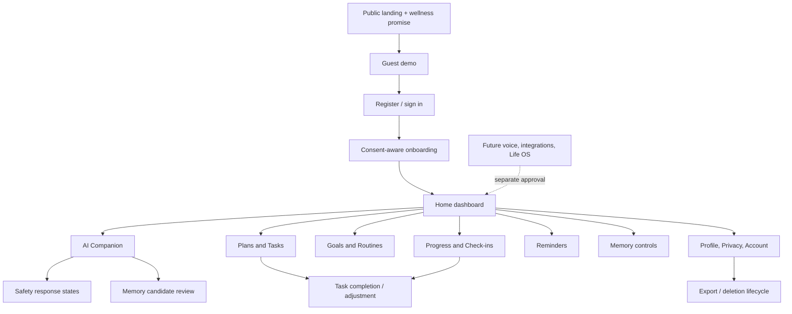

# NexusAI — UI/UX and User Experience Architecture

**Document type:** Phase 09 product experience, interaction, and interface architecture  
**Phase:** Phase 09 — UI/UX & User Experience Architecture  
**Status:** Approved — Phase 09 through Phase 11 gates passed; Phase 12 Implementation Foundation/Project Initialization approved; Phase 13 Part 1 APPROVED; Phase 13 Part 2 AUTHORIZED / IN PROGRESS  
**Canonical product:** NexusAI — Personal AI Health & Wellness Companion  
**Date:** 2026-08-29  
**Platform:** Web-first responsive experience  
**Scope:** UX architecture and screen behavior only. No frontend code, HTML/CSS, React components, design files, or production assets are created.

## 1. Source of truth and product boundary

The approved Phase 00–08 documentation controls product scope, database ownership, API behavior, AI/memory policy, safety modes, and unresolved decisions. This document translates those boundaries into a calm, trustworthy MVP experience without expanding the product into the broader Personal AI Life OS vision.

Current MVP: a web-based Personal AI Health & Wellness Companion that helps users build healthy habits, organize goals and routines, complete daily tasks, check in, review progress, manage reminders, and chat with an AI under explicit memory and safety controls.

The UI must never imply that NexusAI is a doctor, clinical tracker, emergency service, or human being. The persistent wellness disclaimer and contextual safety copy are product requirements, not optional decoration.

## 2. Experience goals

- **Simple:** The next useful action is visible without an overloaded dashboard.
- **Trustworthy:** Explain what the AI knows, remembers, proposes, and cannot do.
- **Calm:** Use neutral, non-judgmental language for progress, reminders, and missed tasks.
- **Personal:** Use approved profile/preferences and consented memory without hidden personalization.
- **Actionable:** Convert a goal into a small plan, task, check-in, and optional reminder.
- **Reversible:** Make edits, undo paths, pause/snooze, memory deletion, and account controls easy to find.
- **Inclusive:** Work with keyboard, screen reader, zoom, reduced motion, mobile web, and variable connectivity.

## 3. User types and experience boundaries

| User type | Experience | Data boundary | Primary UX need |
| --- | --- | --- | --- |
| Guest | Landing page and constrained demo | Ephemeral, non-sensitive, no durable private memory | Understand value and safety before creating an account |
| Authenticated user | Full wellness workspace | Own account, consented context, approved memories | Build routines, chat, track progress, and control data |
| Future support/admin | Separate operational console | Least privilege, scoped access, audited; no private chat/memory by default | Resolve account/delivery issues without surveillance |

Guest and authenticated navigation are intentionally distinct. A guest is never asked for sensitive health information just to sample the product. A user who upgrades sees an explicit transition from demo to account and must make fresh consent choices where required.

## 4. Experience architecture

## 5. MVP surface versus future surface

### MVP surface

- Public landing and wellness disclaimer
- Ephemeral guest demo
- Registration, verification, sign-in, recovery, and session management
- Focused onboarding
- Home dashboard
- AI Companion text chat
- Goals, routines, daily plans, tasks, check-ins, progress
- In-app reminders and preferences
- Consent-based Minimal Memory controls
- Profile, privacy, export, deletion, and account settings
- Calm safety redirect/escalation/blocked states

### Future surface (not active MVP requirements)

- Voice input/output and interruption handling
- Calendar, wearable, search, messaging, smart-home, creator, education, work, robotics, or household features
- Full Life OS navigation or a universal autonomous agent
- Native mobile apps
- Clinical records, clinician portal, diagnosis, treatment, or emergency dispatch

Future features must be added as separately scoped capabilities; they must not appear as disabled-but-prominent MVP navigation items.

## 6. Navigation rationale

The recommended authenticated navigation is:

1. **Home** — today’s priorities and quick actions
2. **AI Companion** — chat, suggestions, and safe guidance
3. **Plans** — today/upcoming plans and tasks
4. **Goals** — goals and routines
5. **Progress** — check-ins and non-clinical trends
6. **Reminders** — reminder list and preferences
7. **Memory** — remembered items and controls
8. **Profile & Settings** — account, consent, privacy, sessions, export, deletion

On narrow screens, Plans, Goals, Progress, and Reminders may be grouped under a “Wellness” navigation section, while Memory and Privacy remain directly discoverable. Home and AI Companion must remain first-level destinations.

## 7. Home dashboard architecture

The dashboard prioritizes a small number of daily actions in this order:

1. Greeting and current date using approved profile preferences
2. Today’s plan with the next one to three tasks
3. Primary check-in action
4. One optional AI suggestion, clearly labeled as a suggestion
5. Goal progress snapshot using non-clinical language
6. Reminder summary with pause/snooze controls
7. Quick “Ask NexusAI” entry

The dashboard does not show raw health metrics, clinical scores, dense charts, or a long AI transcript. Empty states explain how to create a goal or plan. If AI is unavailable, the dashboard still exposes manual plans, tasks, check-ins, and reminders.

## 8. AI Companion UX architecture

The chat surface contains:

- conversation history and current message composer;
- a persistent but concise “general wellness support, not medical diagnosis or treatment” cue;
- suggested prompts tied to goals, routines, check-ins, and plans;
- response mode labels when the response is redirected, escalated, or blocked;
- structured proposal cards for plans/tasks/reminders, with explicit confirm/edit actions;
- memory candidate cards that say “NexusAI would like to remember…” and expose purpose, source, and controls;
- retry/error states that do not duplicate messages or actions;
- a future-compatible voice affordance slot that is not enabled in the MVP.

The assistant is personable through tone and continuity, but it does not claim to be human or conscious. “I can suggest” and “You can choose” are preferred over authoritative clinical language.

### Chat context disclosure

The UI must distinguish:

- **Current conversation:** used for the active chat window;
- **Remembered information:** explicitly approved, visible in Memory, and revocable;
- **Profile/plan context:** application data used for the current feature purpose;
- **AI suggestion:** a proposal that has not changed the user’s state.

## 9. Memory UX architecture

Memory controls are a first-class destination, not a buried privacy link. The user can:

- see each remembered item, category, purpose, source/date, and status;
- approve or reject a candidate;
- edit a value within allowed policy;
- delete one item;
- clear all memory;
- disable future memory and revoke permission;
- view a safe lifecycle status for cleanup.

No dark pattern is permitted: reject/disable/delete controls must be as understandable and reachable as approve/enable controls. The UI never says “the AI remembers everything” and never implies that deleting a memory deletes all chat unless the lifecycle status confirms the exact scope.

## 10. Wellness planning UX

The UI makes the planning chain visible:

`Goal → Plan → Tasks → Routine → Check-in → Progress → Adjustment`

AI-created content is labeled **Suggested by NexusAI** until the user confirms it. Material changes show a before/after summary and a confirmation action. Task completion is one tap/click but supports undo. Missed tasks use neutral language such as “Not recorded yet” rather than failure or shame. Medication-related reminders, if entered by a user, are treated as reminders only; no dosage or treatment UI is introduced.

## 11. Account and privacy UX

Profile & Settings contains clearly labeled sections:

- Profile and communication preferences
- Authentication, recovery, MFA when supported, and active sessions
- Consent history and current choices
- Memory controls
- Notification preferences and quiet hours
- Data export request/status
- Account deletion request/status
- Privacy policy, Terms, and wellness disclaimer

Destructive actions use a clear scope statement, re-authentication/step-up when required by the approved auth policy, confirmation, and a status page. The UI does not promise immediate provider/backup purge while that guarantee remains TBD.

## 12. Safety UX

The UI supports the four approved modes:

| Mode | UI treatment |
| --- | --- |
| `NORMAL` | Ordinary calm response with scope cue where appropriate |
| `WELLNESS_REDIRECT` | Clear boundary, short explanation, and appropriate professional-resource suggestion |
| `SAFETY_ESCALATION` | Prominent but calm instruction to contact local emergency services or a licensed professional according to reviewed policy; no invented numbers |
| `BLOCKED` | Non-judgmental explanation that NexusAI cannot help with that request; offer a safe in-scope alternative where possible |

Safety states must not look like diagnoses, severity scores, or emergency dispatch confirmation. The copy, localization, jurisdiction logic, and policy owner remain TBD.

## 13. Global UX states

Every major surface defines loading, empty, success, validation error, network/offline, unauthorized/session-expired, rate-limited, AI-unavailable, safety response, deleted data, and consent-not-granted states. A global toast is not sufficient for destructive, safety, or form errors; those states remain visible near the affected content.

## 14. Responsive and future voice architecture

The same information hierarchy must work at desktop, tablet, and mobile-web widths. Components use content-first stacking and avoid hover-only actions. A future voice channel can reuse conversation, context disclosure, safety modes, memory approval, and permission prompts; voice is not implemented or shown as active in the MVP.

## 15. Accessibility and trust requirements

The target is WCAG 2.2 AA-informed design with keyboard access, visible focus, semantic headings, accessible names, contrast, text scaling, reduced motion, and screen-reader announcements. Detailed requirements are in [`09-accessibility.md`](09-accessibility.md).

Trust is reinforced through explainable labels, stable navigation, no hidden memory, no surprise side effects, non-judgmental progress language, and honest unavailable/error states.

## 16. Phase boundary

This document defines UX architecture only. It does not create frontend code, HTML/CSS, component libraries, production copy approval, analytics implementation, API endpoints, or Phase 11 implementation work.
