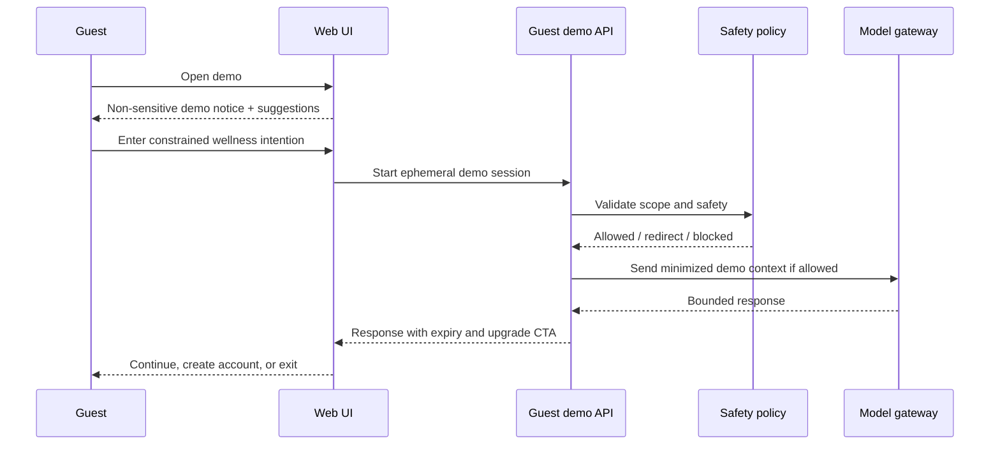
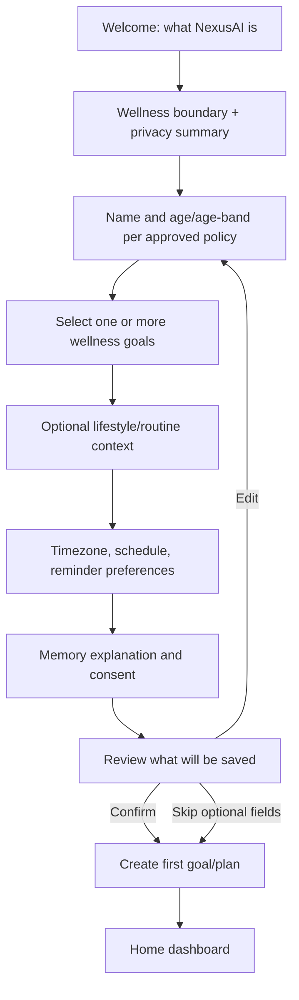
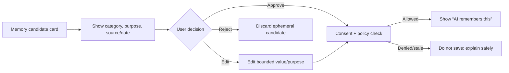
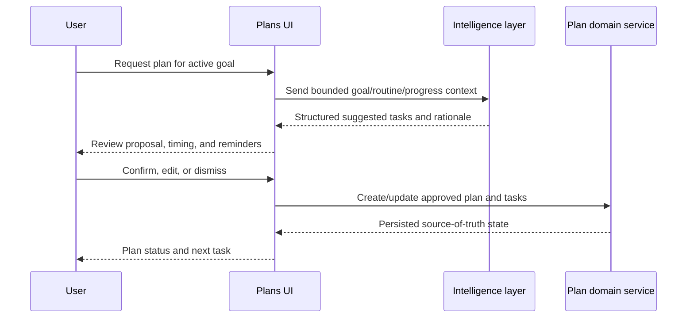
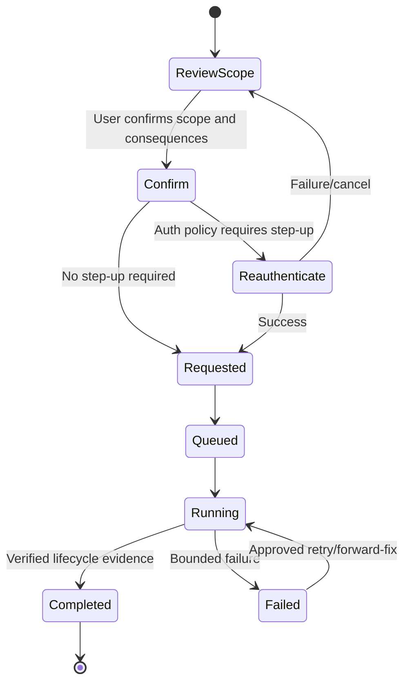

# NexusAI — User Flows

**Document type:** Phase 09 end-to-end MVP user journeys and interaction states  
**Phase:** Phase 09 — UI/UX & User Experience Architecture  
**Status:** Approved — Phase 09 through Phase 11 gates passed; Phase 12 Implementation Foundation/Project Initialization approved; Phase 13 Part 1 APPROVED; Phase 13 Part 2 AUTHORIZED / IN PROGRESS  
**Canonical product:** NexusAI — Personal AI Health & Wellness Companion  
**Date:** 2026-08-29  
**Scope:** User-flow architecture only. No frontend code, API implementation, or production copy is created.

## 1. Flow conventions

- `System` means UI/application behavior; it is not an autonomous AI decision.
- `AI suggests` means a proposal that is not committed until the approved domain service and user confirmation rules allow it.
- `Saved` means the API/domain service confirmed source-of-truth persistence.
- A safety mode can exit any flow before ordinary generation or side effects.
- Every flow has loading, error, retry, session-expired, consent-not-granted, and deleted-data behavior where relevant.

## 2. Guest → AI conversation

Rules: no sensitive health free text, no durable memory, no authenticated history, and no guest reminder/plan persistence. On expiry or rate limit, preserve no private content and explain the next option.

## 3. Guest → account creation

1. Guest selects **Create account** from the demo or public site.
2. UI explains what will carry forward (only explicitly allowed non-sensitive intent, if any) and what will not (guest memory/history by default).
3. User submits registration through the approved authentication flow.
4. UI shows generic verification/recovery state without revealing account existence.
5. After verification/sign-in, user enters onboarding with fresh consent choices.
6. The user can abandon registration without losing a durable private profile beyond approved auth lifecycle behavior.

## 4. New user → onboarding

Required behavior:

- Explain the product, limits, memory controls, and non-doctor status before collecting context.
- Keep optional/sensitive fields skippable unless a later approved policy changes the requirement.
- Show a final summary of saved profile/preferences, consent state, and memory state.
- Do not invent minimum age, age assurance, geography, or jurisdiction behavior; these are TBD.

## 5. User → first AI conversation

1. Home or onboarding offers a suggested prompt tied to the user’s selected goal.
2. User opens AI Companion and sees current-conversation, memory, and profile-context explanation.
3. User sends a wellness question.
4. UI shows a non-blocking loading state and preserves the unsent draft safely.
5. Safety policy selects `NORMAL`, `WELLNESS_REDIRECT`, `SAFETY_ESCALATION`, or `BLOCKED`.
6. If `NORMAL`, the assistant responds using the minimized permitted context.
7. If a plan/task/reminder is suggested, the UI shows a structured proposal with confirm/edit/dismiss actions.
8. If a memory candidate is generated, it appears separately from the answer and is not saved automatically.

If AI is unavailable, the user can continue to Goals, Plans, Tasks, Check-ins, Reminders, and Memory controls.

## 6. User → memory approval

The card uses direct language such as “NexusAI would like to remember this to personalize your wellness plans.” It links to Memory controls. Rejecting a candidate does not delete the current conversation unless the user separately chooses deletion.

## 7. User → goal creation

1. User selects **Create goal** from Home, Goals, or AI proposal.
2. UI requests a short, non-clinical goal title/area and optional timeframe according to approved constraints.
3. If AI suggested the goal, show the original suggestion and user-editable fields.
4. User confirms; the Goals domain service validates ownership and persists the goal.
5. UI shows the active goal with a next-step CTA: create plan, add routine, or continue manually.
6. Errors remain adjacent to fields; duplicate/ownership conflicts do not reveal another account.

## 8. User → AI-generated daily plan

The AI never silently activates a plan. Material changes show a before/after summary. If generation times out, the UI offers manual plan creation and does not duplicate a request without the same idempotency behavior.

## 9. User → task completion

1. Home or Plans shows the next task and status.
2. User selects **Complete**, **Snooze**, **Skip**, or **Not recorded** according to the approved task model.
3. UI provides immediate optimistic feedback only when it can safely reconcile; otherwise it shows a pending state.
4. The task service confirms the status transition.
5. UI offers undo where supported and refreshes the plan/progress view.
6. A reminder may be marked completed or suppressed according to reminder policy; the UI does not expose provider internals.

Missed tasks are neutral and never described as failure, illness, or lack of discipline.

## 10. User → daily check-in

1. Home presents a concise check-in prompt linked to today’s plan or a general reflection.
2. User records completion/skip/snooze/reflection within the approved fields.
3. UI confirms that a check-in is recorded and explains that it is not a medical assessment.
4. Progress aggregates update after the source record is saved.
5. AI may offer an optional reflection or adjustment suggestion using the bounded context.

If the AI or progress read model fails, the saved check-in remains successful and visible.

## 11. User → progress review

1. User opens Progress from navigation or a Home snapshot.
2. UI shows recent check-ins, task completion, goal context, and neutral trends.
3. Each aggregate can explain its source window where practical.
4. User can open a goal/plan/task to make a manual change.
5. AI may suggest a smaller or reordered plan, but the user confirms material changes.

Progress must not resemble a clinical score, diagnosis, risk prediction, or treatment outcome.

## 12. User → memory management

1. User opens Memory and sees current on/off status.
2. User reviews remembered items with category, purpose, source/date, and status.
3. User edits or deletes an item; the UI confirms the exact scope.
4. User chooses **Clear all memory** or **Disable future memory**.
5. The lifecycle API returns a safe status; retrieval is blocked immediately.
6. UI reports asynchronous cleanup as pending until verified completion; it does not promise provider/backup purge prematurely.

## 13. User → data export

1. User opens Settings → Privacy → Export data.
2. UI explains scope, format, expiry, and any pending decision-dependent behavior without inventing a format.
3. User confirms and re-authenticates/steps up if required by the approved auth policy.
4. Lifecycle API creates or returns an idempotent export request.
5. UI shows requested/queued/running/completed/failed status.
6. On completion, the user receives a protected download action or approved delivery mechanism.
7. Artifact expiry is shown; the UI never exposes internal storage paths.

## 14. User → account deletion

The UI names the affected account/profile, chat, plans, tasks, reminders, memory, exports, and derived copies according to the approved lifecycle scope. It does not claim provider, backup, or legal-hold deletion until the policy has evidence.

## 15. User → safety escalation

1. User sends a potentially urgent or high-risk message.
2. UI pauses ordinary response rendering while the safety policy evaluates.
3. The assistant presents `SAFETY_ESCALATION` guidance from a reviewed policy artifact.
4. UI calmly encourages contacting local emergency services or an appropriate licensed professional, without inventing a jurisdiction-specific number.
5. No diagnosis, emergency confirmation, monitoring promise, or automatic dispatch is shown.
6. User can return to safe in-scope wellness actions where policy permits, or the request remains blocked.
7. Safety metadata is audited without exposing classifier scores or raw content.

The exact copy, jurisdiction behavior, and ownership are `TBD / Pending Decision`.

## 16. Cross-flow state matrix

| State | UX response |
| --- | --- |
| Loading | Skeleton/progress indicator with preserved user draft |
| Empty | Explain the next safe action; never imply an error |
| Success | Confirm source-of-truth result and offer next action |
| Validation error | Inline field issue plus accessible summary |
| Network/offline | Preserve safe draft; allow retry; do not duplicate side effects |
| Unauthorized/session expired | Explain sign-in/reauthentication path without exposing data |
| Rate limited | Calm message and retry timing without revealing thresholds |
| AI unavailable | Offer manual wellness functions and safe retry |
| Consent not granted | Explain what is omitted and how to enable it |
| Deleted data | Show unavailable/deleted state; do not recover from stale cache |
| Safety redirect/escalation/blocked | Use reviewed, calm mode-specific copy |

## 17. Future voice continuity

Voice is not implemented in the MVP. A future voice flow must reuse the same conversation identity, safety modes, memory approval, tool confirmation, interruption, and permission rules as text. Voice input/output must never bypass the visual privacy or safety controls.

## 18. Phase boundary

This document defines user journeys and states only. It does not create frontend code, components, production content, voice services, API endpoints, or Phase 11 implementation work.
