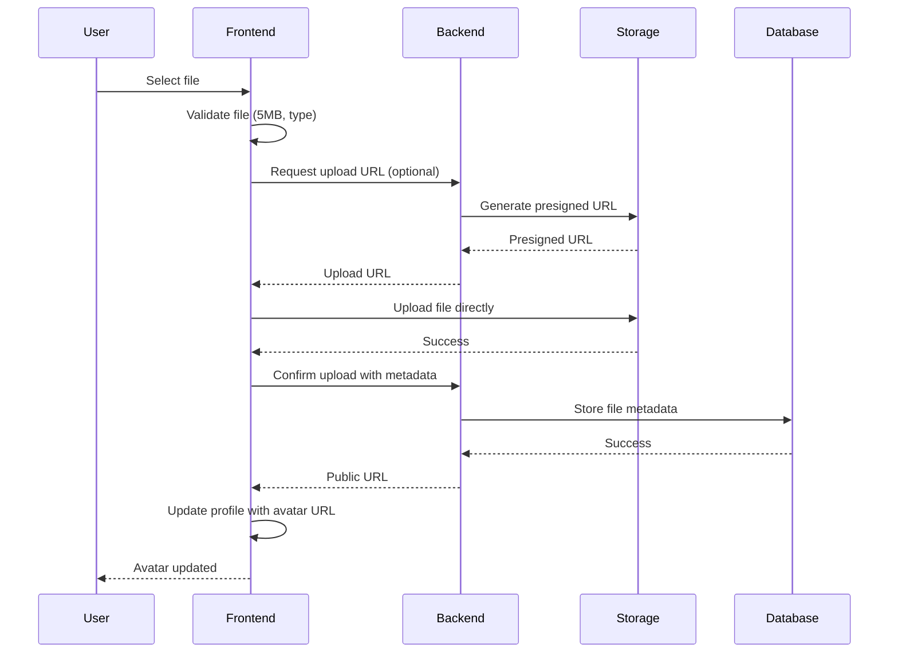
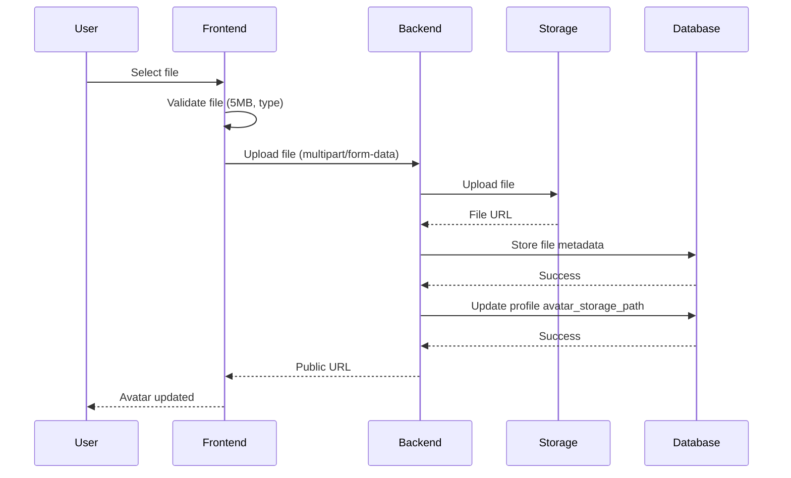

# NexusAI Storage and Media

## Overview

NexusAI currently implements file storage using localStorage for profile images (development only). The database includes a file_metadata table for future cloud storage integration.

## Current Implementation

### Profile Images

**Storage Method**: localStorage (development only)
**Service**: `apps/web/lib/avatar-service.ts`
**Key**: `nexusai_avatar_{userId}`
**Format**: Data URLs (base64 encoded)

### Avatar Service

**File**: `apps/web/lib/avatar-service.ts`

**Functions**:

#### uploadAvatar(userId, file)

Upload avatar to localStorage.

**Validation**:
- Maximum file size: 5MB
- Allowed types: JPEG, PNG, WebP, GIF
- File must be a valid image

**Process**:
1. Validate file size and type
2. Convert file to Data URL (base64)
3. Store in localStorage with key `nexusai_avatar_{userId}`
4. Return Data URL as publicUrl

**Returns**:
```typescript
{
  publicUrl: string,  // Data URL
  storagePath: string // 'local'
}
```

#### loadAvatarFromLocalStorage(userId)

Load avatar from localStorage.

**Process**:
1. Retrieve from localStorage with key `nexusai_avatar_{userId}`
2. Return Data URL or null if not found

**Returns**: string (Data URL) or null

#### deleteAvatar(storagePath, userId)

Delete avatar from localStorage.

**Process**:
1. If storagePath is 'local', remove from localStorage
2. Otherwise, log warning (not implemented for cloud storage)

## Limitations

### localStorage Limitations

1. **Device-Specific**: Data is stored only on the specific device/browser
2. **No Cross-Device Sync**: Avatar does not sync across devices
3. **Quota Limits**: Browser localStorage typically limited to 5-10MB
4. **No Cloud Backup**: No backup if browser data is cleared
5. **Not Production-Ready**: localStorage is not suitable for production use

### Data URL Limitations

1. **Base64 Overhead**: Base64 encoding increases file size by ~33%
2. **No Compression**: Files stored as-is without compression
3. **Memory Usage**: Large images consume significant memory
4. **No CDN**: No CDN distribution for faster loading

## Database Schema

### file_metadata Table

**File**: `packages/database-core/migrations/009_file_metadata.sql`

**Purpose**: Metadata for file storage (future cloud storage integration)

**Columns**:

| Column | Type | Constraints | Description |
|--------|------|-------------|-------------|
| id | uuid | PRIMARY KEY, DEFAULT gen_random_uuid() | File ID |
| account_id | uuid | NOT NULL, FK → accounts.id | Account ID |
| storage_provider | text | NOT NULL, DEFAULT 'supabase', CHECK | Storage provider |
| storage_key | varchar(500) | NOT NULL | Storage key/path |
| mime_type | varchar(100) | NOT NULL | MIME type |
| size_bytes | bigint | NOT NULL, CHECK | File size in bytes |
| file_name | varchar(255) | NULL | Original file name |
| created_at | timestamptz | NOT NULL, DEFAULT clock_timestamp() | Creation timestamp |
| deleted_at | timestamptz | NULL | Soft delete timestamp |

**Constraints**:
- `file_metadata_account_fk`: FOREIGN KEY (account_id) REFERENCES nexus.accounts(id) ON DELETE RESTRICT
- `file_metadata_account_id_uk`: UNIQUE (account_id, id)
- `file_metadata_provider_ck`: CHECK (storage_provider IN ('supabase', 's3', 'local'))
- `file_metadata_size_ck`: CHECK (size_bytes >= 0)

**Indexes**:
- `file_metadata_account_created_idx`: (account_id, created_at DESC)

**Current Status**: Table exists but is not actively used. Prepared for future cloud storage integration.

### user_profiles Table

**Column**: `avatar_storage_path` (varchar(500))

**Purpose**: Reference to avatar file in file_metadata table

**Current Status**: Column exists but is not used (avatars stored in localStorage).

## Future Implementation

### Recommended Cloud Storage

For production, implement cloud storage integration:

### Option 1: Supabase Storage

**Pros**:
- Integrated with Neon (same provider)
- Easy setup
- Built-in CDN
- Row-level security

**Implementation**:
1. Update avatar-service.ts to upload to Supabase Storage
2. Store public URL in file_metadata table
3. Update user_profiles.avatar_storage_path
4. Handle upload errors gracefully

**Example**:
```typescript
import { createClient } from '@supabase/supabase-js';

const supabase = createClient(SUPABASE_URL, SUPABASE_KEY);

async function uploadAvatar(userId: string, file: File) {
  const fileName = `${userId}/${Date.now()}_${file.name}`;
  const { data, error } = await supabase.storage
    .from('avatars')
    .upload(fileName, file);
  
  if (error) throw error;
  
  const { data: { publicUrl } } = supabase.storage
    .from('avatars')
    .getPublicUrl(fileName);
  
  return { publicUrl, storagePath: fileName };
}
```

### Option 2: AWS S3

**Pros**:
- Industry standard
- Highly scalable
- Global CDN (CloudFront)
- Cost-effective

**Implementation**:
1. Configure AWS SDK
2. Upload to S3 bucket
3. Generate signed URLs or use public bucket
4. Store metadata in file_metadata table

**Example**:
```typescript
import { S3Client, PutObjectCommand } from '@aws-sdk/client-s3';

const s3 = new S3Client({ region: 'us-east-1' });

async function uploadAvatar(userId: string, file: File) {
  const fileName = `avatars/${userId}/${Date.now()}_${file.name}`;
  
  const command = new PutObjectCommand({
    Bucket: 'nexusai-avatars',
    Key: fileName,
    Body: file,
    ContentType: file.type,
  });
  
  await s3.send(command);
  
  const publicUrl = `https://nexusai-avatars.s3.amazonaws.com/${fileName}`;
  
  return { publicUrl, storagePath: fileName };
}
```

### Option 3: Cloudflare R2

**Pros**:
- S3-compatible API
- No egress fees
- Global CDN
- Cost-effective

**Implementation**: Similar to AWS S3 with S3-compatible API.

## File Upload Flow (Future)

### Proposed Flow



### Alternative Flow (Backend Upload)



## File Types

### Supported Types

**Current**: JPEG, PNG, WebP, GIF

**Validation**:
```typescript
const allowedTypes = ['image/jpeg', 'image/png', 'image/webp', 'image/gif'];
```

**Future**: May support additional types (PDF, documents, etc.)

## File Size Limits

### Current Limit

**Maximum**: 5MB

**Validation**:
```typescript
if (file.size > 5 * 1024 * 1024) {
  throw new Error('File size exceeds 5MB limit');
}
```

**Future**: May implement tiered limits based on user tier or file type.

## Security Considerations

### Current Implementation

1. **Client-Side Validation**: File type and size validated on client
2. **No Server Validation**: No server-side validation (localStorage bypasses server)
3. **No Access Control**: No access control on localStorage
4. **No Encryption**: Data stored in plaintext in localStorage

### Recommendations for Cloud Storage

1. **Server-Side Validation**: Validate file type and size on server
2. **Access Control**: Implement access control (row-level security)
3. **Encryption**: Encrypt sensitive files at rest
4. **Scanning**: Scan uploaded files for malware
5. **Rate Limiting**: Rate limit upload endpoints
6. **User Quotas**: Implement per-user storage quotas
7. **Audit Logging**: Log all file uploads and downloads

## Privacy Considerations

### Current Implementation

1. **Local Storage**: Data stored only on user's device
2. **No Cloud Sync**: No data leaves user's device
3. **No Analytics**: No tracking of file uploads

### Recommendations for Cloud Storage

1. **Consent**: Obtain user consent before uploading to cloud
2. **Data Minimization**: Only store necessary metadata
3. **Right to Delete**: Allow users to delete their files
4. **Data Portability**: Allow users to export their files
5. **Compliance**: Ensure compliance with GDPR, CCPA, etc.

## Performance Considerations

### localStorage Performance

1. **Synchronous**: localStorage operations are synchronous (blocking)
2. **Size Limit**: Limited to 5-10MB per domain
3. **No Compression**: No automatic compression
4. **No Caching**: No CDN caching

### Cloud Storage Performance

1. **Asynchronous**: Uploads are non-blocking
2. **Scalable**: No size limits (within provider limits)
3. **CDN**: Automatic CDN distribution
4. **Compression**: Can compress images before upload

## Migration Strategy

### From localStorage to Cloud Storage

1. **Phase 1**: Implement cloud storage backend
2. **Phase 2**: Update frontend to use cloud storage
3. **Phase 3**: Migration tool to export localStorage data
4. **Phase 4**: Import localStorage data to cloud storage
5. **Phase 5**: Deprecate localStorage usage

### Migration Tool

```typescript
async function migrateAvatarsToCloud() {
  for (const user of users) {
    const localAvatar = loadAvatarFromLocalStorage(user.id);
    if (localAvatar) {
      // Convert Data URL to Blob
      const blob = dataURLToBlob(localAvatar);
      // Upload to cloud storage
      const { publicUrl } = await uploadAvatarToCloud(user.id, blob);
      // Update database
      await updateProfileAvatar(user.id, publicUrl);
      // Remove from localStorage
      localStorage.removeItem(`nexusai_avatar_${user.id}`);
    }
  }
}
```

## Testing

### Current Testing

- Manual testing with localStorage
- File validation (size, type)
- Display in UI

### Future Testing

- Upload to cloud storage
- Download from cloud storage
- Error handling (upload failures)
- Access control (cannot access other users' files)
- Quota enforcement
- Large file handling

## References

- [04_FRONTEND_GUIDE.md](./04_FRONTEND_GUIDE.md) - Frontend guide
- [06_DATABASE_GUIDE.md](./06_DATABASE_GUIDE.md) - Database schema
- [apps/web/lib/avatar-service.ts](../apps/web/lib/avatar-service.ts) - Avatar service implementation
