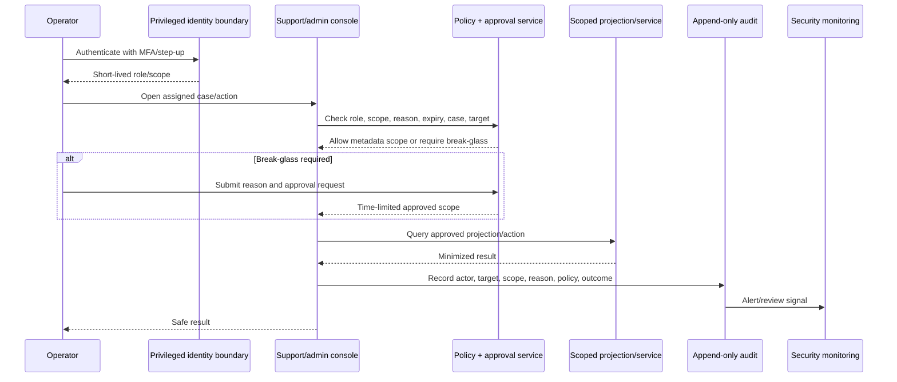

# NexusAI — Admin and Support Security Architecture

**Document type:** Phase 10 privileged access, support isolation, break-glass, and operator audit architecture  
**Phase:** Phase 10 — Security, Privacy, Safety & Compliance Architecture  
**Status:** Approved — Phase 10 and Phase 11 documentation gates passed; Phase 12 Implementation Foundation/Project Initialization approved; Phase 13 Part 1 APPROVED; Phase 13 Part 2 AUTHORIZED / IN PROGRESS  
**Canonical product:** NexusAI — Personal AI Health & Wellness Companion  
**Date:** 2026-08-30  
**Scope:** Admin/support security requirements only. No console, IAM configuration, operator account, or privileged code is created.

## 1. Operating principle

Support and admin functions exist to keep the wellness MVP reliable and safe, not to provide routine surveillance of private users. The default operator view is metadata and safe projections. Private chat, memory values, reflections, export contents, and credentials are excluded unless a separately approved, time-limited break-glass procedure permits access.

The final staffing model, role names, approvers, geography, and support hours remain `TBD / Pending Decision`. The matrix below is the minimum security baseline to review before implementation.

## 2. Logical privileged roles

| Role | Purpose | Default data scope | Standing access |
| --- | --- | --- | --- |
| Support agent | Resolve account, authentication, delivery, or usage issues | Account status, consent status, usage/abuse signals, audit events needed for case | No chat/memory content |
| Operations admin | Operate approved service configuration and aggregate health | Operational metrics, queue/provider status, safe account metadata | No private content by default |
| Security administrator | Investigate security events, manage privileged controls, approve/revoke access | Security/audit events and controlled evidence | No routine wellness content |
| Privacy/lifecycle operator | Process export/deletion/retention workflows | Lifecycle status and protected artifact metadata | No raw content unless approved |
| Safety reviewer | Review safety policy/evaluation outcomes | Minimized safety metadata and approved test artifacts | No routine user chat |
| Break-glass approver | Approve exceptional sensitive access | Approval metadata, not content by default | No standing access |
| Worker/service identity | Execute one bounded job class | Job-scoped records and derived metadata | No interactive login or broad impersonation |

One human may hold multiple logical roles only with separation-of-duties controls and explicit approval. A model/provider cannot hold any privileged role.

## 3. Default permission matrix

| Operation | Support | Operations admin | Security admin | Privacy/lifecycle | Safety reviewer |
| --- | --- | --- | --- | --- | --- |
| View account lifecycle/status | Assigned accounts only | Operational scope | Security scope | Assigned lifecycle scope | No |
| View consent status/history | Safe projection only | No default | Security audit projection | Lifecycle scope | Policy/evaluation scope |
| View usage/abuse signals | Assigned/aggregated | Aggregate/system scope | Security scope | No default | No |
| View audit events | Assigned case scope | Operational events | Security events | Lifecycle events | Safety events |
| View full chat/messages | Denied by default | Denied | Denied by default | Denied | Denied by default |
| View memory values | Denied by default | Denied | Denied by default | Denied by default | Denied |
| Start export/deletion | Assist/request only; user authorization required | No | Controlled incident path | Approved lifecycle path | No |
| Revoke sessions | Assist through approved path | No | Security response | No | No |
| Change safety/provider policy | No | No | Security review only | Privacy review input | Approved safety owner path |
| Access keys/backups/secrets | No | No | Controlled recovery path | No | No |

The approved API support routes expose narrow metadata only. Any expansion of scope requires a new decision, privacy review, and audit design.

## 4. Privileged access flow

## 5. Break-glass procedure

Exceptional access to private chat/memory or high-impact lifecycle/security operations must require:

1. A concrete incident/support case and business/safety reason.
2. Current MFA and recent step-up authentication.
3. Minimum resource and field scope; no bulk account dump.
4. Independent approval or dual control where the sensitivity warrants it.
5. Explicit start time and short expiry; automatic revocation.
6. Read-only access unless a separately approved mutation is necessary.
7. Append-only audit including actor, approver, target, scope, reason, policy version, outcome, and expiry.
8. Real-time or near-real-time alerting for security/privacy review.
9. Post-access review and revocation confirmation.

The UI must not offer a hidden “admin override” and the AI must never initiate break-glass access.

## 6. Session and workstation controls

- Separate operator identity tenant/realm from end-user accounts where supported.
- Require phishing-resistant or approved MFA baseline once selected; exact method is TBD.
- Use short-lived privileged sessions, re-authentication for sensitive actions, idle timeout, device posture where approved, and immediate revoke.
- Prevent privileged actions from untrusted personal devices or unmanaged browser sessions where policy requires.
- Disable token sharing, shared accounts, local storage of secrets, screenshots/downloads of restricted content, and copy/export by default.
- Watermark or label restricted operator views where appropriate without leaking user content.

## 7. Data access and projection rules

- Prefer service-owned projections such as account status, consent status, usage/abuse signals, audit events, delivery status, and lifecycle status.
- Do not expose raw `messages.content`, encrypted memory values, recovery proofs, passwords, tokens, provider payloads, or export contents to ordinary support.
- Support queries are account/case scoped, paginated, rate-limited, and recorded.
- Bulk search and unrestricted cross-account browsing are disabled.
- Production database credentials are never used by the console; service APIs enforce authorization and redaction.

## 8. Privileged action logging

Allow-list:

- operator identity/role and session ID;
- case/ticket reference and reason category;
- target account/resource opaque ID;
- action, scope, policy version, start/expiry, outcome;
- approval/revocation actor;
- request/correlation ID and latency/error category.

Never log raw chat, memory, check-in/reflection text, secrets, credentials, export content, or provider payloads. Audit storage is append-only/append-biased, integrity-protected, access-controlled, and retention-governed.

## 9. Monitoring and review

Alert on:

- break-glass requests, approvals, denials, and expiry failures;
- access outside assigned case/scope;
- unusual volume, export attempts, or cross-account probing;
- role/permission changes and failed step-up;
- direct database/backup/secret access;
- attempts to view private chat/memory without authorization;
- audit write failures or log-redaction failures.

Review privileged access on a defined cadence, after incidents, on role change, and before access renewal. Cadence and accountable owner remain TBD.

## 10. Support safety and privacy behavior

Support copy must avoid revealing whether a user has a particular health condition, safety flag, memory value, or account existence to an unauthorized caller. When an AI safety incident is reported, support receives the minimum metadata needed to route the case; it does not receive hidden prompts or classifier scores by default.

## 11. Open decisions

- Final support/admin/security/privacy/safety role hierarchy and staffing.
- Break-glass approval count, expiry, content scope, and post-access review cadence.
- Operator MFA/step-up method, workstation/device requirements, and session lifetime.
- Case/ticket integration, console hosting boundary, audit retention, and alert ownership.
- Whether any restricted-content review is needed for launch and its legal/privacy basis.

All remain `TBD / Pending Decision`.

## 12. Phase boundary

This document defines privileged-access architecture only. It does not create a support console, operator accounts, IAM policies, database views, or break-glass implementation.
