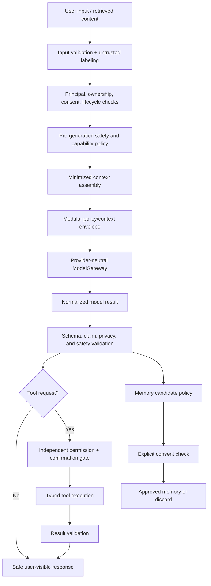
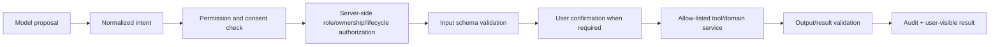

# NexusAI — AI Security Architecture

**Document type:** Phase 10 model, prompt, context, memory, tool, provider, and output security architecture  
**Phase:** Phase 10 — Security, Privacy, Safety & Compliance Architecture  
**Status:** Approved — Phase 10 and Phase 11 documentation gates passed; Phase 12 Implementation Foundation/Project Initialization approved; Phase 13 Part 1 APPROVED; Phase 13 Part 2 AUTHORIZED / IN PROGRESS  
**Canonical product:** NexusAI — Personal AI Health & Wellness Companion  
**Date:** 2026-08-30  
**Scope:** AI security architecture only. No model integration, prompts for production, training code, classifier code, or tool adapters are created.

## 1. Security position

The model is an untrusted reasoning component. It may generate a proposal inside a policy-constrained context, but it is never an authorization authority, consent authority, safety owner, database writer, or source of truth.

The application owns:

- identity, authentication, authorization, ownership, consent, lifecycle, and quotas;
- safety policy and response modes;
- memory approval/revocation/deletion;
- goal/plan/task/check-in/reminder state;
- tool permissions and execution;
- provider selection, retention terms, and logging.

## 2. AI trust-boundary pipeline

Each boundary can reject the request. Passing one gate does not imply that later gates are bypassed.

## 3. Prompt and instruction isolation

The context envelope separates:

1. Immutable system/product scope and wellness disclaimer.
2. Versioned safety policy and allowed response modes.
3. Application business rules and output schema.
4. Explicit user preferences.
5. Approved relevant memories with provenance and purpose.
6. Current conversation window.
7. Validated tool results and capability instructions.

User text, memory values, external search results, and tool outputs are untrusted data. They cannot alter higher-priority policy, reveal hidden prompts/secrets, or grant tools. Do not concatenate all content into one undifferentiated prompt. Use delimiters, provenance labels, field allow-lists, and output validation.

## 4. Prompt-injection and instruction-hijacking defenses

- Treat user and retrieved text as data, never policy.
- Keep policy/safety/tool instructions outside user-editable content.
- Do not pass secrets, credentials, hidden prompts, system paths, or unrestricted account identifiers into model context.
- Limit retrieved memories and search/tool results to the current purpose and account.
- Require the model to return a typed intent/capability request rather than arbitrary instructions.
- Re-check every proposed capability outside the model using principal, consent, safety, ownership, lifecycle, and quota rules.
- Validate generated text for hidden policy disclosure, cross-user content, unsafe claims, and unsupported actions.
- Red-team indirect injection through memory values, goal titles, chat history, tool results, documents, and future search sources.

## 5. Cross-user isolation

- Context assembly begins with the authenticated principal and account scope.
- Every database/query/index/cache/job key carries account ownership.
- Memory and conversation retrieval filters by status, consent, purpose, lifecycle, and same-account relationship.
- Do not use shared semantic indexes or caches without an explicit account-safe partition and deletion strategy.
- Provider payloads contain only the minimized bundle for that account/request.
- Support/admin and worker paths use separate scopes and cannot rely on a model to filter data.
- Test with canary records and adversarial cross-account prompts.

## 6. Data exfiltration controls

Before provider/model or tool transfer:

- remove raw credentials, tokens, keys, secrets, and unnecessary identifiers;
- exclude unrelated profile, goal, plan, chat, memory, or support data;
- apply current consent and purpose checks;
- redact or pseudonymize where practical;
- enforce maximum fields/size/context budgets;
- record provider alias/policy version, not raw payload.

After generation/tool return:

- scan for secrets, other-account identifiers, hidden policy text, and prohibited health/clinical claims;
- validate output schema and response mode;
- suppress or replace unsafe content with a reviewed fallback;
- never expose provider error payloads or hidden reasoning.

## 7. Hallucination and unsafe-output controls

- Keep V1 wellness-only and avoid clinical certainty, diagnosis, treatment, dosage, and emergency claims.
- Use `NORMAL`, `WELLNESS_REDIRECT`, `SAFETY_ESCALATION`, and `BLOCKED` modes from the approved safety architecture.
- Use uncertainty language and distinguish recorded user facts from suggestions.
- Prefer deterministic application data for goals, tasks, check-ins, reminders, consent, and deletion.
- Do not present an AI proposal as saved state until a domain service confirms it.
- Do not create a memory candidate from prohibited clinical or hidden-inference content.
- Maintain reviewed evaluation/red-team sets and sample output review before release.

## 8. AI security versus memory privacy

Memory retrieval and generation have separate permissions:

| Operation | Required controls |
| --- | --- |
| Retrieve memory | Authenticated account, current consent, purpose compatibility, status/expiry, sensitivity, relevance, context budget |
| Generate candidate | Allowed source/category, safety/privacy check, ephemeral bounded storage, no auto-approval |
| Approve memory | Explicit user action, current consent evidence, schema/purpose validation, audit |
| Edit/delete/clear/revoke | Ownership, lifecycle/idempotency, immediate retrieval block, audit, asynchronous cleanup |
| Send provider context | Eligible minimized projection, provider policy evidence, no raw payload persistence |

Revocation invalidates future retrieval immediately. Cleanup of caches, indexes, queues, exports, providers, and backups follows lifecycle evidence; the AI cannot declare deletion complete.

## 9. Tool security

Tool requirements:

- stable capability/version and typed arguments;
- explicit account scope and purpose;
- no arbitrary database, filesystem, shell, network, credential, or provider-secret access;
- idempotency for consequential/retryable actions;
- timeout, bounded retry, and failure state;
- output validation before any follow-on action;
- audit event with actor, capability, scope, policy version, outcome, and confirmation metadata.

## 10. Provider security

Before onboarding an AI provider, review:

- security controls, authentication, encryption, isolation, and incident notification;
- retention, training use, deletion, regional processing, and subprocessors;
- prompt/output logging behavior and administrative access;
- rate/usage limits, availability, outage/fallback, and exit plan;
- support for data-subject requests and lifecycle propagation.

If terms are unknown or incompatible, route to a safe deterministic response/approved provider or block sensitive context. Provider credentials are stored and rotated through a secret boundary.

## 11. AI usage and observability security

Allowed telemetry: operation class/version, provider alias/model class, latency, bounded usage units, error/retry class, safety/policy version, tool/memory validation outcome, and correlation ID.

Prohibited default telemetry: raw prompts, full model outputs, memory values, user reflections, hidden reasoning, provider payloads, credentials, or sensitive search/tool results. Restricted diagnostics require separate approval, redaction, short retention, access control, and audit.

## 12. AI-specific failure behavior

| Failure | Required behavior |
| --- | --- |
| Prompt injection detected | Keep content untrusted; deny unsafe capability; continue with safe response or block |
| Cross-user context suspicion | Discard context/result, alert security, return generic error/fallback |
| Provider timeout/outage | Bounded retry only under policy; no fabricated success or duplicate side effect |
| Invalid output schema/claim | Discard; use reviewed fallback and record minimized event |
| Safety policy unavailable | Fail closed for high-risk calls, memory writes, and tool execution |
| Tool result invalid/unsafe | Do not commit or announce; preserve source-of-truth state and audit |
| Provider retention uncertainty | Do not send restricted context until approved |

## 13. Security testing requirements

Test direct and indirect prompt injection, data exfiltration, cross-user contamination, memory poisoning, tool escalation, secret disclosure, unsafe claims, output encoding/XSS, provider failure, retry/idempotency, deletion/revocation, and policy-version regressions. See [`10-security-testing-strategy.md`](10-security-testing-strategy.md).

## 14. Open decisions

- AI provider/model, regional processing, retention/training, deletion, and subprocessors.
- Model routing, context/token budgets, provider fallback, and cost/latency limits.
- Safety evaluator ownership, evaluation thresholds, and release authority.
- Retrieval/index technology and derived-copy deletion guarantees.
- Exact tool confirmation, quota, and external-integration policy.

All remain `TBD / Pending Decision`.

## 15. Phase boundary

This document defines AI security controls only. It does not create prompts for production, model code, provider SDKs, classifiers, tool adapters, or deployment configuration.
