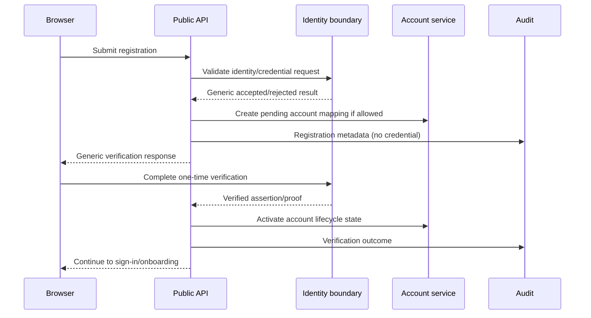
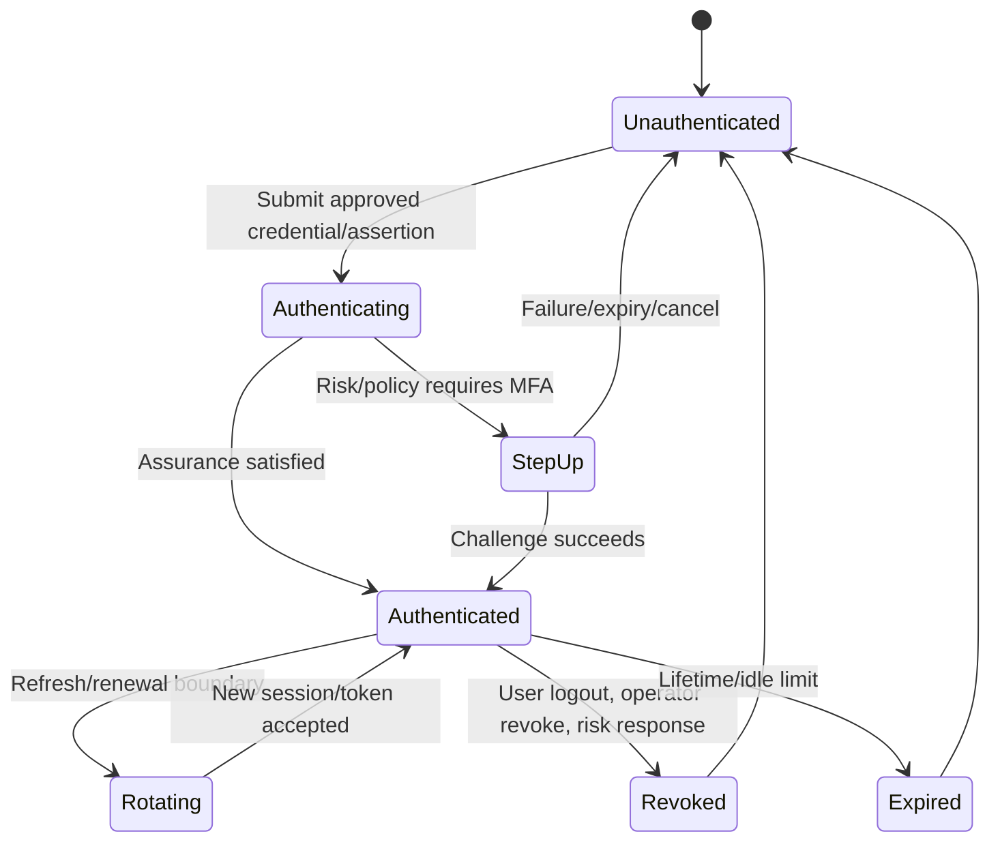

# NexusAI — Authentication and Authorization Architecture

**Document type:** Phase 10 identity, session, RBAC, ownership, and privileged-access requirements  
**Phase:** Phase 10 — Security, Privacy, Safety & Compliance Architecture  
**Status:** Approved — Phase 10 and Phase 11 documentation gates passed; Phase 12 Implementation Foundation/Project Initialization approved; Phase 13 Part 1 APPROVED; Phase 13 Part 2 AUTHORIZED / IN PROGRESS  
**Canonical product:** NexusAI — Personal AI Health & Wellness Companion  
**Date:** 2026-08-30  
**Scope:** Provider-neutral identity and authorization architecture. No identity provider integration, password code, IAM configuration, or production secrets are created.

## 1. Identity principles

- Authenticate every protected request; treat the browser and all client fields as untrusted.
- Authorize server-side using the authenticated principal, resource ownership, role/scope, consent, lifecycle state, and safety policy.
- Deny by default when identity, session, consent, policy, or ownership evidence is missing.
- Never store raw passwords, access tokens, refresh tokens, MFA proofs, or recovery proofs in the NexusAI core database.
- Keep guest capability separate from authenticated account identity.
- Keep human/operator identities separate from worker/service and provider identities.
- Make session revocation and privileged access observable and auditable.

The authentication provider, transport (secure cookie or bearer), MFA baseline, session lifetime, recovery assurance, and launch geography remain `TBD / Pending Decision`.

## 2. Provider-neutral capability requirements

The selected identity solution must support, directly or through a controlled adapter:

- account registration and unique identity mapping;
- verified email or equivalent identity assurance;
- secure sign-in and sign-out;
- recovery/reset without account enumeration;
- session issuance, rotation, expiry, revocation, and device/session management;
- MFA enrollment/challenge and step-up authentication hooks;
- suspicious-login signals and session-risk events;
- secure redirect/return handling if external identity is used;
- audit/event export without raw credential material;
- data-processing, region, breach-notification, retention, and deletion terms acceptable to the approved privacy policy.

If password authentication is used, the identity boundary—not application business tables—owns password hashing, breach screening, strength policy, recovery, lockout/throttling, and credential rotation.

## 3. Account and principal mapping

The approved `accounts` entity is the NexusAI account anchor. It stores an opaque issuer/subject mapping and lifecycle status, not raw credentials. An authenticated request resolves to a principal such as:

```text
principal = {
  account_id,
  subject_ref,
  actor_type: user | support | admin | security_admin | worker,
  scopes,
  auth_time,
  assurance_level,
  session_id,
  policy_version
}
```

The exact serialization is implementation-specific. A model, UI field, URL account ID, or provider response cannot substitute for the verified principal.

## 4. Registration and verification flow



Responses are enumeration-safe. Verification proofs are single-use, short-lived, never echoed or logged, and are not included in ordinary application tables.

## 5. Sign-in and session lifecycle



Required session controls:

- Use secure, HttpOnly, SameSite cookies if cookie transport is selected; if bearer transport is selected, use short-lived access credentials and protected refresh rotation.
- Store only a verifier/hash and metadata required for revocation/device/session management.
- Rotate session identifiers after sign-in, recovery, privilege change, and step-up where supported.
- Revoke the current session on logout and allow users to revoke other sessions.
- Expire sessions using an approved absolute/idle policy; exact values remain TBD.
- Bind risk signals to the session without storing unnecessary device fingerprint data.
- Never place tokens or recovery proofs in URLs, logs, analytics, screenshots, or support views.
- Treat duplicate/replayed proofs and rotated-token reuse as security events.

## 6. Recovery and suspicious-login behavior

- Recovery requests always return generic copy and are throttled by IP/account/device signals.
- Recovery completion requires a one-time proof and approved assurance policy; it does not reveal whether the account exists.
- Password reset/recovery revokes or re-evaluates existing sessions according to the approved policy.
- Suspicious signals (unusual device/location, impossible velocity, repeated failures, token reuse, support override) may require step-up, session revocation, or operator review.
- Exact signals, thresholds, notification channels, and user messaging remain TBD.

## 7. MFA and step-up readiness

The architecture includes MFA/step-up hooks without selecting a method. A future baseline may support a phishing-resistant factor, authenticator, or approved provider challenge. The implementation must define:

- enrollment/recovery and factor reset controls;
- assurance level attached to the session/principal;
- actions requiring step-up (account deletion, export, credential change, break-glass, sensitive support access);
- rate limiting and lockout/recovery behavior;
- audit events without secret/seed exposure.

MFA method, mandatory scope, recovery assurance, and minimum age/age policy are unresolved decisions.

## 8. Authorization model

Use role-based permissions plus contextual attributes (RBAC + bounded ABAC):

1. **Actor role:** guest, user, support, admin, security admin, worker/service.
2. **Scope:** operation and resource type, not a broad “all data” flag.
3. **Ownership:** authenticated `account_id` and same-account nested foreign-key chain.
4. **Consent/purpose:** current consent and stated purpose for memory, notifications, provider use, and export/deletion.
5. **Lifecycle:** account/resource not suspended, deleted, or under an incompatible operation.
6. **Safety/policy:** operation allowed in the selected safety mode and policy version.
7. **Confirmation/step-up:** required for consequential or privileged actions.

The UI may hide an action, but only the server-side authorization decision is authoritative.

## 9. Logical role-permission matrix

This is the minimum logical baseline for architecture. Staffing, role naming, break-glass approvers, and exact scope identifiers require explicit approval.

| Capability | Guest | User (own account) | Support | Admin | Security admin | Worker/service |
| --- | --- | --- | --- | --- | --- | --- |
| Public policy/health | Read public/health | Read | Read | Read | Read | Read |
| Guest demo | Create/use own ephemeral demo | No | No | No | No | Execute bounded worker path |
| Own profile/wellness/preferences | No | Read/write own | No by default | No by default | Break-glass only | Scoped service operation |
| Own goals/plans/tasks/check-ins/reminders | No | Read/write own | No by default | No by default | Break-glass only | Execute approved job scope |
| Own conversations/messages | Ephemeral only | Read/write own | No by default | No by default | Break-glass only | No raw content by default |
| Own memory/consent | No durable memory | Read/write own with consent | No by default | No by default | Break-glass only | Lifecycle/index scope without plaintext by default |
| Own export/deletion | No | Request/read own status | No default initiation | Controlled support action only | Approve/execute privileged path | Execute scoped lifecycle job |
| Account status/support signals | No | Read own | Read scoped metadata | Read scoped metadata | Read/audit all approved | Read job scope |
| Audit/security events | No | Read safe own projections | Read assigned scoped events | Read operational scope | Read security scope | Write assigned events |
| User role/credential changes | No | Own approved path | No | Controlled admin path | Approve/execute privileged path | No |
| Policy/configuration | No | No | No | Operational config only | Security/policy config with separation | Read versioned config |
| Database/backups/secrets | No | No | No | No direct access | Controlled recovery only | Narrow service identity |

Support/admin access to private chat or memory is not granted by this matrix. Exact role hierarchy and break-glass procedure remain TBD.

## 10. Ownership and IDOR controls

- `/me/*` endpoints derive the account from the principal; client-supplied account IDs are ignored or rejected.
- Detail routes verify both resource ownership and every nested relationship (for example, task → plan/goal/routine; message → conversation; memory → source message/consent).
- A resource belonging to another account returns an indistinguishable `404` where defined by the API contract.
- Search, pagination cursors, caches, exports, and background jobs carry account scope and cannot be reused across accounts.
- Negative authorization tests cover every protected operation, including support/admin and worker paths.

## 11. Break-glass privileged access

Any exceptional support/admin access must require:

1. An explicitly assigned privileged role and current MFA/step-up assurance.
2. A specific reason and ticket/case reference.
3. Minimum resource/scope, not a broad account dump.
4. Short, explicit expiry; no standing access.
5. Approval or dual control for chat, memory, export, deletion, key, or backup access as policy requires.
6. Append-only audit event with actor, target, scope, reason, start/expiry, outcome, and policy version—no raw content.
7. Immediate revocation and post-access review.

Break-glass must be visible to security monitoring and cannot be initiated by the AI model or end-user UI.

## 12. Worker and provider identities

- Workers receive job-scoped service identities and cannot impersonate a user without an explicit, auditable delegation mechanism.
- AI/notification/identity providers receive provider credentials only through an adapter secret boundary.
- A provider response cannot grant a NexusAI role or scope.
- Service accounts have separate credentials, rotation, egress, quotas, and revocation.

## 13. Phase 10 open decisions

- Identity provider and local-versus-external account model.
- Cookie versus bearer transport; exact session lifetime/rotation/revocation policy.
- Password policy, MFA method/mandatory scope, recovery and step-up baseline.
- Suspicious-login signals, thresholds, device/session metadata, and user notifications.
- Final admin/support/security-admin role matrix, approvals, break-glass scope, and operator expiry.
- Launch geography, minimum age, age assurance, and privacy jurisdiction.

All remain `TBD / Pending Decision`.

## 14. Phase boundary

This document defines identity and authorization requirements only. It does not integrate an identity provider, implement password/MFA/session code, create IAM roles, or provision privileged access.
