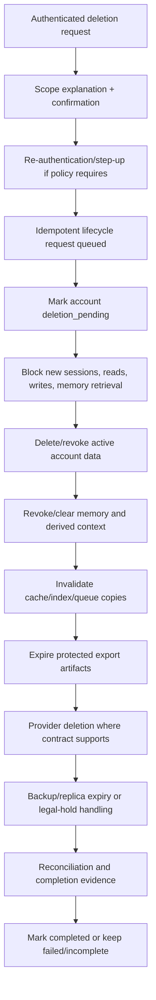

# NexusAI — Data Retention and Deletion Architecture

**Document type:** Phase 10 data lifecycle, retention classes, deletion, revocation, export, backup, and legal-hold architecture  
**Phase:** Phase 10 — Security, Privacy, Safety & Compliance Architecture  
**Status:** Approved — Phase 10 and Phase 11 documentation gates passed; Phase 12 Implementation Foundation/Project Initialization approved; Phase 13 Part 1 APPROVED; Phase 13 Part 2 AUTHORIZED / IN PROGRESS  
**Canonical product:** NexusAI — Personal AI Health & Wellness Companion  
**Date:** 2026-08-30  
**Scope:** Conceptual lifecycle requirements only. No deletion worker, scheduler, DDL change, backup configuration, or legal retention schedule is created.

## 1. Lifecycle principles

- Retain data only for an approved purpose and the shortest practical period.
- Treat deletion/revocation as a distributed lifecycle across primary data, caches, queues, indexes, exports, providers, replicas, logs, and backups.
- Block future use immediately when consent is revoked or a deletion request is accepted.
- Do not claim physical or provider/backup deletion until verified evidence exists.
- Preserve required audit/security evidence without retaining unnecessary raw content.
- Make lifecycle requests authenticated, ownership-scoped, idempotent, resumable, and observable.
- Keep exact periods, legal holds, jurisdictions, and provider guarantees as explicit decisions—not assumptions.

## 2. Retention classes

| Class | Purpose | Lifecycle posture |
| --- | --- | --- |
| Transient | Request context, guest demo state, ephemeral memory candidate | Short TTL, no durable account record, automatic eviction |
| Active | Current account/profile/wellness/planning/chat/memory data | User-visible, consent/purpose-controlled, editable/deletable |
| Operational | Notification deliveries, AI usage metadata, queue/job status | Minimized metadata, bounded troubleshooting/operations retention |
| Governance | Consent, safety, support-access, and audit evidence | Append-only/append-biased, access-controlled, retention reviewed |
| Export artifact | User-requested data copy | Encrypted, opaque reference, short expiry, access audited |
| Backup/recovery | Encrypted recovery copies | Separate access, lifecycle tombstones, expiry/legal-hold policy |

Exact duration for every class is `TBD / Pending Decision` until jurisdiction, legal review, operational objectives, and provider contracts are approved.

## 3. Data category lifecycle

| Category | Primary source | Retention/deletion behavior |
| --- | --- | --- |
| Account/identity/session | `accounts`, `auth_sessions` | Active while account exists; revoke sessions on deletion; retain only approved security evidence |
| Profile/wellness | `user_profiles`, `wellness_profiles` | User-editable; deletion follows account/lifecycle scope |
| Goals/routines/plans/tasks/check-ins | Wellness entities | User correction/soft-delete first; purge/aggregation behavior follows approved schedule |
| Conversations/messages | `conversations`, `messages` | User-owned, soft-delete/lifecycle controlled; exclude deleted content from future context |
| Memory | `memory_records`, consent | Revoke/clear blocks retrieval immediately; physical purge/derived cleanup tracked |
| Consent | `consent_records` | Append-only decisions; retain evidence only as approved, without raw content |
| Safety events | `safety_events` | Minimized policy/action metadata; no raw prompt by default; retention governed |
| Support access | `support_access_events` | Append-only privileged-access evidence; restricted and reviewed |
| Audit events | `audit_events` | Tamper-evident governance evidence; bounded fields and reviewed retention |
| AI usage | `ai_usage_events` | Provider/model/latency/units/error metadata only; no prompts/completions |
| Notifications | `notification_preferences`, `reminders`, `notification_deliveries` | User-controlled reminder lifecycle; delivery metadata bounded; no sensitive bodies by default |
| Export artifacts | Protected artifact store | Encrypted, user-scoped, automatically expires; no public URL |
| Backups/replicas/indexes/caches | Platform/derived boundaries | Invalidate/expire according to lifecycle generation and approved backup policy |

## 4. Account deletion lifecycle

The account remains unavailable during destructive processing according to the approved lifecycle state. A failed job does not silently reactivate the account or claim completion; it remains visible to authorized lifecycle operators for retry/forward-fix.

## 5. Memory revocation and clear

Immediate actions:

- mark memory consent/status revoked/deleted in the primary store;
- prevent all new memory writes;
- exclude memory from retrieval and provider context;
- invalidate request-scoped/context-cache generations;
- show the user a pending/incomplete lifecycle status.

Asynchronous actions:

- remove/disable derived retrieval indexes and embeddings if any are approved;
- cancel or strip pending jobs and queue payloads;
- expire export artifacts containing the memory;
- request provider-side deletion where contract/policy supports it;
- reconcile replicas/backups and record evidence.

The system does not claim that a provider, backup, legal-hold copy, or immutable audit record is deleted until the applicable policy and evidence support that statement.

## 6. Export lifecycle

1. User requests a defined scope through the lifecycle API.
2. The system authenticates ownership and applies any required step-up.
3. A normalized idempotency key prevents duplicate jobs.
4. A worker assembles only the approved user scope, excluding other users and hidden secrets.
5. The artifact is encrypted, access-controlled, opaque, and time-limited.
6. The user receives a protected download/delivery action when available.
7. The artifact expires automatically; access and expiry are audited.

Final export format, delivery mechanism, response times, and legal exceptions remain TBD.

## 7. Legal hold and required-record exceptions

If a valid legal, regulatory, security, fraud, or incident hold requires retaining a subset of records, the lifecycle service should:

- record the hold authority, scope, start, reviewer, and expiry/review date;
- minimize the held data and restrict access;
- block ordinary product use of held content where possible;
- distinguish “deleted from active product” from “retained under approved hold”;
- release and purge held copies when the hold ends;
- avoid inventing a legal basis or hold duration before qualified review.

Legal-hold authority, categories, jurisdiction, and notification obligations are `TBD / Pending Decision`.

## 8. Derived-copy inventory

Every implementation must maintain an inventory of copies and lifecycle hooks:

| Copy | Owner | Required invalidation |
| --- | --- | --- |
| Request/context memory | AI/memory orchestrator | Request end or lifecycle generation mismatch |
| Protected cache | Platform/service | Account/memory revoke event and TTL |
| Retrieval index/embedding | Memory platform | Delete/crypto-disable and index reconciliation |
| Queue/job payload | Worker platform | Cancel/strip before execution; reject stale generation |
| Provider request | Provider adapter | Minimize before send; provider deletion if supported |
| Export artifact | Lifecycle service | Expire/delete and revoke download |
| Replica/read model | Data platform | Tombstone/reconciliation before serving |
| Backup | Recovery platform | Expiry/crypto-shred/legal hold per approved policy |
| Audit/usage metadata | Governance/operations | Retain minimized evidence; never copy raw content |

## 9. Soft deletion and physical purge

Soft-deleted rows are excluded from user queries, context assembly, search, notifications, support projections, and exports. Physical purge is a separate controlled job after retention/hold checks. Purge must be idempotent, auditable, rate-limited, and safe to retry. It must not remove the minimum evidence required to explain a lifecycle decision unless the approved policy permits it.

## 10. Reconciliation and evidence

Completion evidence should include:

- lifecycle request ID and scope;
- affected data/copy classes;
- policy/version and retention decision;
- timestamps and worker outcomes;
- counts/hashes or opaque reconciliation references where safe;
- provider/backup acknowledgement where available;
- unresolved exceptions and next review time.

Evidence must not include raw chat, memory values, export content, credentials, or provider payloads.

## 11. Open decisions

- Exact retention period for each category/class.
- Launch geography, privacy jurisdiction, minimum age, and legal-hold rules.
- Provider deletion/retention/training/regional-processing guarantees.
- Memory/index/cache/queue/replica/backup propagation and completion evidence.
- Export format, delivery, expiry, and identity-verification requirements.
- RTO/RPO, backup region, immutable copies, and recovery authority.

All remain `TBD / Pending Decision`.

## 12. Phase boundary

This document defines lifecycle architecture only. It does not implement deletion workers, purge jobs, backup policies, legal holds, export packaging, or database migrations.
