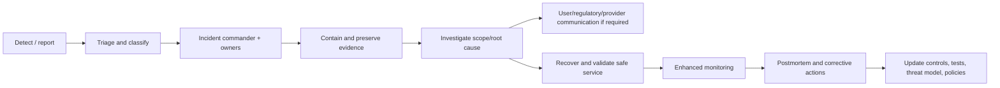

# NexusAI — Incident Response Architecture

**Document type:** Phase 10 security, privacy, AI safety, data-integrity, provider, and continuity incident response  
**Phase:** Phase 10 — Security, Privacy, Safety & Compliance Architecture  
**Status:** Approved — Phase 10 and Phase 11 documentation gates passed; Phase 12 Implementation Foundation/Project Initialization approved; Phase 13 Part 1 APPROVED; Phase 13 Part 2 AUTHORIZED / IN PROGRESS  
**Canonical product:** NexusAI — Personal AI Health & Wellness Companion  
**Date:** 2026-08-30  
**Scope:** Incident-response architecture only. No SOC/on-call tooling, notification integration, forensic collection, or production runbook automation is created.

## 1. Objectives

Incident response should protect users first, contain harm quickly, preserve reliable evidence, communicate honestly, restore safe service, and produce corrective action. It covers security, privacy, AI safety, data integrity, provider, availability, backup/restore, and privileged-access incidents.

The response plan must not imply a legal notification deadline or regulatory duty until launch geography, jurisdiction, data relationships, and counsel review are approved.

## 2. Incident categories

| Category | Examples | Primary owner |
| --- | --- | --- |
| Security incident | Account takeover, credential leak, session theft, XSS/injection, privilege escalation, secret/key exposure | Security incident commander |
| Privacy incident | Unauthorized disclosure, cross-user exposure, memory leakage, export abuse, provider retention breach | Privacy lead with Security |
| AI safety incident | Diagnosis/treatment claim, unsafe escalation, prompt injection causing unsafe action, policy/model drift | Safety owner with Security |
| Data integrity incident | Corrupt plan/task/check-in state, deletion failure/resurrection, audit tampering | Data/platform lead |
| Provider incident | AI/identity/notification provider compromise, outage, retention/deletion failure | Provider/platform lead |
| Availability/continuity incident | DoS, queue exhaustion, database failure, backup restore failure | Platform/operations lead |

One event may have multiple categories and owners. Severity is based on user impact, data sensitivity, scope, duration, exploitability, and safety consequences.

## 3. Severity model

| Severity | Example | Initial posture |
| --- | --- | --- |
| SEV-0 Critical | Active cross-user/highly restricted data exposure, compromised privileged/key boundary, unsafe autonomous action, or widespread account takeover | Immediate containment, executive/security/privacy/safety escalation |
| SEV-1 High | Confirmed restricted-data incident, material AI safety failure, provider compromise affecting users, or major integrity/availability loss | Rapid incident command and affected-flow disablement |
| SEV-2 Medium | Limited account/data exposure, repeated unsafe output with containment, or bounded service degradation | Assigned response and monitored remediation |
| SEV-3 Low | Near miss, isolated control weakness, or low-impact event | Ticket, root-cause analysis, and scheduled fix |

Final severity thresholds, on-call coverage, and communication authority remain TBD.

## 4. Response lifecycle

## 5. Detection sources

- Authentication failures, session anomalies, token reuse, and recovery abuse
- IDOR/authorization failures, role changes, break-glass access, and unusual support queries
- WAF/API rate-limit/injection/XSS signals and dependency alerts
- Secret/key scans, build integrity, dependency vulnerabilities, and provider notices
- Cross-user canary tests, memory revocation reconciliation, export/download anomalies
- Safety mode/output validation failures, user reports, red-team findings, and model/policy drift
- Queue growth, provider outage, database integrity errors, backup/restore failures
- Audit/log redaction failures and suspicious data-access patterns

Detection telemetry must remain minimized; raw chat, memory, prompts, tokens, and secrets are not copied merely to investigate an incident.

## 6. Triage procedure

Within the approved response objective, the incident coordinator should:

1. Confirm whether the signal is genuine and assign category/severity.
2. Identify affected users, accounts, services, providers, data classes, regions, and time window.
3. Determine whether the incident is ongoing, exploitable, or safety-critical.
4. Preserve relevant logs/audit/evidence with integrity controls and restricted access.
5. Assign Security, Privacy, Safety, Platform, Product, Support, and Legal/communications roles as needed.
6. Select containment actions that minimize additional data exposure and preserve user control.
7. Record decisions, timestamps, owners, and uncertainty without speculating in user-facing copy.

## 7. Containment playbooks

### Account takeover/session compromise

- Revoke affected sessions/tokens and require safe re-authentication/step-up.
- Freeze suspicious recovery/privileged actions and preserve evidence.
- Identify affected accounts and avoid exposing attacker-controlled details to users.
- Rotate compromised credentials/secrets where necessary.
- Notify affected users and authorities only through approved, jurisdiction-specific procedures.

### Cross-user or memory exposure

- Disable affected retrieval/cache/index/provider flow immediately.
- Fail closed for memory and sensitive context; preserve independent wellness functions.
- Invalidate affected caches/queues/exports and block stale lifecycle generations.
- Determine scope without copying raw content into logs.
- Start privacy/security assessment and user communication decision.

### AI safety incident

- Disable affected model/route/tool/policy version or switch to a reviewed fallback.
- Preserve minimized safety/usage/audit metadata and representative redacted evidence.
- Evaluate diagnosis/treatment/urgent/escalation behavior and affected users.
- Do not let a model self-approve its output or continue an unsafe tool loop.
- Require safety owner review and regression tests before re-enable.

### Provider compromise/outage

- Stop or minimize provider traffic and revoke/rotate provider credentials if needed.
- Route safe deterministic or approved alternate responses; avoid sending restricted context.
- Request provider incident, retention, deletion, and affected-data evidence.
- Reconcile in-flight jobs, memory candidates, exports, and deletion requests.

### Deletion/integrity failure

- Mark lifecycle requests incomplete and block retrieval/use of affected data.
- Stop restore/replication paths that could resurrect deleted or revoked content.
- Reconcile primary, read models, queues, caches, indexes, exports, providers, and backups.
- Preserve audit evidence and publish only verified status.

## 8. Investigation and evidence

Evidence sources may include:

- append-only audit/security/safety/support events;
- redacted application/security logs and request/correlation IDs;
- authentication/session, role, access, export, lifecycle, and provider metadata;
- deployment/configuration/artifact integrity records;
- backup/restore and reconciliation reports;
- user/support reports and approved red-team artifacts.

Evidence handling requires access control, integrity/tamper evidence, time synchronization, chain-of-custody records, retention/legal-hold review, and redaction. Do not retain raw health/chat/memory content solely because an incident occurred.

## 9. Communication principles

- Be accurate, timely, plain-language, and specific about known/unknown scope.
- Tell users what action they should take (reauthenticate, review sessions, pause integration, contact support) without blaming them.
- Do not reveal exploit details, other users’ data, hidden policy text, classifier scores, or provider secrets.
- Do not claim deletion, containment, safety, or legal notification completion without evidence.
- Coordinate provider, regulator, law-enforcement, and media communication through approved authority.

Exact templates, channels, legal timing, translation, and notification ownership remain TBD.

## 10. Recovery and return to service

Before restoring a disabled flow:

- contain root cause or deploy a reviewed compensating control;
- rotate/revoke credentials/keys as necessary;
- verify authorization, ownership, consent, safety, and lifecycle checks;
- run focused security/safety/integrity tests and canary monitoring;
- reconcile jobs, queues, caches, indexes, exports, providers, and backups;
- obtain accountable Security/Privacy/Safety/Product approval;
- communicate safe service status and remaining limitations.

## 11. Postmortem and corrective action

Every SEV-0/SEV-1 and material SEV-2 event receives a blameless postmortem covering:

- timeline, detection, impact, data classes, affected scope, and user harm;
- root and contributing causes;
- containment/recovery effectiveness;
- missed controls, test gaps, and process failures;
- corrective actions with owners, due dates, evidence, and risk acceptance if any;
- updates to the threat model, security/privacy/safety policies, UI/API/AI contracts, and training.

## 12. Preparedness exercises

Before public beta, conduct tabletop or controlled exercises for account takeover, cross-user memory exposure, AI unsafe output, provider compromise, deletion failure, backup restore, and key/secret compromise. Exact cadence and participants remain TBD.

## 13. Open decisions

- Incident commander/on-call staffing and escalation tree.
- Severity thresholds, response objectives, evidence retention, and legal-hold process.
- User/regulator/provider notification authority, templates, jurisdictions, and channels.
- Provider incident commitments and exit/fallback plan.
- RTO/RPO, restore authorization, and continuity testing cadence.

All remain `TBD / Pending Decision`.

## 14. Phase boundary

This document defines incident-response architecture only. It does not create a SOC, on-call schedule, notification service, forensic tooling, production runbooks, or legal notification determination.
