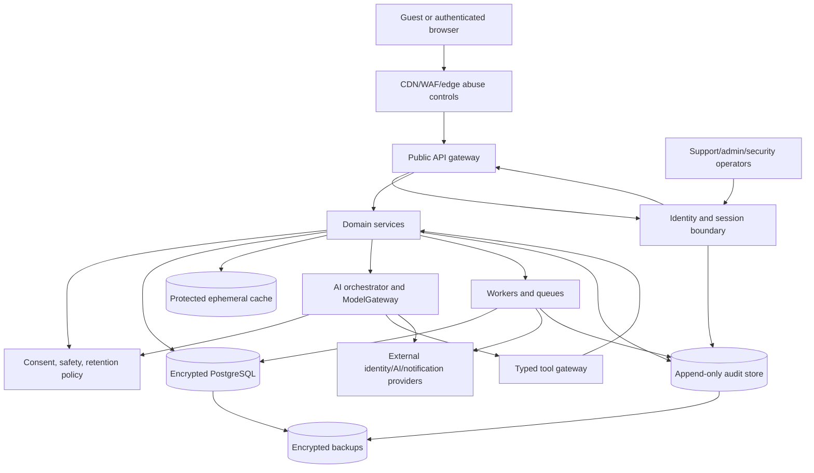

# NexusAI — Security Architecture

**Document type:** Phase 10 security control, trust-boundary, encryption, observability, and recovery architecture  
**Phase:** Phase 10 — Security, Privacy, Safety & Compliance Architecture  
**Status:** Approved — Phase 10 and Phase 11 documentation gates passed; Phase 12 Implementation Foundation/Project Initialization approved; Phase 13 Part 1 APPROVED; Phase 13 Part 2 AUTHORIZED / IN PROGRESS  
**Canonical product:** NexusAI — Personal AI Health & Wellness Companion  
**Date:** 2026-08-30  
**Scope:** Architecture and requirements only. No production security code, infrastructure, policies, certificates, or compliance claims are created.

## 1. Source of truth and security objective

The approved Phase 00–09 documents control product scope, 21 database entities, 77 API operations, AI/memory boundaries, and UI behavior. This phase defines how those assets are protected without changing the approved domain model.

Security objective: preserve confidentiality, integrity, availability, privacy, user control, and safety for accounts, wellness data, conversations, memory, consent, provider calls, admin/support operations, logs, exports, backups, and future intelligence systems.

## 2. Security principles

1. **Least privilege:** Every user, operator, service, worker, and provider gets only the permissions needed for a bounded purpose.
2. **Zero trust between boundaries:** Browser, API, service, worker, data store, provider, and operator boundaries authenticate and authorize independently.
3. **Deny by default:** Missing identity, consent, ownership, policy, or lifecycle evidence denies the sensitive operation.
4. **Defense in depth:** Edge, API, domain service, data, provider, and monitoring controls reinforce one another.
5. **Secure and private by default:** Sensitive options are off until explicitly enabled; memory is off by default.
6. **Data minimization and purpose limitation:** Collect, process, disclose, log, and retain only what a stated feature requires.
7. **Strong identity and explicit authorization:** A model, UI state, URL identifier, or provider response is never an authorization authority.
8. **Tenant/account isolation:** User-owned data is always constrained by authenticated `account_id` and same-account relationships.
9. **Tamper-evident auditability:** Security-sensitive mutations and privileged access create append-only or append-biased evidence.
10. **Fail closed:** Memory writes/retrieval, privileged access, high-risk AI calls, and destructive actions stop when policy/security dependencies are unavailable.
11. **Recoverability:** Backups, lifecycle jobs, and incident procedures are protected and tested.
12. **No security-through-obscurity claims:** Controls depend on identity, authorization, cryptography, validation, and monitoring—not hidden routes or prompts.

## 3. Trust-boundary architecture

Every arrow is a trust transition with authenticated identity, allow-listed protocol, schema validation, bounded data, encryption in transit, and observability. No external provider has direct database access.

## 4. Control planes

| Plane | Responsibilities | Failure posture |
| --- | --- | --- |
| Identity | Registration, verification, session issuance/rotation/revocation, MFA/step-up hooks | Deny protected operations |
| Authorization | Role, scope, account ownership, lifecycle, consent, break-glass | Deny by default; IDOR-safe response |
| Data protection | Encryption, field protection, backups, key/secrets management | Stop sensitive writes if keys/policy unavailable |
| Application/API | Validation, rate limits, CSRF/CORS, output encoding, idempotency | Stable safe error; no partial claim |
| AI/tool | Context minimization, prompt isolation, tool allow-list, response validation | Fail closed for high-risk/memory/tool paths |
| Governance | Policy versioning, audit, retention, incident and safety review | Prevent unreviewed privileged/safety release |
| Detection/recovery | Logs, metrics, alerts, incident response, restore testing | Preserve evidence and contain scope |

## 5. Network and service security requirements

- TLS is required for browser-to-edge, edge-to-API, service-to-service, provider, database, queue, cache, backup, and administrative traffic where technically supported.
- Protected data services use private/restricted network paths and deny public access by default.
- Egress is allow-listed for approved identity, AI, notification, monitoring, and backup destinations.
- Worker/service identities are distinct from human identities and receive short-lived, narrowly scoped credentials.
- Development, test, staging, and production environments are isolated; production data is not copied into lower environments by default.
- Administrative access uses approved secure channels, MFA, device/session controls, and audited just-in-time privilege.

Exact cloud/network implementation remains a later deployment decision.

## 6. Encryption and key management

### In transit

- Use current approved TLS configurations and certificate lifecycle controls.
- Do not disable certificate validation for provider or internal calls.
- Sensitive export/download links are opaque, authenticated, short-lived, and not logged.

### At rest

- Managed database, cache, queue, object/export store, logs, audit store, and backups use encryption at rest.
- Approved `ENCRYPTED_TEXT` and `ENCRYPTED_JSON` fields receive application/data-service encryption before persistence where the Phase 05/06 model requires it.
- Passwords are never encrypted/stored by the core data model; if local password auth exists, the isolated identity boundary stores only a modern salted password hash according to the selected provider/library policy.
- Raw session/recovery tokens are not stored; only approved hashes/metadata are retained.

### Keys and secrets

- Keys live in an approved managed KMS/HSM-class boundary; secrets live in a dedicated secrets manager, never source control, client bundles, prompts, logs, or ordinary database rows.
- Separate key scopes for environments and high-value stores; restrict decrypt permission to the smallest service set.
- Rotation, versioning, revocation, backup/recovery, dual control for sensitive operations, and emergency access are documented and tested.
- Key deletion or crypto-shredding is used only when its lifecycle guarantees are understood; it does not replace required record/state evidence.

Provider, KMS technology, rotation intervals, and cryptographic profiles remain `TBD / Pending Decision` pending deployment design and security review.

## 7. API and application control baseline

- Authenticate every protected request and derive user ownership from the principal for `/me/*` operations.
- Enforce authorization server-side for all 77 operations; UI visibility is never sufficient.
- Validate content type, schema, length, enum, UUID, timestamps, dates, recurrence, pagination, and free text at the API boundary and again at the domain boundary where risk warrants.
- Encode output for its sink and maintain a restrictive content security policy for the web client.
- Protect cookie-authenticated mutations from CSRF; choose CORS allow-lists from approved origins only.
- Use secure, HttpOnly, SameSite cookies when the selected session model uses cookies; bearer transport remains provider/architecture-dependent.
- Apply named rate-limit classes for guest, auth, standard user, AI, lifecycle, and support operations; numeric thresholds remain TBD.
- Require idempotency for lifecycle, AI-send, and consequential tool/mutation paths as defined by the API contract.
- Limit request bodies and reject unsupported uploads. File uploads are not an MVP requirement; any future upload needs type/content scanning, storage isolation, and lifecycle review.
- Use generic auth/recovery errors and `404` masking for non-owned resources.

## 8. Data-store controls

- Use PostgreSQL constraints and same-account foreign keys from the approved DDL as integrity controls.
- Application authorization checks remain mandatory even when a foreign key exists.
- Database roles separate migrations, runtime reads/writes, lifecycle workers, analytics, backups, and emergency operations.
- Production queries and support tools use approved views/projections; no broad table access for ordinary support.
- Append-only or append-biased records (`consent_records`, `audit_events`, `safety_events`, `support_access_events`) cannot be silently rewritten by normal application roles.
- Soft deletion blocks user-visible retrieval immediately; physical purge follows the approved retention/deletion lifecycle.

## 9. Logging and observability security

### Allow-list

- request/correlation ID;
- route template and method;
- response status and stable error code;
- latency, retry count, dependency category;
- coarse actor/role class and policy version;
- provider alias/model class and bounded usage units;
- lifecycle, memory, safety, and privileged-access event type/outcome;
- infrastructure health and queue depth.

### Never log by default

- passwords, MFA/recovery proofs, session/access/refresh tokens, API keys, encryption keys, or provider secrets;
- raw wellness/check-in/reflection/chat text;
- raw memory values or unapproved candidates;
- full prompts, model outputs, provider payloads, or hidden reasoning;
- export contents/URLs, database ciphertext, or notification bodies containing sensitive context;
- arbitrary email/profile data in metrics labels.

Structured logging uses field allow-lists, centralized redaction, bounded retention, access control, integrity protection, and alerts for redaction failures.

## 10. Backup and disaster-recovery security

- Backups are encrypted, access-controlled independently from the primary database, inventory-tracked, and protected from routine application credentials.
- Restore requires an authorized recovery role and recorded approval.
- Restore tests verify confidentiality, integrity, database constraints, lifecycle tombstones, audit continuity, and post-restore credential/key rotation where required.
- Backup retention, immutable-copy policy, region, RTO, RPO, and deletion/legal-hold exceptions remain TBD.
- A restore must not resurrect revoked memory or deleted accounts into active service; lifecycle reconciliation runs before normal traffic.

## 11. Provider and supply-chain security

- Maintain an inventory of identity, AI, notification, hosting, monitoring, backup, and future integration providers.
- Review security posture, data processing, retention/training, regional processing, subprocessors, incident notification, deletion, availability, and exit support before use.
- Pin/verify dependencies through lockfiles and integrity checks in implementation; run SCA/dependency and secret scanning.
- Provider credentials are environment-scoped, least-privilege, rotated, and revocable.
- Provider outage or compromise triggers circuit breaking, credential revocation, data-flow containment, and incident review.

No provider is selected by this phase.

## 12. Security control ownership

| Control family | Recommended accountable function | Current status |
| --- | --- | --- |
| Identity/authentication | Security + Engineering | Exact provider/MFA policy TBD |
| Authorization/RBAC | Security + Service owners | Logical matrix defined in Phase 10; staffing/approvers TBD |
| Privacy/retention | Privacy/Legal + Product | Jurisdiction and periods TBD |
| Memory lifecycle | Privacy + Data/Platform | Propagation evidence design required |
| AI/tool security | AI Safety + Security | Provider and evaluation thresholds TBD |
| Safety governance | Named Safety Owner | Owner is TBD; role recommended |
| Incident response | Security Incident Commander | Staffing/on-call model TBD |
| Backup/DR | Platform/Operations | RTO/RPO and recovery authority TBD |

## 13. Phase boundary

This document defines security architecture requirements only. It does not create WAF rules, IAM roles, encryption keys, certificates, security code, cloud infrastructure, production policies, or compliance certification. Implementation and Phase 11 remain separately gated.
