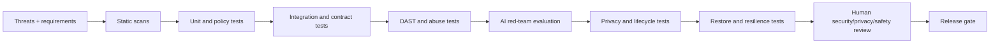

# NexusAI — Security, Privacy & Safety Testing Strategy

**Document type:** Phase 10 security, privacy, safety and compliance testing architecture  
**Phase:** Phase 10 — Security, Privacy, Safety & Compliance Architecture  
**Status:** Approved — Phase 10 and Phase 11 documentation gates passed; Phase 12 Implementation Foundation/Project Initialization approved; Phase 13 Part 1 APPROVED; Phase 13 Part 2 AUTHORIZED / IN PROGRESS  
**Canonical product:** NexusAI — Personal AI Health & Wellness Companion  
**Date:** 2026-08-30  
**Scope:** Test strategy and release gates only. No test code, production tooling, or implementation is created here.

## 1. Purpose and quality objective

Testing must show that the web-based wellness MVP protects account ownership, consent, memory, private conversations, safety decisions, and data lifecycle under both normal and adversarial use. Evidence must be repeatable, attributable, and tied to the approved Product → PRD → Architecture → Database → API → AI → UI/UX contracts.

Security testing is risk-based: Critical and High findings block a release; Medium findings require an owner and mitigation or documented risk acceptance; Low findings are tracked. A passing test suite is not evidence of regulatory compliance.

## 2. Test environments and data rules

| Environment | Purpose | Data rule | Access |
| --- | --- | --- | --- |
| Local/developer | Fast unit and contract feedback | Synthetic fixtures only | Developer identity; no production secrets |
| CI isolated | Repeatable static, unit, integration and policy tests | Generated deterministic fixtures | Ephemeral credentials; least privilege |
| Security staging | DAST, abuse, AI red-team, restore and lifecycle tests | Synthetic or irreversibly anonymized data | Named testers; MFA; audited |
| Production | Safe smoke/health checks only | No destructive security probes; no real user content in fixtures | Restricted operators |

Never copy production chat, memory, health, tokens, exports, or backups into non-production. Test prompts and model outputs are synthetic and must not contain real personal or medical data.

## 3. Test pyramid and evidence

1. **Static:** SAST, dependency/SCA, secret scanning, IaC/container policy scanning when implementation exists, and documentation linting.
2. **Unit/policy:** Ownership predicates, consent gates, safety-mode transitions, redaction, retention clocks, idempotency, and validation rules.
3. **Integration/contract:** API schemas, authentication/session events, RBAC/ABAC, database constraints, queue/workers, provider adapters, and UI-to-API contracts.
4. **Dynamic:** DAST, browser security checks, CSRF/CORS/CSP, injection, IDOR, rate-limit and abuse tests.
5. **AI red-team:** Prompt injection, indirect instruction attacks, cross-user leakage, memory poisoning, exfiltration, unsafe wellness claims, tool authorization, provider failure and fallback.
6. **Resilience/lifecycle:** Backup restore, deletion/export/revocation propagation, replay/idempotency, key rotation, fail-closed behavior, and controlled DoS limits.
7. **Human review:** Security, privacy, safety and accessibility sign-off for high-risk flows.

## 4. Required coverage matrix

| Area | Required scenarios | Evidence / release condition |
| --- | --- | --- |
| Identity lifecycle | Registration, verification, login failure, recovery, MFA/step-up once selected, suspicious-login response, logout and session revocation | Positive and negative cases; no Critical/High auth defect |
| Sessions | Fixation, replay, theft simulation, expiry, rotation after privilege change, concurrent-session revoke, cookie/CSRF behavior | Browser and API traces with secrets redacted |
| Authorization | Every `/me` ownership check; Guest/User/Support/Admin/Security admin/Worker boundaries; IDOR and horizontal/vertical escalation negatives | Matrix coverage report; all unauthorized requests denied and audited |
| Input/output | XSS, SQL/NoSQL/command/template injection, unsafe URL/upload handling, request size limits, output encoding and CSP | DAST plus unit/contract assertions |
| API abuse | Credential stuffing, enumeration, bot traffic, quota/rate-limit bypass, replay and idempotency-key misuse | Thresholds and alert evidence; exact limits remain TBD |
| Data isolation | Cross-user cache/index/search leakage, tenant-key mistakes, concurrent access, backup/export authorization | Deliberate canary records never cross owner boundary |
| Privacy | Consent capture/versioning, purpose checks, minimization, redaction, export authorization, account deletion, memory revoke and derived-copy cleanup | Lifecycle ledger/reconciliation; no unconsented memory or provider training |
| AI prompts | Direct/indirect prompt injection, retrieved-content injection, instruction hierarchy, system-prompt disclosure, unsafe or overconfident wellness advice | Adversarial corpus and evaluator sign-off |
| AI data | Cross-user context, memory poisoning, sensitive-data exfiltration, provider payload minimization/retention, timeout/retry duplication | Golden tests show bounded context and fail-closed provider behavior |
| AI tools | Tool allowlist, explicit permission, input schema validation, confirmation for consequential action, output validation, audit | No tool executes without authorization; negative tests block attempts |
| Safety | Normal, WELLNESS_REDIRECT, SAFETY_ESCALATION, BLOCKED transitions; crisis/urgent language, refusal/redirect copy, human escalation hooks | Safety owner signs off; policy thresholds and jurisdiction TBD |
| Admin/support | Narrow projections, no default chat/memory access, break-glass dual approval/expiry, operator audit and alerting | Access review and simulated misuse report |
| Integrity | Transaction boundaries, FK/unique/check constraints, race conditions, worker retry, audit append-only behavior, tamper detection | Constraint and concurrency test results |
| Availability | Timeouts, queue backpressure, dependency outage, cache failure, controlled load/DoS, graceful degradation | SLO/load targets and RTO/RPO are TBD; no unsafe fail-open |
| Key/secrets | Secret exposure scans, KMS access, rotation/revocation, backup encryption, log redaction | Rotation drill and evidence of zero plaintext secrets |
| Recovery | Backup restore in isolated environment, point-in-time/selected recovery if supported, deletion tombstone behavior after restore | Restore evidence; RTO/RPO approval required |
| Accessibility/security UX | Security errors, consent/revocation, export/deletion, MFA and safety states are understandable and keyboard/screen-reader usable | Phase 09 accessibility criteria plus security UX review |

## 5. AI-specific evaluation protocol

Maintain a versioned synthetic corpus with attack labels, expected safety mode, allowed data classes, and expected refusal/redirect behavior. Run deterministic policy assertions around the model rather than relying only on free-form quality scores. Sample outputs for human review; never treat model confidence as authorization. Provider/model changes require regression against the corpus and a documented decision.

## 6. Findings, reporting and release gates

- Each finding records asset, threat ID, affected boundary, severity, reproducibility, evidence, owner, due date, mitigation, residual risk, and retest result.
- **Block:** any Critical/High exploit, cross-user disclosure, auth bypass, unconsented memory/provider use, unsafe tool execution, deletion resurrection, or inability to revoke access.
- **Conditional:** Medium requires a compensating control, owner and target date before release approval.
- **Track:** Low can ship only with backlog ownership and no compounding risk.
- Reports contain no raw tokens, prompts containing personal data, provider payloads, or health details beyond what is necessary to reproduce safely.

Security, privacy and safety leads review evidence before a release candidate. Exact staffing, cadence, severity thresholds, acceptance authority and external penetration-test timing are `TBD / Pending Decision`.

## 7. Regression and change triggers

Re-run affected suites for any change to authentication/session policy, authorization predicates, data model/DDL, API contract, memory/consent logic, safety policy, provider/model, tool allowlist, notification content, retention/deletion jobs, key management, or admin/support permissions. A quarterly or pre-beta cadence is proposed but not approved.

## 8. Open decisions

- Test ownership, independent reviewer and penetration-test requirement.
- Exact rate limits, load profile, SLOs, RTO/RPO and restore cadence.
- Selected auth provider/MFA, AI provider/model/regions, and safety policy owner.
- Compliance evidence scope, legal hold scenarios and data-retention windows.
- Beta geography, age assurance and localization requirements.

All remain `TBD / Pending Decision`.

## 9. Phase 10 approval checklist

### Completed design work

- [x] Threat register is mapped to security, privacy, AI, safety, admin and lifecycle test families.
- [x] Test environments prohibit production personal/health data.
- [x] Static, dynamic, AI red-team, lifecycle, resilience and human-review layers are defined.
- [x] Critical/High release-blocking criteria and evidence handling are defined.
- [x] Provider-neutral and fail-closed testing expectations are documented.
- [x] No application code, test code, API endpoint or Phase 11 artifact was created.

### Approval items

- [x] User approved the testing strategy and release-gate severity policy as part of Phase 10 approval.
- [ ] Security/privacy/safety owners, independent review expectations and test cadence are assigned.
- [x] Open decisions affecting test execution were explicitly accepted as launch blockers; they remain unresolved.

## 10. Phase boundary and gate disposition

**Current disposition:** Phases 04–12 APPROVED; Phase 13 Part 1 APPROVED; Phase 13 Part 2 AUTHORIZED / IN PROGRESS.

**HISTORICAL SNAPSHOT — NOT CURRENT PROJECT STATUS**

> **Current disposition:** `Phase 10 and Phase 11 approved; Phase 12 approved; Phase 13 not started and pending explicit user approval; awaiting explicit instructions.`

This document defines test strategy and evidence gates only. Phase 10 and Phase 11 approval do not clear the unresolved launch blockers. Phase 12 Implementation Foundation / Project Initialization Part 2 is complete; unresolved launch blockers remain active.
