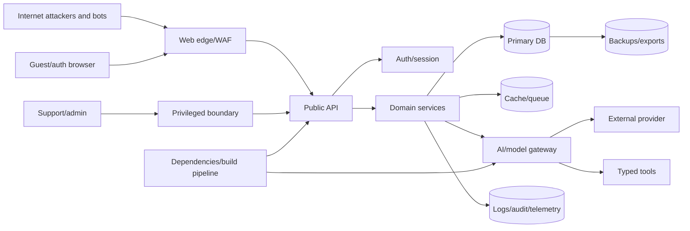

# NexusAI — Threat Model

**Document type:** Phase 10 structured security, privacy, AI, and abuse threat model  
**Phase:** Phase 10 — Security, Privacy, Safety & Compliance Architecture  
**Status:** Approved — Phase 10 and Phase 11 documentation gates passed; Phase 12 Implementation Foundation/Project Initialization approved; Phase 13 Part 1 APPROVED; Phase 13 Part 2 AUTHORIZED / IN PROGRESS  
**Canonical product:** NexusAI — Personal AI Health & Wellness Companion  
**Date:** 2026-08-30  
**Scope:** Architecture-level threats and mitigations only. No penetration testing, exploit code, or production controls are created.

## 1. Method and severity model

The model considers spoofing, tampering, repudiation, information disclosure, denial of service, privilege escalation, privacy harm, AI manipulation, and unsafe action. Ratings are qualitative until beta traffic, deployment, provider, geography, and impact thresholds are approved; those decisions remain `TBD / Pending Decision`.

| Severity | Meaning |
| --- | --- |
| Critical | Credible path to broad restricted-data exposure, privileged compromise, destructive cross-user action, or unsafe product behavior with severe impact |
| High | Account/cross-user compromise, major privacy/safety failure, or sustained outage requiring immediate remediation |
| Medium | Limited exposure/abuse, control bypass with constraints, or material reliability/privacy degradation |
| Low | Low-impact weakness, defense-hardening opportunity, or difficult path with limited consequence |

Risk acceptance requires a named owner, expiry, compensating controls, and review. Critical/high launch blockers cannot be accepted informally.

## 2. Assets

- Account identities, authentication metadata, and active sessions
- Email/profile/preferences and wellness profile
- Goals, routines, plans, tasks, check-ins, and reminders
- Conversations, messages, and approved memory values
- Consent, lifecycle, safety, support, and audit evidence
- AI context, prompts in transit, normalized outputs, provider credentials, and tool permissions
- Encryption keys, application/provider secrets, signing keys, and recovery credentials
- Export artifacts, backups, logs, metrics, traces, and operational dashboards
- Service availability, integrity, user trust, and wellness-only safety boundary

## 3. Actors

- Legitimate guest and authenticated user
- External attacker/bot/credential stuffer
- Malicious or compromised user account
- Compromised browser/device/session
- Support/admin/security operator
- Internal worker/service identity
- External identity/AI/notification/infrastructure provider
- Compromised dependency or build pipeline
- Future tool/integration provider

## 4. Attack surface and trust boundaries

Each arrow is assessed for identity, authorization, input/output validation, confidentiality, integrity, availability, lifecycle, and evidence.

## 5. Threat register

| ID | Threat / attack path | Severity | Primary mitigations | Detection/evidence |
| --- | --- | --- | --- | --- |
| TM-01 | Account takeover through stolen credentials or recovery abuse | Critical | Verified identity flow, strong password policy if used, MFA readiness, rate limits, generic errors, suspicious-login detection, session revocation | Auth failures, new-device/session events, recovery anomalies, user reports |
| TM-02 | Credential stuffing and password spraying | High | Per-IP/account/device throttles, breached-password screening where approved, bot controls, progressive challenge, MFA/step-up | Distributed failure patterns, blocked attempts, credential-abuse alerts |
| TM-03 | Session theft/fixation/replay | Critical | Secure HttpOnly/SameSite cookies or approved bearer controls, token hashing, rotation, short lifetime, device/session view, revocation, TLS | Concurrent geography/device anomalies, rotated-token reuse, session audit |
| TM-04 | CSRF against authenticated mutations | High | SameSite cookie posture, anti-CSRF token/origin checks, re-auth/confirmation for destructive actions | Origin/referrer mismatch, invalid CSRF events, mutation anomalies |
| TM-05 | Stored/reflected/DOM XSS through chat, profile, goals, or AI output | Critical | Contextual output encoding, sanitization, CSP, no unsafe HTML rendering, dependency controls | CSP reports, client error telemetry, security testing |
| TM-06 | SQL/NoSQL/command/template injection | Critical | Parameterized data access, strict schemas, no shell/tool exposure, allow-listed templates, least-privilege DB roles | WAF/app validation alerts, DB query anomaly, SAST/DAST |
| TM-07 | IDOR/broken object authorization | Critical | Principal-derived `/me` ownership, same-account checks, nested authorization, `404` masking, negative tests | Authorization-denial audit, cross-account test suite, unusual ID probing |
| TM-08 | Privilege escalation through role/scope manipulation | Critical | Server-side RBAC/ABAC, immutable signed identity claims, role-change approval, separation of duties | Role/claim changes, forbidden-operation attempts, privileged review |
| TM-09 | Support/admin misuse or compromised privileged account | Critical | No default chat/memory access, MFA, just-in-time scopes, reason/expiry, dual approval for sensitive access, immutable audit | Break-glass events, query scope, unusual exports/access, periodic review |
| TM-10 | API abuse, bot abuse, AI cost exhaustion | High | Guest isolation, named rate-limit classes, quotas, request limits, idempotency, bot/anomaly controls, budget circuit breakers | Rate-limit hits, usage spikes, queue growth, provider cost anomaly |
| TM-11 | Rate-limit bypass via distributed identities/IPs | High | Multi-signal limits, account/device/session keys, abuse scoring, provider-side caps, safe degradation | Correlated traffic patterns, quota anomalies, identity churn |
| TM-12 | Cross-user data exposure through cache/query/index contamination | Critical | Account-scoped cache/index keys, ownership filters, no shared raw context, tenant-isolation tests, purge/invalidation | Canary tests, cache-key audits, cross-account access alerts |
| TM-13 | Sensitive logging/telemetry leakage | High | Logging allow-list, centralized redaction, no raw content/tokens, restricted retention/access, redaction tests | DLP/redaction alerts, log sampling, secret scanning |
| TM-14 | Memory leakage, stale revoked memory, or candidate auto-save | Critical | Memory off by default, current consent/purpose checks, candidate approval, immediate retrieval block, derived-copy cleanup | Memory audit events, revocation reconciliation, isolation tests |
| TM-15 | Export abuse or insecure artifact access | High | Step-up/confirmation, account ownership, opaque short-lived reference, encryption, single-user scope, artifact expiry | Export request/access audit, download anomaly, failed-auth alerts |
| TM-16 | Account/memory deletion failure or resurrection | High | Idempotent lifecycle jobs, tombstones, status evidence, retry/reconciliation, restore-time lifecycle replay | Incomplete job alerts, post-delete scans, restore tests |
| TM-17 | Backup theft or unauthorized restore | Critical | Separate encrypted backups, least-privilege recovery role, dual approval, immutable audit, restore isolation | Backup-access events, restore authorization, integrity checks |
| TM-18 | Prompt injection/instruction hijacking | High | Separate system/policy/user/tool layers, untrusted-content labels, capability allow-list, output/tool validation, no model authority | Prompt-injection evals, denied tool calls, safety/policy events |
| TM-19 | AI data exfiltration through response or provider | Critical | Context minimization, account isolation, secret exclusion, provider contracts, response validation, egress controls | Output DLP/safety checks, provider audit, cross-user canary tests |
| TM-20 | Hallucinated clinical advice or unsafe output | High | Wellness-only policy, pre/post safety checks, reviewed modes/copy, evaluation sets, response reporting | Safety events, user reports, sampled evaluation, regression alerts |
| TM-21 | Unauthorized tool execution or action tampering | Critical | Intent → permission → auth → validation → execution → result validation → audit; explicit confirmation | Tool-denial logs, action diffs, idempotency conflict, privileged alerts |
| TM-22 | Malicious/poisoned memory or retrieved context (memory poisoning) | High | Explicit candidate review, bounded taxonomy, provenance, sensitivity/purpose filters, editable/delete controls | Candidate rejection, provenance anomalies, retrieval evals |
| TM-23 | Provider compromise, retention breach, or credential leak | Critical | Provider due diligence, minimal payload, scoped/rotated secret, egress allow-list, circuit breaker, exit/revoke plan | Provider incident notice, token anomalies, failure/traffic changes |
| TM-24 | Supply-chain/dependency/build compromise (supply chain) | Critical | Dependency pinning/provenance, SCA, signed builds/artifacts where supported, secret scanning, protected CI, review gates | Build integrity failures, dependency alerts, unexpected release changes |
| TM-25 | Notification leakage of wellness data | High | Non-sensitive preview by default, approved channel consent, template allow-list, provider minimization | Delivery template audit, complaints, provider payload sampling |
| TM-26 | Data integrity corruption/partial workflow commit | High | Transactions/constraints, idempotency, state machines, reconciliation, append-only evidence | Constraint errors, job mismatch, integrity scans |
| TM-27 | Denial of service/provider outage (DoS) | High | Rate limits, queues, timeouts, circuit breakers, graceful manual features, capacity alerts | Availability/latency, queue depth, dependency health |
| TM-28 | Secrets or keys committed to source/client bundle | Critical | Secrets manager, pre-commit/CI secret scanning, least-privilege rotation/revocation | Secret scan, repository audit, credential-use alerts |
| TM-29 | Privacy consent bypass or purpose creep | Critical | Current consent at point of use, purpose identifiers, policy versioning, data-flow inventory, user controls | Consent/purpose audit, denied retrieval/write, privacy review |
| TM-30 | Safety policy tampering or unreviewed model/prompt change | High | Versioned policy artifacts, approval workflow, signed/restricted release, regression evaluation, rollback | Artifact diff/audit, policy-version telemetry, safety drift alert |

## 6. Abuse cases

### Cross-account resource probing

An attacker cycles UUIDs for goals, messages, memories, exports, or support paths. The API derives account ownership from the principal, validates nested ownership, returns indistinguishable `404` responses, rate-limits probing, and audits unusual enumeration.

### Malicious AI instruction

A user or retrieved text requests hidden prompt disclosure, another user’s memory, a broader tool, or policy bypass. Content remains untrusted, the model receives no secret or authorization authority, tool calls are schema/permission checked outside the model, and output is validated.

### Compromised support session

An attacker gains a support credential and searches user data. Support scopes exclude chat/memory by default; sensitive access requires break-glass reason, duration, step-up/MFA, approval where required, and audit/alerting.

### Deletion-versus-backup conflict

A user deletes memory/account data while derived copies or backups remain. Retrieval blocks immediately; lifecycle jobs invalidate active copies; backup expiry and legal-hold exceptions follow an approved policy; completion is not claimed without evidence.

## 7. Residual risks and blockers

- Exact launch geography, age policy, privacy obligations, retention periods, and breach-notification requirements are unresolved.
- Auth provider, MFA/session baseline, support/admin staffing, and break-glass approvers are unresolved.
- AI provider retention/training/regional processing/deletion guarantees are unresolved.
- Memory/provider/backup cleanup guarantees and RTO/RPO are unresolved.
- Numeric rate limits, beta scale, cost thresholds, and alert thresholds are unresolved.

These prevent a production-ready residual-risk rating. They remain explicit Phase 10 findings and `TBD / Pending Decision` items rather than assumed answers.

## 8. Threat-model maintenance

Review the threat model when adding a provider, tool, data category, auth method, payment flow, file upload, native/voice channel, model, support capability, deployment region, or new user population. Security incidents and test findings update the register and control evidence.

## 9. Phase boundary

This document defines threats and mitigations only. It does not authorize active exploitation, penetration testing against external systems, production configuration, or implementation.
