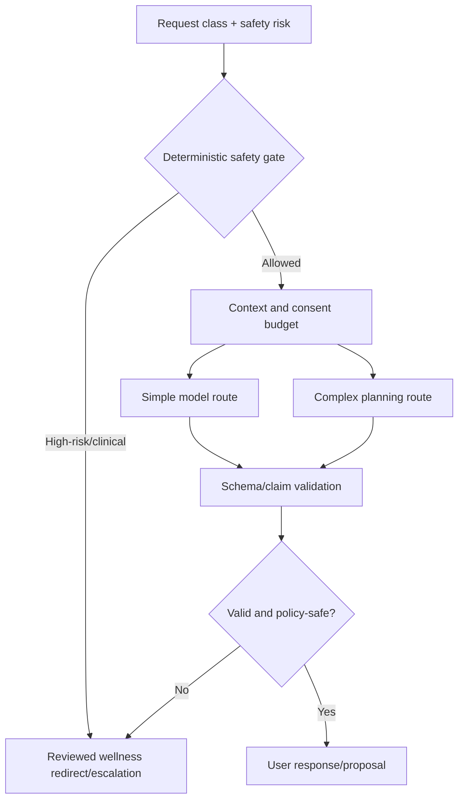

# NexusAI — AI Provider and Model Strategy

**Document type:** Phase 11 AI provider, model routing, privacy, evaluation and NexusAI Brain compatibility plan  
**Phase:** Phase 11 — Technology Stack, Implementation Architecture & Development Foundation Planning  
**Status:** Approved — Phase 11 documentation gate passed; Phase 12 Implementation Foundation/Project Initialization approved; Phase 13 Part 1 APPROVED; Phase 13 Part 2 AUTHORIZED / IN PROGRESS  
**Canonical product:** NexusAI — Personal AI Health & Wellness Companion  
**Date:** 2026-08-30  
**Scope:** Provider strategy only. No model account, SDK, prompt implementation, training run, or provider integration is created.

## 1. Non-negotiable boundary

All AI traffic goes through `NexusAI IntelligenceEngine / ModelGateway`. Product modules never call a provider SDK directly. The gateway owns provider selection, context minimization, safety/policy gates, schema normalization, retries, usage metadata and fallback. The model remains untrusted: it cannot authorize access, grant consent, change safety mode, write memory directly, or execute tools.

The MVP remains wellness-only and non-diagnostic. Private user content is not used for model training without separate explicit consent. Provider retention, training, regional processing, subprocessor, deletion and incident terms are Phase 10 High/TBD decisions.

## 2. Provider option comparison

| Option | Quality/latency | Privacy/control | Cost/hardware | Engineering/operations | Long-term fit | Decision |
| --- | --- | --- | --- | --- | --- | --- |
| A. Commercial hosted API | Highest immediate quality and broad model choices; predictable integration | Provider contract, region, retention/training and incident terms must be verified; egress exposure | Usage-based, no GPU operations; cost varies with tokens/traffic | Lowest integration burden; quota/outage dependence | Strong adapter-based path, but vendor lock-in risk | **Preferred MVP strategy** |
| B. Hosted open-source inference | More model choice/control and possible regional options | Provider still handles data unless self-hosted; quality/evaluation varies | Usage-based; hardware managed by host | Medium integration/evaluation burden | Easier model portability than one commercial API | Secondary option |
| C. Self-hosted open-source model | Maximum data/control and potential unit economics at high volume | Team owns patching, isolation, abuse, retention and incident controls | GPU, inference, monitoring and capacity cost; poor fit for early low volume | High operational complexity and ML expertise | Useful later for specialized workloads | Defer |
| D. Hybrid | Route sensitive/critical workloads selectively; resilience and cost options | Multiple provider/data-region contracts and deletion semantics | More than one integration and minimum commitment | Highest policy/observability complexity | Best at scale if governance is mature | Future phase |
| E. Immediate proprietary model development | Full strategic independence in theory | Requires large data governance, safety, ML security and legal program | Very high compute, talent and evaluation cost | Not compatible with MVP timeline | Long-term NexusAI Brain goal | Not for MVP |

Commercial hosted inference is the most realistic MVP choice for a founder-led team, including a Bangladesh-based team where minimizing GPU operations, 24/7 inference infrastructure and specialized ML staffing is valuable. This is an engineering assumption, not a jurisdiction or vendor decision.

## 3. Gateway contract

The provider-neutral gateway receives:

- operation class (chat, plan suggestion, check-in reflection, safety classification, memory candidate);
- authenticated account scope and policy version;
- minimized current conversation and eligible context;
- output schema, token/context budget and timeout policy;
- allowed capability/tool intents (if any).

It returns a normalized result containing response text or structured proposal, safety mode, usage metadata, provider alias/model class, policy/evaluation version, finish/error class and trace correlation. It must not return hidden reasoning, raw provider payloads or credentials.

## 4. Context and privacy policy

- Include only current conversation plus purpose-eligible goals, plans, check-ins and approved memory.
- Exclude unrelated profile fields, support data, credentials, tokens, secrets, hidden prompts and other accounts.
- Apply consent, lifecycle, sensitivity and context-budget checks before every call.
- Pseudonymize identifiers where practical; never assume pseudonymization removes regulatory duties.
- Do not persist raw prompts/completions in ordinary logs or the core business model.
- Keep provider-bound data inventory, retention/deletion evidence and subprocessor record.

If provider terms or region are unknown, block restricted context or return a safe deterministic response.

## 5. Model routing plan

Routing categories are conceptual:

- **Simple:** concise wellness phrasing, summarization, task wording, reminder copy—lower-cost model where quality gates pass.
- **Complex:** multi-step planning or context synthesis—stronger model with bounded context and budget.
- **Safety:** deterministic rules and reviewed classifiers/evaluators around every model, never model confidence alone.
- **Fallback:** safe deterministic explanation or pending state during provider outage/uncertain retention.

Exact models, budgets, latency/cost thresholds and fallback providers are `TBD / Pending Decision`.

## 6. Evaluation and release criteria

Maintain a versioned synthetic evaluation set covering:

- prompt injection and indirect retrieved-content attacks;
- cross-user context and memory poisoning;
- secret/PII exfiltration and hidden-prompt disclosure;
- wellness-only boundary, clinical certainty, crisis/high-risk language;
- structured output validity, tool authorization and confirmation;
- provider timeout, malformed output, rate limit and retention uncertainty;
- memory consent/revocation and deletion propagation.

A provider/model change requires regression results, safety/privacy review, cost/latency comparison, rollback route and updated ADR. Critical/High security or safety regressions block release.

## 7. Provider onboarding checklist

Before sending restricted data to a provider, document:

1. Security review and authentication method.
2. Data retention, training/improvement use and deletion controls.
3. Processing region, subprocessors and cross-border transfer basis.
4. Prompt/output logging and human access practices.
5. Incident notification and support commitments.
6. Rate limits, quotas, availability, timeout and circuit-breaker behavior.
7. Data-subject request and account/memory deletion propagation.
8. Credential scoping, rotation, egress allow-list and revocation.
9. Export/exit plan and a tested provider-neutral adapter.

Provider approval is a product/privacy/security gate, not merely an engineering configuration.

## 8. Memory and tool interaction

Memory candidates are generated ephemerally, shown for user confirmation, and stored only through the memory policy. Retrieval is current-consent and purpose constrained. Tool requests are normalized intents that pass independent authorization, input validation, confirmation and output validation. The provider never receives a broad “user profile dump” or tool credential.

## 9. Bangladesh/team and regional considerations

The architecture should support a distributed team with limited ML-ops capacity: hosted inference, mock providers for local development, asynchronous jobs, measured budgets, and an adapter that can swap regional providers. Data-region selection, latency to the target population, support hours, payment/contracting availability and local legal review remain launch decisions.

## 10. Future path to the proprietary NexusAI Brain

The following migration path is supported without rewriting public API, user profiles, memory, planning, safety or UI:

1. Hosted commercial provider behind ModelGateway (MVP).
2. Second commercial or hosted open model for fallback/evaluation.
3. Specialized open/self-hosted model for narrow tasks where volume/privacy justify operations.
4. NexusAI-trained components for routing, safety evaluation, retrieval or wellness personalization.
5. Proprietary NexusAI Brain behind the same normalized gateway and policy contracts.

Only the adapter, model registry, evaluation artifacts, routing policy and infrastructure should change. User-visible claims must continue to reflect actual capability.

## 11. Open decisions

- Provider/model, region, retention/training and deletion terms.
- Model routing classes, context/token budgets, cost/latency thresholds and fallback.
- Evaluation corpus owner, safety thresholds, release authority and incident process.
- Retrieval/index technology and derived-copy deletion guarantee.
- Future self-hosting trigger, GPU budget and ML-ops staffing.

All remain `TBD / Pending Decision`.

## 12. Phase boundary

This document defines AI provider strategy only. It does not create provider accounts, send data, install SDKs, write prompts, train models, implement routing, or start Phase 12.
