# NexusAI — CI/CD Foundation Strategy

**Document type:** Phase 11 continuous integration, delivery, security gates and release governance  
**Phase:** Phase 11 — Technology Stack, Implementation Architecture & Development Foundation Planning  
**Status:** Approved — Phase 11 documentation gate passed; Phase 12 Implementation Foundation/Project Initialization approved; Phase 13 Part 1 APPROVED; Phase 13 Part 2 AUTHORIZED / IN PROGRESS  
**Canonical product:** NexusAI — Personal AI Health & Wellness Companion  
**Date:** 2026-08-30  
**Scope:** CI/CD planning only. No workflow files, build runners, registry, deployment, package installation, or migration execution is created.

## 1. Goals

CI/CD should make the approved documentation and implementation contracts executable as evidence: reproducible builds, contract compatibility, security/privacy/safety checks, migration safety, isolated test data, staged promotion and explicit human approval. The pipeline must never bypass Phase 10 launch blockers or silently alter the 21-entity database/77-operation API model.

## 2. Proposed pipeline

```mermaid
flowchart LR
  C[Commit / pull request] --> F[Format + lint]
  F --> T[Type check + unit tests]
  T --> CT[Contract + integration tests]
  CT --> S[SAST + SCA + secret scan]
  S --> B[Build immutable artifacts]
  B --> D[DAST / AI red-team / lifecycle tests]
  D --> ST[Staging deployment]
  ST --> R[Restore and smoke validation]
  R --> A[Explicit release approval]
  A --> P[Production promotion]
  P --> M[Post-release monitoring / rollback]
```

## 3. Pull-request checks

Required checks for every change:

- markdown/document link and phase-boundary validation;
- formatting, linting and type checks;
- unit tests for changed modules and policy decisions;
- API request/response/error contract tests;
- database migration lint and schema/ownership constraint checks;
- dependency/SCA, license-policy and secret scanning;
- build reproducibility and artifact provenance;
- affected security/privacy/AI evaluation suites.

Protected branches require review. Auth, policy, database, AI/provider, lifecycle, support/admin and infrastructure changes require designated ownership review once owners are assigned.

## 4. Test and evidence handling

CI uses synthetic fixtures, mock providers and ephemeral credentials. Logs and artifacts are redacted; no production prompts, messages, memory, exports, tokens, health data or backups are uploaded to CI. Test reports identify commit, environment, policy version, schema/API version, suite, result, severity and artifact hash.

Security evidence is retained for an approved period and access-controlled. Exact retention, independent review and compliance evidence scope are `TBD / Pending Decision`.

## 5. Build and artifact policy

- Pin runtime and dependency versions using a lockfile.
- Produce immutable, traceable web/API/worker artifacts from the same commit.
- Generate a software bill of materials and dependency provenance when supported.
- Do not bake secrets, provider keys, prompts containing private data or environment-specific credentials into artifacts.
- Sign or attest artifacts where the selected CI/registry supports it.
- Scan final artifacts for secrets and prohibited debug content.

## 6. Staging and pre-production gates

Staging must run with isolated databases, sandbox providers, synthetic data and production-like policy enforcement. Before production approval, demonstrate:

- auth/session and RBAC/IDOR negative coverage;
- API contract and database constraint compatibility;
- AI prompt-injection, cross-user, memory, exfiltration, tool and safety evaluations;
- export/deletion/revocation lifecycle and reconciliation;
- backup restore and lifecycle tombstone checks;
- rate-limit/abuse and dependency outage behavior;
- redacted telemetry, alert routing and incident handoff;
- accessibility/security UX checks for consent, MFA, export/delete and safety states.

## 7. Database migration delivery

Migrations are separate, ordered, reviewed artifacts. CI checks dependency order, idempotency expectations, lock/long-running-risk warnings, backward compatibility and rollback/forward-fix notes. Production migration execution requires an explicit change approval, backup/recovery confirmation and a tested application compatibility window.

Do not combine destructive data purge with an ordinary feature release. Lifecycle and retention changes require privacy/security review.

## 8. Promotion and rollback

- Promote the same immutable artifact from staging to production; do not rebuild with different source.
- Record release, policy, schema, provider alias/model class and approval metadata.
- Use feature flags for reversible high-risk capabilities; default new memory/provider/tool behavior off.
- Roll back application artifacts when safe; use forward-fix for irreversible schema/data changes.
- If a provider, policy or safety regression occurs, disable the route/tool/provider and fall back to deterministic behavior while incident response begins.
- Post-release monitoring observes error, latency, queue, security, privacy and safety signals before declaring stability.

## 9. CI identity and secrets

CI uses short-lived, repository-scoped identities. Production deployment credentials are separated from test credentials and require protected approvals. Secrets are injected from a secrets manager and masked in logs. Pull requests from untrusted forks cannot access production or restricted staging secrets.

## 10. Release gate ownership

| Gate | Required reviewer |
| --- | --- |
| Product/API/database compatibility | Product + Engineering |
| Security/authz/secrets | Security owner |
| Privacy/consent/retention | Privacy/legal owner |
| AI/provider/memory | AI safety + privacy/security |
| Safety policy/evaluation | Named safety owner |
| Reliability/restore | Platform/operations |
| Final production approval | Founder/launch authority |

Owners, staffing, approval quorum, cadence and RTO/RPO are `TBD / Pending Decision`.

## 11. Pipeline implementation alternatives

Use the source-control host’s native CI initially if it provides protected branches, secret management, artifact retention, dependency scanning and environment approvals. A dedicated CI platform is justified only if build minutes, isolation, regional controls or evidence requirements exceed native capability. Avoid multi-provider pipeline orchestration for MVP.

## 12. Phase boundary

This document defines CI/CD strategy only. It does not create workflow files, runners, registries, deployment credentials, staging/production environments, or Phase 12 implementation.
