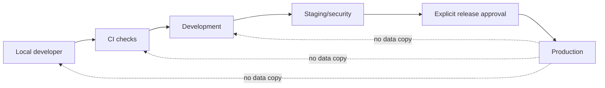

# NexusAI — Development Environments and Local Developer Experience

**Document type:** Phase 11 environment topology, configuration, local workflow and safety rules  
**Phase:** Phase 11 — Technology Stack, Implementation Architecture & Development Foundation Planning  
**Status:** Approved — Phase 11 documentation gate passed; Phase 12 Implementation Foundation/Project Initialization approved; Phase 13 Part 1 APPROVED; Phase 13 Part 2 AUTHORIZED / IN PROGRESS  
**Canonical product:** NexusAI — Personal AI Health & Wellness Companion  
**Date:** 2026-08-30  
**Scope:** Environment planning only. No environment, account, secret, database, package, or deployment is created.

## 1. Environment principles

Every environment has isolated credentials, databases (where appropriate), policy versions, logs and provider accounts. Production personal/health data never enters local, CI or staging fixtures. The environment model must preserve Phase 10 fail-closed behavior when an identity, consent, safety, lifecycle or provider dependency is unavailable.

## 2. Environment matrix

| Environment | Purpose | Data | Providers | Deployment/access |
| --- | --- | --- | --- | --- |
| Local | Individual development and fast tests | Generated synthetic fixtures; disposable database | Mock identity/AI/notification by default | Developer workstation; no production credentials |
| CI | Deterministic checks per change | Seeded synthetic fixtures; ephemeral services | Contract mocks or isolated test accounts | Ephemeral runner; short-lived credentials |
| Development | Shared integration and exploratory testing | Synthetic only; resettable | Sandbox identity/AI/storage where available | Restricted team access; observable |
| Staging/security | Release candidate, DAST, AI red-team, restore and lifecycle tests | Synthetic or irreversibly anonymized | Provider sandbox/approved low-risk account | MFA, named testers, audited |
| Production | Real user service | Production data under approved policy | Approved providers/region only | Least-privilege operations; break-glass controls |

A separate pre-production environment is added only when development and staging have materially different risk or scale requirements.

## 3. Environment flow

Promotion moves an immutable build and reviewed policy versions forward. It does not promote databases by copying production data into lower environments.

## 4. Local developer journey

A future developer or AI coding agent should be able to:

1. Open the repository and read the current phase/source-of-truth index.
2. Select the supported Node.js LTS and package-manager versions from a checked-in tool policy.
3. Create a local environment file from a non-secret example.
4. Start disposable PostgreSQL and any explicitly required local service through the documented development profile.
5. Start web, API and worker processes with mock providers by default.
6. Apply approved local migrations and safe seed/reference data only.
7. Run formatting, linting, type, unit, integration, contract, E2E and security checks.
8. Inspect redacted logs, correlation IDs, policy versions and job state.
9. Stop and reset local services without affecting shared environments.

No step should require production access, real user data, real provider secrets or an unreviewed external AI call.

## 5. Configuration separation

| Configuration class | Examples | Storage rule |
| --- | --- | --- |
| Safe checked-in defaults | Port, route prefix, mock mode, feature-flag defaults | Version-controlled; no secrets |
| Environment variables | Database URL reference, public origin, non-secret limits, deployment metadata | Injected per environment; validated at startup |
| Secrets | Identity credentials, AI keys, storage credentials, signing/KMS references | Secret manager or local secure store; never Git/client/logs |
| Policy artifacts | Safety, consent, retention, model routing, prompt/template versions | Reviewed, versioned, environment-approved |
| User/account state | Profiles, goals, memory, consent, lifecycle | Isolated database; never copied to lower environments |

Startup should fail closed when required secrets or policy versions are missing. Non-essential observability features may degrade only if security evidence is not lost.

## 6. Local data and provider stubs

Local fixtures cover guest flow, onboarding, goals/plans/tasks, check-ins, reminders, chat, memory candidates/approval/revocation, export/deletion, safety modes and support projections using synthetic content. Fixtures include cross-account canaries and stale lifecycle generations to exercise negative authorization and cleanup logic.

Mock providers must expose success, timeout, rate-limit, malformed-output, retention-uncertain and outage scenarios. The mock contract matches the provider-neutral adapter; application modules do not branch on a specific provider SDK.

## 7. Database and migration workflow

Local schema work follows the approved Phase 06 migration ordering and 21-entity model. Development/staging migrations run against isolated databases, are reviewed in CI, and are never applied from an unreviewed workstation to production. Destructive data resets are limited to disposable local/CI databases.

## 8. Access and identity

- Local and CI identities are separate from human production identities.
- Development/staging operator access uses MFA and named accounts; no shared credentials.
- Production access is just-in-time, scope-limited and audited as defined in Phase 10.
- AI provider keys and storage credentials are never embedded in web bundles or test fixtures.

## 9. Observability by environment

Local logs are readable but redacted. CI stores only bounded test evidence. Development/staging retain security-relevant correlation, policy and lifecycle events. Production follows Phase 10 logging allow-lists, restricted retention, alerting and incident response. Trace IDs must not become a covert carrier for chat, memory or health text.

## 10. Environment parity and drift

Keep runtime major versions, schema compatibility, policy validation and container/build settings aligned across staging and production. Differences must be documented (scale, domains, provider sandbox, secrets, feature flags). A release candidate is rejected when an environment-specific bypass disables authz, consent, safety, lifecycle or redaction controls.

## 11. Recovery and deletion tests

Staging periodically exercises backup restore, key/secret rotation, account deletion, memory revocation, export expiry, queue replay and provider outage using synthetic accounts. Restored data is reconciled against lifecycle tombstones before any test traffic is enabled.

Cadence, RTO/RPO, backup region, exact retention and provider sandbox availability remain `TBD / Pending Decision`.

## 12. Phase boundary

This document defines environment and local-development expectations only. It does not create `.env` files, credentials, containers, databases, deployment targets, migrations, or source code.
