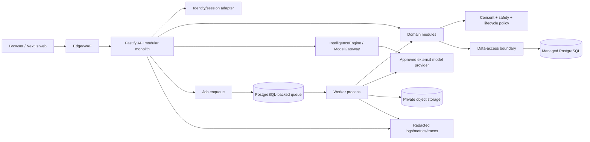

# NexusAI — Implementation Architecture

**Document type:** Phase 11 application implementation architecture  
**Phase:** Phase 11 — Technology Stack, Implementation Architecture & Development Foundation Planning  
**Status:** Approved — Phase 11 documentation gate passed; Phase 12 Implementation Foundation/Project Initialization approved; Phase 13 Part 1 APPROVED; Phase 13 Part 2 AUTHORIZED / IN PROGRESS  
**Canonical product:** NexusAI — Personal AI Health & Wellness Companion  
**Date:** 2026-08-30  
**Scope:** Logical implementation boundaries and runtime responsibilities. No application source code, API endpoint implementation, infrastructure, or package installation is created.

## 1. Goals and constraints

The implementation must deliver the approved web-first wellness MVP while preserving the Phase 00–10 source of truth: guest demo, authenticated onboarding, wellness profile, goals/routines/plans/tasks/check-ins, reminders, AI Companion, consent-based Minimal Memory, export/delete, safety modes, 21 database entities, 77 API operations, and Phase 10 security/privacy controls.

Use a modular monolith for the API plus a separately scalable worker process. Keep module boundaries explicit even while deployment is simple. No module may bypass authorization, consent, safety, lifecycle, ownership, or audit policy.

## 2. Runtime topology

The browser never connects directly to PostgreSQL, queues, object storage, or AI providers. Provider credentials and secrets remain inside server-side adapters.

## 3. Module boundaries

| Module | Owns | May call | Must not do |
| --- | --- | --- | --- |
| Identity/session | Principal resolution, session events, recovery hooks | Identity provider adapter, audit | Store raw credentials or grant business permissions |
| Account/profile | Account lifecycle, user/wellness profile | Consent, lifecycle, data access | Read another account or infer hidden health attributes |
| Wellness | Goals, routines, plans, tasks, check-ins, progress | Ownership policy, reminders, AI proposal adapter | Commit model output directly as source-of-truth state |
| Reminder | Preferences, reminders, delivery state | Consent, queue, notification adapter | Put restricted wellness text in notification payloads by default |
| Conversation | Conversations and messages | Safety policy, IntelligenceEngine | Send unrestricted history/provider payloads |
| Consent/memory | Consent records, candidate/approved memory, revoke/clear | Lifecycle, audit, context builder | Save memory without explicit current consent |
| Safety/policy | Risk classification, modes, policy versions, safe fallbacks | Audit, evaluation metadata | Depend on model confidence or UI-only checks |
| IntelligenceEngine | Context assembly, provider routing, normalized result | Consent/memory, safety, ModelGateway, tool gateway | Authorize access, invent clinical care, or write arbitrary data |
| Tool gateway | Typed capability request, validation, confirmation, execution | Domain service, authorization, audit | Run arbitrary shell/database/network/provider actions |
| Lifecycle | Export, deletion, revocation, retention jobs | Queue, object storage, providers, audit | Claim completion without reconciliation evidence |
| Support/admin | Narrow projections and privileged workflows | Authz, audit, lifecycle | Browse private chat/memory by default |
| Audit/usage | Append-oriented security, consent, safety, support, usage evidence | All modules | Capture raw prompts, memory, secrets, or passwords |

## 4. Request processing pipeline

1. Edge applies TLS, abuse controls, request-size limits and correlation ID.
2. API adapter parses version, content type, pagination and idempotency headers.
3. Identity adapter resolves the principal and assurance level; protected operations fail closed.
4. Route schema validates input; domain service validates business invariants.
5. Authorization evaluates role, scope, account ownership, lifecycle, consent, safety mode and confirmation/step-up.
6. Domain module executes a transaction through the data-access boundary and emits minimized audit/usage events.
7. AI calls pass through IntelligenceEngine → policy → ModelGateway; provider payloads are minimized.
8. Response schema validates output and redacts restricted fields before returning the approved API envelope.

## 5. Internal dependency rules

- Dependencies point toward policy and domain contracts, not provider SDKs.
- Shared packages contain types, schemas, errors, policy identifiers and telemetry contracts—not business logic copied across modules.
- Modules communicate through typed application interfaces or domain events; no cross-module table writes.
- Data-access functions require an explicit principal/account scope for user-owned queries.
- Workers reuse domain services and authorization/policy checks; a job payload is not proof of permission.
- External providers are isolated behind adapters and normalized interfaces.

## 6. API implementation style

Implement the approved REST contract under `/api/v1`; internal worker/service calls use `/internal/v1` or an equivalent authenticated in-process interface. Do not add endpoints because a framework makes them convenient.

Every operation defines:

- request/response schema and content type;
- authentication and role requirement;
- account/resource ownership rule;
- consent/safety/lifecycle preconditions;
- stable error code and HTTP mapping;
- pagination/cursor behavior where applicable;
- idempotency requirement for retries or consequential mutation;
- correlation/audit event category.

Use a single error envelope with generic security-sensitive messages. `404` masking is used for non-owned resources where the approved API contract specifies it.

## 7. Background execution

Workers process AI generation, reminder delivery, export, deletion, memory cleanup, provider deletion requests and reconciliation. Jobs include an opaque job ID, account scope, lifecycle generation, policy version, idempotency key, attempt count and expiry—not raw secrets or unrestricted content.

Queue consumers must be idempotent, bounded-retry, timeout-aware and safe against stale lifecycle generations. A provider outage produces a safe pending/fallback state; it must not fabricate success or duplicate side effects.

## 8. Configuration and policy separation

Configuration is divided into:

- environment settings (URLs, non-secret limits, feature flags);
- secret references (identity, AI, storage, observability credentials);
- versioned policy artifacts (safety, consent, retention, routing, prompts/templates);
- database reference/state (user settings and lifecycle status).

Policy versions are attached to decisions and audit events. Changing a safety or privacy policy requires review, evaluation and a reversible release—not a silent string edit.

## 9. Deployment model and future extraction

For MVP, deploy web, API and worker as separately scaled workloads in one cloud account/project, backed by managed PostgreSQL and private object storage. API and worker share packages but have distinct runtime identities and resource limits.

Extract a service only when one of these signals is demonstrated: independent scaling need, provider isolation requirement, failure-domain isolation, team ownership, or security boundary that cannot be maintained inside the monolith. Likely first extraction candidates are AI/provider workers and notification delivery. Extraction must preserve public REST contracts, database ownership, consent/memory lifecycle and audit semantics.

## 10. Error, retry and degradation behavior

| Failure | API behavior | Background behavior |
| --- | --- | --- |
| Identity unavailable | Generic protected-operation failure | Do not process user-scoped jobs without a valid service identity |
| Database unavailable | Safe 5xx with correlation ID; no partial success | Retry boundedly; preserve idempotency and alert |
| AI provider timeout | Safe fallback or pending response; no fabricated wellness claim | Bounded retry; circuit-break and record usage outcome |
| Consent/memory policy unavailable | Block memory/provider context and high-risk action | Keep job pending/failed; never bypass policy |
| Queue unavailable | Return accepted only when durable enqueue is confirmed | Alert; do not lose deletion/export request |
| Object storage unavailable | Keep export pending; never emit an unprotected URL | Retry and reconcile expiry |

## 11. Implementation quality gates

Before source implementation is approved, define shared schema ownership, module test contracts, security review of authorization predicates, database transaction boundaries, provider adapter contract, redacted telemetry contract, and local/staging parity. Phase 10 High blockers must have owners and explicit decisions before public beta.

## 12. Phase boundary

This document defines implementation architecture only. It does not initialize projects, install dependencies, create routes, write services, configure cloud resources, or start Phase 12.
