# NexusAI — Infrastructure and Deployment Strategy

**Document type:** Phase 11 cloud, deployment topology, managed services, security and recovery strategy  
**Phase:** Phase 11 — Technology Stack, Implementation Architecture & Development Foundation Planning  
**Status:** Approved — Phase 11 documentation gate passed; Phase 12 Implementation Foundation/Project Initialization approved; Phase 13 Part 1 APPROVED; Phase 13 Part 2 AUTHORIZED / IN PROGRESS  
**Canonical product:** NexusAI — Personal AI Health & Wellness Companion  
**Date:** 2026-08-30  
**Scope:** Infrastructure planning only. No cloud account, service, network, secret, container, or deployment is provisioned.

## 1. Infrastructure objectives

Provide a secure, low-operations path for the web-first wellness MVP while preserving Phase 10 controls: private managed PostgreSQL, encrypted backups, scoped service identities, redacted observability, provider egress controls, isolated environments, lifecycle reconciliation and auditable privileged access.

Do not select a final cloud region or provider until launch geography, privacy roles, AI-provider processing, age policy and contractual requirements are approved.

## 2. Cloud-category comparison

| Option | MVP cost/complexity | Managed PostgreSQL/storage/queues | Security and recovery | Scaling | Lock-in | Decision |
| --- | --- | --- | --- | --- | --- | --- |
| AWS-light managed | Broadest primitives, mature IAM/KMS/RDS/object storage, many regions; more configuration | Strong; queue/cache can be added only when needed | Mature private networking, backup/PITR and audit ecosystem | Clear path from small service to larger workloads | Medium–high service-specific lock-in; portable interfaces reduce it | **Reference option, pending geography/cost** |
| GCP-light managed | Good managed containers/PostgreSQL/object storage and strong developer workflow | Strong, with product-specific tradeoffs | Strong IAM/KMS/logging; region/data-processing review needed | Good autoscaling path | Medium | Candidate alternative |
| Azure-light managed | Good enterprise identity/network integration and PostgreSQL options | Strong for Microsoft-oriented teams | Strong policy/compliance tooling; higher learning overhead for small team | Good | Medium–high | Candidate alternative |
| Simpler managed platform | Fastest setup and lower early operations | May bundle web/DB/storage; fewer private-network, region, audit or recovery controls | Must verify encryption, access, backup/PITR, logs, incident terms | Suitable for early beta, uncertain at high scale | Platform coupling and migration cost | Candidate if Phase 10 review passes |
| Self-managed Kubernetes/VMs | Maximum control in theory | Team owns every layer | Highest patching, IAM, backup and incident burden | Flexible but expensive | Infrastructure lock-in through operations | Reject for MVP |

## 3. Recommended MVP deployment shape

Use one cloud account/project per organizational boundary, with separate environments and least-privilege identities. The reference shape is:

- managed edge/CDN/WAF;
- Next.js web workload;
- private Fastify API workload;
- separately scaled worker workload;
- managed PostgreSQL with connection pooling and PITR capability;
- private S3-compatible object storage for exports/future attachments;
- PostgreSQL-backed job queue initially;
- managed secrets/KMS boundary;
- centralized redacted logs, metrics, traces and alerting;
- provider egress allow-list and circuit breakers.

```mermaid
flowchart TB
  USER[Browser] --> EDGE[CDN/WAF/edge]
  EDGE --> WEB[Web workload]
  EDGE --> API[Private API ingress]
  API --> IAM[Managed identity adapter]
  API --> PG[(Managed PostgreSQL)]
  API --> AI[Provider-neutral ModelGateway]
  AI --> EXT[Approved AI provider]
  API --> JOB[PostgreSQL-backed jobs]
  JOB --> WORK[Worker workload]
  WORK --> PG
  WORK --> OBJ[(Private object storage)]
  API --> OBS[Logs/metrics/traces]
  WORK --> OBS
  PG --> BAK[Encrypted backup/PITR]
  SEC[Secrets/KMS] --> API
  SEC --> WORK
```

Web, API and worker are independently deployable but remain in the modular-monolith repository. No external provider receives direct database access.

## 4. Network and identity controls

- Public edge terminates approved TLS and applies abuse/rate controls.
- API, worker, database, queue and object storage use private or restricted paths where supported.
- Egress is limited to identity, AI, notification (future), observability, storage and backup destinations.
- Runtime identities are separate for web, API, worker, migrations, backup and operator access.
- Database and storage credentials are short-lived or rotated, scoped per environment and never embedded in client bundles.
- Operators use MFA, just-in-time access, case scope and audited break-glass for exceptional data access.

Exact VPC/VNet, firewall, WAF rules, certificate, KMS, provider and region are `TBD / Pending Decision`.

## 5. Data services

### PostgreSQL

Managed PostgreSQL is the approved platform. Use private connectivity, TLS, encryption at rest, connection pooling, query timeouts, role separation, backups/PITR and restore testing. The 21-entity model and Phase 06 DDL remain authoritative.

### Object storage

Private, encrypted bucket/container with account-scoped opaque keys. Export artifacts expire automatically, are served through short-lived signed access, and are included in deletion/backup lifecycle. Future profile images/attachments require separate upload scanning and privacy review.

### Queue/cache

Start with PostgreSQL-backed jobs and no dedicated Redis. Add managed Redis or a managed queue only after measured multi-instance rate-limit, latency, throughput or failure-domain needs. Any new service must have ownership, backup/retention and deletion semantics.

## 6. Backup, recovery and deletion

- Automated encrypted backups and point-in-time recovery where supported.
- Independent recovery credentials and isolated restore target.
- Restore validation includes schema constraints, lifecycle tombstones, memory revocation, deletion status and audit continuity.
- Backup retention, immutable copies, region, RTO/RPO and legal-hold behavior remain TBD.
- A restored database cannot re-enable deleted/revoked accounts or memory without lifecycle reconciliation.

## 7. Deployment units and release flow

| Unit | Scaling signal | Identity | Data access |
| --- | --- | --- | --- |
| Web | Requests/render latency | Web runtime | Public API only |
| API | Request latency/error/CPU | API service identity | Domain data-access boundary |
| Worker | Queue depth/attempts/latency | Job-scoped worker identity | Approved jobs and providers |
| Migration runner | Migration status/lock | Short-lived migration identity | Schema changes only, approval-gated |
| Recovery tooling | Restore status | Break-glass recovery role | Isolated backup/restore only |

Promote an immutable build and policy versions from CI to staging, then production after explicit approval. Database migrations follow the approved ordering and a forward-fix strategy.

## 8. Regional and contractual dependency

The final region must satisfy launch geography, privacy notice, cross-border transfer, provider processing, age population, backup location, support access and availability requirements. The architecture supports regional relocation by keeping provider adapters, object keys, database connection settings and policy configuration environment-scoped. No current region is selected.

## 9. Operational burden and lock-in reduction

Prefer managed primitives but retain portability at the application boundary: PostgreSQL standard features, S3-compatible object interface, REST contracts, provider-neutral ModelGateway, typed job interface and structured telemetry. Avoid cloud-specific business logic in domain modules. Export data and policy versions in documented formats to support migration.

## 10. Infrastructure risks

- Simpler platforms may not provide sufficient region, private-network, audit or backup controls.
- Major clouds can create configuration and cost sprawl for a small team.
- AI/provider egress and backup storage may dominate cost as usage grows.
- Misconfigured environment isolation can expose production data to CI/staging.
- Region/provider decisions remain blocked by Phase 10 legal/privacy and AI retention questions.

## 11. Phase boundary

This document defines infrastructure strategy only. It does not provision cloud services, configure networks, create containers, install agents, create credentials, or deploy the application.
