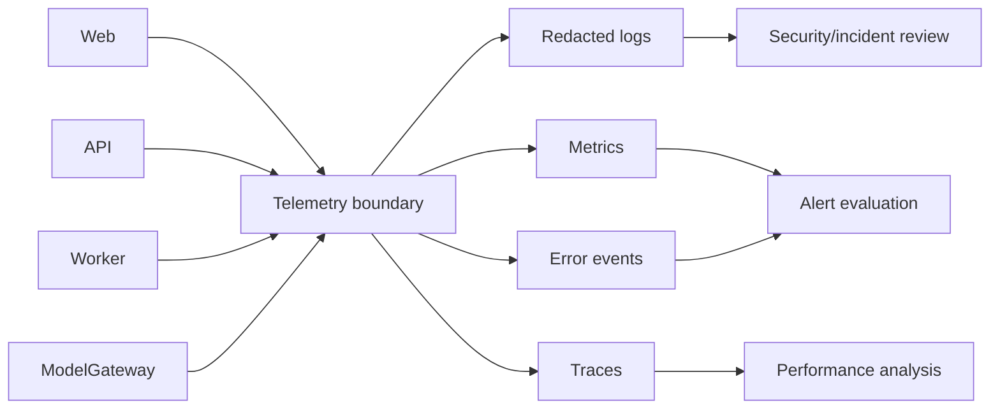

# NexusAI — Observability Strategy

**Document type:** Phase 11 logs, metrics, traces, error monitoring, AI/queue health and security alerting architecture  
**Phase:** Phase 11 — Technology Stack, Implementation Architecture & Development Foundation Planning  
**Status:** Approved — Phase 11 documentation gate passed; Phase 12 Implementation Foundation/Project Initialization approved; Phase 13 Part 1 APPROVED; Phase 13 Part 2 AUTHORIZED / IN PROGRESS  
**Canonical product:** NexusAI — Personal AI Health & Wellness Companion  
**Date:** 2026-08-30  
**Scope:** Observability design only. No monitoring vendor, dashboard, agent, alert, or production collector is configured.

## 1. Objectives

Observability must detect security/privacy/safety failures, explain user-visible reliability, support incident response and measure product health without turning chat or wellness content into telemetry. Phase 10 logging allow-lists, retention, access control and redaction are mandatory.

## 2. Signal architecture

Use an OpenTelemetry-compatible internal contract where practical, but keep the backend/vendor replaceable. Telemetry exporters must not receive raw prompts, completions, memory values, reflections, credentials or export contents.

## 3. Structured logging

### Allowed fields

- correlation/request ID and trace/span ID;
- route template, method, status and stable error code;
- service/module/version and environment;
- coarse actor class and policy version;
- latency, retry, queue and dependency category;
- provider alias/model class and bounded usage units;
- safety mode/event type and outcome;
- lifecycle, memory, consent, privileged-access and audit event category.

### Prohibited by default

Passwords, MFA/recovery proofs, access/refresh/session tokens, keys, provider secrets, raw chat/check-in/reflection text, memory values, full prompts/completions, hidden reasoning, provider payloads, export content/URLs, notification bodies and arbitrary email/profile labels.

Apply schema allow-lists, centralized redaction, length limits, access controls, integrity protection and reviewed retention. Redaction failure is a security incident, not a reason to log more content.

## 4. Metrics

### Reliability/product metrics

- request rate, latency percentiles and safe error rate by route class;
- authentication success/failure, session revocation and recovery outcomes;
- onboarding completion, goal/plan/task/check-in/reminder completion aggregates;
- AI request latency, timeout/error class, bounded usage units and fallback rate;
- queue depth, age, retry/dead-letter counts and lifecycle completion rate;
- export/deletion/memory-revocation pending, failed and reconciled counts;
- database connection pool, lock/wait, storage and backup health;
- availability and capacity signals.

### Security/privacy/safety metrics

- rate-limit and bot-control hits;
- IDOR/authorization-denial and suspicious session signals;
- prompt-injection/tool-denial and cross-user canary failures;
- consent/memory policy denials and stale-generation attempts;
- break-glass requests/approvals/expiry failures;
- redaction, audit-write and provider-egress policy failures;
- safety-mode counts and reported unsafe-output events.

Metrics use coarse dimensions. Never put account IDs, emails, health categories, memory text or user-generated labels in metric dimensions.

## 5. Tracing

Trace API → policy → data access → ModelGateway → provider → worker only with opaque correlation IDs. Span attributes are allow-listed categories and timing/status values. Sampling is higher for failures/security events and lower for routine success; sampled traces still contain no restricted content. Trace retention and sampling percentages are `TBD / Pending Decision`.

## 6. Error monitoring

Capture normalized exception class, service/version, route category, dependency category, policy version and correlation ID. Group duplicate failures without including request bodies or provider payloads. User-facing errors remain generic and safe; support views expose only approved metadata.

## 7. Alerting baseline

| Alert family | Examples | Initial response |
| --- | --- | --- |
| Availability | Error/latency spike, queue backlog, database exhaustion, provider outage | Triage service health and safe degradation |
| Security | Auth anomaly, token reuse, IDOR canary, privilege change, secret scan, egress violation | Contain account/credential/path; open incident |
| Privacy/lifecycle | Redaction failure, cross-user context, deletion/revocation backlog, export access anomaly | Block affected path, preserve evidence, reconcile |
| AI safety | Unsafe-output evaluation drift, prompt-injection spike, unauthorized tool attempt | Disable route/tool/provider, safety review |
| Integrity | Audit write failure, job replay mismatch, constraint errors, restore mismatch | Stop unsafe mutation and investigate |

Exact thresholds, paging channel, on-call staffing, severity mapping and escalation authority remain `TBD / Pending Decision`.

## 8. Access and retention

Observability stores are separated by environment and role. Security/privacy evidence access requires MFA, least privilege, case scope and audit. Operational telemetry is minimized and retained only for approved periods; immutable evidence and legal-hold treatment follow Phase 10 lifecycle decisions. Analytics exports cannot include restricted content.

## 9. AI/provider observability

Record provider alias/model class, operation class, usage units, latency, retry/fallback/error category, safety/policy version and correlation ID. Do not record provider prompt/completion payloads or hidden reasoning. Provider dashboards must be reviewed for retention, region and staff-access implications before enablement.

## 10. Local and staging use

Local telemetry goes to a developer-only sink with redaction enabled. CI keeps bounded test evidence. Staging security/AI evaluations may retain synthetic payload references for reproducibility. Production monitoring is read-only for ordinary operators and integrated with incident response/break-glass review.

## 11. Vendor and migration strategy

Define an internal telemetry schema and exporter interface so logs, metrics, traces and error events can move between vendors. Keep dashboards-as-code and alert definitions versioned after implementation. Export essential incident evidence in a documented, portable format.

## 12. Phase boundary

This document defines observability architecture only. It does not select a vendor, create dashboards/alerts, install agents, collect production data, or start Phase 12.
