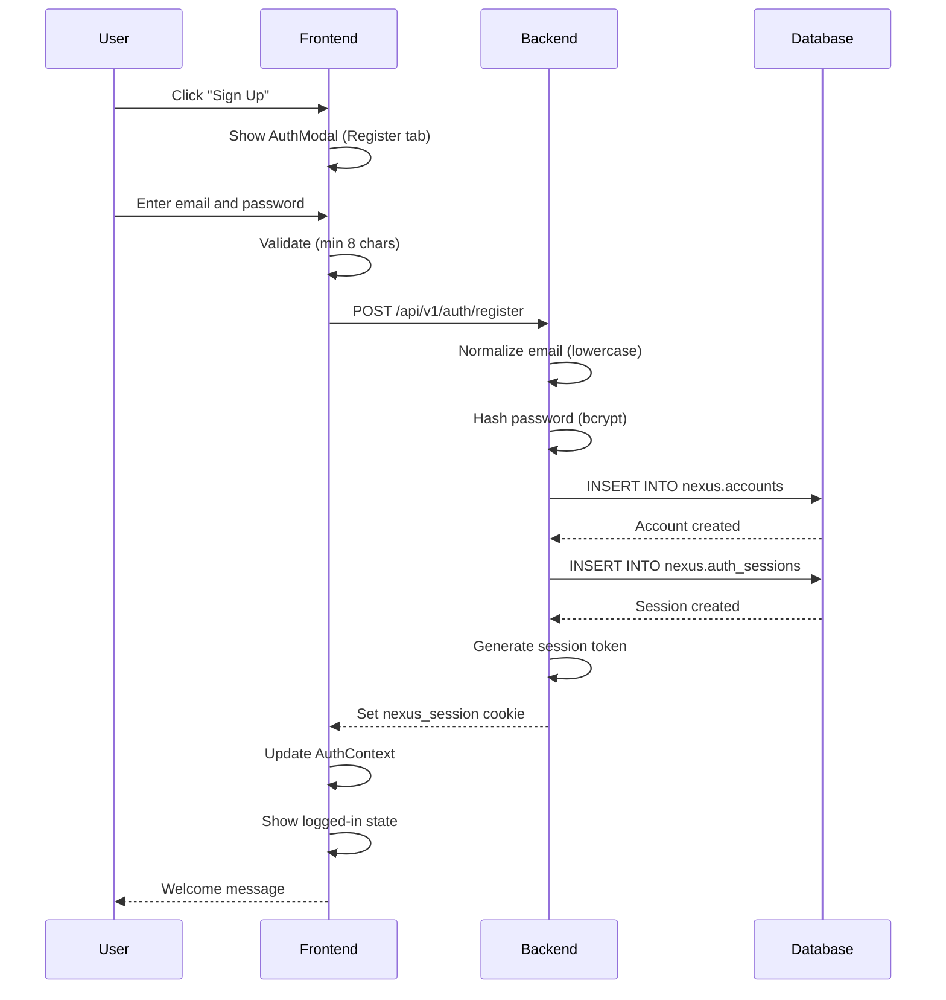
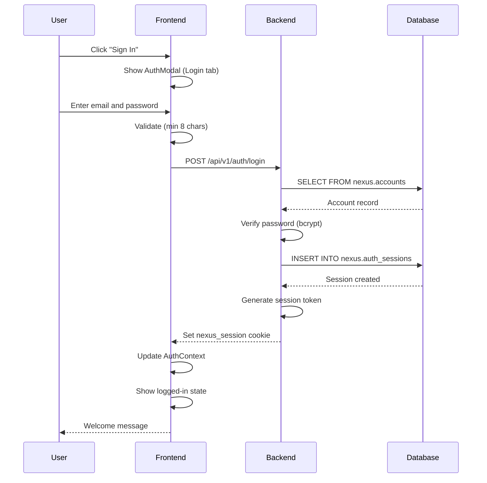
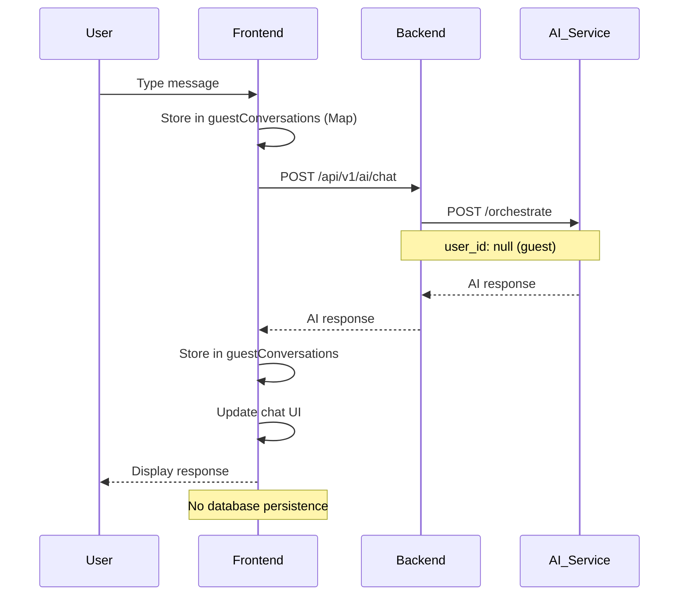
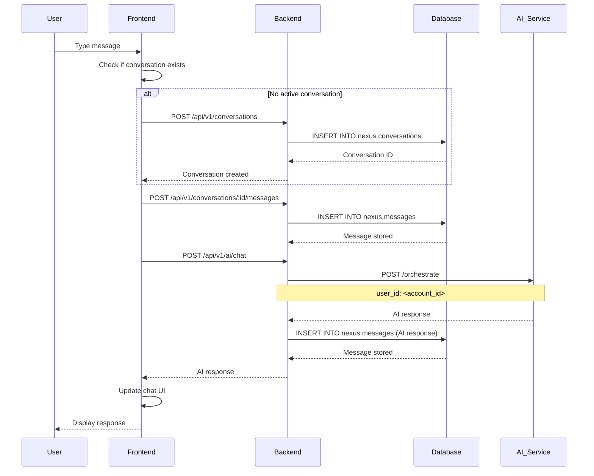
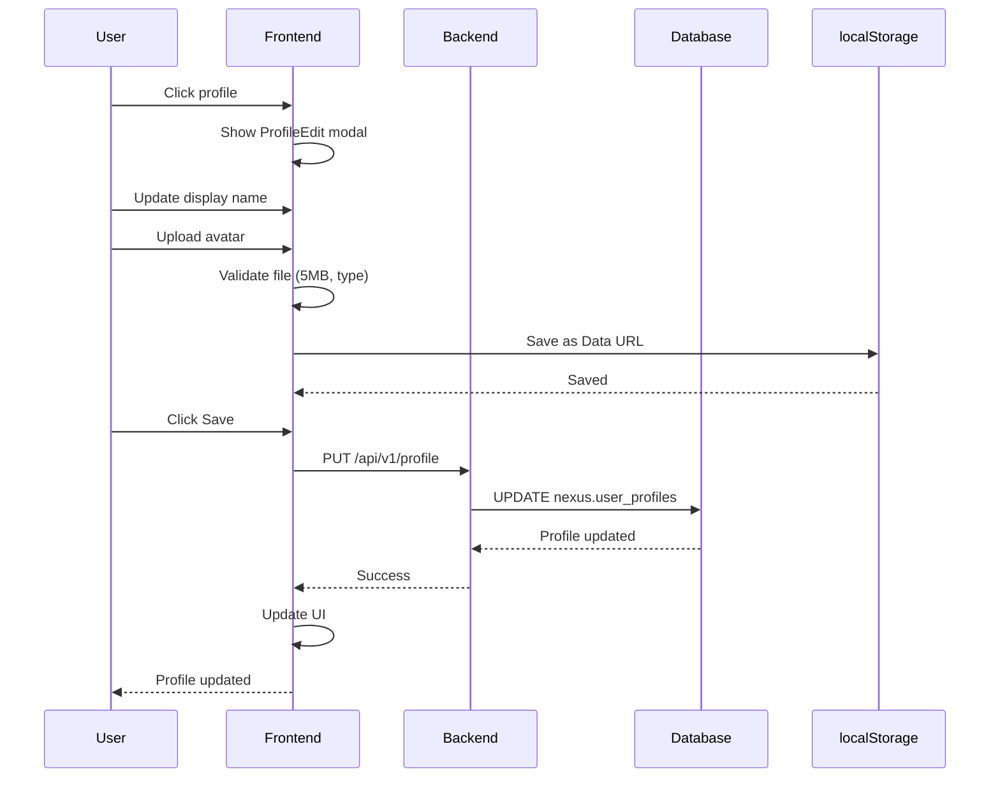
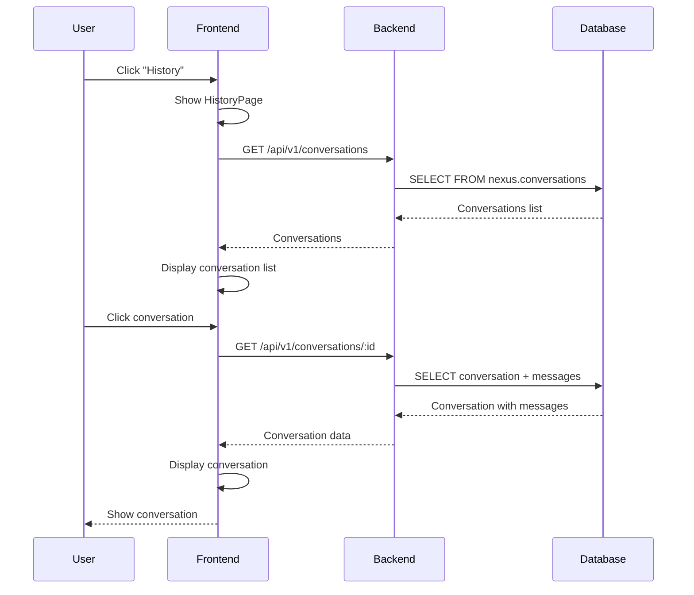
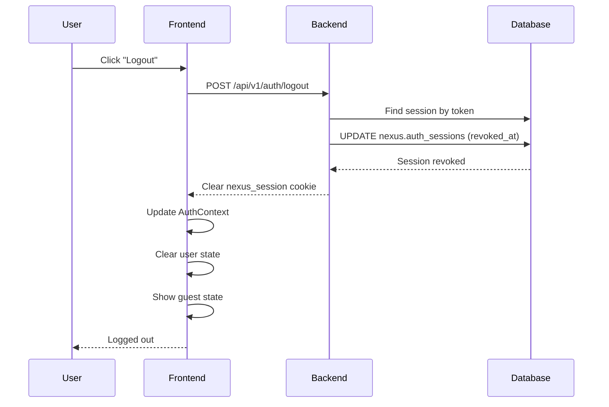

# NexusAI Data Flows and Workflows

## Overview

This document describes the key data flows and user workflows in the NexusAI application.

## User Workflows

### 1. User Registration

**Flow**: Guest → Registered User



**Key Points**:
- Email normalized to lowercase
- Password hashed with bcrypt
- Session token stored as hash in database
- HTTP-only cookie set on client
- AuthContext updated with user info

---

### 2. User Login

**Flow**: Guest → Authenticated User



**Key Points**:
- Generic error message prevents email enumeration
- Account status checked (must be 'active')
- New session created on each login
- Old sessions remain valid until expiration

---

### 3. Guest Chat

**Flow**: In-memory chat without persistence



**Key Points**:
- No authentication required
- Conversations stored in browser memory (Map)
- No database persistence
- Lost on page refresh
- user_id is null when calling AI service

---

### 4. Authenticated Chat

**Flow**: Persistent chat with database storage



**Key Points**:
- Conversation created if none exists
- User message persisted before AI call
- AI response persisted after AI call
- user_id passed to AI service
- Full conversation history available

---

### 5. Profile Update

**Flow**: Update user profile



**Key Points**:
- Avatar stored in localStorage (dev only)
- Profile data stored in database
- Avatar not synchronized across devices
- Recommendation: Use cloud storage for production

---

### 6. View Conversation History

**Flow**: List and view past conversations



**Key Points**:
- Conversations ordered by started_at DESC
- Pagination (10 items at a time)
- Relative time formatting
- Requires authentication

---

### 7. User Logout

**Flow**: End session



**Key Points**:
- Session marked as revoked in database
- Cookie cleared on client
- AuthContext updated
- Profile state reset to Guest

---

## Data Flows

### Authentication Data Flow

```
User Input → Frontend Validation → Backend API
                                              ↓
Password Hashing (bcrypt) ← Database ← Session Storage
                                              ↓
                                      HTTP-only Cookie
                                              ↓
                                      Client Storage
```

### Chat Data Flow (Authenticated)

```
User Input → Frontend → Backend API → Database (user message)
                                   ↓
                            AI Service (external)
                                   ↓
Backend API → Database (AI response) → Frontend → UI
```

### Chat Data Flow (Guest)

```
User Input → Frontend (memory) → Backend API → AI Service
                                              ↓
                                          Frontend (memory) → UI
```

### Profile Data Flow

```
User Input → Frontend → localStorage (avatar)
                           ↓
                      Backend API → Database (profile data)
                           ↓
                      Frontend → UI
```

## Session Lifecycle

### Session Creation

1. User registers or logs in
2. Backend generates random session token
3. Backend hashes token with bcrypt
4. Backend stores hash in nexus.auth_sessions
5. Backend sets HTTP-only cookie with plaintext token
6. Client stores cookie

### Session Validation

1. Client sends request with nexus_session cookie
2. Backend extracts token from cookie
3. Backend queries all active sessions for account
4. Backend hashes token and compares with stored hashes
5. If match found, session is valid
6. Backend updates last_seen_at
7. Backend sets request.accountId

### Session Expiration

1. Session expires after 7 days
2. Backend checks expires_at on each request
3. If expired, returns 401 Unauthorized
4. Client must re-authenticate

### Session Revocation

1. User logs out
2. Backend marks session as revoked (revoked_at)
3. Backend clears cookie
4. Session cannot be reused

## Error Handling Flows

### Authentication Error

```
Invalid Credentials → Backend returns 401
                         ↓
                  Frontend shows error
                         ↓
                  User retries
```

### AI Service Error

```
AI Service Down → Backend returns 502
                         ↓
                  Frontend shows Bangla error
                         ↓
                  User retries
```

### Network Error

```
Network Failure → Frontend shows error
                         ↓
                  User retries
```

## State Management

### Frontend State

**AuthContext**:
- user: User object or null
- isAuthenticated: Boolean
- initialized: Boolean

**ChatInterface**:
- inputValue: Current input
- isTyping: AI typing state
- activeRequestId: Current request ID
- guestConversations: Map of guest conversations

**Page (page.tsx)**:
- activeNav: Current navigation
- profileName: User's display name
- profileEmail: User's email
- profilePhoto: User's avatar URL

### Backend State

**Request State**:
- request.accountId: Set by auth middleware
- request.id: Unique request ID

**Database State**:
- nexus.accounts: User accounts
- nexus.auth_sessions: Active sessions
- nexus.conversations: Conversations
- nexus.messages: Messages
- nexus.user_profiles: User profiles

## Cache Strategy

### Current Implementation

- **No caching layer**: All requests go to database
- **Session validation**: Queries up to 100 recent sessions each time
- **Frontend**: No client-side caching of API responses

### Recommended Improvements

- **Redis**: Cache session validation results
- **CDN**: Cache static assets
- **Frontend**: Cache user profile data
- **Database**: Add query result caching

## Performance Considerations

### Database Queries

- Session validation: O(n) where n = number of recent sessions (limit 100)
- Conversation list: Indexed by account_id and started_at
- Message list: Indexed by conversation_id and sequence_no

### Network Requests

- Authentication: One request per login/logout
- Session validation: One request per page visibility change
- Chat: Two requests per message (persist + AI call)
- Profile: One request per save

### Recommendations

- Implement connection pooling (already configured: pool size 20)
- Add database query caching
- Implement Redis for session caching
- Add CDN for static assets

## References

- [03_SYSTEM_ARCHITECTURE.md](./03_SYSTEM_ARCHITECTURE.md) - Architecture diagrams
- [05_BACKEND_API_REFERENCE.md](./05_BACKEND_API_REFERENCE.md) - API documentation
- [07_AUTHENTICATION_SECURITY.md](./07_AUTHENTICATION_SECURITY.md) - Authentication details
