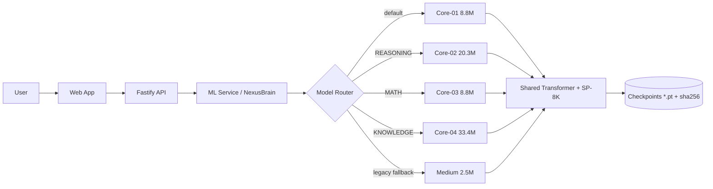

# NexusAI Four-Core System Architecture

**Verified against source:** 2026-11-18

## 1. Model layer

```
packages/ai-core/
├── core01/transformer.py          # NexusAICore01 — SHARED decoder-only Transformer
│                                  #   (token emb + sinusoidal PE + pre-norm blocks
│                                  #    + MHA + GELU FFN + output projection)
├── core01/inference.py            # InferenceEngine (core-01 path)
├── core01/tokenizer_interface.py  # SentencePiece wrapper (bos/eos/pad handling)
├── core01/training.py             # training loop (AMP, grad-accum, RNG resume)
├── core01/sft_dataset.py          # SFT serialization + response-only loss mask
├── core01/pretraining_driver.py   # pretraining driver w/ zero-step guard
├── nexus_core.py                  # multi-core factory: get_config/build_model/
│                                  #   load_checkpoint_strict/chat_generate
└── models/
    ├── nexusai_core_01..04/config/model_config.py   # per-core configs
    ├── checkpoints_core0*/        # versioned checkpoints (+ .sha256)
    └── production/current.json    # production designation (Core-01 run3)
```

**Honest architecture note:** Core-01 through Core-04 use **one shared Transformer implementation** with **independent configurations, weights, datasets, and training runs**. They are not four different architectures.

## 2. Tokenizer

SentencePiece BPE, vocab 8000 (`data/experimental/phase9_2/tokenizers/bpe_8k/`). IDs: pad=0, unk=1, bos=2, eos=3. `tokenizer_interface.py` validates vocab vs config; `nexus_core.chat_prompt_ids` serializes SFT format `[BOS] "user: <text>" [EOS]`.

## 3. Registry & router (ml-service)

- `model_registry.py` — validated registry of 5 models; `validate()` = file+SHA-256+tokenizer; `load()` = strict state-dict; `generate()` returns `(text, provenance)`.
- `model_router.py` — `detect_language_v2` → `classify_intent_v2` → specialist/primary model or labeled deterministic handler. `neural_only=True` restricts to neural cores and returns explicit `MODEL_GENERATION_FAILED` errors — never silent fallback.

## 4. Application flow

```
User → Web app (Next.js/React) → Fastify API → ml-service (FastAPI, port per main.py)
     → NexusBrain.respond(message, neural_only?)
         → intent specialist (core-03 MATH, core-04 KNOWLEDGE, core-02 REASONING*)
         → or primary core-01 → legacy fallback core-medium
     → neural text OR labeled deterministic/tool response + provenance trace
```

*core-02 excluded from neural-only candidates (template-bound, per router comment).

## 5. Data

- Per-core SFT sets: `data/core02_reasoning`, `core03_math`, `core04_knowledge` (+ `_full`), each with `train/validation/test.jsonl`, `dataset_manifest.json`, `checksums.sha256`.
- General conversational: `data/unified_conversational/v1..v4` (v5 builders exist, v5 NOT constructed).
- Pretraining corpus: `data/phase2/run4_corpus` (Run4), `data/experimental/phase9_2` tokenizer assets.

## 6. Diagram


